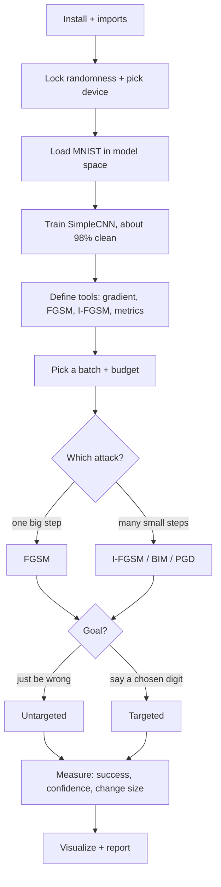

# FGSM & I-FGSM - Cheatsheet

*HTB Academy · AI Evasion - First-Order Attacks · FGSM part (Sections 1-12)*

> **How to use this sheet**
> - Run the cells **top to bottom in one Jupyter notebook**. Later cells use names that earlier cells created.
> - **[INPUT NEEDED]** = replace every `<<LIKE_THIS>>` first. A leftover `<<...>>` makes the cell fail with `SyntaxError` on purpose, so you can't forget one.
> - **[just run]** = run it as it is.
> - **Model space** = the shifted and rescaled pixel values the model actually sees (normalized). **Pixel space** = normal brightness, 0 (black) to 1 (white). Every budget you type must say which one it's in.

## What this module does

You train a small digit classifier (MNIST, about 98% accurate), then fool it by adding tiny, carefully chosen changes to the pixels. The model's own training signal, the **gradient**, tells you which way to nudge each pixel to make it most wrong. **FGSM** does this in one big step. **I-FGSM** does it in many small steps and is far stronger at the same budget. Both can be **untargeted** ("be wrong") or **targeted** ("say this digit").

## The flow



---

## Part A - Setup

## Step 1 - Install the HTB library

[just run]

**What & why:** installs HTB's helper library, which provides the dataset loader, the model, training, the display converter and the plot colours.

```python
# "!" runs a terminal command from inside a Jupyter cell.
# --upgrade replaces an older copy if one is already installed.
!pip install --upgrade git+https://github.com/PandaSt0rm/htb-ai-library
```

**If it breaks:** if there's no internet available, the library is often already installed, so just go to Step 2. If Step 2 then says `No module named 'htb_ai_library'`, you need the install.

## Step 2 - Imports

[just run]

**What & why:** loads every tool the rest of the sheet uses (PyTorch, plotting, HTB helpers and colours).

```python
import os # operating-system helpers
import random # Python's random numbers
from typing import Dict, Optional, Tuple # labels for inputs/outputs (no effect on results)
import numpy as np # number arrays
import torch # PyTorch: tensors (number grids) + gradients
from torch import nn, Tensor # neural-network building blocks + the tensor type
import torch.nn.functional as F # loss (cross_entropy) and softmax
from torch.utils.data import DataLoader # feeds data in batches
from torchvision import datasets, transforms # image datasets + converters
import matplotlib.pyplot as plt # plotting

# HTB helper library
from htb_ai_library import (
    set_reproducibility, # locks randomness so every run gives the same numbers
    SimpleCNN, # the victim model (small image classifier)
    get_mnist_loaders, # ready-made MNIST train/test data
    mnist_denormalize, # model space -> normal 0-1 pixels (for display)
    train_model, # trains the model
    evaluate_accuracy, # measures clean accuracy
)

# HTB plot colours (used by the visualization functions)
from htb_ai_library import (
    HTB_GREEN, NODE_BLACK, HACKER_GREY, WHITE,
    AZURE, NUGGET_YELLOW, MALWARE_RED, VIVID_PURPLE, AQUAMARINE
)
```

**Expected:** no output. Any error here means a missing install (Step 1).

## Step 3 - Lock randomness + pick the device

[just run]

**What & why:** **reproducibility** means the same seed gives the same "random" numbers, so results are comparable run to run. The device is the GPU if there is one, otherwise the CPU. The model and the data must always be on the **same** device.

```python
set_reproducibility(1337) # fixed seed -> identical results every run

# Use the NVIDIA GPU ("cuda") if available, otherwise the CPU
device = torch.device("cuda" if torch.cuda.is_available() else "cpu")
print(device)
```

**Expected:** `cpu` or `cuda`. Either is fine; MNIST is small.

## Step 4 - Load the data

[just run]

**What & why:** downloads MNIST (handwritten digits 0-9, 28×28 greyscale) and serves it 128 images at a time. `normalize=True` converts pixels into **model space** (centred and rescaled). This makes training much faster, but it means the budget and the clipping must be done in model space too.

```python
# Downloads to ./data the first time. Test loader is NOT shuffled -> first batch is always the same.
# normalize=True -> images arrive in model space (roughly -0.42 ... 2.82 instead of 0 ... 1)
train_loader, test_loader = get_mnist_loaders(batch_size=128, normalize=True)
```

**Options:**
- **If** you're training your own model as in the course -> `normalize=True` (**pick this**). All attack functions below expect model-space images.
- **If** a task hands you plain 0-1 images (from a file or an API) -> keep `normalize=True` here for training, and use the pixel-space option (Steps 10 and 17) on those images.

## Step 5 - Build, train and score the victim model

[just run]

**What & why:** creates SimpleCNN (two pattern-detecting layers, then two decision layers, ending in 10 scores, one per digit), trains it for one pass over the 60,000 training images, and records the **clean baseline accuracy**, the "before" number every attack is measured against.

```python
model = SimpleCNN().to(device) # create the model on the device
# 1 epoch = one pass over all training images (enough for about 98% on MNIST)
trained_model = train_model(model, train_loader, test_loader, epochs=1, device=device)
model = trained_model # make sure "model" is the trained one
baseline_acc = evaluate_accuracy(trained_model, test_loader, device)
print(f"Baseline test accuracy: {baseline_acc:.2f}%")
model.eval() # evaluation mode: REQUIRED before attacking
```

**Expected:** about `Baseline test accuracy: 98.41%` (a training-progress line prints first).

**Remember:** high clean accuracy says **nothing** about robustness. This 98% model gets broken below.

---

## Part B - Tools (define once, then reuse)

## Step 6 - Constants + budget converter

[just run]

**What & why:** MNIST's average brightness and spread, the model-space versions of pure black and pure white (the **valid range** you must clip to), and two helpers that convert a budget between pixel space and model space. **Converting a budget only uses the spread (std); the average cancels out.**

```python
MNIST_MEAN, MNIST_STD = 0.1307, 0.3081 # MNIST average brightness and spread
MNIST_NORM_MIN = (0.0 - MNIST_MEAN) / MNIST_STD # pure black in model space, about -0.424
MNIST_NORM_MAX = (1.0 - MNIST_MEAN) / MNIST_STD # pure white in model space, about 2.821

def eps_pixel_to_norm(eps_pixel):
    # A budget given in normal pixels (e.g. 8/255 or 0.1) -> model-space budget for the attacks
    return eps_pixel / MNIST_STD

def eps_norm_to_pixel(eps_norm):
    # A model-space budget -> normal pixels (for reports; times 255 gives "brightness levels")
    return eps_norm * MNIST_STD

print(round(MNIST_NORM_MIN, 3), round(MNIST_NORM_MAX, 3))
print(round(eps_norm_to_pixel(0.8), 4), round(eps_norm_to_pixel(0.8) * 255))
```

**Expected:**
```
-0.424 2.821
0.2465 63
```

**Quick conversions:**

| Budget | Model space | Pixel space | Out of 255 |
|---|---|---|---|
| course default | 0.8 | 0.246 | 63 |
| course comparison | 0.7 | 0.216 | 55 |
| "8/255" style | 0.102 | 0.031 | 8 |
| "0.1 pixel" style | 0.325 | 0.1 | 26 |
| "0.3 pixel" style | 0.97 | 0.3 | 77 |

## Step 7 - Helper: loss with a safety guard

[just run]

**What & why:** runs the model and measures how wrong it is (**cross-entropy loss**, one number). It **refuses** to run if you forgot `model.eval()`.

```python
def _forward_and_loss(model: nn.Module, x: Tensor, y: Tensor) -> Tuple[Tensor, Tensor]:
    """Forward pass and cross-entropy loss without side effects."""
    # Guard: stop if the model is still in training mode
    if getattr(model, "training", False):
        raise RuntimeError("Expected model.eval() for attack computations to avoid BN/Dropout state updates")
    logits = model(x) # 10 raw scores per image
    loss = F.cross_entropy(logits, y) # one number: how wrong the model is about labels y
    return logits, loss
```

**If it breaks:** `RuntimeError: Expected model.eval()` -> run `model.eval()` and try again.

## Step 8 - Helper: the input gradient (the heart of every attack)

[just run]

**What & why:** asks the model "if I nudge each pixel, which way does your wrongness go?" and returns one **slope per pixel**. The weights are **never** changed. This is the reverse of training: **training changes weights to be less wrong; the attack changes pixels to be more wrong.**

```python
def _input_gradient(model: nn.Module, x: Tensor, y: Tensor) -> Tensor:
    """Return gradient of loss with respect to input tensor x."""
    x_req = x.clone().detach().requires_grad_(True) # copy images + "track slopes for these pixels"
    _, loss = _forward_and_loss(model, x_req, y) # how wrong the model is right now
    model.zero_grad(set_to_none=True) # clear leftovers from earlier runs
    loss.backward() # compute a slope for every pixel
    return x_req.grad.detach() # same shape as the images
```

**If it breaks:** a gradient of `None` means gradient tracking was off. Never wrap attack code in `torch.no_grad()`.

## Step 9 - FGSM attack function (model space)

[just run]

**What & why:** **FGSM (Fast Gradient Sign Method, Goodfellow et al. 2014)**: get the slopes, keep only each slope's **direction** (+ or −), move **every** pixel by exactly the budget in that direction, then clip into the valid range. One step, very fast, the standard baseline. Keeping only the direction is the best single move when the rule is "no pixel may change more than X".

```python
def fgsm_attack(model: nn.Module,
                images: Tensor,
                labels: Tensor,
                epsilon: float,
                targeted: bool = False) -> Tensor:
    # labels: TRUE labels for untargeted, TARGET labels for targeted

    # Valid normalized range for MNIST (model-space black and white)
    MNIST_NORM_MIN = (0.0 - 0.1307) / 0.3081
    MNIST_NORM_MAX = (1.0 - 0.1307) / 0.3081

    if epsilon < 0: # budget can't be negative
        raise ValueError("epsilon must be non-negative")
    if not images.is_floating_point(): # images must be decimal numbers
        raise ValueError("images must be floating point tensors")

    grad = _input_gradient(model, images, labels) # one slope per pixel
    step_dir = -1.0 if targeted else 1.0 # untargeted: push away; targeted: pull toward target
    x_adv = images + step_dir * epsilon * grad.sign() # move every pixel by exactly epsilon
    x_adv = torch.clamp(x_adv, MNIST_NORM_MIN, MNIST_NORM_MAX) # stay a valid image
    return x_adv.detach()
```

**Remember:** the clip range is **hard-coded for MNIST**. On another dataset, change those two numbers.

## Step 10 - OPTION: FGSM for plain 0-1 images (pixel space)

[just run] (only needed if you'll use Step 17)

**What & why:** the same attack for images that arrive as normal 0-1 pixels with a pixel budget (like 8/255). It converts to model space for the model, converts the slopes back, steps in pixel space, and clips to 0-1.

**Options:**
- **If** your images come from `test_loader` (model space) -> **skip this**; use Step 9 with a converted budget (Step 6). For sign-based FGSM the two give the same result.
- **If** your images are plain 0-1 pixels (from a file, an API, or `normalize=False`) -> use this.

```python
def _norm_params(images: Tensor, mean: list, std: list) -> Tuple[Tensor, Tensor]:
    """Convert normalization parameters to broadcastable tensors of shape (1, C, 1, 1)."""
    device, dtype, C = images.device, images.dtype, images.shape[1] # match device, number type, channels
    mean_t = torch.tensor(mean, device=device, dtype=dtype).view(1, -1, 1, 1) # shape fits any batch
    std_t = torch.tensor(std, device=device, dtype=dtype).view(1, -1, 1, 1)
    if mean_t.shape[1] != C or std_t.shape[1] != C: # 1 value per colour channel
        raise ValueError("mean/std channels must match images")
    return mean_t, std_t

def fgsm_pixel_space(model: nn.Module,
                     images: Tensor,
                     labels: Tensor,
                     epsilon: float,
                     mean: list,
                     std: list,
                     targeted: bool = False) -> Tensor:
    """FGSM for [0,1] pixel-space images attacking a model that expects normalized input.
    Returns adversarial images in [0,1] pixel space."""
    mean_t, std_t = _norm_params(images, mean, std)
    x = images.clone().detach() # plain 0-1 copy
    x_norm = (x - mean_t) / std_t # convert to model space for the model
    x_norm.requires_grad_(True) # track slopes on the model-space version

    _, loss = _forward_and_loss(model, x_norm, labels)
    model.zero_grad(set_to_none=True)
    loss.backward()

    # Convert gradient from normalized space to image space
    grad_img = x_norm.grad / std_t
    step_dir = -1.0 if targeted else 1.0
    x_adv = torch.clamp(x + step_dir * epsilon * grad_img.sign(), 0.0, 1.0) # step + clip in PIXEL space
    return x_adv.detach()
```

## Step 11 - I-FGSM attack function (many small steps)

[just run]

**What & why:** **I-FGSM (also called BIM, Kurakin et al. 2016)** repeats small FGSM steps, **re-reading the slopes after every step**. After each step it pulls every pixel back to within the budget of the **original** image (**projection**) and into the valid range. Same budget, better aim. **With a random start it is essentially PGD (Madry et al. 2017).**

```python
def iterative_fgsm(model: nn.Module,
                   images: Tensor,
                   labels: Tensor,
                   epsilon: float,
                   num_iter: int,
                   alpha: Optional[float] = None,
                   targeted: bool = False,
                   random_start: bool = False) -> Tensor:
    """Iterative FGSM (Basic Iterative Method) with projection. Returns normalized adversarials."""
    # Valid normalized range for MNIST
    MNIST_NORM_MIN = (0.0 - 0.1307) / 0.3081
    MNIST_NORM_MAX = (1.0 - 0.1307) / 0.3081

    if alpha is None:
        alpha = epsilon / max(num_iter, 1) # default step size: budget split across the steps
    if random_start:
        torch.manual_seed(1337) # NOTE: same "random" noise on every call
        delta = torch.empty_like(images).uniform_(-epsilon, epsilon) # random noise inside the budget
        x_adv = torch.clamp(images + delta, MNIST_NORM_MIN, MNIST_NORM_MAX)
    else:
        x_adv = images.clone() # start from the clean images

    for _ in range(num_iter): # repeat num_iter times
        x_adv = x_adv.detach().requires_grad_(True) # fresh start for slopes at the CURRENT image
        logits = model(x_adv)
        loss = F.cross_entropy(logits, labels) # how wrong (true labels) / how far from target (target labels)
        model.zero_grad(set_to_none=True)
        loss.backward() # slopes at the current image
        step_dir = -1.0 if targeted else 1.0
        x_adv = x_adv + step_dir * alpha * x_adv.grad.sign() # one SMALL step
        # Projection: cap each pixel's drift from the ORIGINAL images at epsilon, then keep it valid
        x_adv = torch.clamp(images + (x_adv - images).clamp(-epsilon, epsilon), MNIST_NORM_MIN, MNIST_NORM_MAX)

    return x_adv.detach()
```

**Remember:** this function has **no** `model.eval()` guard, so always run `model.eval()` first.

**Options (settings):**
- **If** unsure -> `num_iter=10`, leave `alpha` empty (it becomes budget ÷ steps), `random_start=True`. **Pick this.**
- **If** it's too slow -> fewer steps (each step costs one gradient computation).
- **If** you set `alpha` yourself -> make sure step size times number of steps is **at least** the budget, or the attack can't reach the edge of its allowed change.
- **If** you need "plain BIM" exactly -> `random_start=False`.

## Step 12 - Measuring function

[just run]

**What & why:** reports accuracy before and after, **attack success rate** (flips among only the images that were originally right), confidence in the **true** class before and after, and the change size (average overall size per image, and the single biggest pixel change, which proves the budget was respected).

```python
def evaluate_attack(model: nn.Module,
                    clean_images: Tensor,
                    adversarial_images: Tensor,
                    true_labels: Tensor) -> Dict[str, float]:
    """Compute accuracy, success rate, confidence shift, and norms (both image sets in model space)."""
    model.eval()
    with torch.no_grad(): # only measuring -> no gradients
        clean_logits = model(clean_images)
        adv_logits = model(adversarial_images)

        clean_probs = F.softmax(clean_logits, dim=1) # scores -> probabilities (each row adds to 1)
        adv_probs = F.softmax(adv_logits, dim=1)

        clean_pred = clean_logits.argmax(dim=1) # predicted digit per image
        adv_pred = adv_logits.argmax(dim=1)

        clean_correct = (clean_pred == true_labels)
        adv_correct = (adv_pred == true_labels)

        originally_correct = clean_correct
        flipped = (~adv_correct) & originally_correct # was right, now wrong

        # probability the model gives the TRUE digit, per image
        conf_clean = clean_probs.gather(1, true_labels.view(-1, 1)).squeeze(1)
        conf_adv = adv_probs.gather(1, true_labels.view(-1, 1)).squeeze(1)

        # change size: overall size per image, and the single biggest pixel change in the batch
        l2 = (adversarial_images - clean_images).view(clean_images.size(0), -1).norm(p=2, dim=1)
        linf = (adversarial_images - clean_images).abs().amax()

        return {
            "clean_accuracy": clean_correct.float().mean().item(),
            "adversarial_accuracy": adv_correct.float().mean().item(),
            # Success rate among originally correct samples only
            "attack_success_rate": (
                flipped.float().sum() / originally_correct.float().sum().clamp_min(1.0)
            ).item(),
            "avg_clean_confidence": conf_clean.mean().item(),
            "avg_adv_confidence": conf_adv.mean().item(),
            "avg_confidence_drop": (conf_clean - conf_adv).mean().item(),
            "avg_l2_perturbation": l2.mean().item(),
            "max_linf_perturbation": linf.item(),
        }
```

---

## Part C - Run the attack

## Step 13 - Pick a batch + choose the settings

[INPUT NEEDED]

**What & why:** takes the first 128 test images, sets the budget and step count, and records which images the model gets right **before** attacking. Only those count for success.

```python
images, labels = next(iter(test_loader)) # first 128 test images + true digits
images, labels = images.to(device), labels.to(device)
model.eval()

epsilon = <<EPSILON>> # budget in MODEL SPACE (course used 0.8, about 63/255)
num_iter = <<NUM_ITER>> # I-FGSM steps (course used 10)

with torch.no_grad(): # just predicting -> no gradients
    clean_pred = model(images).argmax(dim=1) # answers on clean images
originally_correct = (clean_pred == labels) # only these count
print("clean correct:", originally_correct.sum().item(), "of", len(labels))
```

**fill in:**
- `<<EPSILON>>` = the model-space budget, e.g. `0.8`. If the task gives a **pixel** budget (e.g. "8/255" or "0.1"), write `eps_pixel_to_norm(8/255)` (or `eps_pixel_to_norm(0.1)`) instead.
- `<<NUM_ITER>>` = number of I-FGSM steps, e.g. `10`.

**Options (which space is my budget in?):**
- **If** it says "/255", "pixel", or a number like 0.03 or 0.1 -> pixel space -> convert with `eps_pixel_to_norm`.
- **If** it's a number like 0.5-1.0 with normalized data -> probably model space -> use it directly.
- **If** unsure -> write both versions down in your notes and say which one you used.

**Expected:** `clean correct: 125 of 128` (anywhere from about 124 to 128).

## Step 14 - Run the untargeted attacks (FGSM and I-FGSM)

[just run]

**What & why:** **untargeted** = "be wrong, any wrong digit." Runs both attacks on the same batch with the same budget and prints each one's success rate.

```python
model.eval()
# OPTION A - FGSM: one big step (fast baseline)
x_adv = fgsm_attack(model, images, labels, epsilon)
# OPTION B - I-FGSM: many small steps with fresh slopes (stronger, slower)
x_adv_ifgsm = iterative_fgsm(model, images, labels, epsilon=epsilon, num_iter=num_iter, random_start=True)

with torch.no_grad(): # predicting only
    adv_pred = model(x_adv).argmax(dim=1)
    adv_pred_ifgsm = model(x_adv_ifgsm).argmax(dim=1)

n_ok = originally_correct.float().sum().clamp_min(1.0) # number originally right (never zero)
flipped = (adv_pred != labels) & originally_correct # was right, now wrong
flipped_ifgsm = (adv_pred_ifgsm != labels) & originally_correct
print(f"FGSM success: {(flipped.float().sum() / n_ok).item():.2%}")
print(f"I-FGSM success: {(flipped_ifgsm.float().sum() / n_ok).item():.2%}")
```

**Expected:** at budget 0.8, FGSM about 70% and I-FGSM about 100%. At 0.7, about 58% and 95%.

**Options (which result to use):**
- **If** the task says "FGSM" / "single step" -> use `x_adv`.
- **If** the task says iterative / BIM / PGD, or you need the highest success, or FGSM doesn't flip it -> use `x_adv_ifgsm`.
- **If** you have to submit **one** image -> take it from the attack that flipped it, e.g. `x_adv_ifgsm[i:i+1]`.

## Step 15 - Measure both attacks side by side

[just run]

**What & why:** the full picture: not just "did it flip," but how confused the model became and how big the change was.

```python
metrics_fgsm = evaluate_attack(model, images, x_adv, labels)
metrics_ifgsm = evaluate_attack(model, images, x_adv_ifgsm, labels)
for k in metrics_fgsm: # print each metric for both attacks
    print(f"{k:24s} FGSM {metrics_fgsm[k]:.4f} | I-FGSM {metrics_ifgsm[k]:.4f}")
```

**How to read it:**

| Metric | Plain meaning | Course result at 0.8 (FGSM vs I-FGSM) |
|---|---|---|
| clean_accuracy | right before the attack | about 0.98 / 1.00 |
| adversarial_accuracy | still right after the attack (all images) | 0.32 vs 0.00 |
| attack_success_rate | flipped, among the originally right only | about 0.68 vs 1.00 |
| avg_clean_confidence | belief in the true digit before | about 0.98 |
| avg_adv_confidence | belief in the true digit after | 0.39 vs 0.01 |
| avg_confidence_drop | belief lost | 0.59 vs 0.97 |
| avg_l2_perturbation | overall change size per image (model space) | 10.8 vs 14.1 |
| max_linf_perturbation | biggest single pixel change; **must equal or be under the budget** | 0.8 vs 0.8 |

**Remember:** `avg_adv_confidence` is the belief in the **true** digit, not in the wrong answer.

## Step 16 - Targeted attack ("make it say THIS digit")

[INPUT NEEDED]

**What & why:** **targeted** = make the model say a digit **you** choose. Exactly two changes from untargeted: **pass the TARGET digit as the label, and step the opposite way** (`targeted=True` does the flip). It's harder than untargeted, so it often needs a bigger budget or more steps. This cell finds a correctly classified source image, then tries budgets from smallest to largest and stops at the first one that works.

```python
SOURCE_DIGIT = <<SOURCE_DIGIT>> # the digit you start from, e.g. 1
TARGET_DIGIT = <<TARGET_DIGIT>> # the digit you want the model to say, e.g. 7
eps_candidates = <<EPS_LIST>> # model-space budgets to try, smallest first, e.g. [0.5, 0.8, 1.0]
USE_IFGSM = <<USE_IFGSM>> # True = I-FGSM (stronger), False = FGSM (one step)

model.eval()
# 1) Find a SOURCE_DIGIT image that the model classifies correctly
candidate, candidate_label = None, None
for xb, yb in test_loader:
    xb, yb = xb.to(device), yb.to(device)
    match_indices = (yb == SOURCE_DIGIT).nonzero(as_tuple=True)[0] # positions of that digit
    if len(match_indices) == 0:
        continue # none in this batch
    with torch.no_grad():
        preds = model(xb[match_indices]).argmax(dim=1)
        correct_mask = (preds == SOURCE_DIGIT)
        if correct_mask.any():
            local_idx = correct_mask.nonzero(as_tuple=True)[0][0].item()
            idx = match_indices[local_idx].item() # map back to the batch position
            candidate = xb[idx]
            candidate_label = yb[idx]
            break
if candidate is None:
    raise RuntimeError("No correctly classified source digit found")

# 2) Try each budget; stop at the first one that hits the target
target_label = torch.tensor([TARGET_DIGIT], device=device) # the TARGET goes in the labels slot
success_eps, x_adv_targeted = None, None
for eps_try in eps_candidates:
    if USE_IFGSM:
        x_t = iterative_fgsm(model, candidate.unsqueeze(0), target_label,
                             epsilon=eps_try, num_iter=num_iter, targeted=True, random_start=True)
    else:
        x_t = fgsm_attack(model, candidate.unsqueeze(0), target_label,
                          epsilon=eps_try, targeted=True)
    with torch.no_grad():
        probs = F.softmax(model(x_t), dim=1)[0] # probabilities for the 10 digits
    pred = probs.argmax().item()
    print(f"epsilon={eps_try:.2f} -> predicted {pred} (p={probs[pred].item():.2%})")
    if pred == TARGET_DIGIT:
        success_eps, x_adv_targeted = eps_try, x_t
        break
if success_eps is None:
    print("Target never reached: try bigger budgets, more steps, or USE_IFGSM = True")
```

**fill in:**
- `<<SOURCE_DIGIT>>` = starting digit (0-9), e.g. `1`.
- `<<TARGET_DIGIT>>` = digit to force, e.g. `7`. Must differ from the source.
- `<<EPS_LIST>>` = a list of model-space budgets, smallest first, e.g. `[0.5, 0.8, 1.0]`. For a finer search use `[round(e, 2) for e in np.arange(0.3, 1.01, 0.02)]`.
- `<<USE_IFGSM>>` = `True` or `False`.

**Options:**
- **If** you want the smallest budget or a confident result -> `USE_IFGSM = True` (course: 1 -> 7 at 99.8% confidence vs 43.5% with FGSM).
- **If** the task says single-step targeted FGSM -> `False`.

**Expected (course, 1 -> 7):** `epsilon=0.50 -> predicted 1`, then `epsilon=0.80 -> predicted 7`.

**Three outcomes:** **hit** (says the target) · **miss** (wrong, but not the target, so it doesn't count) · **failure** (still correct).

## Step 17 - OPTION: attack plain 0-1 images with a pixel budget

[INPUT NEEDED]

**What & why:** for when the task gives images in normal pixels or wants the budget in pixel units exactly. Uses Step 10's function. The result is in pixel space (ready to save or show); convert it back to model space before giving it to the model.

```python
eps_px = <<EPS_PIXEL>> # budget in normal pixels, e.g. 8/255
mean, std = [0.1307], [0.3081] # MNIST average + spread
mean_t, std_t = _norm_params(images, mean, std)

# Model space -> normal 0-1 pixels (skip this line if your images are ALREADY plain pixels)
pixel_images = torch.clamp(images * std_t + mean_t, 0.0, 1.0)

model.eval()
x_adv_pixel = fgsm_pixel_space(model, pixel_images, labels, eps_px, mean, std) # result: plain 0-1 pixels
x_adv_pixel_norm = (x_adv_pixel - mean_t) / std_t # back to model space before showing it to the model

with torch.no_grad():
    p = model(x_adv_pixel_norm).argmax(dim=1)
ok = originally_correct.float()
print(f"pixel-space FGSM success: {(((p != labels).float() * ok).sum() / ok.sum().clamp_min(1.0)).item():.2%}")
```

**fill in:** `<<EPS_PIXEL>>` = budget in normal pixels, e.g. `8/255` or `0.1`. If your images are already plain pixels (not from `test_loader`), replace the `pixel_images = ...` line with `pixel_images = <<YOUR_PIXEL_IMAGES>>`.

---

## Part D - Visualize

## Step 18 - Plot functions (style + 4-panel view)

[just run]

**What & why:** draws the original, the adversarial, the change (×10 so you can see it) and a probability bar chart. The attack is passed in **as a function**, so the same plotter works for FGSM and I-FGSM. Images are converted back to normal pixels for display.

```python
def _style_axes(ax: plt.Axes) -> None:
    """Apply Hack The Box dark theme to one panel."""
    ax.set_facecolor(NODE_BLACK) # dark background
    ax.tick_params(colors=HACKER_GREY) # grey axis numbers
    for spine in ax.spines.values(): # grey border lines
        spine.set_color(HACKER_GREY)
    ax.grid(True, color=HACKER_GREY, linestyle="--", alpha=0.25) # faint dashed grid

def visualize_attack(model: nn.Module,
                    image: Tensor,
                    label: Tensor,
                    make_adv,
                    title: str,
                    num_classes: int = 10,
                    targeted: bool = False,
                    target_class: Optional[int] = None) -> None:
    """HTB-styled 4-panel view. image: ONE model-space image (C,H,W); make_adv: the attack function."""
    model.eval()
    dev = next(model.parameters()).device # device the model lives on
    image_dev = image.to(dev)
    label_dev = label.to(dev)

    # Clean prediction (predicting only -> no gradients)
    with torch.no_grad():
        clean_probs = F.softmax(model(image_dev.unsqueeze(0)), dim=1).squeeze(0)
        clean_pred = int(clean_probs.argmax().item())

    # Run the attack (NOT inside no_grad: attacks need gradients). unsqueeze(0) = make a batch of 1
    x_adv_dev = make_adv(model, image_dev.unsqueeze(0), label_dev.unsqueeze(0)).squeeze(0)
    perturbation_dev = x_adv_dev - image_dev

    # Adversarial prediction
    with torch.no_grad():
        adv_probs = F.softmax(model(x_adv_dev.unsqueeze(0)), dim=1).squeeze(0)
        adv_pred = int(adv_probs.argmax().item())

    # Model space -> normal 0-1 pixels for human eyes
    image_vis = mnist_denormalize(image_dev.unsqueeze(0)).squeeze(0).detach().cpu()
    x_adv_vis = mnist_denormalize(x_adv_dev.unsqueeze(0)).squeeze(0).detach().cpu()
    perturbation_vis = (x_adv_vis - image_vis) # the real visible change

    # Layout: 2 rows x 3 columns (3 images on top, probability bars across the bottom)
    fig = plt.figure(figsize=(16, 10), facecolor=NODE_BLACK)
    gs = fig.add_gridspec(2, 3, hspace=0.35, wspace=0.35)

    # Panel 1: original image (vmin/vmax fix black=0, white=1 so images are comparable)
    ax1 = fig.add_subplot(gs[0, 0])
    _style_axes(ax1)
    if image_vis.shape[0] == 1:
        ax1.imshow(image_vis.squeeze(0), cmap='gray', vmin=0, vmax=1)
    else:
        ax1.imshow(image_vis.permute(1, 2, 0))
    ax1.set_title(f"Original | class={clean_pred} | p={clean_probs[clean_pred]:.2%}",
                  color=HTB_GREEN, fontweight="bold")
    ax1.set_xticks([])
    ax1.set_yticks([])

    # Panel 2: adversarial image (red title = no longer the true digit)
    ax2 = fig.add_subplot(gs[0, 1])
    _style_axes(ax2)
    if x_adv_vis.shape[0] == 1:
        ax2.imshow(x_adv_vis.squeeze(0), cmap='gray', vmin=0, vmax=1)
    else:
        ax2.imshow(x_adv_vis.permute(1, 2, 0))
    title_color = MALWARE_RED if adv_pred != int(label.item()) else HTB_GREEN
    adv_title = f"Adversarial | class={adv_pred} | p={adv_probs[adv_pred]:.2%}"
    if targeted and target_class is not None:
        adv_title += f" | target={target_class}"
    ax2.set_title(adv_title, color=title_color, fontweight="bold")
    ax2.set_xticks([])
    ax2.set_yticks([])

    # Panel 3: the change, amplified x10 and centred (mid-grey = no change)
    ax3 = fig.add_subplot(gs[0, 2])
    _style_axes(ax3)
    pert_scaled = (perturbation_vis * 10 + 0.5).clamp(0, 1)
    if pert_scaled.shape[0] == 1:
        ax3.imshow(pert_scaled.squeeze(0), cmap='gray', vmin=0, vmax=1)
    else:
        ax3.imshow(pert_scaled.permute(1, 2, 0))
    ax3.set_title("Perturbation (x10)", color=NUGGET_YELLOW, fontweight="bold")
    ax3.set_xticks([])
    ax3.set_yticks([])

    # Panel 4: clean vs adversarial probability bars, side by side for each digit
    ax4 = fig.add_subplot(gs[1, :])
    _style_axes(ax4)
    x = np.arange(num_classes)
    width = 0.4
    ax4.bar(x - width/2, clean_probs[:num_classes].cpu(), width,
            color=AZURE, label="clean")
    ax4.bar(x + width/2, adv_probs[:num_classes].cpu(), width,
            color=MALWARE_RED, label="adv")
    ax4.set_xlabel("Class", color=WHITE)
    ax4.set_ylabel("Probability", color=WHITE)
    legend = ax4.legend(facecolor=NODE_BLACK, edgecolor=HACKER_GREY)
    for text in legend.get_texts():
        text.set_color(WHITE)
    ax4.set_title("Class probabilities", color=HTB_GREEN, fontweight="bold")
    for text in ax4.get_xticklabels() + ax4.get_yticklabels():
        text.set_color(HACKER_GREY)

    # Main title and show
    fig.suptitle(title, color=HTB_GREEN, fontweight="bold", fontsize=24, y=0.98)
    fig.tight_layout(rect=(0, 0, 1, 0.93))
    plt.show()
```

## Step 19 - Plot wrappers for FGSM and I-FGSM

[just run]

**What & why:** short helpers that plug each attack into the plotter. For targeted mode they automatically swap in the target labels.

```python
def visualize_fgsm_attack(model: nn.Module,
                          image: Tensor,
                          label: Tensor,
                          epsilon: float,
                          num_classes: int = 10,
                          targeted: bool = False,
                          target_class: Optional[int] = None) -> None:
    """Show an FGSM attack on ONE image."""
    def _make_adv(m, xb, yb):
        if targeted and target_class is None:
            raise ValueError("target_class must be provided when targeted=True")
        y_used = yb if not targeted else torch.full_like(yb, target_class) # targeted -> target labels
        return fgsm_attack(m, xb, y_used, epsilon, targeted=targeted)

    mode = "Targeted" if targeted else "Untargeted"
    visualize_attack(model, image, label, _make_adv,
                     title=f"FGSM {mode}",
                     num_classes=num_classes,
                     targeted=targeted,
                     target_class=target_class)

def visualize_ifgsm(model: nn.Module,
                    image: Tensor,
                    label: Tensor,
                    epsilon: float,
                    num_iter: int,
                    targeted: bool = False,
                    target_class: Optional[int] = None) -> None:
    """Show an I-FGSM attack on ONE image. If targeted=True you MUST give target_class."""
    alpha = epsilon / max(num_iter, 1) # default step size

    def _make_adv(m, xb, yb):
        y_used = yb if not targeted else torch.full_like(yb, target_class) # targeted -> target labels
        return iterative_fgsm(
            m, xb, y_used,
            epsilon, num_iter, alpha,
            targeted=targeted,
            random_start=True
        )

    mode = "Targeted" if targeted else "Untargeted"
    visualize_attack(
        model, image, label, _make_adv,
        title=f"I-FGSM {mode}",
        targeted=targeted,
        target_class=target_class
    )
```

## Step 20 - Show an untargeted attack

[INPUT NEEDED]

**What & why:** draws both attacks on the same image, so you can see I-FGSM's much more confident wrong answer.

```python
i = <<IMAGE_INDEX>> # which image in the batch (0-127)
model.eval()
visualize_fgsm_attack(model, images[i].detach().cpu(), labels[i].detach().cpu(), epsilon)
visualize_ifgsm(model, images[i].detach().cpu(), labels[i].detach().cpu(), epsilon, num_iter)
```

**fill in:** `<<IMAGE_INDEX>>` = a number from 0 to 127, e.g. `0`. To auto-pick the first image FGSM actually flipped, use `flipped.nonzero().flatten()[0].item()`.

## Step 21 - Show the targeted attack

[just run] (uses Step 16's results)

```python
model.eval()
if success_eps is None:
    print("Nothing to show: the targeted attack never hit the target")
elif USE_IFGSM:
    visualize_ifgsm(model, candidate.detach().cpu(), candidate_label.detach().cpu(),
                    success_eps, num_iter, targeted=True, target_class=TARGET_DIGIT)
else:
    visualize_fgsm_attack(model, candidate.detach().cpu(), candidate_label.detach().cpu(),
                          success_eps, targeted=True, target_class=TARGET_DIGIT)
```

**How to read the figure:**

| Panel | What to look for |
|---|---|
| Original | the true digit and its confidence (usually about 100%) |
| Adversarial | **red title** = no longer the true digit. Targeted: check that `class=` **equals** `target=`, otherwise it's a miss |
| Perturbation (x10) | mid-grey = no change, lighter = brightened, darker = darkened. FGSM looks almost two-tone; I-FGSM shows in-between shades and stroke-like patterns |
| Probability bars | blue = clean, red = attacked. A close race (e.g. 51% vs 43%) is a **weak** flip; one tall red bar (99%) is a **confident** flip |

Course examples: FGSM turned a "7" into a "3" at only 51% (the 7 still had 43%). I-FGSM did the same at 99.7%. Targeted 1 -> 7: FGSM 43.5%, I-FGSM 99.8%. The images still look like the original digit to a human.

---

## Part E - Check and report

## Step 22 - Prove the budget + state the improvement

[just run]

**What & why:** proves no pixel moved more than the budget (in both units), then states the improvement both ways. "64.9% improvement" is **relative**; the plain difference is in **percentage points**. Report both.

```python
for name, xa in [("FGSM", x_adv), ("I-FGSM", x_adv_ifgsm)]:
    biggest = (xa - images).abs().max().item() # largest single-pixel change (must be <= epsilon)
    px = eps_norm_to_pixel(biggest) # same change in normal pixels
    print(f"{name:7s} max change {biggest:.4f} model space = {px:.4f} pixel = {round(px * 255)}/255")

f = metrics_fgsm["attack_success_rate"]
g = metrics_ifgsm["attack_success_rate"]
print(f"FGSM {f:.1%} -> I-FGSM {g:.1%}: +{(g - f) * 100:.1f} points, "
      f"{(g - f) / max(f, 1e-9):.1%} relative")
```

**Expected (budget 0.8):** both lines show `max change 0.8000 model space = 0.2465 pixel = 63/255`, then an improvement line like `FGSM 68.0% -> I-FGSM 100.0%: +32.0 points, 47.1% relative`.

**Write it up as:** "An L∞-bounded [FGSM / I-FGSM] evasion attack with budget [0.8 model space, about 63/255 pixel levels] flipped [X]% of correctly classified test images, reducing average true-class confidence from [A] to [B] (OWASP ML01:2023 Input Manipulation)."

---

## If you remember nothing else

## The attack in 4 lines

1. Put the model in **evaluation mode** and never touch its weights. Turn on **gradient tracking for the image**, not the model.
2. Measure how wrong the model is on the **true** digit, then ask PyTorch for **one slope per pixel**: which way each pixel should move to make it more wrong.
3. Move **every pixel a small fixed amount** in the direction its slope says (only the direction, not the size). **Targeted:** use the **target** digit as the label and move the **opposite** way.
4. **Clip** each pixel to at most the budget away from the **original** image and inside the valid range. **FGSM** = do it once with the full budget. **I-FGSM** = repeat with small steps (budget ÷ steps), re-reading the slopes each time.

## The core from memory

```python
# setup: get_mnist_loaders(batch_size=128, normalize=True) -> SimpleCNN().to(device) -> train_model(...) -> model.eval()
model.eval()
alpha = epsilon / num_iter # num_iter = 1 and alpha = epsilon gives plain FGSM
x_adv = images.clone()
for _ in range(num_iter):
    x_adv = x_adv.detach().requires_grad_(True) # track slopes for the pixels
    loss = F.cross_entropy(model(x_adv), labels) # targeted: labels = target digits
    loss.backward() # slopes -> x_adv.grad
    x_adv = x_adv + alpha * x_adv.grad.sign() # targeted: MINUS instead of plus
    x_adv = torch.clamp(images + (x_adv - images).clamp(-epsilon, epsilon), -0.424, 2.821)
```

## Must-know facts

- **First-order attacks use only the gradient (the slopes)**, so they need **white-box** access to the model. Black-box options: estimate the slopes by querying with tiny nudges (like the GoodWords "impact" score), or attack a look-alike **surrogate** model and rely on **transferability** (attacks often fool other models too).
- **Training changes weights to make the model less wrong; the attack freezes the weights and changes the pixels to make it more wrong.**
- **FGSM** (Goodfellow et al., 2014): one step, every pixel moves exactly the budget, sign only. Fast baseline. It's the best single step under a "max change per pixel" budget, but it can overshoot because it trusts the slope at the start.
- ==I-FGSM = BIM== (Kurakin et al., 2016): many small steps, re-reading the slopes each time, with projection measured from the **original** image. **PGD** (Madry et al., 2017) = I-FGSM + random start (and optionally several restarts, keeping the best).
- **Why it works:** near a real image, networks behave almost like straight lines (**local linearity**), and 784 tiny aligned nudges add up to a big change (**high dimensionality**). Accurate, confident models with sharp boundaries can be **easier** to attack.
- **Targeted:** only two changes (target label + reversed step). Harder than untargeted, so it needs a bigger budget or more steps. Outcomes: hit / miss / failure.
- **The four rulers (norms):** **L0** = how many pixels were touched (not a true norm). **L1** = total change. **L2** = overall straight-line size (a smooth haze; what DeepFool minimises). **L∞** = the single biggest pixel change (the FGSM/I-FGSM budget). The same change can be small on one ruler and big on another.
- **Normalization:** MNIST average 0.1307, spread 0.3081. Model-space range is −0.424 (black) to 2.821 (white). Convert budgets with the spread only. 0.8 model space is about 0.246 pixel, about 63/255. **Clip in the same space the image is in.**
- **Attack code rules:** `model.eval()` **yes**, `torch.no_grad()` **no** (it kills the gradients; `x.grad` comes back `None`). Model and data on the same device. Targeted -> the labels you pass are the **targets**.
- **Metrics:** success rate = flips among the **originally correct** only. Adversarial accuracy = over all images. Confidence = probability of the **true** digit. The max L∞ must equal or be under the budget.
- **Course numbers:** clean 98.41%. At 0.8: FGSM about 70% success (true-digit confidence 98% -> 39%), I-FGSM 100% (-> about 1%). At 0.7: FGSM 57.8% vs I-FGSM 95.3% (+37.5 points, 64.9% relative). Targeted 1 -> 7: FGSM failed at 0.5 and hit at 0.8 with 43.5%; I-FGSM hit at 99.8%.
- **Tuning I-FGSM:** step size times number of steps must reach at least the budget. Too-big steps overshoot and bounce. A random start rescues near-misses.
- **Frameworks:** OWASP ML Top 10 -> **ML01:2023 Input Manipulation Attack** (an inference-time attack needing only query access, unlike training-time data poisoning). Google **SAIF** -> defense in depth: adversarial training (development), robustness evaluation (before deployment), input filtering (operation), and red teams measuring how much change it takes to reach a target success rate.
- **Reporting:** always state the **norm + budget + space** (e.g. "L∞, 0.8 model space, about 63/255"), the success rate, the confidence drop, and improvements as both points and relative %.
