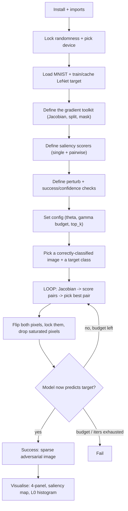

# JSMA (Jacobian Saliency Map Attack) - Cheatsheet

_HTB Academy · AI Evasion - Sparsity Attacks · the JSMA half (Sections 14-26)_

> **How to use this sheet**
> 
> - Run the cells **top to bottom in one Jupyter notebook**. Later cells reuse names earlier cells made.
> - **[INPUT NEEDED]** = fill every `<<LIKE_THIS>>` before running.
> - **[just run]** = run it as it is.
> - This sheet has **no math**. Where the real attack uses a formula, you get one plain-English line instead.
> - Images stay in **pixel space**: plain brightness, **0 (black) to 1 (white)**.
> - The sheet builds the **pairwise** attack (the strong one, ~90% on MNIST). The weaker single-pixel version shares most of the same code, and the pieces that differ are called out.

## What this module does

JSMA is the **change as FEW pixels as possible** attack (it minimises the **L0 count** - how many pixels you touch - not how big the changes are). It uses the model's own gradients to score every pixel for one thing: _does nudging it push the model toward the class I want AND away from everything else?_ Each step it picks the best pixel (or **pair** of pixels) and slams it fully from black to white (or back), then repeats until the model is fooled or a pixel budget runs out. The result is a few bright "dots" on strategic strokes rather than the faint all-over fuzz of FGSM.



---

## Part A - Setup

## Step 1 - Install the HTB library

[just run]

Installs PyTorch and the HTB Academy helper library used across this module.

```python
!pip install torch torchvision -q
# The HTB AI library is normally already installed in the lab. If an import below fails, install it the way the module told you.
```

> **If it breaks:** in the HTB lab these are already present - just skip to Step 2.

## Step 2 - Imports, style, seed, device

[INPUT NEEDED]

Loads everything, fixes randomness so your runs are repeatable, and picks the GPU if there is one.

```python
import torch
import torch.nn as nn
import torch.nn.functional as F
import numpy as np
import matplotlib.pyplot as plt
from pathlib import Path
import warnings
warnings.filterwarnings('ignore')

from htb_ai_library.core import set_reproducibility
from htb_ai_library.data import get_mnist_loaders
from htb_ai_library.models import SimpleLeNet
from htb_ai_library.training import train_model
from htb_ai_library.utils import save_model, load_model
from htb_ai_library.visualization import use_htb_style

use_htb_style() # HTB plot colours
set_reproducibility(<<SEED>>) # same number = same results every run

device = torch.device('cuda' if torch.cuda.is_available() else 'cpu')
print("Using device:", device)

output_dir = Path('output')
output_dir.mkdir(exist_ok=True) # folder to save the model + pictures
```

**fill in:** `<<SEED>>` - any fixed number, e.g. `1337`. Keep it the same all session so your results don't change between runs.

## Step 3 - Load MNIST and the target model

[just run]

Loads the digit dataset and a small **LeNet** model, training it once then caching it. **JSMA works best on a small, shallow model like this** - on big deep nets single pixels matter less and success drops.

```python
train_loader, test_loader = get_mnist_loaders(batch_size=128)
model_path = output_dir / 'mnist_target.pth'

model = SimpleLeNet().to(device)

if model_path.exists(): # already trained? reuse it
    model = load_model(model, model_path, device)
    print("Loaded existing model")
else: # first run: train + save
    model = train_model(model, train_loader, test_loader, epochs=5, learning_rate=0.001, device=device)
    save_model(model, model_path)

model.eval() # REQUIRED: turn dropout OFF so gradients are stable
print("Model ready")
```

> **If it errors:** a shape/size error means the model class doesn't match the saved weights - delete `output/mnist_target.pth` and let it retrain.

---

## Part B - The gradient toolkit (shared by every version)

## Step 4 - The Jacobian (per-class gradients)

[just run]

The Jacobian is a table with **one row per class** showing how every pixel pushes that class's score. Building it needs **one backward pass per class** (10 for MNIST) - this is JSMA's slow part. Keep each function in its own block.

```python
def compute_class_gradient(x, model, class_idx, wrt='logits'):
    """How does every pixel affect ONE class's score? Returns a flat length-784 vector."""
    x_grad = x.detach().requires_grad_(True) # track gradients w.r.t. the PIXELS
    logits = model(x_grad)
    if wrt == 'logits':
        scalar = logits[0, class_idx] # use the raw score (NOT softmax) - see note
    else:
        scalar = F.softmax(logits, dim=1)[0, class_idx]
    scalar.backward() # fill in the gradients
    # flatten in channel-height-width order and COPY (the .grad buffer gets reused next call)
    return x_grad.grad.detach().cpu().numpy().flatten().copy()

def compute_jacobian_matrix(x, model, num_classes=10, wrt='logits'):
    """Stack one gradient row per class -> a (classes x pixels) table, e.g. (10, 784)."""
    if x.shape[0] != 1:
        raise ValueError("needs ONE image at a time (batch size 1)") # a batch would average gradients = garbage
    rows = [compute_class_gradient(x, model, c, wrt) for c in range(num_classes)]
    return np.asarray(rows)
```

> **Why `wrt='logits'` and never softmax:** softmax forces the "help target" and "hurt others" signals to cancel out, which quietly destroys JSMA's logic. Always use the raw scores (logits).

## Step 5 - Split the table into "target" vs "the rest", and mask

[just run]

From the Jacobian we need two things per pixel: **how much it helps the target (alpha)** and **how much it moves all the OTHER classes combined (beta)**. Beta is computed the fast way: add up every row, then subtract the target row.

```python
def extract_target_gradient(jacobian, target_class):
    """alpha = the target class's own row. Copied so later masking can't corrupt the table."""
    return jacobian[target_class].copy()

def extract_other_gradients(jacobian, target_class):
    """beta = effect on all OTHER classes combined = (sum of every row) - (target row)."""
    return jacobian.sum(axis=0) - jacobian[target_class]

def apply_search_mask(gradient, search_space):
    """Zero out pixels we're not allowed to touch. Multiplying keeps every pixel at its own index."""
    return gradient * search_space # True->1, False->0
```

---

## Part C - Picking the pixel(s)

## Step 6 - The search space (which pixels are still usable)

[just run]

A simple on/off list over all pixels. Pixels drop out once they hit pure black (0.0) or pure white (1.0), because they can't move further.

```python
def initialize_search_space(shape):
    """A True/False list, one per pixel, all True to start. MNIST -> 784 Trues."""
    num_features = int(np.prod(shape[1:])) # ignore the batch dim
    return np.ones(num_features, dtype=bool)

def remove_saturated_pixels(search_space, x, clip_min=0.0, clip_max=1.0, epsilon=1e-6):
    """Turn OFF any pixel already at the black or white boundary (with a tiny tolerance for rounding)."""
    x_flat = x.detach().cpu().numpy().flatten()
    saturated = (x_flat <= clip_min + epsilon) | (x_flat >= clip_max - epsilon)
    return search_space & ~saturated # keep pixels that are available AND not saturated
```

## Step 7 - Single-pixel saliency (the baseline scorer)

[just run]

Score each pixel for changing it **alone**. **A pixel is worth zero unless it both helps the target and hurts the others**; when it qualifies, its score is "how much it helps" times "how much it hurts". You score pushing it UP and pushing it DOWN separately, and keep the better. (The pairwise attack in Step 8 is the strong one - these are kept because the saliency _picture_ in Step 15 uses them, and single-pixel is still worth understanding.)

```python
def score_increase_saliency(target_grad, other_grad):
    """Good to push UP: raising it helps target (alpha>0) AND hurts others (beta<0)."""
    mask = (target_grad > 0) & (other_grad < 0)
    return target_grad * np.abs(other_grad) * mask # zero where the signs are wrong

def score_decrease_saliency(target_grad, other_grad):
    """Good to push DOWN: lowering it helps target (alpha<0) AND hurts others (beta>0)."""
    mask = (target_grad < 0) & (other_grad > 0)
    return np.abs(target_grad) * other_grad * mask

def select_best_direction(inc_scores, dec_scores):
    """Pick the single best pixel across both directions. Returns (pixel, score, is_increase)."""
    i, d = int(np.argmax(inc_scores)), int(np.argmax(dec_scores))
    si, sd = float(inc_scores[i]), float(dec_scores[d])
    return (i, si, True) if si > sd else (d, sd, False) # a zero winner means 'no valid pixel left'
```

## Step 8 - Pairwise saliency (the REAL attack's brain)

[just run]

Score **pairs** of pixels moved together. Add the two pixels' "help target" numbers and their "hurt others" numbers, then apply the same rule to the pair. **This finds pixels that are useless alone but powerful together** (one covers the other's weakness). Because checking every pair is expensive, `top_k` keeps only the most promising pixels first. Keep each function in one block.

```python
def prune_candidates(alpha, beta, search_space, top_k):
    """Keep only the top_k individually-strongest available pixels, so we don't test millions of pairs."""
    valid = np.where(search_space)[0] # positions still usable
    if valid.size < 2 or top_k is None or valid.size <= top_k:
        return valid # nothing to prune
    prelim = np.abs((alpha * search_space)[valid]) * np.abs((beta * search_space)[valid])
    return valid[np.argsort(-prelim)[:top_k]] # best-first, keep top_k

def evaluate_pairs(alpha, beta, valid, direction):
    """Try every pair of the kept pixels; return the best-scoring pair for this direction."""
    best_p, best_q, best_score = -1, -1, 0.0
    for i in range(valid.size):
        p = valid[i]
        for j in range(i + 1, valid.size): # j starts at i+1 -> each pair once, no self-pairs
            q = valid[j]
            a_pq = alpha[p] + alpha[q] # pair's combined "help target"
            b_pq = beta[p] + beta[q] # pair's combined "hurt others"
            if direction == 'increase':
                if a_pq <= 0 or b_pq >= 0: # signs wrong -> skip
                    continue
                score = a_pq * abs(b_pq)
            else:
                if a_pq >= 0 or b_pq <= 0:
                    continue
                score = abs(a_pq) * b_pq
            if score > best_score:
                best_score, best_p, best_q = float(score), int(p), int(q)
    return best_p, best_q, best_score

def compute_pairwise_saliency(alpha, beta, search_space, direction='increase', top_k=None):
    """Prune, then find the best pair. Returns (-1,-1,0.0) when no valid pair exists."""
    valid = prune_candidates(alpha, beta, search_space, top_k)
    if valid.size < 2:
        return -1, -1, 0.0
    best_p, best_q, best_score = evaluate_pairs(alpha, beta, valid, direction)
    return (-1, -1, 0.0) if best_p == -1 else (best_p, best_q, best_score)
```

## Step 9 - Apply a change, and the success/confidence checks

[just run]

Actually modify pixels, and two quick read-outs: did we hit the target, and how confident is the model in the target now. **Both pixels of a pair must move the SAME way** or the pair score is meaningless.

```python
def apply_single_pixel_perturbation(x, pixel_idx, theta, increase, clip_min=0.0, clip_max=1.0):
    """Move ONE pixel by +theta (increase) or -theta (decrease), kept inside [0,1]."""
    shape = x.shape
    xf = x.view(-1).clone() # flatten + CLONE so we don't corrupt the original
    xf[pixel_idx] = torch.clamp(xf[pixel_idx] + (theta if increase else -theta), clip_min, clip_max)
    return xf.view(shape)

def apply_pair_perturbation(x, p, q, theta, increase, clip_min=0.0, clip_max=1.0):
    """Move BOTH pixels of a pair by the same signed step, each kept inside [0,1]."""
    shape = x.shape
    xf = x.view(-1).clone()
    step = theta if increase else -theta
    xf[p] = torch.clamp(xf[p] + step, clip_min, clip_max)
    xf[q] = torch.clamp(xf[q] + step, clip_min, clip_max)
    return xf.view(shape)

def check_target_reached(x, target_class, model):
    """True once the model's top prediction equals the target class."""
    with torch.no_grad():
        return int(model(x).argmax(dim=1).item()) == target_class

def compute_confidence(x, target_class, model):
    """The model's probability for the target class (0..1). Climbs toward 1 as the attack works."""
    with torch.no_grad():
        return float(F.softmax(model(x), dim=1)[0, target_class].item())
```

---

## Part D - Run the attack

## Step 10 - Attack configuration

[INPUT NEEDED]

The knobs. Sensible defaults are filled in; the notes say when to change them.

```python
config = {
    'theta': 1.0, # step size per pixel. 1.0 = flip fully black<->white in one hit (recommended)
    'gamma': 0.15, # pixel budget as a FRACTION of the image (0.15 of 784 = up to 117 pixels)
    'max_iter': 90, # safety cap on loop passes
    'top_k': 128, # how many pixels to consider for pairing (speed vs quality)
    'wrt': 'logits', # ALWAYS 'logits' (never 'softmax')
    'clip_min': 0.0,
    'clip_max': 1.0,
}
```

**fill in / tune:**

- `theta` - **If** you want the best success on MNIST -> keep `1.0`. **If** you want subtler, less visible changes -> lower it (e.g. `0.25`), but expect more iterations and some failures.
- `gamma` - **If** the attack succeeds -> leave `0.15`. **If** it fails hitting the budget -> raise toward `0.2-0.3`. **If** you need extreme sparsity -> lower it (fewer pixels allowed).
- `top_k` - **If** default -> `128` (rarely misses the best pair). **If** you need speed -> `64`. **If** you want the guaranteed-best pair and don't mind it being slow -> `None`.

## Step 11 - The pairwise JSMA attack (one function)

[just run]

The whole attack: repeatedly build the Jacobian, score pairs both ways, flip the best pair, lock those pixels, drop saturated ones, stop on success or budget. Keep this intact.

```python
def jsma_pairwise(x, target_class, model, config, num_classes=10):
    """Run pairwise JSMA on ONE image. Returns (adv_image, success, pixels_used, confidence_curve)."""
    x_adv = x.clone().detach()
    search_space = initialize_search_space(x.shape)
    max_pixels = int(config['gamma'] * int(np.prod(x.shape[1:]))) # the hard pixel budget
    pixels_modified, conf_curve = 0, []

    for iteration in range(config['max_iter']):
        if check_target_reached(x_adv, target_class, model): # already won? stop (cheap check first)
            break
        if pixels_modified >= max_pixels: # out of budget? stop
            break

        # 1) per-pixel sensitivities
        jacobian = compute_jacobian_matrix(x_adv, model, num_classes, config['wrt'])
        alpha = extract_target_gradient(jacobian, target_class)
        beta = extract_other_gradients(jacobian, target_class)

        # 2) best pair for each direction, then the overall winner
        p_inc, q_inc, s_inc = compute_pairwise_saliency(alpha, beta, search_space, 'increase', config['top_k'])
        p_dec, q_dec, s_dec = compute_pairwise_saliency(alpha, beta, search_space, 'decrease', config['top_k'])
        if max(s_inc, s_dec) <= 0.0: # no valid pair left? stop
            break
        if s_inc >= s_dec:
            p, q, increase = p_inc, q_inc, True
        else:
            p, q, increase = p_dec, q_dec, False
        if p < 0 or q < 0: # safety: no real pair
            break

        # 3) flip both pixels, lock them, drop any now-saturated pixels
        x_adv = apply_pair_perturbation(x_adv, p, q, config['theta'], increase,
                                        config['clip_min'], config['clip_max'])
        search_space[p] = False
        search_space[q] = False
        search_space = remove_saturated_pixels(search_space, x_adv, config['clip_min'], config['clip_max'])

        pixels_modified += 2 # pairwise changes 2 pixels per pass
        conf_curve.append(compute_confidence(x_adv, target_class, model))

    success = check_target_reached(x_adv, target_class, model)
    return x_adv, success, pixels_modified, conf_curve
```

> **Single-pixel instead?** Swap the two `compute_pairwise_saliency` calls for `score_increase_saliency`/`score_decrease_saliency` + `select_best_direction`, use `apply_single_pixel_perturbation`, and add `1` instead of `2` to `pixels_modified`. It's the weaker baseline (~70% vs ~90%); use pairwise unless practice specifically asks for single-pixel.

## Step 12 - Attack one image

[INPUT NEEDED]

Grab a digit the model gets right, choose a target class, and run.

```python
# find the first correctly-classified test image
x, original_class = None, None
for xb, yb in test_loader:
    xb, yb = xb.to(device), yb.to(device)
    with torch.no_grad():
        preds = model(xb).argmax(dim=1)
    for i in range(xb.size(0)):
        if preds[i].item() == yb[i].item():
            x = xb[i:i+1] # keep the batch dim -> shape (1,1,28,28)
            original_class = int(yb[i].item())
            break
    if x is not None:
        break

target_class = <<TARGET_CLASS>> # the digit you want the model to see instead

x_adv, success, pixels_used, conf_curve = jsma_pairwise(x, target_class, model, config)
print(f"{original_class} -> target {target_class} | success: {success} | pixels used: {pixels_used}")
print("true L0 (pixels actually changed):", int(np.count_nonzero((x_adv - x).detach().cpu().numpy())))
```

**fill in:** `<<TARGET_CLASS>>` - a digit `0-9` different from `original_class`. Not sure? use `(original_class + 5) % 10` to pick a "far" target automatically.

> **Note:** `pixels_used` counts _modifications_; the honest sparsity is the **true L0** line (count of pixels that actually changed), which can be a little lower.

## Step 13 - Attack several images (batch + success rate)

[INPUT NEEDED]

Run on a handful of samples to get a success rate, the way practice's evaluation does.

```python
images, origs, targets = [], [], []
for xb, yb in test_loader:
    xb, yb = xb.to(device), yb.to(device)
    with torch.no_grad():
        preds = model(xb).argmax(dim=1)
    for i in range(xb.size(0)):
        if len(images) >= <<NUM_SAMPLES>>:
            break
        if preds[i].item() == yb[i].item(): # only attack correctly-classified images
            o = int(yb[i].item())
            images.append(xb[i:i+1]); origs.append(o); targets.append((o + 5) % 10)
    if len(images) >= <<NUM_SAMPLES>>:
        break

adv_list, successes, l0s = [], 0, []
for x_i, t_i in zip(images, targets):
    x_adv_i, ok_i, _, _ = jsma_pairwise(x_i, t_i, model, config)
    adv_list.append(x_adv_i)
    successes += int(ok_i)
    if ok_i:
        l0s.append(int(np.count_nonzero((x_adv_i - x_i).detach().cpu().numpy())))

print(f"Success: {successes}/{len(images)} ({100*successes/len(images):.0f}%)")
if l0s:
    print(f"True L0 of successes: mean {np.mean(l0s):.1f}, range [{min(l0s)}, {max(l0s)}]")
```

**fill in:** `<<NUM_SAMPLES>>` - how many images to attack, e.g. `10`. Each is ~0.4s, so 10-20 is a good demo size.

---

## Part E - See the results

## Step 14 - The 4-panel picture (original / adversarial / change / modified pixels)

[just run]

The single best picture for one result: what it was, what it became, where the change landed, and how sparse it is.

```python
def show_attack_4panel(x_orig, x_adv, true_cls, target_cls, model, save=None):
    """Original | Adversarial (green=success) | perturbation heatmap | binary modified-pixel mask."""
    o = np.squeeze(x_orig.detach().cpu().numpy())
    a = np.squeeze(x_adv.detach().cpu().numpy())
    mag = np.abs(a - o)
    l0 = int(np.count_nonzero(a - o))
    l2 = float(np.linalg.norm(a - o))
    linf = float(mag.max())
    with torch.no_grad():
        pred = int(model(x_adv).argmax(dim=1).item())
    ok = (pred == target_cls)

    fig, ax = plt.subplots(1, 4, figsize=(14, 3.8))
    ax[0].imshow(o, cmap='gray'); ax[0].set_title(f"Original\nTrue: {true_cls}")
    ax[1].imshow(a, cmap='gray')
    ax[1].set_title(f"Adversarial\nPred {pred} Target {target_cls} " + ("Success" if ok else "Fail"),
                    color=('#9FEF00' if ok else '#FF3E3E'))
    ax[2].imshow(mag / (mag.max() + 1e-8), cmap='hot') # normalise so faint changes still show
    ax[2].set_title(f"Change\nL0={l0} L2={l2:.2f} Linf={linf:.3f}")
    ax[3].imshow(mag > 0, cmap='hot')
    ax[3].set_title(f"Modified pixels\n{l0}/{o.size} ({100*l0/o.size:.1f}%)")
    for a_ in ax: a_.axis('off')
    plt.tight_layout()
    if save: plt.savefig(save, dpi=150, bbox_inches='tight')
    plt.show()

show_attack_4panel(x, x_adv, original_class, target_class, model, save=output_dir / 'jsma_4panel.png')
```

**Reading it:** the change concentrates on a few strokes as scattered hot dots (that's the L0 look), and the far-right mask shows how few pixels moved. `Linf≈1.0` means at least one pixel flipped fully to black or white - expected with `theta=1.0`.

## Step 15 - The saliency map (which pixels JSMA wants first)

[just run]

A heatmap of pixel importance on the clean image: bright = JSMA would grab it first. Good sanity check that it targets real strokes, not random background.

```python
def show_saliency_map(x_img, target_class, model, save=None):
    """Importance heatmap (single-pixel scores) reshaped back to the image grid."""
    J = compute_jacobian_matrix(x_img, model, 10, 'logits')
    alpha = extract_target_gradient(J, target_class)
    beta = extract_other_gradients(J, target_class)
    ss = initialize_search_space(x_img.shape)
    scores = np.maximum(score_increase_saliency(alpha, beta), # best of up/down per pixel
                        score_decrease_saliency(alpha, beta)) * ss
    h, w = x_img.shape[-2:]
    plt.figure(figsize=(6, 6))
    plt.imshow(scores.reshape(h, w), cmap='hot')
    plt.title('Saliency Map (brighter = more important)'); plt.axis('off')
    plt.colorbar(fraction=0.046, pad=0.04)
    if save: plt.savefig(save, dpi=150, bbox_inches='tight')
    plt.show()

show_saliency_map(x, target_class, model, save=output_dir / 'jsma_saliency.png')
```

## Step 16 - L0 histogram (how sparse are the attacks, overall)

[just run]

Spread of pixel counts across your batch, with mean and median lines. Mean sitting right of median = a few expensive attacks pulling the average up.

```python
l0_all = [int(np.count_nonzero((a - xi).detach().cpu().numpy())) for a, xi in zip(adv_list, images)]
plt.figure(figsize=(8, 4.5))
plt.hist(l0_all, bins=30, color='#9FEF00', alpha=0.7)
plt.axvline(np.mean(l0_all), color='#FFAF00', ls='--', lw=2, label=f"Mean: {np.mean(l0_all):.1f}")
plt.axvline(np.median(l0_all), color='#2EE7FF', ls='--', lw=2, label=f"Median: {np.median(l0_all):.1f}")
plt.xlabel('L0 (pixels changed)'); plt.ylabel('Count'); plt.title('L0 Distribution')
plt.legend(); plt.grid(alpha=0.3); plt.tight_layout()
plt.savefig(output_dir / 'jsma_l0_hist.png', dpi=150, bbox_inches='tight'); plt.show()
```

---

## If you remember nothing else

## The attack in 4 lines

1. **Goal: flip the prediction by changing as FEW pixels as possible** (minimise the L0 count). Big per-pixel changes are fine; few pixels is the point.
2. **Score pixels by the model's gradients:** a pixel (or pair) is worth zero unless it both _helps the target class_ and _hurts all the others_; otherwise its score is "how much it helps" × "how much it hurts".
3. **Each step: build the Jacobian -> pick the best pair -> flip both pixels fully -> lock them -> drop any pixel stuck at black/white.** Repeat until the model predicts the target or the pixel budget runs out.
4. **Pairwise + theta=1.0 + logits is the strong setup** (~90% on MNIST); single-pixel is the weaker baseline (~70%).

## The core from memory

```python
# setup: load MNIST + small LeNet, model.eval(); work in plain 0..1 pixels
for _ in range(max_iter):
    if check_target_reached(x_adv, target, model): break # won?
    if pixels_used >= gamma * num_pixels: break # out of budget?
    J = compute_jacobian_matrix(x_adv, model, 10, 'logits') # 1 backward pass per class
    alpha = extract_target_gradient(J, target) # helps target
    beta = extract_other_gradients(J, target) # sum(all rows) - target row = hurts others
    p,q,si = compute_pairwise_saliency(alpha, beta, search, 'increase', top_k)
    _,_,sd = compute_pairwise_saliency(alpha, beta, search, 'decrease', top_k)
    # take higher-scoring direction; flip BOTH pixels same way with theta=1.0
    x_adv = apply_pair_perturbation(x_adv, p, q, 1.0, increase)
    search[p] = search[q] = False # lock used pixels
    search = remove_saturated_pixels(search, x_adv) # drop 0.0 / 1.0 pixels
    pixels_used += 2
```

## Must-know facts

- **JSMA minimises L0 (the COUNT of changed pixels), not their size** - so it flips a few pixels hard (black<->white), giving visible dots/strokes rather than FGSM's faint all-over noise. Norm owners in general: FGSM = L∞, DeepFool = L2, ElasticNet = L1+L2, **JSMA = L0**.
- **A pixel's saliency is zero unless it helps the target AND hurts every other class combined**; when it qualifies, score = (help) × (hurt). You check pushing it up and down and keep the better.
- **Always use logits, never softmax** - softmax makes the "help" and "hurt" signals cancel, which breaks the whole selection.
- ==alpha = the target's gradient row; beta = (sum of all rows) − that row== = the combined effect on competitors.
- **Pairwise beats single-pixel** because two pixels' gradients are added before scoring, so a pixel that's useless alone can pair up and pass - more success with fewer pixels.
- ==theta is the step size, gamma is the pixel-budget fraction (max pixels = gamma × total)==; theta=1.0 saturates a pixel in one hit, gamma=0.15 ≈ 117 pixels on MNIST.
- **top_k prunes how many pixels get paired** (128 default, 64 faster, None exhaustive-and-slow) - needed because checking all pairs is quadratic.
- **Cost is one backward pass per class per step**, so JSMA is cheap on MNIST's 10 classes but impractical on ImageNet's 1000; it also works best on shallow models like LeNet.
- **Report true sparsity with `count_nonzero(adv − orig)`**, not the step counter - the counter can over-report because some moves end up net-zero after clamping.
- **Method point:** **this is OWASP ML01 Input Manipulation - a white-box, iterative, saliency-guided L0 attack**; rebuild the model, attack only correctly-classified images in plain 0..1 pixels, and keep `model.eval()` on so the gradients are stable.