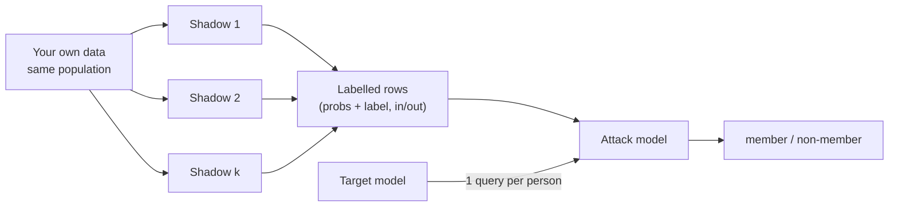

# The Shadow Model Attack

## The idea in one breath

You can't see the target's training set, so you **build your own look-alike models (shadow models) where you _do_ know who was in training**. You record how they answer members vs non-members, and that labelled data trains a small **attack model** that you then point at the real target. It works **only if the shadows overfit the same way the target does**, so you need to copy its architecture, training procedure and data distribution. The key limitation is **shadow-target mismatch**.

> **Heads-up:** No mangled formulas in this paste. A few things to keep straight:
> 
> - **Three models now:** the **target model** (the victim, its training set secret), the **shadow models** (yours, training set known), and the **attack model** (yours, a yes/no member classifier). The course also calls the attack model the "attack classifier". It's the same thing.
> - **"in" / "out":** when shadow data gets labelled, "in" means member (it was in that shadow's training set) and "out" means non-member.
> - **"Prediction vector"** = the full **softmax probability vector**, e.g. `[0.05, 0.95]`. **"Confidence"** = the biggest number in it.

---

## Part 1: The Shadow Model Attack (the pipeline)

### Step 1: The problem it solves

To train any classifier you need **labelled examples**. Here that means "this prediction came from a member" and "this one came from a non-member". For the target you have no labels, because its training set is secret.

### Step 2: The trick: make models where you know the answer

You train several **shadow models** yourself. Since you picked their training data, you know exactly who is "in" and "out" for each one.

### Step 3: Toy pipeline with 2 shadows and 8 records

Your own data pool has 8 records, r1 to r8, from the same population as the target's data.

|Shadow|Trained on ("in" = member)|Held out ("out" = non-member)|
|---|---|---|
|Shadow 1|r1, r2, r3, r4|r5, r6, r7, r8|
|Shadow 2|r2, r4, r6, r8|r1, r3, r5, r7|

Each shadow is queried on all 8 records, so you get 16 labelled rows for the attack model:

|Row|Shadow|Record|Prediction vector|True label|Attack label|
|---|---|---|---|---|---|
|1|1|r1|[0.03, 0.97]|1|in (1)|
|2|1|r5|[0.25, 0.75]|1|out (0)|
|3|2|r1|[0.20, 0.80]|1|out (0)|
|4|2|r6|[0.98, 0.02]|0|in (1)|
|...|...|...|...|...|...|

r1 is "in" for Shadow 1 but "out" for Shadow 2. That's the point of **different random subsets**: the attack model learns how the **model's behaviour** changes with membership, not quirks of one particular record or one particular shadow.

### Step 4: Apply the attack to the target

The attack model is trained on those rows. Then you send the target **one query** per person you care about, feed its prediction vector plus the true label into the attack model, and get member or non-member back.



**If the shadows overfit like the target, a detector trained on the shadows transfers to the target.** That one sentence is the whole attack.

---

## Part 2: Why Shadow Models Work (the similarity assumption)

The attack transfers when the shadows show the **same overfitting pattern** as the target: higher confidence on training samples and a different error distribution. Three things need to roughly match:

|What to match|Examples|Why it matters|
|---|---|---|
|**Model architecture**|Similar capacity and structure (CNN vs CNN, similar depth)|Sets _how much_ and _in what pattern_ the model overfits|
|**Training procedure**|Optimizer type, learning rate, number of epochs|Controls memorization vs generalization|
|**Data distribution**|Same population as the target's training data|Overfitting patterns depend on the data's statistics|

This is the same idea as the **surrogate model** in your evasion API cheatsheets (train a local copy and hope its behaviour transfers). There you transferred _adversarial examples_. Here you transfer a _membership detector_.

---

## Part 3: What Makes Attacks Succeed or Fail

|Factor|More vulnerable when...|Why|What it means for a report's remediation|
|---|---|---|---|
|**Model complexity / capacity**|More parameters (10-layer 1M params > 2-layer 10k params; deep nets and LLMs > logistic regression)|More room to store individual examples|Use the smallest model that does the job|
|**Training data size** (inverse)|**Smaller** training set (1,000 samples > 1 million)|Each example has more influence on the weights|Train on more data|
|**Training duration / regularization**|More epochs, no regularization|Overfitting grows with training|Dropout (0.5), weight decay, early stopping|
|**Number of output classes**|More classes (1000-class ImageNet > binary)|The softmax vector carries more detail|Return only the label or top-1, or round probabilities|
|**Data heterogeneity**|Outliers and samples near the decision boundary|Unusual records get memorized hardest (course: ~80% attack accuracy on outliers vs ~55% on typical samples)|Report the at-risk individuals, not just the average|
|**Shadow-target mismatch**|(makes the attack **fail**)|Learned patterns don't transfer: CNN shadows vs a transformer target, CIFAR-10 shadows vs a medical target|n/a (this is the attacker's limitation)|

### Why more classes = more signal (toy)

- **Binary:** `[0.95, 0.05]`. The second number is just 1 − the first, so there's **only one free number**, and the only thing you learn is "how confident".
- **3 classes:** `[0.90, 0.07, 0.03]` vs `[0.90, 0.05, 0.05]`. Same confidence, but the _shape_ of the leftover probability differs. That shape is extra information the attack model can use.
- **1000 classes:** 999 free numbers per query. A much richer fingerprint.

Two connections to Section 1: the outlier point is the "average accuracy understates the risk" note, and the regularization row is what Cell 4 there showed (audit accuracy fell from 72.8% to 51.2%).

---

## Part 4: Attack Model Architecture

### Step 1: Shadows should copy the target and be diverse

- Match the target's architecture as closely as you can.
- Train **multiple** shadows on **different random subsets** so the attack model learns robust signals instead of one shadow's artifacts.

### Step 2: The attack model's input = probabilities + one-hot true label

```
attack input = [ softmax probabilities (K numbers) , one-hot true label (K numbers) ] -> 2K numbers
```

|Symbol|Plain English|Toy (3 classes)|Real|
|---|---|---|---|
|K|Number of classes|3|2 in my cells, 10 for CIFAR-10|
|softmax probabilities|The target's prediction vector|[0.05, 0.90, 0.05]|`predict_proba` output|
|one-hot true label|A 1 in the true class's slot, 0 elsewhere|true class 1 -> [0, 1, 0]|`np.eye(K)[y]`|
|attack input|The two glued together|[0.05, 0.90, 0.05, 0, 1, 0] (6 numbers)|4 numbers for binary, 20 for CIFAR-10|
|output|Member (1) or non-member (0)| - | - |

**Read aloud:** "The attack model sees what the target said _and_ what the right answer was, and decides whether that combination looks like a training-set answer."

### Step 3: Why include the true label

- Different classes overfit differently. Some classes are easy, so even non-members get high confidence. The one-hot lets the attack model **learn class-specific membership patterns**.
- The label also tells the attack whether the target was **right**, which is Section 1's correctness signal.

### Step 4: Why a small network is enough

The membership signal is subtle but **low-dimensional** (only 2K numbers), so a simple neural network does the job.

> **An honest note the course skips (1):** Shokri et al.'s original paper trained **one attack model per class** (K separate attack models). The course uses one attack model conditioned on the one-hot label. It's the same goal (class-specific patterns), just packaged differently. If you read the paper, don't be confused by the difference.

---

## Part 5: Threat Model Assumptions

|Assumption|What the course assumes|Why it's realistic|Defender's lever (for remediation)|
|---|---|---|---|
|**Black-box access**|Send inputs, see outputs; no parameters, gradients or activations|Models are served through APIs|n/a|
|Output type|The **full softmax vector**, not just the label|Many APIs return confidence scores|Return the label only, top-1, or rounded scores|
|Query limits|Unlimited; **1 query per target individual** (100 people = 100 queries)|Typical limits like 1000/min or 10000/day don't stop it|Rate limits barely help here|
|Shadow training|Offline, never touches the target|Expensive, but invisible to the owner|n/a|
|**Detection**|Queries look like normal inference, so they're hard to detect|Unlike **model extraction**, which probes the input space systematically|Query monitoring (SAIF "consumer" duty) has limited power|
|Data knowledge|Knows the **data distribution**, not the exact training samples|A nearby hospital, a competitor, public datasets like Adult Census|n/a|
|Stronger attacker|**White-box** = compute exact loss; knowing lr/epochs/batch size = better shadows| - |Protect model weights and training configs|

The course treats **black-box as the hardest _and_ most realistic case**. It's also probably the case you'd meet if a target exposes a prediction API.

> **An honest note the course skips (2):** "Very few queries" assumes the attacker already **has** in-distribution data to train shadows with. Without it, Shokri et al. _synthesize_ shadow training data by querying the target many times and searching for inputs it's confident on. That approach needs a lot of queries and would be easier to spot.
> 
> **An honest note the course skips (3):** Returning only labels is a real remediation lever, but **label-only membership attacks exist**: they probe how robust the predicted label is to small changes. So hiding probabilities _reduces_ the leak, it doesn't _eliminate_ it. In a report, list it as a short-term mitigation and differential privacy (DP-SGD / PATE) as the long-term fix.

---

## Part 6: Alternative Attack Approaches

### Step 1: Metric-based attack (confidence threshold)

"Confidence ≥ 0.9 -> member." No training at all. This is Section 1's rule R2 (and R3 with correctness added).

### Step 2: Loss-based attack (toy first)

The **cross-entropy loss** on one sample is:

```
loss = -ln( p_true )
```

Here `p_true` is the probability the model gave to the **true** label. Members should have **lower** loss, because training minimized exactly these losses.

Using Section 1's toy patients, and remembering that H was _wrong_ at 0.92 confidence, so the true label only got 0.08. The threshold is τ = −ln(0.9) = 0.105:

|Patient|Truly member?|p_true|loss = −ln(p_true)|loss ≤ 0.105? -> verdict|Right?|
|---|---|---|---|---|---|
|A|Yes|0.95|0.051|member|✓|
|B|Yes|0.98|0.020|member|✓|
|C|Yes|0.91|0.094|member|✓|
|D|Yes|0.60|0.511|non-member|✗|
|E|No|0.80|0.223|non-member|✓|
|F|No|0.54|0.616|non-member|✓|
|G|No|0.94|0.062|member|✗|
|H|No|0.08|2.526|non-member|✓|

That's 6/8 = 75%, **exactly Section 1's rule R3**. **Loss folds confidence and correctness into one number**. A wrong prediction gives a tiny p_true and a huge loss, which is why H (2.526) is so obvious. It also means the attacker **must know the true label**, which the shadow attack assumes too.

|Symbol|Plain English|Toy|Real (my Cell 1)|
|---|---|---|---|
|p_true|Probability given to the correct answer|A: 0.95, H: 0.08|`probs[np.arange(len(y)), y]`|
|−ln(·)|Turns "probability near 1" into "loss near 0", and "probability near 0" into a big loss|−ln(0.95) = 0.051|`-np.log(...)`|
|τ|Loss threshold|0.105 (= −ln 0.9)|`tau = -np.log(0.9)`|

**Read aloud:** "If the model put at least 90% on the right answer, the loss is under 0.105 and I call it a member."

### Step 3: Likelihood ratio attack (toy)

Instead of one threshold, **compare how likely a sample's behaviour is under "member" vs "non-member"**. Suppose that, measured on your shadows:

- 70% of members have loss ≤ 0.105, and only 20% of non-members do.
- A target sample with loss ≤ 0.105 then has a ratio of 0.70 / 0.20 = **3.5**. It's 3.5× more likely to come from a member, so you call it a member.
- A sample with loss > 0.105 has a ratio of 0.30 / 0.80 = **0.375**, so you call it a non-member.

The course says this "can achieve optimal statistical efficiency but requires careful distribution modeling." For you that's **low priority as math, but worth knowing by name**.

### Step 4: Comparison

|Approach|Needs training?|Needs true label?|Strength|Weakness|
|---|---|---|---|---|
|**Metric-based** (confidence threshold)|No|No (the confidence-only version)|Zero effort; surprisingly good on vulnerable models|One fixed threshold for every record and class|
|**Loss-based**|No|**Yes**|Combines both signals in one number|Still one fixed threshold|
|**Likelihood ratio**|Models the member / non-member distributions|Yes|Statistically optimal|Needs careful distribution modelling|
|**Shadow model**|Yes (k shadows + attack model)|Yes|Learns nuanced, class-specific patterns; works even when the confidence gap is small|Expensive; fails on shadow-target mismatch|

> **An honest note the course skips (4):** The course presents the likelihood ratio approach as an _alternative to_ shadow models, but the strongest modern version (**LiRA**, Carlini et al. 2022) is **built on** shadow models. It trains shadows with and without each sample and compares the two loss distributions. LiRA also popularized judging attacks by the **true-positive rate at a very low false-positive rate**, i.e. "can I be _certain_ about a few people", rather than average accuracy.
> 
> **An honest note the course skips (5):** The similarity assumption is softer than the course makes it sound. Later work (Salem et al. 2019, "ML-Leaks") found that **a single shadow model is often enough**, and that some attacks still transfer with shadow data from a different dataset. Mismatch does hurt, but "will fail" is too strong.

---

## Reading the figure/output

This section had no figures or output blocks. My cells below include one result that's worth reading closely (Cell 4).

---

## Copy-paste cells (mine, not the course's)

These build on your Section 1 cells (`X_mem`, `X_non`, `y_mem`, `y_non`, `target`, `leak_signals`, `make_classification`, `train_test_split`, `RandomForestClassifier`), so run those first. I ran all four, and the outputs below are real.

### Cell 1: Loss-based attack on your Section 1 target

This computes `-ln(p_true)` per record and calls anything at or under τ = 0.105 a member.

```python
def per_sample_loss(model, X, y):
    probs = model.predict_proba(X)
    p_true = probs[np.arange(len(y)), y] # probability given to the TRUE label
    return -np.log(np.clip(p_true, 1e-12, 1.0)) # cross-entropy loss per sample

loss_mem = per_sample_loss(target, X_mem, y_mem)
loss_non = per_sample_loss(target, X_non, y_non)
tau = -np.log(0.9) # loss threshold = "true-label prob of at least 0.9"

is_member = np.r_[np.ones(len(loss_mem)), np.zeros(len(loss_non))].astype(bool)
guess = np.r_[loss_mem, loss_non] <= tau # low loss -> member
print(f"Mean loss members: {loss_mem.mean():.3f} non-members: {loss_non.mean():.3f}")
print(f"Threshold tau = {tau:.3f}")
print(f"Loss-based attack accuracy = {(guess == is_member).mean():.3f}")
```

Expected:

```txt
Mean loss members: 0.110 non-members: 0.409
Threshold tau = 0.105
Loss-based attack accuracy = 0.728
```

That's the same 0.728 as Section 1's "both" rule, which confirms on real data that the loss rule = rule R3.

### Cell 2: What the attack model actually sees (probs + one-hot)

`attack_features()` builds the 2K-number input from Part 4 for 3 members and 3 non-members.

```python
def attack_features(model, X, y, num_classes=2):
    probs = model.predict_proba(X) # softmax-style probability vector
    one_hot = np.eye(num_classes)[y] # true label as one-hot
    return np.hstack([probs, one_hot]) # [p0, p1, ..., onehot0, onehot1, ...]

feat_mem = attack_features(target, X_mem[:3], y_mem[:3])
feat_non = attack_features(target, X_non[:3], y_non[:3])
np.set_printoptions(precision=2, suppress=True)
print("Attack-model input shape:", feat_mem.shape)
print("3 members :\n", feat_mem)
print("3 non-members :\n", feat_non)
```

Expected:

```txt
Attack-model input shape: (3, 4)
3 members :
 [[0.03 0.97 0. 1. ]
 [0.94 0.06 1. 0. ]
 [0.01 0.99 0. 1. ]]
3 non-members :
 [[0.24 0.76 0. 1. ]
 [0.08 0.92 0. 1. ]
 [0.12 0.88 0. 1. ]]
```

In each row, the first two numbers are the probabilities and the last two are the one-hot label. The members get 0.94 to 0.99 on their true class, and the non-members get 0.76 to 0.92.

### Cell 3: Outliers leak more (the "data heterogeneity" claim)

This uses a fresh dataset where I **know** which 15% of records are unusual (their labels are flipped). It scores each group with **ROC-AUC**, which is threshold-free: "the chance a random member scores higher than a random non-member", where 0.5 = coin flip and 1.0 = perfect. For the toy, 13 of the 16 member/non-member pairs have the member on top, so AUC = 0.81. Variable names are new (`Xo`, `yo`, `m_o`), so nothing from Section 1 gets overwritten.

```python
from sklearn.metrics import roc_auc_score

rng = np.random.default_rng(0)
Xo, yo = make_classification(n_samples=1000, n_features=20, n_informative=5,
                             flip_y=0.0, random_state=1)
unusual = rng.random(len(yo)) < 0.15 # mark 15% of records as "unusual"...
yo = np.where(unusual, 1 - yo, yo) # ...by flipping their label (odd records)

idx_mem, idx_non = train_test_split(np.arange(len(yo)), test_size=0.5, random_state=0)
m_o = RandomForestClassifier(n_estimators=100, random_state=0).fit(Xo[idx_mem], yo[idx_mem])

def p_true_of(model, X, y):
    return model.predict_proba(X)[np.arange(len(y)), y] # prob given to the TRUE label

score = np.r_[p_true_of(m_o, Xo[idx_mem], yo[idx_mem]), p_true_of(m_o, Xo[idx_non], yo[idx_non])]
is_mem = np.r_[np.ones(len(idx_mem)), np.zeros(len(idx_non))].astype(bool)
odd = np.r_[unusual[idx_mem], unusual[idx_non]]

print(f"AUC on typical records ({(~odd).sum()}): {roc_auc_score(is_mem[~odd], score[~odd]):.3f}")
print(f"AUC on unusual records ({odd.sum()}): {roc_auc_score(is_mem[odd], score[odd]):.3f}")
for t in [0.6, 0.8, 0.9]:
    hit = (score >= t) == is_mem
    print(f" threshold {t}: accuracy typical {hit[~odd].mean():.3f} | unusual {hit[odd].mean():.3f}")
```

Expected:

```txt
AUC on typical records (869): 0.905
AUC on unusual records (131): 0.991
  threshold 0.6: accuracy typical 0.663 | unusual 0.954
  threshold 0.8: accuracy typical 0.832 | unusual 0.611
  threshold 0.9: accuracy typical 0.707 | unusual 0.504
```

Unusual records are almost perfectly exposed (AUC 0.991 vs 0.905). But **the best threshold is different for each group**: 0.6 works for unusual records and 0.8 for typical ones. At 0.9, the unusual records look "safe" (0.504) when they're actually the most exposed. **One fixed threshold can hide the people at highest risk**, and that's exactly what a learned attack model (the shadow approach) fixes.

### Cell 4: Training set size vs leakage (and why fixed-threshold accuracy can mislead)

This is one loop, so it's one cell. It uses `p_true_of` from Cell 3, so run Cell 3 first.

```python
for n_train in [100, 400, 2000]:
    Xs, ys = make_classification(n_samples=2 * n_train, n_features=20, n_informative=5,
                                 flip_y=0.15, random_state=0)
    Xa, Xb, ya, yb = train_test_split(Xs, ys, test_size=0.5, random_state=0, stratify=ys)
    m = RandomForestClassifier(n_estimators=100, random_state=0).fit(Xa, ya)
    s = np.r_[p_true_of(m, Xa, ya), p_true_of(m, Xb, yb)]
    im = np.r_[np.ones(len(ya)), np.zeros(len(yb))].astype(bool)
    print(f"train size {n_train:>4}: test acc {m.score(Xb, yb):.3f} | "
          f"attack AUC {roc_auc_score(im, s):.3f} | accuracy@0.9 {((s >= 0.9) == im).mean():.3f}")
```

Expected:

```txt
train size 100: test acc 0.820 | attack AUC 0.872 | accuracy@0.9 0.670
train size 400: test acc 0.790 | attack AUC 0.854 | accuracy@0.9 0.724
train size 2000: test acc 0.867 | attack AUC 0.828 | accuracy@0.9 0.746
```

|Metric|Trend as training data grows|What it tells you|
|---|---|---|
|Attack AUC|0.872 -> 0.854 -> 0.828 (**down**)|Matches the course: more data means less leakage|
|Accuracy at a fixed 0.9 threshold|0.670 -> 0.724 -> 0.746 (**up**)|The opposite conclusion, because the 0.9 threshold fits some models better than others, not because leakage grew|

> **An honest note the course skips (6):** The same attack measured two ways gave opposite trends. **Use a threshold-free metric like AUC to compare leakage between models**, or let a trained attack model pick its own boundary. A fixed-threshold accuracy only tells you how well _that_ threshold suits _that_ model.

## Key facts to lock in

- **The shadow model attack trains several look-alike models whose training sets you control**. You label their predictions on their own training data as "in" and on held-out data as "out", train an attack model on those labelled predictions, then apply it to the target's predictions.
- **It only works if the shadows overfit like the target**, which needs similar architecture (capacity and structure), training procedure (optimizer, learning rate, epochs) and data distribution. **Shadow-target mismatch is the key limitation**: CNN shadows vs a transformer target, or CIFAR-10 shadows vs a medical target.
- **The attack model's input is the softmax probability vector concatenated with the one-hot true label (2K numbers for K classes)**. The label lets it learn class-specific membership patterns and whether the target was right, and the low dimension is why a simple neural network is enough.
- **Leakage rises with model capacity, with more epochs and less regularization, and with more output classes, and it falls with more training data**. A model trained on 1,000 samples leaks more than the same architecture trained on 1 million, and binary outputs carry only one free number while 1000-class outputs carry 999.
- **Vulnerability isn't uniform: outliers and near-boundary samples leak far more** (course: ~80% vs ~55%; my Cell 3: AUC 0.991 vs 0.905). So a report should name the at-risk records, not just quote an average.
- **The threat model is black-box with the full softmax vector, one query per target person, offline shadow training, and knowledge of the data distribution (not the exact samples)**. The queries look like normal inference, which makes MIA much harder to detect than model extraction. White-box access (exact loss) makes it stronger.
- **Cheaper alternatives are the metric-based confidence threshold (e.g. ≥ 0.9), the loss-based attack (−ln p_true below a threshold, needs the true label) and the likelihood-ratio attack**. Loss-based folds confidence and correctness into one number. A shadow attack learns nuanced patterns a single fixed threshold can't, which matters when the confidence gap is small.
- **Method point:** ==Compare leakage between models with a threshold-free metric such as ROC-AUC (0.5 = no leak), not accuracy at one fixed threshold==. In my Cell 4, more training data lowered AUC (0.872 -> 0.828) while fixed-0.9 accuracy rose (0.670 -> 0.746), so the wrong metric points you the wrong way. For remediation, list label-only or rounded outputs as a short-term mitigation (label-only attacks still exist) and differential privacy as the long-term fix.

---

