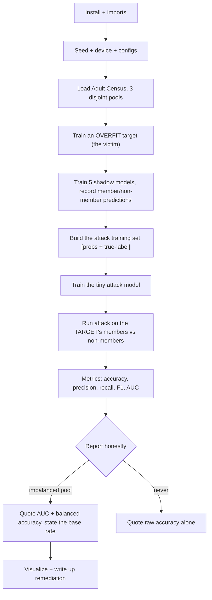

# Shadow Model Membership Inference - Cheatsheet

_HTB Academy · AI Privacy · Shadow Model Attack (Sections 2-6) · the course's own pipeline, start to finish_

> **How to use this sheet**
> 
> - Run the cells **top to bottom in one Jupyter notebook**. Later cells use names earlier cells created.
> - **[INPUT NEEDED]** = replace every `<<LIKE_THIS>>` first. A leftover `<<...>>` makes the cell fail on purpose, so you can't forget one.
> - **[just run]** = run it as it is.
> - **Member** = a record that **was** in the target model's training set. **Non-member** = a record it never trained on. The whole attack is one yes/no question: "was this record a member?"
> - **Target model** = the victim you attack. **Shadow models** = your own copies, where you know who was in training. **Attack model** = a tiny classifier that reads a prediction and says member or not.

## What this module does

A model trained on people's data quietly leaks **who was in its training set**, because it behaves a little differently on records it memorised. You can't see the target's training set, so you build **shadow models** you _do_ control, record how they treat members vs non-members, and train a small **attack model** on that. Then you point the attack model at the real target. The headline the course reports is **69% attack accuracy**, but the honest, trustworthy number is **AUC around 0.57** - the 69% is mostly inflated by an uneven test set, and this sheet shows you how to report it straight.

## The flow



---

## Part A - Setup

## Step 1 - Install the libraries

[just run]

**What & why:** installs PyTorch and friends, plus HTB's helper library, which provides the dataset loader, the models, the training loops, and all the plotting functions.

```python
# "!" runs a terminal command from inside a Jupyter cell.
!pip install torch numpy scikit-learn matplotlib tqdm safetensors opacus flask
# --upgrade replaces an older copy if one is already installed.
!pip install --upgrade git+https://github.com/PandaSt0rm/htb-ai-library
```

**If it breaks:** if there's no internet available, these are usually pre-installed, so skip to Step 2. If Step 2 then says `No module named 'htb_ai_library'`, you need the install. (`opacus` is for the DP-SGD material; `flask` is for the optional evaluators - harmless to install now.)

## Step 2 - Imports

[just run]

**What & why:** loads every tool the rest of the sheet uses. The scikit-learn imports are the **scoring** functions (accuracy, precision, recall, F1) and the data splitter and scaler. The HTB imports are the models, training loops, and plots.

```python
import os # file paths and folders
import json # save results as a text file
import numpy as np # number arrays
import torch # PyTorch: the neural-network framework
import torch.nn.functional as F # softmax and loss helpers
from sklearn.model_selection import train_test_split # random splitting of arrays
from sklearn.preprocessing import StandardScaler # rescales features to a common scale
from sklearn.metrics import (accuracy_score, precision_score, # attack scoring functions
                             recall_score, f1_score, classification_report)

# HTB helper library
from htb_ai_library import (
    set_reproducibility, use_htb_style, # lock randomness; dark plot theme
    MLP, AttackModel, # target/shadow network; member-or-not network
    load_adult_census, # downloads + splits the dataset
    train_fixed_epochs, # trains a set number of epochs (used to OVERFIT the target)
    train_with_early_stopping, # trains, stops when it stops improving (shadows + attack)
    evaluate_model, # accuracy + predictions + probabilities
    get_model_predictions, # probabilities from a plain numpy array
    prepare_attack_data, # builds [probabilities + true-label] rows for the attack
    create_dataloader, # wraps numpy arrays so PyTorch can train on them
    plot_training_history, plot_overfitting_gap, plot_confidence_distributions,
    plot_shadow_confidence_distributions, plot_attack_roc_curve, plot_precision_recall_curve,
    plot_attack_accuracy_comparison, analyze_attack_decision_boundary, plot_decision_boundary,
)
```

**Expected:** no output. Any error here means a missing install (Step 1).

## Step 3 - Lock randomness, pick the device, make folders

[just run]

**What & why:** **reproducibility** means the same seed gives the same "random" numbers, so every run matches. The device is the GPU if present, else the CPU (this dataset is small, CPU is fine). The folders are where models and plots get saved.

```python
RANDOM_SEED = 1337
DEVICE = torch.device("cuda" if torch.cuda.is_available() else "cpu")
set_reproducibility(RANDOM_SEED) # seeds Python, numpy, and torch at once
use_htb_style() # HTB dark theme for the plots

OUTPUT_DIR = "output"
MODEL_DIR = f"{OUTPUT_DIR}/models"
FIGS_DIR = "figs"
FIG_PREFIX = "Intro_" # every saved plot filename starts with this
os.makedirs(MODEL_DIR, exist_ok=True) # create folder; no error if it exists
os.makedirs(FIGS_DIR, exist_ok=True)

DATASET_CONFIG = {"num_classes": 2} # binary task: income <=50K vs >50K
print(DEVICE)
```

**Expected:** `cpu` or `cuda`. Either is fine.

## Step 4 - The three model configs

[INPUT NEEDED] (only the epoch counts, and only if your CPU is slow)

**What & why:** three recipes, one per model. The **target** is built to leak on purpose: big network, **no dropout**, trained a long time with no early stopping. The **shadows** are smaller and regularised (they only need to behave roughly like the target). The **attack model** is tiny, because its input is only 4 numbers.

```python
TARGET_MODEL_CONFIG = {
    "hidden_layers": [256, 128],
    "dropout": 0.0, # NO dropout -> memorises the training data (that's the point)
    "epochs": <<TARGET_EPOCHS>>,
    "batch_size": 32,
    "learning_rate": 0.001,
}
SHADOW_MODEL_CONFIG = {
    "num_shadow_models": 5,
    "hidden_layers": [128, 64],
    "dropout": 0.3, # regularised -> leaks less (shadows just need to be representative)
    "epochs": <<SHADOW_EPOCHS>>,
    "batch_size": 64,
    "learning_rate": 0.001,
    "early_stopping_patience": 10,
    "shadow_data_size": 0.5, # each shadow trains on half of its data, holds the other half out
}
ATTACK_MODEL_CONFIG = {
    "hidden_layers": [64, 32],
    "dropout": 0.2,
    "epochs": <<ATTACK_EPOCHS>>,
    "batch_size": 128, # big batches: the 4-number input is simple, so this is stable + fast
    "learning_rate": 0.001,
    "early_stopping_patience": 15, # longer patience: the membership signal is faint, give it time
}
```

**fill in:**

- `<<TARGET_EPOCHS>>` = how long to overfit the target. Course value: `100`. On a slow CPU use `40` (still overfits plenty).
- `<<SHADOW_EPOCHS>>` = `100` to match the course; `40` if slow (early stopping ends them sooner anyway).
- `<<ATTACK_EPOCHS>>` = `100` course; `30` is fine (the attack converges in 20-40 epochs).

**Options:**

- **If** you want to reproduce the course numbers exactly -> `100 / 100 / 100`.
- **If** you're on CPU and just need it working -> `40 / 40 / 30`. The shape of the result is the same; the exact decimals move a little.

---

## Part B - Data

## Step 5 - Load the dataset into three disjoint pools

[just run]

**What & why:** downloads the **Adult Census** dataset (predict whether income is above $50K from 14 demographic features) and cuts it into **three pools that never overlap**. The split matters: if a "non-member" were secretly also in the target's training data, the attack would look better than it is.

```python
print("Loading Adult Census dataset...")
X_target, y_target, X_shadow, y_shadow, X_attack_eval, y_attack_eval, num_features = load_adult_census(
    random_state=RANDOM_SEED
)
print(f"Dataset loaded: {num_features} features")
print(f" Target training (members): {len(X_target)} samples")
print(f" Shadow training: {len(X_shadow)} samples")
print(f" Attack evaluation (non-members): {len(X_attack_eval)} samples")
```

**Expected:**

```
Dataset loaded: 14 features
  Target training (members): 24421 samples
  Shadow training: 12210 samples
  Attack evaluation (non-members): 12211 samples
```

|Pool|Size|Role|
|---|---|---|
|`X_target` / `y_target`|24,421|The target's secret training set - the **members** you'll try to identify|
|`X_shadow` / `y_shadow`|12,210|Your own same-population data for training **shadow models**|
|`X_attack_eval` / `y_attack_eval`|12,211|Genuine **non-members** for the final honest test|

**Good to know (plain English):** the data arrives as **raw numbers** (age ~38, a big "fnlwgt" column ~190,000), categories turned into integer codes, **not** rescaled. Only ~24% of people earn >50K, so a model that always guessed "≤50K" would already score ~76%. Remember that base rate; it comes back at the end.

## Step 6 - Rescale the features (fit on members only)

[just run]

**What & why:** the raw columns are on wildly different scales (age in tens, "fnlwgt" in hundred-thousands), which would swamp the network. **StandardScaler** recentres every column to a common scale. **Learn the scaling from the training members only, then apply the same scaling to everyone else** - otherwise the same person would be encoded differently in different pools.

```python
scaler = StandardScaler()
X_target_norm = scaler.fit_transform(X_target) # LEARN the scale from members, then apply it
X_attack_eval_norm = scaler.transform(X_attack_eval) # APPLY the same scale (transform, NOT fit_transform)
print("scaled members:", X_target_norm.shape, "| scaled non-members:", X_attack_eval_norm.shape)
```

**Expected:** `scaled members: (24421, 14) | scaled non-members: (12211, 14)`.

**Remember:** `fit_transform` on the members, `transform` on everything else. Using `fit_transform` twice would learn two different scales and quietly break the comparison.

---

## Part C - Train the target model (the victim)

## Step 7 - Build the DataLoaders and the target network

[just run]

**What & why:** wraps the arrays so PyTorch can feed them in batches, then creates the target network (14 inputs -> 256 -> 128 -> 2 scores). The non-member loader is passed in only so training can **measure** on it each epoch; it is never trained on, so the "validation" curves are really non-member curves.

```python
train_loader = create_dataloader(X_target_norm, y_target, TARGET_MODEL_CONFIG['batch_size'])
test_loader = create_dataloader(X_attack_eval_norm, y_attack_eval,
                                TARGET_MODEL_CONFIG['batch_size'], shuffle=False)

target_model = MLP(
    input_size=num_features,
    hidden_layers=TARGET_MODEL_CONFIG['hidden_layers'],
    num_classes=DATASET_CONFIG['num_classes'],
    dropout=TARGET_MODEL_CONFIG['dropout'], # 0.0 on purpose
)
print(f"Architecture: {num_features} -> {TARGET_MODEL_CONFIG['hidden_layers']} -> 2")
```

**Expected:** `Architecture: 14 -> [256, 128] -> 2`.

## Step 8 - Train the target and measure the overfitting gap

[just run]

**What & why:** trains for the full fixed number of epochs (no early stopping, so it keeps memorising), then measures accuracy on members vs non-members. The **overfitting gap** (members minus non-members) is the behavioural difference the whole attack feeds on.

```python
history = train_fixed_epochs(
    target_model, train_loader, test_loader,
    device=DEVICE, # NOTE: must be written as device=DEVICE
    epochs=TARGET_MODEL_CONFIG['epochs'],
    learning_rate=TARGET_MODEL_CONFIG['learning_rate'],
)

train_acc, _, _ = evaluate_model(target_model, train_loader, DEVICE) # accuracy on members
test_acc, _, _ = evaluate_model(target_model, test_loader, DEVICE) # accuracy on non-members
print(f"\nTarget Model Performance:")
print(f" Training Accuracy: {train_acc:.4f}")
print(f" Test Accuracy: {test_acc:.4f}")
print(f" Overfitting Gap: {train_acc - test_acc:.4f}")

plot_training_history(history, "Target Model Training",
                      save_path=os.path.join(FIGS_DIR, f"{FIG_PREFIX}target_training.png"))
plot_overfitting_gap(train_acc, test_acc,
                     save_path=os.path.join(FIGS_DIR, f"{FIG_PREFIX}overfitting_gap.png"))
```

**Expected (course, 100 epochs, real data):**

```
  Training Accuracy: 0.9360
  Test Accuracy: 0.8247
  Overfitting Gap: 0.1113
```

A training-progress bar prints first. On fewer epochs the gap is smaller but still clearly positive - that's all the attack needs.

**If it breaks:** `TypeError: train_fixed_epochs() takes 3 positional arguments but 4 were given` -> you wrote `DEVICE` without `device=`. Fix: `device=DEVICE`. (The library forces that word.)

**Remember:** high member accuracy with lower non-member accuracy is the vulnerability. In a real report, the fixes are the opposite of these choices: **add dropout, use early stopping, train on more data, apply differential privacy**.

---

## Part D - Train the shadow models

## Step 9 - Make 5 different data splits for the shadows

[just run]

**What & why:** each shadow trains on a **different random half** of the shadow pool and holds the other half out. Using different seeds (1337, 1338, ...) gives variety, so the attack learns a general signal instead of one split's quirks.

```python
shadow_splits = []
for i in range(SHADOW_MODEL_CONFIG['num_shadow_models']):
    seed = RANDOM_SEED + i
    X_train_s, X_out_s, y_train_s, y_out_s = train_test_split(
        X_shadow, y_shadow, train_size=SHADOW_MODEL_CONFIG['shadow_data_size'],
        random_state=seed, stratify=y_shadow # keep the same class mix in both halves
    )
    shadow_splits.append((X_train_s, X_out_s, y_train_s, y_out_s))
print(f"Created {len(shadow_splits)} shadow splits")
print(f"Per shadow: ~{len(shadow_splits[0][0])} in (members), ~{len(shadow_splits[0][1])} out (non-members)")
```

**Expected:** `Created 5 shadow splits`, then `~6105 in (members), ~6105 out (non-members)`.

## Step 10 - Train all 5 shadows and collect their predictions (ONE cell)

[just run]

**What & why:** for each shadow: scale its data with the **target's** scaler, carve out a validation slice for early stopping, train it, then record its predictions on its own members and non-members and turn them into attack rows. **The course split this one loop across four separate blocks; I merged it into a single cell, with every line unchanged, because a loop must run as one unit.**

```python
all_attack_X = [] # the 4-number attack rows from every shadow
all_attack_y = [] # the 1/0 member labels from every shadow
all_preds_in = [] # raw member probabilities (kept only for the histogram)
all_preds_out = [] # raw non-member probabilities

for i, (X_train_s, X_out_s, y_train_s, y_out_s) in enumerate(shadow_splits):
    print(f"\nTraining Shadow Model {i+1}/{SHADOW_MODEL_CONFIG['num_shadow_models']}")

    # Scale with the TARGET's scaler so identical records look identical across models
    X_train_s_norm = scaler.transform(X_train_s)
    X_out_s_norm = scaler.transform(X_out_s)

    # Carve a validation slice (20%) out of this shadow's training rows, for early stopping
    X_tr_s, X_val_s, y_tr_s, y_val_s = train_test_split(
        X_train_s_norm, y_train_s, test_size=0.2,
        random_state=RANDOM_SEED + i, stratify=y_train_s
    )
    train_loader_s = create_dataloader(X_tr_s, y_tr_s, SHADOW_MODEL_CONFIG['batch_size'])
    val_loader_s = create_dataloader(X_val_s, y_val_s, SHADOW_MODEL_CONFIG['batch_size'], shuffle=False)

    # Build and train this shadow (smaller + dropout, unlike the target)
    shadow_model = MLP(
        input_size=num_features,
        hidden_layers=SHADOW_MODEL_CONFIG['hidden_layers'],
        num_classes=DATASET_CONFIG['num_classes'],
        dropout=SHADOW_MODEL_CONFIG['dropout'],
    )
    train_with_early_stopping(
        shadow_model, train_loader_s, val_loader_s,
        device=DEVICE,
        epochs=SHADOW_MODEL_CONFIG['epochs'],
        learning_rate=SHADOW_MODEL_CONFIG['learning_rate'],
        patience=SHADOW_MODEL_CONFIG['early_stopping_patience'],
        verbose=False,
    )

    # Record predictions on members and non-members, then build attack rows + 1/0 labels
    preds_in = get_model_predictions(shadow_model, X_train_s_norm, DEVICE)
    preds_out = get_model_predictions(shadow_model, X_out_s_norm, DEVICE)
    attack_X_s, attack_y_s = prepare_attack_data(preds_in, preds_out, y_train_s, y_out_s)
    all_attack_X.append(attack_X_s)
    all_attack_y.append(attack_y_s)
    all_preds_in.append(preds_in)
    all_preds_out.append(preds_out)

    # Confirm this shadow overfits a little (members > non-members)
    full_in = create_dataloader(X_train_s_norm, y_train_s, SHADOW_MODEL_CONFIG['batch_size'], shuffle=False)
    full_out = create_dataloader(X_out_s_norm, y_out_s, SHADOW_MODEL_CONFIG['batch_size'], shuffle=False)
    train_acc_s, _, _ = evaluate_model(shadow_model, full_in, DEVICE)
    out_acc_s, _, _ = evaluate_model(shadow_model, full_out, DEVICE)
    print(f" Shadow {i+1} - Train Acc: {train_acc_s:.4f}, Out Acc: {out_acc_s:.4f}")
```

**Expected:** five progress runs, each ending with a line like `Shadow 1 - Train Acc: 0.86xx, Out Acc: 0.84xx` (members a point or two above non-members).

**Good to know:** the shadows overfit **much less** than the target (they use dropout + early stopping), so their member/non-member gap is tiny. That's expected - see the honest note in Step 18.

## Step 11 - Combine all shadow rows into one attack training set

[just run]

**What & why:** stacks the 5 shadows' rows into one balanced training set for the attack model. Balanced (equal members and non-members) matters: an uneven set would teach the attack to just guess the bigger group.

```python
attack_X = np.concatenate(all_attack_X, axis=0) # shape (61050, 4)
attack_y = np.concatenate(all_attack_y, axis=0) # shape (61050,)
print(f"Total attack training samples: {len(attack_X)}")
print(f" Members: {np.sum(attack_y == 1)}")
print(f" Non-members: {np.sum(attack_y == 0)}")
print(f"One row looks like [prob_class0, prob_class1, is_label0, is_label1]: {attack_X[0].round(3)}")
```

**Expected:**

```
Total attack training samples: 61050
  Members: 30525
  Non-members: 30525
```

Each row is 4 numbers: the two class probabilities, then a one-hot of the record's true label.

---

## Part E - Train the attack model

## Step 12 - Three-way split of the attack data

[just run]

**What & why:** the attack model gets **train / validation / test** splits. Train teaches it, validation tells early stopping when to stop, test gives an honest score on shadow data it never saw.

```python
# First hold out 20% as a test set
X_attack_train, X_attack_test, y_attack_train, y_attack_test = train_test_split(
    attack_X, attack_y, test_size=0.2, random_state=RANDOM_SEED, stratify=attack_y
)
# Then carve a validation set out of the remaining 80%
X_attack_tr, X_attack_val, y_attack_tr, y_attack_val = train_test_split(
    X_attack_train, y_attack_train, test_size=0.2, random_state=RANDOM_SEED, stratify=y_attack_train
)
attack_train_loader = create_dataloader(X_attack_tr, y_attack_tr, ATTACK_MODEL_CONFIG['batch_size'])
attack_val_loader = create_dataloader(X_attack_val, y_attack_val, ATTACK_MODEL_CONFIG['batch_size'], shuffle=False)
attack_test_loader = create_dataloader(X_attack_test, y_attack_test, ATTACK_MODEL_CONFIG['batch_size'], shuffle=False)
print(f"train {len(X_attack_tr)} | val {len(X_attack_val)} | test {len(X_attack_test)}")
```

**Expected:** `train 39072 | val 9768 | test 12210`.

## Step 13 - Build and train the attack model

[just run]

**What & why:** creates the tiny attack network (4 inputs -> 64 -> 32 -> 2) and trains it. **On shadow data it only reaches about 50-51% - this looks like failure but is expected**, because the regularised shadows barely leak. The real test is on the target, later.

```python
attack_input_size = attack_X.shape[1] # 4
attack_model = AttackModel(
    input_size=attack_input_size,
    hidden_layers=ATTACK_MODEL_CONFIG['hidden_layers'],
    dropout=ATTACK_MODEL_CONFIG['dropout'],
)
print(f"Attack model: {attack_input_size} -> {ATTACK_MODEL_CONFIG['hidden_layers']} -> 2")

history_attack = train_with_early_stopping(
    attack_model, attack_train_loader, attack_val_loader,
    device=DEVICE,
    epochs=ATTACK_MODEL_CONFIG['epochs'],
    learning_rate=ATTACK_MODEL_CONFIG['learning_rate'],
    patience=ATTACK_MODEL_CONFIG['early_stopping_patience'],
)
plot_training_history(history_attack, "Attack Model Training",
                      save_path=os.path.join(FIGS_DIR, f"{FIG_PREFIX}attack_training.png"))
```

**Expected:** a progress run; the loss barely moves (hovers near the coin-flip value) and accuracy stays around 0.50-0.51. That is normal here.

## Step 14 - Score the attack on held-out shadow data + save it

[just run]

**What & why:** measures the attack on shadow-test data (expect ~50%), prints the per-class breakdown, and saves the ~20 KB attack model.

```python
attack_test_acc, attack_test_predictions, attack_test_probs = evaluate_model(
    attack_model, attack_test_loader, DEVICE)
print(f"\nAttack Model Test (shadow data) Accuracy: {attack_test_acc:.4f}")
print("\nClassification report:")
print(classification_report(y_attack_test, attack_test_predictions,
                            target_names=['Non-Member', 'Member'], digits=4))

attack_model_path = os.path.join(MODEL_DIR, "attack_model.pt")
torch.save(attack_model.state_dict(), attack_model_path)
print(f"Saved to {attack_model_path}")
```

**Expected:** accuracy around `0.50` - `0.51`, a per-class report with everything near 0.50, and a save confirmation. **Low here is fine - the shadows deliberately leak little.**

## Step 15 - See what threshold the attack learned (optional insight)

[just run]

**What & why:** probes the attack model across confidence levels to see where it flips to "member". On this weak shadow signal the lines barely move off 0.5 - which is itself the point.

```python
boundary_analysis = analyze_attack_decision_boundary(attack_model, DEVICE)
for cls, data in boundary_analysis.items():
    mp, conf = data['membership_probs'], data['confidences']
    crosses = np.where(np.diff(np.sign(mp - 0.5)) != 0)[0]
    where = f"crosses 0.5 at confidence ~{conf[crosses[0]]:.3f}" if len(crosses) else "never crosses 0.5"
    print(f" Class {cls}: membership-prob range [{mp.min():.3f}, {mp.max():.3f}] -> {where}")

plot_decision_boundary(boundary_analysis,
                       save_path=os.path.join(FIGS_DIR, f"{FIG_PREFIX}decision_boundary.png"))
```

**Expected:** one class often **never crosses 0.5** (it has no usable threshold), the other crosses somewhere in the middle. Both ranges are narrow (roughly 0.37-0.52). That matches the ~50% shadow accuracy.

---

## Part F - Execute the attack on the target

## Step 16 - Collect the target's predictions on members and non-members

[just run]

**What & why:** this is the real attack: query the **target** on its own training rows (members) and on rows it never saw (non-members), and keep the probability vectors.

```python
preds_members = get_model_predictions(target_model, X_target_norm, DEVICE) # 24,421 members
preds_non_members = get_model_predictions(target_model, X_attack_eval_norm, DEVICE) # 12,211 non-members
print(f"Members: {len(preds_members)} | Non-members: {len(preds_non_members)}")
```

**Expected:** `Members: 24421 | Non-members: 12211`.

## Step 17 - Build the evaluation set and run the attack (ONE cell)

[just run]

**What & why:** turns the target's predictions into attack rows, then asks the attack model for a member/non-member verdict on each. **`prepare_attack_data` labels its first argument "member" and its second "non-member" by position, so members and non-members are prepared in separate calls with an empty placeholder for the missing side, then stacked.** This is one logical unit (build the eval set, then score it), so it's one cell.

```python
# Members: real preds in slot 1, an empty (0-row, 2-col) array in slot 2
attack_X_members, attack_y_members = prepare_attack_data(
    preds_members, np.zeros((0, preds_members.shape[1])),
    y_target, np.array([], dtype=np.int64)
)
# Non-members: empty placeholder in slot 1, real preds in slot 2
attack_X_non_members, attack_y_non_members = prepare_attack_data(
    np.zeros((0, preds_non_members.shape[1])), preds_non_members,
    np.array([], dtype=np.int64), y_attack_eval
)
attack_X_eval = np.concatenate([attack_X_members, attack_X_non_members], axis=0)
attack_y_eval = np.concatenate([attack_y_members, attack_y_non_members], axis=0)
print(f"Eval set: {len(attack_X_eval)} total | members {np.sum(attack_y_eval==1)} | non-members {np.sum(attack_y_eval==0)}")

# Score every row (shuffle=False so predictions stay aligned with labels)
attack_eval_loader = create_dataloader(attack_X_eval, attack_y_eval,
                                       ATTACK_MODEL_CONFIG['batch_size'], shuffle=False)
_, attack_predictions, attack_probs = evaluate_model(attack_model, attack_eval_loader, DEVICE)
membership_probs = attack_probs[:, 1] # column 1 = P(member), from 0.0 to 1.0
print(f"Mean membership probability: {membership_probs.mean():.4f}")
```

**Expected:** `Eval set: 36632 total | members 24421 | non-members 12211`, then a mean membership probability (often fairly high, because the attack leans toward "member").

**If it breaks:** a concatenation error inside `prepare_attack_data` means the empty array had the wrong column count - it must be `np.zeros((0, 2))` (2 columns), not `np.zeros((0,))`.

## Step 18 - The four headline metrics

[just run]

**What & why:** the numbers the course reports. Read them, but do **not** stop here - Step 19 is where you learn what they really mean.

```python
attack_accuracy = accuracy_score(attack_y_eval, attack_predictions)
attack_precision = precision_score(attack_y_eval, attack_predictions)
attack_recall = recall_score(attack_y_eval, attack_predictions)
attack_f1 = f1_score(attack_y_eval, attack_predictions)
print(f" Attack Accuracy: {attack_accuracy:.4f}")
print(f" Attack Precision: {attack_precision:.4f}")
print(f" Attack Recall: {attack_recall:.4f}")
print(f" Attack F1 Score: {attack_f1:.4f}")
```

**Expected (course, real data):**

```
  Attack Accuracy: 0.6915
  Attack Precision: 0.6899
  Attack Recall: 0.9758
  Attack F1 Score: 0.8083
```

**What each one means (plain English):**

|Metric|Plain meaning|
|---|---|
|accuracy|fraction of all member/non-member calls that were right|
|precision|of the records you **called** "member", how many really were|
|recall|of the **real** members, how many you caught|
|F1|one number that is only high when precision and recall are both decent|

---

## Part G - Report it honestly (the part that matters)

## Step 19 - The honest decomposition (AUC, base rate, balanced accuracy)

[just run]

**What & why:** the 69% accuracy is misleading, because the evaluation pool is **2:1** (twice as many members as non-members). On a 2:1 pool, just answering "member" for everyone already scores ~66.7%. This cell shows the real picture: **how many non-members you actually caught (specificity), the honest advantage over the base rate, the balanced accuracy, and the AUC - the one metric that doesn't care about the imbalance.**

```python
from sklearn.metrics import confusion_matrix, roc_auc_score
tn, fp, fn, tp = confusion_matrix(attack_y_eval, attack_predictions).ravel()
specificity = tn / (tn + fp) # fraction of NON-members correctly cleared
always_member = (attack_y_eval == 1).mean() # score of the dumb "everyone is a member" strategy
balanced_acc = (attack_recall + specificity) / 2 # average of member-caught and non-member-caught
auc = roc_auc_score(attack_y_eval, membership_probs)

print(f"Reported accuracy : {attack_accuracy:.4f}")
print(f"'Always member' baseline (NOT 0.5) : {always_member:.4f}")
print(f"Honest advantage over that baseline: {attack_accuracy - always_member:+.4f}")
print(f"Recall (members caught) : {attack_recall:.3f}")
print(f"Specificity (non-members caught) : {specificity:.3f} <- usually low: attack over-calls 'member'")
print(f"Balanced accuracy : {balanced_acc:.4f}")
print(f"AUC (threshold-free, HONEST) : {auc:.4f} <- quote THIS in a report")
```

**Expected (course, real data):** always-member baseline `0.6667`, honest advantage about `+0.025`, specificity about `0.12`, balanced accuracy about `0.55`, AUC about `0.57`. The 69% shrinks to a ~2.5-point real edge once you account for the base rate.

> **The lesson in one line:** **on an imbalanced pool, report AUC (and balanced accuracy) and state the base rate; never quote raw accuracy alone.**

## Step 20 - Re-score on a balanced pool (watch the 69% fall)

[just run]

**What & why:** proof of the point above. Cut the members down to match the non-members so 50% is the real baseline again, then re-measure. Accuracy collapses toward the AUC; the AUC itself barely moves (it never cared about balance).

```python
rng = np.random.default_rng(RANDOM_SEED)
idx_m = np.where(attack_y_eval == 1)[0]
idx_n = np.where(attack_y_eval == 0)[0]
k = min(len(idx_m), len(idx_n))
keep = np.r_[rng.choice(idx_m, k, replace=False), idx_n] # members trimmed down to k
yb, pb = attack_y_eval[keep], membership_probs[keep]
print(f"Balanced pool: {int((yb==1).sum())} members + {int((yb==0).sum())} non-members (baseline 0.500)")
print(f"Balanced accuracy @0.5 : {accuracy_score(yb, (pb > 0.5).astype(int)):.4f} <- the honest 'accuracy'")
print(f"AUC (unchanged) : {roc_auc_score(yb, pb):.4f}")
```

**Expected:** a 12,211 + 12,211 pool, accuracy around **0.55**, AUC around **0.57** (essentially the same as before). This single cell is your evidence that the headline 69% was mostly the base rate.

## Step 21 - Save all results to a JSON file

[just run]

**What & why:** stores the target performance, the attack metrics, and the config, for your report. The stored `advantage` uses the 0.5 baseline (the library's choice); when you write it up, use the base-rate advantage from Step 19 or quote AUC.

```python
results = {
    'attack_accuracy': attack_accuracy, 'attack_precision': attack_precision,
    'attack_recall': attack_recall, 'attack_f1': attack_f1,
    'attack_y_true': attack_y_eval, 'attack_y_pred': attack_predictions,
    'attack_probs': membership_probs,
    'confidence_members': np.max(preds_members, axis=1),
    'confidence_non_members': np.max(preds_non_members, axis=1),
}
output = {
    'target_model': {'train_accuracy': float(train_acc), 'test_accuracy': float(test_acc),
                     'overfitting_gap': float(train_acc - test_acc)},
    'attack_results': {'accuracy': float(attack_accuracy), 'precision': float(attack_precision),
                       'recall': float(attack_recall), 'f1_score': float(attack_f1),
                       'auc': float(auc), 'advantage': float(attack_accuracy - 0.5)},
    'configuration': {'random_seed': RANDOM_SEED,
                      'num_shadow_models': SHADOW_MODEL_CONFIG['num_shadow_models'],
                      'target_architecture': TARGET_MODEL_CONFIG['hidden_layers'],
                      'attack_architecture': ATTACK_MODEL_CONFIG['hidden_layers']},
}
results_path = os.path.join(FIGS_DIR, f"{FIG_PREFIX}attack_results.json")
with open(results_path, 'w') as f:
    json.dump(output, f, indent=2) # float(...) wraps avoid "not JSON serializable" errors
print(f"Saved {results_path}")
```

**Expected:** `Saved figs/Intro_attack_results.json`.

---

## Part H - Visualize

## Step 22 - Draw the attack plots

[just run]

**What & why:** the four attack figures. **All HTB plot functions SAVE a PNG and then close it, so nothing shows in the notebook on its own** - Step 23 displays them.

```python
auc_score = plot_attack_roc_curve(results['attack_y_true'], results['attack_probs'],
                                  save_path=os.path.join(FIGS_DIR, f"{FIG_PREFIX}attack_roc.png"))
plot_precision_recall_curve(results['attack_y_true'], results['attack_probs'],
                            save_path=os.path.join(FIGS_DIR, f"{FIG_PREFIX}attack_pr.png"))
plot_confidence_distributions(results['confidence_members'], results['confidence_non_members'],
                              save_path=os.path.join(FIGS_DIR, f"{FIG_PREFIX}confidence_distributions.png"))
plot_shadow_confidence_distributions(all_preds_in, all_preds_out,
                                     save_path=os.path.join(FIGS_DIR, f"{FIG_PREFIX}shadow_confidence.png"))
plot_attack_accuracy_comparison(results,
                                save_path=os.path.join(FIGS_DIR, f"{FIG_PREFIX}attack_metrics.png"))
print(f"Attack AUC: {auc_score:.4f}")
print(f"Mean confidence - Members: {np.mean(results['confidence_members']):.4f}")
print(f"Mean confidence - Non-Members: {np.mean(results['confidence_non_members']):.4f}")
```

**Expected (course, real data):** `Attack AUC: 0.5675`, member confidence `0.9301`, non-member `0.9226` (a gap of only 0.0075 - members and non-members both pile up near full confidence, which is why the AUC is modest even though the model overfits a lot).

## Step 23 - Actually see the saved figures

[just run]

**What & why:** loads every saved PNG into the notebook so you can look at them.

```python
from IPython.display import Image, display
for name in ["target_training", "overfitting_gap", "shadow_confidence", "attack_training",
             "decision_boundary", "attack_roc", "attack_pr",
             "confidence_distributions", "attack_metrics"]:
    path = os.path.join(FIGS_DIR, f"{FIG_PREFIX}{name}.png")
    display(Image(filename=path)) if os.path.exists(path) else print("Missing:", path)
```

**Expected:** the training curves, overfitting bar, confidence histograms, ROC, PR, and metrics bar, all inline.

**How to read the key figures:**

|Figure|What to look for|
|---|---|
|Target training|Non-member loss **rising** while member loss falls = overfitting. The gap is the vulnerability.|
|Overfitting gap bar|Two bars, members taller. That height difference is what the attack feeds on.|
|ROC curve|The honest headline. AUC ~0.57 means a slight but real lean; the closer to 0.5, the weaker the leak.|
|Confidence histograms|Members and non-members almost on top of each other, both near 1.0. A big accuracy gap can still give a tiny confidence gap.|
|Metrics bar|Recall towers near 1.0 while the rest sit ~0.69 - the visual sign the attack is over-calling "member".|

---

## Optional - fix the library's early-stopping bug

## Step 24 - OPTIONAL: a corrected early-stopping trainer

[just run] no input needed - only run if you want correct "best weights" restoring

**What & why:** the library's `train_with_early_stopping` tries to restore the _best_ weights but saves them with a shallow copy, so you actually keep the weights from the **stop** epoch, not the best one. It still works, just not optimally. This drop-in uses a **different name** (`train_es_fixed`) so it can't clash with the library, and does a proper deep copy. To use it, swap `train_with_early_stopping(...)` for `train_es_fixed(...)` in Steps 10 and 13 (same arguments). Your numbers will shift slightly from the course's.

```python
import copy
def train_es_fixed(model, train_loader, val_loader, device, epochs=100,
                   learning_rate=0.001, patience=10, verbose=False):
    """Same as train_with_early_stopping, but truly restores the best-validation weights."""
    model = model.to(device)
    opt = torch.optim.Adam(model.parameters(), lr=learning_rate)
    best_val, wait, best_state = float("inf"), 0, None
    for epoch in range(epochs):
        model.train()
        for xb, yb in train_loader:
            xb, yb = xb.to(device), yb.to(device)
            opt.zero_grad(set_to_none=True)
            F.cross_entropy(model(xb), yb).backward()
            opt.step()
        model.eval()
        vloss, n = 0.0, 0
        with torch.no_grad():
            for xb, yb in val_loader:
                xb, yb = xb.to(device), yb.to(device)
                vloss += F.cross_entropy(model(xb), yb).item() * yb.size(0); n += yb.size(0)
        vloss /= max(n, 1)
        if vloss < best_val:
            best_val, wait = vloss, 0
            best_state = copy.deepcopy(model.state_dict()) # DEEP copy = real snapshot
        else:
            wait += 1
            if wait >= patience:
                break
    if best_state is not None:
        model.load_state_dict(best_state)
    return model
```

**Expected:** no output when defined. Use it only if you care about exact best-epoch restoring; the course flow is fine without it.

---

## If you remember nothing else

## The attack in 4 lines

1. **Build shadow models you control.** Train several copies on data where you know who was "in" vs "out", and record how each copy's predictions differ for members vs non-members.
2. **Train a tiny attack model** on those recorded predictions (input = the probability vector + the record's true label; output = member or not).
3. **Point it at the target.** Query the target on its members and on known non-members, feed the predictions through the attack model, and collect its verdicts.
4. **Report honestly.** The raw accuracy is inflated by an uneven test pool; the trustworthy number is **AUC** (plus balanced accuracy), and you must state the base rate.

## The core from memory

```python
# 1) shadows -> attack training rows (for each of 5 shadows, on different data halves):
preds_in = get_model_predictions(shadow, X_in_scaled, DEVICE) # members
preds_out = get_model_predictions(shadow, X_out_scaled, DEVICE) # non-members
X_rows, y_rows = prepare_attack_data(preds_in, preds_out, y_in, y_out) # [probs, onehot] + 1/0
# ...stack all shadows -> attack_X (N,4), attack_y (N,)

# 2) train the attack model (4 -> 64 -> 32 -> 2); ~50% on shadow data is EXPECTED
attack_model = AttackModel(input_size=4, hidden_layers=[64,32], dropout=0.2)
train_with_early_stopping(attack_model, train_loader, val_loader, device=DEVICE, patience=15)

# 3) run on the TARGET's members vs non-members, take P(member):
membership_probs = get_model_predictions_as_attack(target, members, non_members)[:, 1]

# 4) the HONEST score:
from sklearn.metrics import roc_auc_score
auc = roc_auc_score(true_member_labels, membership_probs) # ~0.57 = modest real leak
```

## Must-know facts

- **Membership inference decides whether one specific record was in the target's training set**, using only the predictions the model returns (black-box, one query per person). Membership itself can be the sensitive fact (e.g. a model trained only on patients with a condition).
- **The root cause is overfitting: the model behaves differently on data it memorised**, which shows up as a gap between its accuracy (and confidence) on members vs non-members. The fixes are dropout, early stopping, more training data, and differential privacy (DP-SGD / PATE).
- **Shadow models are your own look-alikes where you know the membership labels**; you train the attack model on their behaviour, then transfer it to the target. The attack only works if the shadows overfit in a similar way - a big architecture/training mismatch makes it fail.
- **The attack model's input is the probability vector plus the one-hot true label (4 numbers for a 2-class task)**, so it can learn class-specific patterns; a tiny network (~2,500 parameters) is enough because the signal is simple.
- **Around 50% accuracy on shadow test data is expected, not failure**, because the regularised shadows leak very little. Shadow-data accuracy does not predict target performance; the attack comes alive on the overfit target.
- **The headline 69% accuracy is inflated by a 2:1 member/non-member pool, where "always say member" already scores 66.7%**. The honest advantage is only about +2.5 points, and specificity (non-members correctly cleared) is only about 12%.
- **AUC (~0.57) is the metric to trust, because it ignores class balance**; balanced accuracy (~0.55) agrees. Always report AUC and the base rate, and never quote raw accuracy alone on an imbalanced pool.
- **All HTB privacy plot functions save a PNG and close it, so you must display the saved file yourself** (Step 23). Fit the scaler on training members only and reuse it everywhere, and always pass `device=DEVICE` by name to the training functions.
- **Framework tie-in for the report:** membership inference is **OWASP ML04:2023** (for classic models) and ties to **LLM02:2025 Sensitive Information Disclosure** for LLM apps; a sensible CWE is **CWE-359 (Exposure of Private Personal Information)** or the broader CWE-200. All three major frameworks recommend **differential privacy** as the fix.