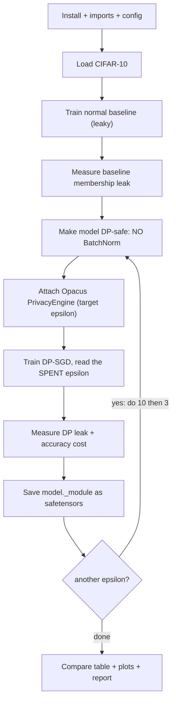

# DP-SGD - Cheatsheet

*HTB Academy · AI Privacy · the DP-SGD privacy DEFENSE (CIFAR-10, course pipeline)*

> **How to use this sheet**
> - DP-SGD is a **defense**, not an attack. It stops the membership-inference attack you learned earlier ("was this record in the training set?") by building a model that barely depends on any one person.
> - Run the cells **top to bottom in one Jupyter notebook**. Later cells use names earlier cells made.
> - **[INPUT NEEDED]** = replace every `<<LIKE_THIS>>` first. **[just run]** = run it as it is.
> - **Privacy budget (epsilon)** = one number for how much the model may leak about any one person. **Smaller = more private.** This is NOT the FGSM epsilon (perturbation size) - different meaning entirely.
> - **No math on this sheet.** Every idea is one plain-English line; the real numbers are quoted as facts.

## What DP-SGD does

Keep the normal model, but change **how it's trained**: during each training step, (1) **clip** every example's gradient so no single record can push the model much, and (2) **add random noise** to the update. Over many steps the finished model is nearly the same whether or not any one person was in the data - so a membership attack can't tell. The library that does the clipping, noising and privacy bookkeeping is **Opacus**.

Three things matter: run the pipeline, read the privacy-vs-accuracy tradeoff, and write it up as a report remediation (name the fix, give the budget with delta, state the accuracy cost).

## The flow



---

## Part A - Setup

## Step 1 - Install

[just run]

**What & why:** the HTB helper library gives the dataset, model and training loops. Opacus is the DP engine. (torchvision and tqdm are needed by the helper library but aren't in its install line.)

```python
# "!" runs a terminal command from inside a Jupyter cell.
!pip install --upgrade git+https://github.com/PandaSt0rm/htb-ai-library
!pip install opacus torchvision tqdm
```

**If it breaks:** in the lab these are often already installed - skip to Step 2. If Step 2 then says a module is missing, run this.

## Step 2 - Imports

[just run]

```python
import os, json
import torch
import torch.optim as optim
from safetensors.torch import save_file # the model-saving format the validator expects

from htb_ai_library import (
    set_reproducibility, use_htb_style,
    CIFAR10CNN, # the model (no BatchNorm on purpose)
    get_cifar10_loaders, # ready-made CIFAR-10 data
    train_baseline_sgd, # normal (non-private) training
    train_dp_sgd, # DP-SGD training (uses an attached Opacus engine)
    evaluate_accuracy, # accuracy, returns a PERCENT (0-100)
    compute_mia_advantage, # membership test (balanced, best threshold)
    plot_accuracy_comparison, plot_privacy_utility_tradeoff,
)
from opacus import PrivacyEngine
from opacus.validators import ModuleValidator # checks/fixes layers DP-SGD can't use
```

**Expected:** no output. An error here = a missing install (Step 1).

## Step 3 - Config + folders

[just run]

**What & why:** one place for every setting. Baseline and DP models share the **same** epochs, batch size and learning rate on purpose, so any accuracy difference is caused by the privacy, not the setup.

```python
RANDOM_SEED = 1337
BATCH_SIZE = 256
BASELINE_EPOCHS = <<EPOCHS>> # course used 20
BASELINE_LR = 0.1
DP_EPOCHS = <<EPOCHS>> # MUST match the epochs you pass to training in Step 7
DP_LR = 0.1
MAX_GRAD_NORM = 1.0 # the clip: how much any one example may influence an update
DELTA = 1e-5 # the "tiny failure chance"; keep well below 1 / number-of-training-images

set_reproducibility(RANDOM_SEED)
use_htb_style()
device = torch.device('cuda' if torch.cuda.is_available() else 'cpu')

# The course forgets to define these three names and later crashes - define them here.
FIGS_DIR, OUTPUT_DIR, MODELS_DIR = "figs", "output", "models"
for d in (FIGS_DIR, OUTPUT_DIR, MODELS_DIR):
    os.makedirs(d, exist_ok=True)
print("device:", device)
```

**fill in:** `<<EPOCHS>>` (both lines) = training passes. **Course: `20`.** On a slow CPU `10` is fine (DP-SGD is 2-5× slower than normal training). ==Keep both equal, and keep DP_EPOCHS equal to the `epochs=` you pass in Step 7.==

**Expected:** `device: cuda` (or `cpu`).

## Step 4 - Load CIFAR-10

[just run]

**What & why:** 60,000 colour images (32×32), 10 classes. **Keep this plain `train_loader` - you need it for a fair membership test later.**

```python
train_dataset, test_dataset, train_loader, test_loader = get_cifar10_loaders(
    batch_size=BATCH_SIZE, download=True)
print(f"train {len(train_dataset)} | test {len(test_dataset)} | batch {BATCH_SIZE}")
```

**If it's slow:** CIFAR-10 downloads from a slow server. If you already have the `cifar-10-batches-py` folder, pass `data_root="<<PATH>>"` (the folder that *contains* it) to skip the download.

**Expected:** `train 50000 | test 10000 | batch 256`.

---

## Part B - The leaky baseline

## Step 5 - Train the baseline + measure its leak

[just run]

**What & why:** a normal model with no privacy. It overfits (memorizes training images), which is exactly what a membership attack exploits. This is the "before" picture.

```python
baseline_model = CIFAR10CNN().to(device) # 3 conv blocks + 2 dense layers, NO BatchNorm
baseline_model = train_baseline_sgd(baseline_model, train_loader, device,
                                    epochs=BASELINE_EPOCHS, learning_rate=BASELINE_LR)

train_acc_baseline = evaluate_accuracy(baseline_model, train_loader, device) # percent 0-100
test_acc_baseline = evaluate_accuracy(baseline_model, test_loader, device)
print(f"baseline train {train_acc_baseline:.2f}% test {test_acc_baseline:.2f}% "
      f"gap {train_acc_baseline - test_acc_baseline:.2f} points")

# membership test: balanced 10k vs 10k, best of 1000 thresholds
mia_acc_baseline, mia_adv_baseline = compute_mia_advantage(baseline_model, train_loader, test_loader, device)
print(f"baseline MIA advantage {mia_adv_baseline:.4f} (0 = no leak)")

torch.save(baseline_model.state_dict(), f"{OUTPUT_DIR}/baseline_model.pth")
```

**Expected (course):** `train ~77% test 67.13% gap ~10 points`, `MIA advantage ~0.019`.

**Read it:** the **overfitting gap (train minus test) is the memorization signal.** `compute_mia_advantage` reports **accuracy − 0.5** on a balanced pool (0.5 = a coin flip); many papers call "advantage" twice that, so say which you mean in a report.

> **Honest note - the "noise floor":** best-of-1000 thresholds on 10k-vs-10k means a model that leaks **nothing** still scores about **0.004** advantage by luck (up to ~0.008). So 0.019 is real leakage, but anything near 0.004 later is "no measurable leak", not "a tiny leak."

---

## Part C - Train DP-SGD

## Step 6 - DP-safe model + attach the privacy engine

[INPUT NEEDED]

**What & why:** three changes make training private: (1) make the model DP-safe, (2) fresh optimizer, (3) wrap model+optimizer+data with Opacus and give it the **target budget**. Opacus works out the noise.

```python
TARGET_EPSILON = <<TARGET_EPSILON>> # run the whole DP section with 10.0 first, then again with 3.0

_, _, train_loader_dp, test_loader_dp = get_cifar10_loaders(batch_size=BATCH_SIZE, download=False)

dp_model = CIFAR10CNN().to(device)
dp_model = ModuleValidator.fix(dp_model) # swaps any DP-UNSAFE layer (e.g. BatchNorm) for a safe one
print("remaining DP problems (want []):", ModuleValidator.validate(dp_model, strict=False))

optimizer_dp = optim.SGD(dp_model.parameters(), lr=DP_LR, momentum=0.9)
privacy_engine = PrivacyEngine(accountant="rdp") # "rdp" = the tight privacy-accounting method
dp_model, optimizer_dp, train_loader_dp = privacy_engine.make_private_with_epsilon(
    module=dp_model, optimizer=optimizer_dp, data_loader=train_loader_dp,
    target_epsilon=TARGET_EPSILON, target_delta=DELTA,
    epochs=DP_EPOCHS, max_grad_norm=MAX_GRAD_NORM,
)
print("noise multiplier Opacus chose:", round(optimizer_dp.noise_multiplier, 3))
```

**fill in:** `<<TARGET_EPSILON>>` = `10.0`, then rerun this section with `3.0`. Smaller epsilon = more private = more noise = lower accuracy.

**Expected:** `remaining DP problems (want []): []`, then a noise multiplier (CIFAR-10 at 20 epochs: ~**0.53** at epsilon 10, ~**0.76** at epsilon 3).

> **Honest notes:** (1) the course claims noise multipliers of 1.2 / 3.8 - those don't match a standard setup; trust what `optimizer_dp.noise_multiplier` prints. (2) **Epsilon depends on the noise amount, the data/batch ratio, the number of steps and delta - NOT on the clip value `MAX_GRAD_NORM`.** A bad clip only costs accuracy. (3) **No BatchNorm** because it mixes examples within a batch and can't be clipped per-example; `ModuleValidator.fix` swaps it for GroupNorm. `CIFAR10CNN` already avoids it, so `.fix` is a no-op here, but always keep the call.

## Step 7 - Train privately + read the SPENT budget

[INPUT NEEDED]

**What & why:** the loop is the ordinary one - it's private only because the optimizer is the wrapped one. It prints the budget being **spent** and returns the final spent value.

```python
dp_model, final_epsilon = train_dp_sgd(
    dp_model, train_loader_dp, privacy_engine, optimizer_dp, device,
    epochs=<<EPOCHS>>, # pass explicitly - must equal DP_EPOCHS
    delta=DELTA,
)
print(f"FINAL spent privacy: (epsilon {final_epsilon:.2f}, delta {DELTA})")

train_acc_dp = evaluate_accuracy(dp_model, train_loader_dp, device)
test_acc_dp = evaluate_accuracy(dp_model, test_loader_dp, device)
print(f"DP train {train_acc_dp:.2f}% test {test_acc_dp:.2f}% gap {train_acc_dp - test_acc_dp:.2f} points")
```

**fill in:** `<<EPOCHS>>` = the **same** number as `DP_EPOCHS`. ==Leave `epochs=`/`delta=` off and the loop silently defaults to 20 / 1e-5; if you trained a different number, the noise was sized wrong and your real epsilon ends up HIGHER than the target.==

**Expected (course):** epsilon 10 -> `train 61.24% test 58.15% gap 3.09`; epsilon 3 -> `train 54.12% test 53.01% gap 1.11`. **The gap shrinking (10 -> 3 -> 1) is the clearest proof it worked.**

## Step 8 - Measure the DP leak + save

[INPUT NEEDED]

**What & why:** repeat the membership test on the private model, then save it. **Save with `._module` to strip Opacus's wrapper - otherwise every weight name gets a `_module.` prefix and a plain `CIFAR10CNN` (or a validator) can't load it.**

```python
mia_acc_dp, mia_adv_dp = compute_mia_advantage(dp_model, train_loader_dp, test_loader_dp, device)
print(f"DP MIA advantage {mia_adv_dp:.4f} (baseline {mia_adv_baseline:.4f}) | "
      f"accuracy cost {test_acc_baseline - test_acc_dp:.2f} points")

tag = str(TARGET_EPSILON).replace('.', '')
torch.save(dp_model._module.state_dict(), f"{OUTPUT_DIR}/dp_model_eps{tag}.pth")
save_file(dp_model._module.state_dict(), f"{MODELS_DIR}/dp_model.safetensors") # the file a validator expects
print(f"saved {MODELS_DIR}/dp_model.safetensors")
```

**fill in:** nothing, but the course submits the **epsilon=10** model (keeps accuracy above 50% with a low leak). Save whichever you want graded as `dp_model.safetensors`.

**Expected (course, epsilon 10):** advantage ~0.008 (at/below the noise floor - no measurable leak), accuracy cost ~9 points.

---

## Part D - Compare and report

## Step 9 - Table + plots + results file

[just run] (after BOTH epsilon runs)

```python
results = {
    "baseline": {"test_acc": test_acc_baseline, "mia_adv": mia_adv_baseline, "epsilon": "inf"},
    "dp_eps10": {"test_acc": <<TEST10>>, "mia_adv": <<ADV10>>, "epsilon": <<EPS10>>},
    "dp_eps3": {"test_acc": <<TEST3>>, "mia_adv": <<ADV3>>, "epsilon": <<EPS3>>},
    "delta": DELTA, # the course's results file leaves delta out - include it
}
print(f"{'model':<12}{'test acc':>10}{'MIA adv':>10}{'epsilon':>10}")
for k, v in results.items():
    if isinstance(v, dict):
        print(f"{k:<12}{v['test_acc']:>10.2f}{v['mia_adv']:>10.4f}{str(v['epsilon']):>10}")
with open(f"{OUTPUT_DIR}/results.json", "w") as f:
    json.dump(results, f, indent=2)

plot_accuracy_comparison(test_acc_baseline, <<TEST10>>, <<TEST3>>, save_path=f"{FIGS_DIR}/dp_accuracy.png")
plot_privacy_utility_tradeoff(test_acc_baseline, <<TEST10>>, <<TEST3>>,
                              mia_adv_baseline, <<ADV10>>, <<ADV3>>, <<EPS10>>, <<EPS3>>,
                              save_path=f"{FIGS_DIR}/dp_tradeoff.png")
from IPython.display import Image, display # these plotters save+close; nothing shows inline without this
display(Image(f"{FIGS_DIR}/dp_accuracy.png")); display(Image(f"{FIGS_DIR}/dp_tradeoff.png"))
```

**fill in:** `<<TEST10>>`, `<<ADV10>>`, `<<EPS10>>` and the `3` versions = the numbers you printed in Steps 7-8 (e.g. `TEST10=58.15, ADV10=0.008, EPS10=10.00`).

**Expected table (course):**

| Model | Test acc | MIA adv | Epsilon |
|---|---|---|---|
| baseline | ~67% | 0.019 | inf |
| DP eps 10 | ~58% | 0.008 | 10.00 |
| DP eps 3 | ~53% | 0.004 | 3.00 |

**Reading the tradeoff plot:** x-axis is often **inverted** (stronger privacy on the right), baseline drawn at a stand-in epsilon (like 100) for "infinite". Lower epsilon = lower accuracy AND lower leak. Once the advantage hits the ~0.004 noise floor, more noise buys no measurable extra privacy but keeps costing accuracy.

---

## Part E - Writing it up in the report

**Finding:** Membership inference against [model]. CWE-359 (Exposure of Private Personal Information), or CWE-200.

**Root cause (one line):** the model overfits its training data (train-minus-test gap of X points), so it is more confident on records it memorized; the attack beat a coin flip by X.

**Remediation - short / medium / long:**
- **Short (cheap):** return labels/top-k only, early stopping, weight decay, more data. These **reduce** the leak but don't eliminate it.
- **Medium (the real fix):** retrain with **DP-SGD** (Opacus). Give the target + spent **epsilon**, **delta** (below 1/dataset-size), the clip value, noise multiplier, epochs and accountant (RDP); and the **accuracy cost in points**.
- **Long:** pretrain on public data (lets you use a smaller epsilon), and audit the membership leak (AUC / low-FPR) in CI.

**Always:** quote **epsilon WITH delta**, and back it with a before/after membership number on a **balanced** pool. Note what DP does **not** cover: individual records only - not aggregate patterns, model stealing, or adversarial examples.

---

## If you remember nothing else

## DP-SGD in 4 lines

1. Keep the normal model but make it **DP-safe** (no BatchNorm; `ModuleValidator.fix`).
2. Attach an Opacus **`PrivacyEngine`** with a **target epsilon**; it clips each example's gradient and adds noise.
3. Train through the wrapped optimizer, then read the **spent** epsilon.
4. Measure the membership leak before and after on a balanced pool; report epsilon-with-delta and the accuracy cost.

## The core from memory

```python
dp_model = ModuleValidator.fix(CIFAR10CNN().to(device)) # 1) DP-safe model (no BatchNorm)
opt = optim.SGD(dp_model.parameters(), lr=0.1, momentum=0.9)
pe = PrivacyEngine(accountant="rdp")
dp_model, opt, loader = pe.make_private_with_epsilon( # 2) wrap model+opt+data, target epsilon
    module=dp_model, optimizer=opt, data_loader=loader,
    target_epsilon=10.0, target_delta=1e-5, epochs=20, max_grad_norm=1.0)
dp_model, spent_eps = train_dp_sgd(dp_model, loader, pe, opt, device, epochs=20, delta=1e-5) # 3) train
save_file(dp_model._module.state_dict(), "models/dp_model.safetensors") # ._module strips the wrapper
```

## Must-know facts

- **DP-SGD works by clipping each example's gradient to a fixed cap (`max_grad_norm`) and adding Gaussian noise to every update**, so the finished model barely depends on any one person. Opacus does the clipping, noising and accounting.
- ==The privacy budget is epsilon (smaller = more private); always reported with delta, and delta must be kept well below 1 / dataset-size== (1e-5 for CIFAR-10's 50,000 images). Epsilon alone is not a complete claim.
- **Epsilon depends on the noise amount, sampling ratio, number of steps and delta - NOT on the clip value.** A bad clip only costs accuracy. Read the **spent** epsilon (what `train_dp_sgd` returns), not the target, and pass `epochs=`/`delta=` or the loop defaults to 20/1e-5 and your real epsilon overshoots.
- **DP-SGD needs a BatchNorm-free model** (BatchNorm mixes examples and can't be clipped per-example); `ModuleValidator.fix` swaps it for GroupNorm.
- **Save with `model._module.state_dict()`** or the weight names keep Opacus's `_module.` prefix and won't load into a plain model or a validator.
- **The overfitting gap shrinking (10 -> 3 -> 1 points for baseline / eps 10 / eps 3) is the sturdiest evidence it worked**; the membership advantage at eps 3 (~0.004) is already at the luck floor, so quote AUC/balanced accuracy, never raw accuracy on an imbalanced pool.
- **Course numbers: baseline ~67% test / 0.019 advantage; eps 10 -> ~58% / 0.008 (≈9-pt cost); eps 3 -> ~53% / 0.004 (≈14-pt cost).** Stronger privacy = less leak = less accuracy, with diminishing privacy returns.
- **Method point:** **pick the largest epsilon (least noise) whose measured leak is already at the noise floor and that still meets the accuracy target**; report epsilon-with-delta, the accuracy cost in points, the before/after leak, and note DP doesn't cover aggregate patterns, model theft or evasion.
