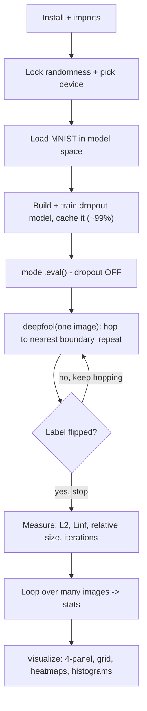

# DeepFool - Exam Cheatsheet

*HTB Academy · AI Evasion · DeepFool part (Sections 14-21)*

> **How to use this sheet**
> - Run the cells **top to bottom in one Jupyter notebook**. Later cells reuse names earlier cells made.
> - **🔵 INPUT NEEDED** = fill every `<<LIKE_THIS>>` before running.
> - **⚪ no input needed - just run** = run it as it is.
> - This sheet has **no math**. Where the real algorithm uses a formula, you get one plain-English line instead.
> - Images here live in **model space** (the shifted, rescaled values the model sees). Convert any size to normal pixels by **multiplying by 0.3081**.

## What this module does

DeepFool is the "how little does it take?" attack. Instead of picking a budget and pushing hard like FGSM, it finds the **smallest change that makes the model change its mind**, measured as overall size (L2). It works by repeatedly guessing the straight-line shortest hop to the nearest class boundary, taking that hop, re-checking, and stopping the instant the label flips. The size it lands on is a **robustness measurement**: a small number means the image sat close to a boundary, a big number means it was hard to fool.



---

## Part A - Setup

## Step 1 - Install the HTB library

⚪ no input needed - just run

Installs HTB's helper library (the dataset loader, the dropout model, training, the display converter, the plot colours).

```python
# "!" runs a terminal command from inside a notebook cell.
# --upgrade replaces an older copy if one is already there.
!pip install --upgrade git+https://github.com/PandaSt0rm/htb-ai-library
```

**If it breaks:** no internet in the lab usually means the library is already installed, so skip to Step 2. If Step 2 then says `No module named 'htb_ai_library'`, you really do need this install.

## Step 2 - Imports

⚪ no input needed - just run

Loads everything the sheet uses. This DeepFool model is `MNISTClassifierWithDropout`, plus three caching helpers, plus the function-typing label `Tuple`.

```python
import os # file paths, making folders
from typing import Tuple # just a label for the function's return (no effect on results)
import numpy as np # number arrays and averages
import torch # tensors (number grids) + gradients
from torch import nn # neural-network building blocks
import torch.nn.functional as F # softmax, for reading confidence
import matplotlib.pyplot as plt # plotting

# HTB helpers
from htb_ai_library import (
    set_reproducibility, # locks randomness so every run matches
    MNISTClassifierWithDropout, # the victim model (has dropout)
    get_mnist_loaders, # ready-made MNIST train/test data
    train_model, # trains the model
    evaluate_accuracy, # measures clean accuracy
    save_model, # writes a trained model to disk
    load_model, # reads one back
    analyze_model_confidence, # right-vs-wrong confidence summary
    mnist_denormalize, # model space -> normal 0..1 pixels (for display)
)

# HTB plot colours
from htb_ai_library import (
    HTB_GREEN, NODE_BLACK, HACKER_GREY, WHITE,
    AZURE, NUGGET_YELLOW, MALWARE_RED, VIVID_PURPLE, AQUAMARINE
)
```

**Expected:** no output. An error here means the install (Step 1) is missing something.

## Step 3 - Lock randomness + pick the device

⚪ no input needed - just run

Fixes the seed so results repeat, and picks the GPU if there is one.

```python
set_reproducibility(1337) # same "random" numbers every run
device = torch.device('cuda' if torch.cuda.is_available() else 'cpu')
print(device)
```

**Expected:** `cpu` or `cuda`. Either is fine.

## Step 4 - Build, train and cache the victim model

⚪ no input needed - just run

Trains `MNISTClassifierWithDropout` for 5 passes (about 99% accurate) the first time, and on later runs just loads the saved copy instead of retraining. **Dropout needs more passes than the FGSM model did, so 5 instead of 1.**

```python
model_path = 'output/mnist_model.pth' # where the trained model is cached
os.makedirs('output', exist_ok=True) # make the output folder if missing

model = None # "no usable model yet" flag

# Try to reuse a cached model
if os.path.exists(model_path):
    data = load_model(model_path) # read the saved dictionary
    model = data['model'].to(device)
    model.eval() # dropout OFF for a fair accuracy check
    _, test_loader = get_mnist_loaders(batch_size=100, normalize=True)
    acc = evaluate_accuracy(model, test_loader, device)
    print(f"Cached model accuracy: {acc:.2f}%")
    if acc < 90.0: # reject a bad cache
        model = None

# Train only if there's no good cache
if model is None:
    train_loader, test_loader = get_mnist_loaders(batch_size=64, normalize=True)
    model = MNISTClassifierWithDropout().to(device)
    model = train_model(model, train_loader, test_loader, epochs=5, device=device)
    acc = evaluate_accuracy(model, test_loader, device)
    print(f"Trained to: {acc:.2f}%")
    save_model({ # cache it as a dictionary
        'model': model,
        'architecture': 'MNISTClassifierWithDropout',
        'accuracy': acc,
        'training_config': {'epochs': 5, 'batch_size': 64, 'device': str(device)}
    }, model_path)

model.eval() # ALWAYS end in eval mode before attacking
print("training mode?", model.training) # must print False
```

**Expected:** an accuracy near 98.9%, then `training mode? False`.

**Options - which batch path runs:**
- **If** a good cached model exists → the load branch runs, so `train_loader` is **never created**. Fine, nothing below needs it.
- **If** not (first run, or accuracy below 90%) → it trains and saves.

> **If this errors:** on newer PyTorch, loading a whole saved model can fail with an "unpickling" or "weights only" error. Fixes: delete `output/mnist_model.pth` and let it retrain, or update the library. **Only ever load model files you made yourself** - loading an untrusted `.pth` can run hidden code (a real supply-chain attack).

> **Why `model.eval()` matters here:** dropout randomly switches neurons off. In training mode the model gives a different answer every time, so the attack would read random, useless gradients. `eval()` turns dropout off and makes the gradients stable.

## Step 5 - (optional) Check the model's confidence

⚪ no input needed - just run

A healthy model is very sure when right (~0.99) and unsure when wrong (~0.6-0.7).

```python
_, test_loader = get_mnist_loaders(batch_size=100, normalize=True)
stats = analyze_model_confidence(model, test_loader, device=device, num_samples=1000)
for k, v in stats.items():
    print(k, ":", v)
```

**Expected:** about 99% accuracy with mean confidence near 0.99 on correct predictions. Remember: **high confidence does NOT mean far from a boundary**, which is exactly what DeepFool goes on to show.

---

## Part B - The attack (define once, then reuse)

## Step 6 - The DeepFool function

⚪ no input needed - just run

This is the whole attack in one function. Plain-English version of what it does: for one image, it looks at every other class, works out which class's boundary is the **shortest hop** away, hops there, re-checks the prediction, and repeats until the label changes. The small **overshoot** (2%) makes sure it lands just past the boundary rather than exactly on it. Keep this cell intact.

```python
def deepfool(image, net, num_classes=10, overshoot=0.02, max_iter=50, device='cuda'):
    """
    Minimal-perturbation attack on ONE image.

    image: a single image, shape (1, C, H, W)
    net: the target model, already in eval mode
    num_classes: how many top classes to consider (10 = all, for MNIST)
    overshoot: how far past the boundary to step (2% is standard)
    max_iter: give up after this many hops
    Returns: (total_change, hops_used, original_class, final_class, attacked_image)
    """
    image = image.to(device)
    net = net.to(device)

    # Rank the classes by score at the start (highest first). label = the top one.
    f_image = net(image).data.cpu().numpy().flatten()
    I = f_image.argsort()[::-1] # class numbers, best score first
    label = I[0] # the model's original prediction

    pert_image = image.clone() # the image we keep nudging
    r_tot = torch.zeros(image.shape).to(device) # running total of all hops
    loop_i = 0 # hop counter

    while loop_i < max_iter:
        x = pert_image.clone().requires_grad_(True) # track slopes for the pixels
        fs = net(x) # fresh scores at this point
        k_i = fs.data.cpu().numpy().flatten().argsort()[::-1][0] # top class now

        if k_i != label: # STOP as soon as the label flips
            break

        pert = float('inf') # smallest distance so far (start huge)
        w = None # direction of the closest boundary

        # Check each rival class; keep the closest boundary.
        for k in range(1, num_classes):
            if I[k] == label:
                continue

            if x.grad is not None:
                x.grad.zero_() # clear old slopes
            fs[0, I[k]].backward(retain_graph=True) # slopes of the rival's score
            grad_k = x.grad.data.clone()

            if x.grad is not None:
                x.grad.zero_()
            fs[0, label].backward(retain_graph=True) # slopes of the current class's score
            grad_label = x.grad.data.clone()

            # Direction that lifts the rival while lowering the current class, and the gap to close.
            w_k = grad_k - grad_label
            f_k = (fs[0, I[k]] - fs[0, label]).data.cpu().numpy()
            # Distance to this boundary = gap divided by how fast that direction closes it.
            pert_k = abs(f_k) / (torch.norm(w_k.flatten()) + 1e-10)

            if pert_k < pert: # closer than anything seen -> remember it
                pert = pert_k
                w = w_k

        # Hop exactly to the closest boundary (the tiny +1e-4 avoids a zero-size hop).
        r_i = (pert + 1e-4) * w / (torch.norm(w.flatten()) + 1e-10)
        r_tot = r_tot + r_i

        # Rebuild the attacked image from the ORIGINAL plus the total, with a 2% overshoot.
        pert_image = image + (1 + overshoot) * r_tot
        loop_i += 1

    return r_tot, loop_i, label, k_i, pert_image
```

**How to call it:** one image of shape `(1, C, H, W)`, model in eval mode, and pass `device=device`. It returns five things in this order: total change, hops used, original class, final class, attacked image.

> **If this errors:**
> - `NameError: Tuple` → add `from typing import Tuple` (Step 2 has it).
> - `AssertionError: Torch not compiled with CUDA` → you're on CPU; pass `device=device` and make sure Step 3 picked `cpu`.
> - weird results → you passed a whole batch. Use one image: `imgs[0:1]` (keeps the batch dimension), not `imgs[0]`.

> **Two gaps to know (the course's code leaves these out):**
> - It **never clips to a valid image**, so pixels can drift slightly past pure black/white. Fine for measuring; clip if you need a submittable image.
> - If it runs out of hops (`max_iter`), the returned final class can be **stale**. Always re-check the prediction on the returned image yourself (Step 8).

---

## Part C - Run it on one image

## Step 7 - Pick one image and attack it

🔵 INPUT NEEDED

Grabs a single test image and runs the attack.

```python
_, test_loader = get_mnist_loaders(batch_size=1, normalize=True) # one image per batch
image, true_label = next(iter(test_loader)) # the first test image (a 7)
image = image.to(device)

model.eval() # dropout OFF (required)
r_total, iterations, orig_label, adv_label, pert_image = deepfool(
    image, model, num_classes=10, overshoot=<<OVERSHOOT>>, max_iter=50, device=device
)
print(f"{orig_label} -> {adv_label} in {iterations} hops")
```

**fill in:** `<<OVERSHOOT>>` = how far past the boundary to step.
- **If** you just want a reliable flip → `0.02` (**pick this**, the standard).
- **If** a flip keeps collapsing after you clip the image → `0.05` (a bigger cushion).

**Expected:** something like `7 -> 2 in 4 hops`. Well-separated digits take 1-3 hops; look-alike ones take 4-6.

## Step 8 - Measure the change, and re-check it yourself

⚪ no input needed - just run

Measures the size three ways and confirms the flip independently of the function's own answer.

```python
with torch.no_grad(): # just reading, no attack here
    final_pred = model(pert_image).argmax(dim=1).item()
    adv_conf = F.softmax(model(pert_image), dim=1).max().item()

delta = pert_image - image # the REAL change (includes the 2% overshoot)
l2_model = delta.norm().item() # overall size, model space
linf_model = delta.abs().max().item() # biggest single-pixel change, model space
relative = l2_model / image.norm().item() # change as a fraction of the image

print(f"re-checked prediction: {final_pred} (function said {adv_label})")
print(f"L2 : {l2_model:.4f} model = {l2_model*0.3081:.4f} pixel")
print(f"Linf: {linf_model:.4f} model = {round(linf_model*0.3081*255)}/255 pixel")
print(f"relative size: {relative:.2%}")
print(f"confidence of the NEW class: {adv_conf:.3f}")
```

**Expected (for the first 7):** re-checked prediction 2, L2 about 7.72 model space (about 2.38 pixel), relative about 32%, new-class confidence about 0.40.

> **Reading the confidence:** that number is the probability of the **new** class, not a pass/fail threshold. With 10 classes there is no "0.5 line"; the prediction is just whichever class scores highest. A narrow win (new class ~0.40, old class close behind) is exactly what a minimal attack should produce.

## Step 9 - (optional) Clip to a valid image and confirm it still fools

🔵 INPUT NEEDED

DeepFool doesn't clip, so do it yourself if you need a real, valid image.

```python
clipped = pert_image.clamp(<<LOW>>, <<HIGH>>) # force pixels into the valid range
with torch.no_grad():
    print("after clipping:", model(clipped).argmax(dim=1).item(), "| original:", orig_label)
```

**fill in:** `<<LOW>>`, `<<HIGH>>` = the valid range for your image space.
- **If** images are in model space (normalized, as here) → `-0.424`, `2.821`.
- **If** you converted to plain pixels → `0.0`, `1.0`.

**Expected:** usually still the adversarial class. If it snaps back to the original, re-run Step 7 with a bigger overshoot (0.05).

---

## Part D - Run it on many images

## Step 10 - Batch loop: attack N images, store each result

🔵 INPUT NEEDED

Attacks the first N test images one at a time (DeepFool only handles one image at a time) and saves each outcome in a list.

```python
num_examples = <<N>> # how many images to attack
_, test_loader = get_mnist_loaders(batch_size=1, normalize=True)
model.eval()

results = [] # one dictionary per image
for idx, (data, target) in enumerate(test_loader):
    if idx >= num_examples:
        break
    data = data.to(device)
    r, iters, orig, adv, p_img = deepfool(data, model, num_classes=10,
                                          overshoot=0.02, max_iter=50, device=device)
    results.append({
        'original_image': data.cpu(), # move to CPU to save GPU memory
        'perturbation': r.cpu(),
        'perturbed_image': p_img.cpu(),
        'original_label': orig, # the model's prediction (not the true label)
        'adversarial_label': adv,
        'true_label': target.item(),
        'iterations': iters,
        'l2_norm': torch.norm(r.cpu()).item(),
        'success': (orig != adv) # did the prediction change
    })
    print(f" {idx+1}: true={target.item()} {orig}->{adv} iters={iters} L2={torch.norm(r.cpu()).item():.3f}")
```

**fill in:** `<<N>>` = number of images.
- **If** you just want a quick demo → `20` (runs in a second or two).
- **If** you want trustworthy averages for a report → `100` or more (slower, better stats).

**Expected:** one line per image. Sizes vary a lot (roughly 0.6 to 7.7 on MNIST) and most images take 2-4 hops.

## Step 11 - Summarize the batch

⚪ no input needed - just run

Prints the headline numbers and the most common class flips.

```python
l2s = np.array([r['l2_norm'] for r in results])

# Success rate the proper way: only count images the model got RIGHT to begin with.
correct = [r for r in results if r['original_label'] == r['true_label']]
flipped = [r for r in correct if r['success']]
rate = len(flipped) / len(correct) if correct else 0

print(f"success (on originally-correct): {len(flipped)}/{len(correct)} = {rate:.1%}")
print(f"L2 mean {l2s.mean():.3f} | median {np.median(l2s):.3f} | min {l2s.min():.3f} | max {l2s.max():.3f}")
print(f"L2 mean in pixel space: {l2s.mean()*0.3081:.3f}")
print(f"avg hops: {np.mean([r['iterations'] for r in results]):.1f}")

# Which digit->digit flips happen most
from collections import Counter
flips = Counter(f"{r['original_label']}->{r['adversarial_label']}" for r in results if r['success'])
print("most common flips:", flips.most_common(5))
```

**Expected:** a success rate near 100%, mean L2 around 4-5 model space, and look-alike flips (like 9->4) near the top. **For DeepFool the size matters, not the success rate** - it almost always succeeds because it has no budget cap.

---

## Part E - Visualize

## Step 12 - Four-panel view of one attack

⚪ no input needed - just run (uses Step 7's result)

Shows the original, the change (amplified so you can see it), a heatmap of where it changed, and the attacked image.

```python
orig_img = mnist_denormalize(image.squeeze()).cpu().numpy() # back to 0..1 for display
adv_img = mnist_denormalize(pert_image.squeeze()).cpu().numpy()
pert = r_total.cpu().squeeze().numpy() # the raw change
pert_disp = pert - pert.min() # shift lowest to 0
if pert_disp.max() > 0:
    pert_disp = pert_disp / pert_disp.max() # stretch to 0..1 (display only)

fig, ax = plt.subplots(1, 4, figsize=(15, 5), facecolor=NODE_BLACK)
for a in ax:
    a.set_facecolor(NODE_BLACK); a.axis('off')

ax[0].imshow(orig_img, cmap='gray', vmin=0, vmax=1)
ax[0].set_title(f"Original: {orig_label}", color=HTB_GREEN, fontweight='bold')
ax[1].imshow(pert_disp, cmap='inferno')
ax[1].set_title("Change (amplified)", color=NUGGET_YELLOW, fontweight='bold')
im = ax[2].imshow(np.abs(pert), cmap='viridis') # size of change per pixel
ax[2].set_title(f"Magnitude\nL2: {r_total.norm().item():.2f}", color=AZURE, fontweight='bold')
plt.colorbar(im, ax=ax[2], fraction=0.046)
ax[3].imshow(adv_img, cmap='gray', vmin=0, vmax=1)
ax[3].set_title(f"Adversarial: {adv_label}", color=HTB_GREEN, fontweight='bold')

plt.suptitle("DeepFool Attack", color=HTB_GREEN, fontsize=14, fontweight='bold')
plt.tight_layout(); plt.show()
```

**Reading it:**

| Panel | What to look for |
|---|---|
| Original | the starting digit |
| Change (amplified) | in this colour map, **zero change is the MIDDLE colour, not the darkest**; bright = brightened, dark = darkened |
| Magnitude | brightness = how much each pixel moved; the colour-bar top ≈ the biggest single-pixel change |
| Adversarial | the fooled digit; on MNIST the change is often **visible**, since even a "minimal" L2 is a real pixel change here |

## Step 13 - Grid of many originals vs adversarials

⚪ no input needed - just run (uses Step 10's `results`)

Pairs up the first 10 results, original on top, adversarial below.

```python
n = min(10, len(results))
fig, axes = plt.subplots(4, 5, figsize=(15, 12), facecolor=NODE_BLACK)
for a in axes.flatten():
    a.set_facecolor(NODE_BLACK); a.axis('off')

for i in range(n):
    r, c = i // 5, i % 5 # which row-pair, which column
    top = mnist_denormalize(results[i]['original_image'].squeeze()).numpy()
    bot = mnist_denormalize(results[i]['perturbed_image'].squeeze()).numpy()
    axes[r*2, c].imshow(top, cmap='gray', vmin=0, vmax=1)
    axes[r*2, c].set_title(f"Orig: {results[i]['original_label']}", color=HTB_GREEN, fontsize=10)
    colour = MALWARE_RED if results[i]['success'] else HACKER_GREY # red = flipped
    axes[r*2+1, c].imshow(bot, cmap='gray', vmin=0, vmax=1)
    axes[r*2+1, c].set_title(f"Adv: {results[i]['adversarial_label']}", color=colour, fontsize=10)

plt.suptitle("DeepFool: original vs adversarial", color=HTB_GREEN, fontsize=16)
plt.tight_layout(); plt.show()
```

**Reading it:** flips land on **look-alike digits** (9↔4, 1→7, 5→6) because DeepFool always goes to the nearest boundary, and the noise clusters on the strokes, not the background.

## Step 14 - (optional) Distribution charts

⚪ no input needed - just run (uses Step 10's `results`)

Histograms of size and hops, so you can see the spread, not just the average.

```python
fig, ax = plt.subplots(1, 2, figsize=(12, 4), facecolor=NODE_BLACK)
for a in ax:
    a.set_facecolor(NODE_BLACK); a.tick_params(colors=WHITE)

ax[0].hist([r['l2_norm'] for r in results], bins=15, color=HTB_GREEN, edgecolor=HACKER_GREY)
ax[0].set_title("Perturbation size (L2)", color=HTB_GREEN); ax[0].set_xlabel("L2", color=WHITE)

iters = [r['iterations'] for r in results]
ax[1].hist(iters, bins=range(1, max(iters)+2), color=AZURE, edgecolor=HACKER_GREY)
ax[1].set_title("Hops needed", color=HTB_GREEN); ax[1].set_xlabel("hops", color=WHITE)

plt.tight_layout(); plt.show()
```

**Reading it:** the size chart is usually **spread out, not clustered** (easy images near the bottom, hard ones far to the right). A bar sitting between whole numbers on the hops chart just means "that many hops".

---

## If you remember nothing else

## The attack in 4 lines

1. Put the model in **eval mode** (dropout OFF) so its gradients are stable. Attack **one image** at a time.
2. DeepFool looks at every other class, finds the **nearest decision boundary**, and takes the exact small hop needed to reach it.
3. It **re-checks** after each hop and **stops the moment the label flips** - no budget, so the final size measures how fragile that image was.
4. A **2% overshoot** nudges it just past the boundary. Then **re-check the prediction yourself**, convert the size to pixel space (× 0.3081), and clip to a valid image if you need to submit it.

## The core from memory

```python
# setup: get_mnist_loaders(normalize=True) -> MNISTClassifierWithDropout -> train 5 epochs -> model.eval()
r_total, iterations, orig, adv, pert_image = deepfool(image, model, device=device) # one image, (1,C,H,W)
delta = pert_image - image
# size = delta.norm() (model space; x 0.3081 = pixel space). re-check: model(pert_image).argmax()
# clip if submitting: pert_image.clamp(-0.424, 2.821)
```

## Must-know facts

- **DeepFool finds the SMALLEST change that flips the label, instead of maximizing damage inside a fixed budget like FGSM.** That makes its perturbation size a robustness **measurement**, fair for comparing models.
- **It optimizes overall size (L2); FGSM optimizes biggest-single-pixel change (L∞).** On the same image DeepFool wins on L2, FGSM wins on L∞. "Minimal" always needs a ruler attached.
- **DeepFool keeps the gradient's relative sizes**, so influential pixels move more; FGSM flattens everything to the same step. That's why DeepFool's change concentrates on the strokes.
- **With many classes it hops to the NEAREST boundary each time, re-choosing every hop.** It's untargeted by nature; the flip lands on whatever class is closest (usually a look-alike digit).
- **The 2% overshoot makes it cross the real boundary, not just touch it**, and is applied to the running total. Without it you'd land exactly on the line (a tie, not a flip).
- **Report robustness as the average relative size (often called rho-adv), in the same image space for every model you compare.** A bigger number = more robust.
- The victim uses **dropout and 5 training epochs**; dropout is a clean-accuracy regularizer, NOT a defence. **`model.eval()` before attacking is mandatory**, or dropout makes the gradients random.
- On MNIST a "minimal" L2 is still a **visible** change (the 7→2 example moved some pixels by about half the brightness range). Minimal in L2 does not mean invisible on high-contrast digits.
- **Count success only over images the model got RIGHT first**, and report the **spread** (median, min, max), because sizes vary over 10× from image to image.
- Framework tie-in: this is **OWASP ML01:2023 Input Manipulation** (an inference-time, white-box attack needing the model's gradients). The follow-on idea, **universal perturbations**, stacks DeepFool steps across many images into one pattern that fools most inputs.
