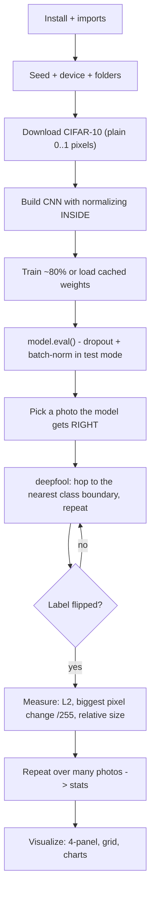

# DeepFool on Real Photos (CIFAR-10) - Exam Cheatsheet

_HTB Academy · AI Evasion · DeepFool part, rebuilt on a real-world colour dataset_

> **How to use this sheet**
> 
> - Run the cells **top to bottom in one Jupyter notebook**. Later cells reuse names earlier cells made.
> - **🔵 INPUT NEEDED** = replace every `<<LIKE_THIS>>` first. A leftover `<<...>>` makes the cell fail on purpose, so you can't forget one.
> - **⚪ no input needed - just run** = run it as it is.
> - **No math here.** Wherever the algorithm uses a formula, you get one plain-English line instead.
> - This sheet does **not** need the HTB library. Everything is built from plain PyTorch, so it also works on a lab machine or a target you don't control.
> - ==All images stay in normal pixels (0 = black, 1 = full brightness).== The model does its own normalizing inside. So every size you print is already in pixel units, and "× 255" turns it into brightness levels.

## What this sheet does

You train a small colour-photo classifier on **CIFAR-10** (planes, cars, birds, cats, deer, dogs, frogs, horses, ships, trucks), then use **DeepFool** to find the **smallest change** that makes it name the wrong object. On real photos that change is usually **too small for a person to see**, which is exactly why this attack matters outside the classroom. The size of the change per photo is your **robustness measurement**.



---

## Part A - Setup

## Step 1 - Install

⚪ no input needed - just run

Makes sure PyTorch, torchvision (datasets) and matplotlib (plots) are present. In most labs they already are, and this does nothing.

```python
# "!" runs a terminal command from inside a notebook cell.
!pip install torch torchvision matplotlib
```

**If it breaks:** no internet usually means they're already installed. Go to Step 2. If Step 2 says `No module named 'torch'`, you do need this.

## Step 2 - Imports

⚪ no input needed - just run

Loads every tool the sheet uses. The HTB colours are used if the library is there; otherwise the same colours are typed in by hand, so plots look the same either way.

```python
import os # folders and file paths
import time # timing the training
import random # Python's random numbers (seeded below)
from collections import Counter, defaultdict # easy counting
import numpy as np # number arrays, averages
import torch # tensors (number grids) + gradients
from torch import nn # neural-network building blocks
import torch.nn.functional as F # loss + softmax
from torch.utils.data import DataLoader # feeds data in batches
from torchvision import datasets, transforms # CIFAR-10 + image converters
import matplotlib.pyplot as plt # plotting

# HTB dark-theme colours (use the library's if installed, otherwise the same hex codes)
try:
    from htb_ai_library import (HTB_GREEN, NODE_BLACK, HACKER_GREY, WHITE,
                                AZURE, NUGGET_YELLOW, MALWARE_RED)
except ImportError:
    HTB_GREEN, NODE_BLACK, HACKER_GREY, WHITE = "#9FEF00", "#141D2B", "#A4B1CD", "#FFFFFF"
    AZURE, NUGGET_YELLOW, MALWARE_RED = "#0086FF", "#FFAF00", "#FF3E3E"
```

**Expected:** no output.

## Step 3 - Seed, device, folders

🔵 INPUT NEEDED

Locks randomness so results repeat, picks the GPU if there is one, and sets where data and the trained model are saved.

```python
SEED = 1337
random.seed(SEED); np.random.seed(SEED); torch.manual_seed(SEED) # same "random" numbers every run

device = torch.device("cuda" if torch.cuda.is_available() else "cpu")
print("device:", device)

DATA_DIR = r"<<DATA_FOLDER>>" # where CIFAR-10 is downloaded (about 170 MB)
OUTPUT_DIR = "output" # where the trained model + figures go
os.makedirs(DATA_DIR, exist_ok=True)
os.makedirs(OUTPUT_DIR, exist_ok=True)
```

**fill in:** `<<DATA_FOLDER>>` = a folder for the download, e.g. `C:\ml_data` or just `./data`.

- **If** you're on your own Windows PC → pick a folder **outside OneDrive** (OneDrive syncing made your GTSRB loading crawl).
- **If** you're on a lab machine → `./data` is fine.

**Expected:** `device: cuda` (or `cpu`, which works, just slower to train).

## Step 4 - Dataset facts

⚪ no input needed - just run

The 10 class names (so output says "cat" instead of "3") and CIFAR-10's average brightness and spread per colour, which the model uses to normalize itself.

```python
CLASSES = ["airplane", "automobile", "bird", "cat", "deer",
           "dog", "frog", "horse", "ship", "truck"] # position = class number

# Average and spread of the training photos, one value per colour (red, green, blue)
CIFAR_MEAN = (0.4914, 0.4822, 0.4465)
CIFAR_STD = (0.2470, 0.2435, 0.2616)
```

**Remember:** class number 3 = "cat", 5 = "dog", 1 = "automobile", 9 = "truck" and so on, in that order.

## Step 5 - Load CIFAR-10

🔵 INPUT NEEDED

Downloads CIFAR-10 (50,000 training photos, 10,000 test photos, each 32×32 in colour) and keeps them as **plain 0..1 pixels**. No normalizing here; the model does that itself.

```python
USE_AUGMENT = <<USE_AUGMENT>> # True or False

if USE_AUGMENT:
    # Small random shifts and mirror flips -> the model learns better
    train_tf = transforms.Compose([
        transforms.RandomCrop(32, padding=4),
        transforms.RandomHorizontalFlip(),
        transforms.ToTensor(), # picture -> numbers 0..1, shape (3, 32, 32)
    ])
else:
    train_tf = transforms.ToTensor()
test_tf = transforms.ToTensor() # test photos are never changed

train_set = datasets.CIFAR10(DATA_DIR, train=True, download=True, transform=train_tf)
test_set = datasets.CIFAR10(DATA_DIR, train=False, download=True, transform=test_tf)

g = torch.Generator().manual_seed(SEED) # repeatable shuffling
train_loader = DataLoader(train_set, batch_size=128, shuffle=True, num_workers=0, generator=g)
test_loader = DataLoader(test_set, batch_size=256, shuffle=False, num_workers=0)

print(len(train_set), "train |", len(test_set), "test | one image:", test_set[0][0].shape)
```

**fill in:** `<<USE_AUGMENT>>` = `True` or `False`.

- **If** you have a GPU and 5-10 minutes → `True` (**pick this**, about 5 points more accurate).
- **If** you're on CPU or in a hurry → `False` (faster per epoch, slightly worse model).

**Expected:** `50000 train | 10000 test | one image: torch.Size([3, 32, 32])`.

> **If it hangs:** keep `num_workers=0`. Anything higher often freezes Jupyter on Windows.

## Step 6 - The model (normalizing built in)

⚪ no input needed - just run

Two pieces in one cell. `Normalize` shifts and rescales each colour inside the model. `CifarCNN` is three pattern-finding blocks then a decision layer, with **batch-norm** (keeps training stable) and **dropout** (fights memorizing). Because the model takes plain 0..1 photos, you can attack it with plain pixel budgets, exactly like a real deployed model that receives image files.

```python
class Normalize(nn.Module):
    """Shift and rescale each colour channel, inside the model."""
    def __init__(self, mean, std):
        super().__init__()
        # Stored on the model so they move to the GPU with it. Shape (1, 3, 1, 1) = one value per colour.
        self.register_buffer("mean", torch.tensor(mean).view(1, 3, 1, 1))
        self.register_buffer("std", torch.tensor(std).view(1, 3, 1, 1))

    def forward(self, x):
        return (x - self.mean) / self.std


class CifarCNN(nn.Module):
    """Small colour-photo classifier: 3 conv blocks -> 256 -> 10 scores."""
    def __init__(self, num_classes=10):
        super().__init__()
        self.norm = Normalize(CIFAR_MEAN, CIFAR_STD)

        def block(c_in, c_out):
            # two 3x3 pattern layers, then halve the picture size, then a little dropout
            return nn.Sequential(
                nn.Conv2d(c_in, c_out, 3, padding=1), nn.BatchNorm2d(c_out), nn.ReLU(),
                nn.Conv2d(c_out, c_out, 3, padding=1), nn.BatchNorm2d(c_out), nn.ReLU(),
                nn.MaxPool2d(2), nn.Dropout(0.25),
            )

        self.features = nn.Sequential(block(3, 32), block(32, 64), block(64, 128)) # 32 -> 16 -> 8 -> 4
        self.classifier = nn.Sequential(
            nn.Flatten(), # 128 x 4 x 4 = 2048 numbers in a row
            nn.Linear(128 * 4 * 4, 256), nn.ReLU(), nn.Dropout(0.5),
            nn.Linear(256, num_classes), # one raw score per class
        )

    def forward(self, x):
        return self.classifier(self.features(self.norm(x)))
```

**Expected:** no output.

## Step 7 - Training and scoring helpers

⚪ no input needed - just run

One function trains for one pass over the data; the other scores accuracy on any loader.

```python
def train_one_epoch(model, loader, optimizer, device):
    """One pass over the training photos. Returns (average loss, train accuracy %)."""
    model.train() # dropout + batch-norm in TRAINING mode
    total, correct, loss_sum = 0, 0, 0.0
    for x, y in loader:
        x, y = x.to(device), y.to(device)
        optimizer.zero_grad() # clear last batch's slopes
        out = model(x) # scores
        loss = F.cross_entropy(out, y) # how wrong
        loss.backward() # slopes for every weight
        optimizer.step() # nudge the weights
        loss_sum += loss.item() * y.size(0)
        correct += (out.argmax(1) == y).sum().item()
        total += y.size(0)
    return loss_sum / total, 100 * correct / total


def evaluate(model, loader, device):
    """Accuracy % on a loader, with the model in test mode."""
    model.eval() # dropout OFF, batch-norm uses saved stats
    correct, total = 0, 0
    with torch.no_grad(): # scoring only, no slopes needed
        for x, y in loader:
            x, y = x.to(device), y.to(device)
            correct += (model(x).argmax(1) == y).sum().item()
            total += y.size(0)
    return 100 * correct / total
```

**Expected:** no output.

## Step 8 - Train once, then reuse the saved weights

🔵 INPUT NEEDED

Trains the model the first time and saves only its **weights** (the safe format). On later runs it just loads them, which takes a second.

```python
EPOCHS = <<EPOCHS>>
MODEL_PATH = os.path.join(OUTPUT_DIR, "cifar_cnn.pth")

model = CifarCNN().to(device)

if os.path.exists(MODEL_PATH):
    # Weights-only file: safe to load (no hidden code can run)
    model.load_state_dict(torch.load(MODEL_PATH, map_location=device))
    print("Loaded cached weights from", MODEL_PATH)
else:
    optimizer = torch.optim.Adam(model.parameters(), lr=1e-3)
    for epoch in range(EPOCHS):
        t0 = time.time()
        loss, train_acc = train_one_epoch(model, train_loader, optimizer, device)
        test_acc = evaluate(model, test_loader, device)
        print(f"epoch {epoch+1}/{EPOCHS} | loss {loss:.3f} | train {train_acc:.1f}% "
              f"| test {test_acc:.1f}% | {time.time()-t0:.0f}s")
    torch.save(model.state_dict(), MODEL_PATH) # save weights only
    print("Saved to", MODEL_PATH)

model.eval() # ALWAYS end in test mode before attacking
clean_acc = evaluate(model, test_loader, device)
print(f"Clean test accuracy: {clean_acc:.2f}% | training mode? {model.training}")
```

**fill in:** `<<EPOCHS>>` = how many passes over the training photos.

- **If** you have a GPU → `10` (**pick this**, about 80-85% accuracy, a few minutes).
- **If** CPU only or just testing that everything runs → `2` (about 60-65%, still fine for practising the attack).

**Expected:** one line per epoch, then something like `Clean test accuracy: 82% | training mode? False`. Your exact number will differ a little.

**Options - retraining:**

- **If** you change the model or the epochs and want a fresh model → delete `output/cifar_cnn.pth` and re-run this cell.
- **Otherwise** leave it, and it reloads instantly.

> **Why this matters for the attack:** CIFAR-10 models are only about 80% accurate, so **one photo in five is already wrong before you attack**. Every success rate below only counts photos the model got right first.

## Step 9 - (optional) Confidence check

⚪ no input needed - just run

Shows how sure the model is when it's right vs wrong.

```python
model.eval()
right, wrong = [], []
with torch.no_grad():
    for x, y in test_loader:
        x, y = x.to(device), y.to(device)
        probs = F.softmax(model(x), dim=1) # scores -> probabilities
        conf, pred = probs.max(dim=1) # top probability + its class
        right += conf[pred == y].tolist()
        wrong += conf[pred != y].tolist()
print(f"mean confidence when RIGHT: {np.mean(right) if right else 0:.3f} ({len(right)} photos)")
print(f"mean confidence when WRONG: {np.mean(wrong) if wrong else 0:.3f} ({len(wrong)} photos)")
```

**Expected:** noticeably higher confidence when right (around 0.9) than when wrong (around 0.6). High confidence still **doesn't mean far from a boundary**, which DeepFool will show.

---

## Part B - The attack (define once, reuse everywhere)

## Step 10 - The DeepFool function

⚪ no input needed - just run

The whole attack in one function. In plain words: for one photo, it checks every other class, works out which one's boundary is the **shortest hop** away (using the slopes of the scores), hops exactly there plus a 2% **overshoot**, re-checks, and repeats until the label changes. This version also fixes the three gaps in the course's version: it puts the model in test mode itself, **keeps pixels in the valid 0..1 range**, and re-checks the final label.

```python
def deepfool(image, net, num_classes=10, overshoot=0.02, max_iter=50, clip=True):
    """
    Smallest change that flips the label of ONE photo.

    image: one photo, shape (1, 3, H, W), pixels 0..1
    net: the model (it normalizes inside)
    num_classes: how many top classes to consider (10 = all for CIFAR-10;
                 use 10 also for 1000-class models to save time)
    overshoot: how far past the boundary to land (0.02 = 2%)
    max_iter: give up after this many hops
    clip: keep pixels between 0 and 1 (True = a valid photo)
    Returns: (total_step, hops_used, original_class, final_class, attacked_photo)
    """
    net.eval() # dropout off, batch-norm in test mode
    device = next(net.parameters()).device
    image = image.to(device)

    # Rank classes by score once at the start. label = the model's original answer.
    with torch.no_grad():
        scores = net(image)[0]
    order = scores.argsort(descending=True) # class numbers, best first
    label = order[0].item()
    rivals = [c.item() for c in order[1:num_classes]]

    r_tot = torch.zeros_like(image) # running total of all hops
    pert_image = image.clone() # the photo we keep nudging
    loop_i = 0

    while loop_i < max_iter:
        x = pert_image.clone().detach().requires_grad_(True) # track slopes for the pixels
        fs = net(x)[0] # fresh scores here
        if fs.argmax().item() != label: # label flipped -> done
            break

        # Slopes of the CURRENT class's score (same for every rival, so do it once)
        grad_label = torch.autograd.grad(fs[label], x, retain_graph=True)[0]

        best_dist, best_dir = float("inf"), None
        for k in rivals:
            grad_k = torch.autograd.grad(fs[k], x, retain_graph=True)[0] # slopes of rival k
            w_k = grad_k - grad_label # direction: lift rival, lower current class
            gap = (fs[k] - fs[label]).item() # how far behind the rival is (negative)
            # distance to this boundary = gap size divided by how fast this direction closes it
            dist = abs(gap) / (w_k.norm().item() + 1e-10)
            if dist < best_dist: # closest boundary so far -> remember it
                best_dist, best_dir = dist, w_k

        # Hop exactly that distance toward the closest boundary
        r_i = (best_dist + 1e-4) * best_dir / (best_dir.norm() + 1e-10)
        r_tot = r_tot + r_i

        # Rebuild from the ORIGINAL photo + total hops, with the 2% overshoot
        pert_image = image + (1 + overshoot) * r_tot
        if clip:
            pert_image = pert_image.clamp(0.0, 1.0) # keep a valid photo
        pert_image = pert_image.detach()
        loop_i += 1

    # Re-check the final answer honestly (also correct if max_iter was hit)
    with torch.no_grad():
        k_i = net(pert_image).argmax(dim=1).item()
    return r_tot.detach(), loop_i, label, k_i, pert_image
```

**How to call it:** one photo shaped `(1, 3, 32, 32)`. Five things come back in this order: total step, hops used, original class, final class, attacked photo.

> **If this errors:**
> 
> - `RuntimeError ... does not require grad` → you wrapped the call in `torch.no_grad()`. Never do that around the attack.
> - wrong shape errors → you passed `test_set[i][0]` without `.unsqueeze(0)`. The function needs the batch dimension of 1.

---

## Part C - Attack one photo

## Step 11 - Pick a photo the model gets right

🔵 INPUT NEEDED

Loads one test photo and checks the model's answer. Only attack photos it gets **right**; attacking an already-wrong photo proves nothing.

```python
IMAGE_INDEX = <<IMAGE_INDEX>> # which test photo (0 to 9999)

img, true_label = test_set[IMAGE_INDEX] # one photo (3, 32, 32) + its true class number
image = img.unsqueeze(0).to(device) # add the batch dimension -> (1, 3, 32, 32)

model.eval()
with torch.no_grad():
    probs = F.softmax(model(image), dim=1)[0]
pred = probs.argmax().item()
print(f"true: {CLASSES[true_label]} | model says: {CLASSES[pred]} ({probs[pred]:.3f})")
print("OK to attack" if pred == true_label else "Model is already wrong -> pick another index")
```

**fill in:** `<<IMAGE_INDEX>>` = a number from 0 to 9999, e.g. `0` (a cat).

- **If** it prints "already wrong" → try the next number.
- **If** you want it picked for you → use this instead of a number: `next(i for i in range(10000) if model(test_set[i][0].unsqueeze(0).to(device)).argmax().item() == test_set[i][1])`

**Expected:** `true: cat | model says: cat (0.9...)` then `OK to attack`.

## Step 12 - Run DeepFool

🔵 INPUT NEEDED

Attacks the chosen photo.

```python
r_total, iterations, orig_label, adv_label, pert_image = deepfool(
    image, model, num_classes=10, overshoot=<<OVERSHOOT>>, max_iter=50, clip=True
)
print(f"{CLASSES[orig_label]} -> {CLASSES[adv_label]} in {iterations} hops")
```

**fill in:** `<<OVERSHOOT>>` = how far past the boundary to land.

- **If** you want the standard, smallest reliable flip → `0.02` (**pick this**).
- **If** the label snaps back after saving or clipping (rare) → `0.05`.

**Expected:** something like `cat -> dog in 2 hops`. Look-alike classes (cat ↔ dog, automobile ↔ truck, deer ↔ horse) usually flip in 1-3 hops.

## Step 13 - Measure the change

⚪ no input needed - just run

Measures how big the change is in three ways, in plain pixel units, and checks how spread out it is.

```python
delta = pert_image - image # the REAL change (overshoot + clipping included)
l2 = delta.norm().item() # overall size
linf = delta.abs().max().item() # biggest change to any single pixel colour
relative = l2 / image.norm().item() # change as a fraction of the photo
uniform = l2 / (delta.numel() ** 0.5) # biggest change IF it were spread evenly

with torch.no_grad():
    adv_probs = F.softmax(model(pert_image), dim=1)[0]

print(f"L2 size: {l2:.4f}")
print(f"biggest pixel change: {linf:.4f} = {linf*255:.1f}/255 brightness levels")
print(f"relative size: {relative:.2%} of the photo")
print(f"concentration: {linf/uniform:.1f}x more than an even spread")
print(f"new class '{CLASSES[adv_label]}' probability: {adv_probs[adv_label]:.3f} | "
      f"old class '{CLASSES[orig_label]}': {adv_probs[orig_label]:.3f}")
```

**Expected:** small numbers. On a model like this, the L2 is often well **under 1**, the biggest pixel change a handful of brightness levels out of 255, and the relative size a few percent or less. The new class wins only narrowly over the old one. Your exact numbers will vary by photo.

> **Reading it:** a change of only a few /255 per pixel is **invisible to a person**. That's the real-world takeaway: on natural photos, "minimal" means you genuinely can't see it, unlike on high-contrast MNIST digits.

---

## Part D - Attack many photos

## Step 14 - Batch loop

🔵 INPUT NEEDED

Attacks the first N test photos one at a time and stores every result. Photos the model already gets wrong are recorded but not attacked.

```python
num_examples = <<N>>

results = []
for i in range(num_examples):
    img, y = test_set[i]
    x = img.unsqueeze(0).to(device)
    with torch.no_grad():
        pred = model(x).argmax(dim=1).item()
    if pred != y: # already wrong -> skip the attack
        results.append({"index": i, "true_label": y, "original_label": pred, "correct": False})
        continue

    r, hops, orig, adv, p_img = deepfool(x, model, num_classes=10, overshoot=0.02, max_iter=50)
    d = p_img - x # real change
    results.append({
        "index": i, "true_label": y, "correct": True,
        "original_label": orig, "adversarial_label": adv, "success": orig != adv,
        "iterations": hops,
        "l2": d.norm().item(), "linf": d.abs().max().item(),
        "relative": (d.norm() / x.norm()).item(),
        "original_image": x.cpu(), "perturbed_image": p_img.cpu(),
    })
    print(f" {i}: {CLASSES[orig]:>10} -> {CLASSES[adv]:<10} hops={hops} "
          f"L2={d.norm().item():.3f} max={d.abs().max().item()*255:.1f}/255")
```

**fill in:** `<<N>>` = how many test photos.

- **If** you want a quick look → `20`.
- **If** you want numbers good enough for a report → `200` (takes longer, much steadier averages).

**Expected:** one line per photo the model got right. Expect a few skipped (the ~20% it already gets wrong).

## Step 15 - Summarize

⚪ no input needed - just run

Headline numbers for a report: success on originally-correct photos, size spread, hops, the robustness score, and the most common class flips.

```python
attacked = [r for r in results if r["correct"]]
flipped = [r for r in attacked if r["success"]]
l2s = np.array([r["l2"] for r in flipped])
linfs = np.array([r["linf"] for r in flipped])

print(f"photos looked at: {len(results)} | model right on: {len(attacked)} "
      f"({100*len(attacked)/len(results):.0f}%)")
print(f"attack success on those: {len(flipped)}/{len(attacked)} = {len(flipped)/max(len(attacked),1):.1%}")
print(f"L2 mean {l2s.mean():.3f} | median {np.median(l2s):.3f} | min {l2s.min():.3f} | max {l2s.max():.3f}")
print(f"biggest pixel change: median {np.median(linfs)*255:.1f}/255 | max {linfs.max()*255:.1f}/255")
print(f"avg hops: {np.mean([r['iterations'] for r in flipped]):.1f}")
print(f"robustness score (avg relative size, 'rho'): {np.mean([r['relative'] for r in flipped]):.2%}")

flips = Counter(f"{CLASSES[r['original_label']]} -> {CLASSES[r['adversarial_label']]}" for r in flipped)
print("most common flips:", flips.most_common(5))
```

**Expected:** success near 100% on the photos it got right, a median biggest-pixel change of only a few /255, and look-alike flips (cat ↔ dog, automobile ↔ truck, deer ↔ horse) near the top. **For DeepFool the size is the result, not the success rate.**

---

## Part E - Visualize

## Step 16 - Four-panel view of one attack

⚪ no input needed - just run (uses Steps 11-13)

Original, the change made visible, where it changed, and the fooled photo.

```python
def show(t): # (1,3,H,W) tensor -> picture matplotlib can draw
    return t[0].permute(1, 2, 0).detach().cpu().numpy().clip(0, 1)

amp = 0.5 / max(linf, 1e-8) # stretch so the biggest change fills the colour range
change_vis = (delta * amp + 0.5).clamp(0, 1) # grey = no change, brighter/darker = up/down
heat = delta[0].abs().max(dim=0).values.cpu() # biggest change across the 3 colours, per pixel

fig, ax = plt.subplots(1, 4, figsize=(16, 4.5), facecolor=NODE_BLACK)
for a in ax:
    a.set_facecolor(NODE_BLACK); a.axis("off")

ax[0].imshow(show(image), interpolation="nearest")
ax[0].set_title(f"Original: {CLASSES[orig_label]}", color=HTB_GREEN, fontweight="bold")
ax[1].imshow(show(change_vis), interpolation="nearest")
ax[1].set_title(f"Change (stretched x{amp:.0f})", color=NUGGET_YELLOW, fontweight="bold")
im = ax[2].imshow(heat * 255, cmap="viridis", interpolation="nearest")
ax[2].set_title("Where it changed (/255)", color=AZURE, fontweight="bold")
cb = plt.colorbar(im, ax=ax[2], fraction=0.046); cb.ax.tick_params(colors=WHITE)
ax[3].imshow(show(pert_image), interpolation="nearest")
ax[3].set_title(f"Adversarial: {CLASSES[adv_label]}", color=MALWARE_RED, fontweight="bold")

fig.text(0.5, 0.02, f"hops: {iterations} | L2: {l2:.3f} | biggest change: {linf*255:.1f}/255 | "
         f"relative: {relative:.2%}", ha="center", color=WHITE)
plt.suptitle("DeepFool on CIFAR-10", color=HTB_GREEN, fontsize=14, fontweight="bold")
plt.tight_layout(); plt.show()
```

**Reading it:**

|Panel|What to look for|
|---|---|
|Original|the photo and the model's (correct) answer|
|Change (stretched)|==grey = untouched==. Coloured specks show which way each colour moved. It's stretched hugely (the number in the title) because the real change is tiny|
|Where it changed|brighter = bigger change, in /255 levels. The colour-bar top is the biggest change|
|Adversarial|looks **identical to the original** to your eye, but the label is wrong|

## Step 17 - Grid: many originals vs adversarials

⚪ no input needed - just run (uses Step 14's `results`)

Ten photo pairs: original on top, attacked version below.

```python
pairs = [r for r in results if r["correct"] and r["success"]][:10]

fig, axes = plt.subplots(4, 5, figsize=(14, 12), facecolor=NODE_BLACK)
for a in axes.flatten():
    a.set_facecolor(NODE_BLACK); a.axis("off")

for i, r in enumerate(pairs):
    row, col = (i // 5) * 2, i % 5 # which row-pair, which column
    axes[row, col].imshow(show(r["original_image"]), interpolation="nearest")
    axes[row, col].set_title(f"orig: {CLASSES[r['original_label']]}", color=HTB_GREEN, fontsize=10)
    axes[row + 1, col].imshow(show(r["perturbed_image"]), interpolation="nearest")
    axes[row + 1, col].set_title(f"adv: {CLASSES[r['adversarial_label']]} ({r['linf']*255:.0f}/255)",
                                 color=MALWARE_RED, fontsize=10)

plt.suptitle("DeepFool: original vs adversarial (CIFAR-10)", color=HTB_GREEN, fontsize=16)
plt.tight_layout(); plt.show()
```

**Reading it:** the two rows should look the same to you. The red labels show the model now names a **similar-looking class**, because DeepFool always goes to the nearest boundary.

## Step 18 - Charts: size spread, hops, and the weakest classes

⚪ no input needed - just run (uses Step 14's `results`)

Histograms of the change size and hops, plus the average change needed per class. ==A lower bar = an easier class to fool.==

```python
by_class = defaultdict(list)
for r in flipped:
    by_class[r["true_label"]].append(r["l2"])
cls_ids = sorted(by_class)

fig, ax = plt.subplots(1, 3, figsize=(17, 4.5), facecolor=NODE_BLACK)
for a in ax:
    a.set_facecolor(NODE_BLACK); a.tick_params(colors=WHITE)
    for s in a.spines.values(): s.set_edgecolor(HACKER_GREY)

ax[0].hist(l2s, bins=15, color=HTB_GREEN, edgecolor=HACKER_GREY)
ax[0].set_title("Change size (L2)", color=HTB_GREEN); ax[0].set_xlabel("L2", color=WHITE)

hops = [r["iterations"] for r in flipped]
ax[1].hist(hops, bins=range(1, max(hops) + 2), color=AZURE, edgecolor=HACKER_GREY, align="left")
ax[1].set_title("Hops needed", color=HTB_GREEN); ax[1].set_xlabel("hops", color=WHITE)

ax[2].bar([CLASSES[c] for c in cls_ids], [np.mean(by_class[c]) for c in cls_ids],
          color=NUGGET_YELLOW, edgecolor=HACKER_GREY)
ax[2].set_title("Average change needed per class", color=HTB_GREEN)
ax[2].tick_params(axis="x", rotation=45)

plt.tight_layout(); plt.show()
for c in cls_ids:
    print(f"{CLASSES[c]:>10}: n={len(by_class[c]):3d} mean L2={np.mean(by_class[c]):.3f}")
```

**Reading it:** the size chart is usually spread out with a long tail (most photos easy, a few hard). On the per-class chart, classes with **short bars** are the most fragile. **Small class counts (n) make those bars shaky**, so use a bigger N in Step 14 for a report.

---

## If you remember nothing else

## The attack in 4 lines

1. Put the model in **test mode** (`model.eval()`: dropout off, batch-norm frozen). Attack **one photo at a time**, and only photos the model gets **right**.
2. For every other class, DeepFool works out **how far away that class's boundary is**, using the slopes of the scores, and picks the **closest** one.
3. It **hops exactly there plus 2%**, keeps pixels in 0..1, **re-checks**, and repeats until the label changes. There's no budget, so the final size is a **measurement** of how fragile the photo was.
4. Report the change in **plain pixel units**: overall size (L2), biggest single change in **/255**, and the **relative size** averaged over many photos.

## The core from memory

```python
# setup: CIFAR10(..., transform=ToTensor()) -> model with Normalize INSIDE -> train or load state_dict -> model.eval()
img, y = test_set[i]; image = img.unsqueeze(0).to(device) # one photo, (1,3,32,32), 0..1
r, hops, orig, adv, pert_image = deepfool(image, model, overshoot=0.02)
delta = pert_image - image
print(delta.norm().item(), delta.abs().max().item() * 255) # L2, biggest change in /255
# success only counts photos the model got right first
```

## Must-know facts

- **DeepFool finds the SMALLEST change that flips the label**, instead of pushing as hard as a fixed budget allows like FGSM. Its output size is a per-photo **robustness measurement**, and the average relative size ("rho") compares whole models fairly.
- **It minimizes overall size (L2), while FGSM limits the biggest single-pixel change (L∞).** "Smallest" always needs its ruler stated.
- **Each hop goes to the NEAREST class boundary and the choice is redone every hop**, so DeepFool is untargeted by nature. On photos it usually lands on a look-alike class (cat ↔ dog, automobile ↔ truck, deer ↔ horse).
- **The 2% overshoot pushes the photo just past the boundary**, so the label really flips instead of tying.
- **On real colour photos the minimal change is typically only a few /255 per pixel and invisible to people**, which is why this matters for deployed systems (cameras, content filters, self-driving perception). On MNIST the same attack is visible because the digits are stark black and white.
- **Putting the normalizing step inside the model keeps everything in plain pixels**: clip to 0..1, sizes in /255, and the same code works on photos loaded from files or sent to an API.
- CIFAR-10 models are only about 80% accurate, so **count success only over photos the model got right first**, and report the spread (median, min, max), not just the mean.
- **`model.eval()` is required before attacking**: dropout makes the slopes random and batch-norm changes behaviour in training mode. Save models as weights only (`state_dict`), because loading a full pickled model can run hidden code.
- Framework tie-in: **OWASP ML01:2023 Input Manipulation**, a white-box, inference-time attack that needs the model's gradients. Defenders use DeepFool's minimal sizes to audit robustness before deployment.