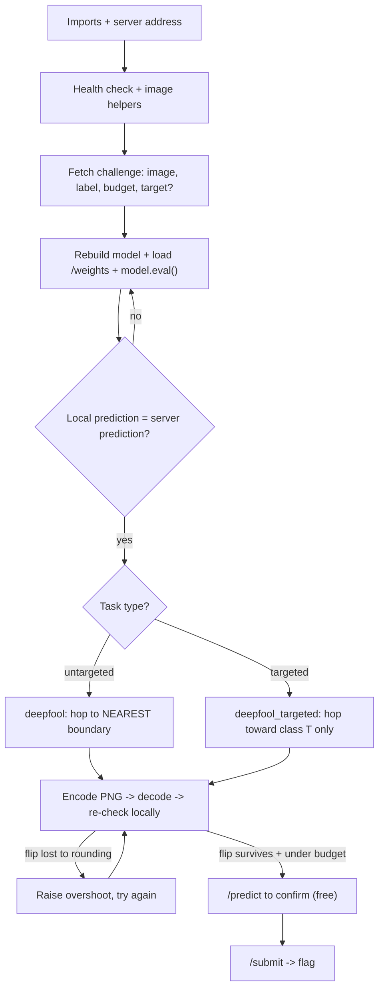

# DeepFool API Challenge - Exam Cheatsheet

_HTB Academy · AI Evasion · DeepFool for "submit an adversarial image to a server" challenges (untargeted + targeted)_

> **How to use this sheet**
> 
> - This is for the challenge style where a **server** gives you an image and you **submit** a changed one. The server checks that its prediction changed (or became a **target** class) and that your change stays **under a budget**.
> - Run the cells **top to bottom in one Jupyter notebook**. Later cells reuse names earlier cells made.
> - **🔵 INPUT NEEDED** = fill every `<<LIKE_THIS>>` before running.
> - **⚪ no input needed - just run** = run it as it is.
> - This sheet has **no math**. Where the algorithm uses a formula, you get one plain-English line instead.
> - Everything here is in **pixel space**: plain brightness, **0 (black) to 1 (white)**. The challenge model normalizes **inside** itself, so you never normalize by hand.

## What this challenge type is

A server holds a model. It hands you **one image** it classifies correctly and a **budget**: the biggest allowed change, usually measured as **overall size (L2)** for DeepFool challenges, sometimes as **biggest single-pixel change (L∞)**. DeepFool is the natural fit for an L2 budget because it hunts for the **smallest change that flips the answer**, so if anything fits under the budget, DeepFool usually finds it.

There are two versions of the task:

- **Untargeted** → "make it predict **anything** except the true class". Use plain DeepFool. It hops to whichever boundary is **nearest**.
- **Targeted** → "make it predict class **T**". Use targeted DeepFool. It ignores every other class and only hops toward **T**.

The catch that breaks most submits: DeepFool lands **just barely past the boundary**, and saving as PNG **rounds every pixel to a whole step of 1/255**. That rounding can push the image back across the line. So you always **encode, decode, and re-check** before you submit, and you grow the overshoot if the flip didn't survive.



---

## Part A - Talk to the server

## Step 1 - Imports and the server address

🔵 INPUT NEEDED

Loads the tools and sets the instance address and the image type. Start the instance on the HTB page first.

```python
import io, base64 # byte buffers, text <-> bytes
import numpy as np # number arrays
import requests # talks to the server
import torch # tensors + gradients
import torch.nn as nn # model building blocks
import torch.nn.functional as F # softmax, for reading confidence
from PIL import Image # reads and writes PNG images
import matplotlib.pyplot as plt # plotting (Part F)

BASE_URL = "<<http://INSTANCE_IP:PORT>>" # full address, with http:// and the port, no trailing slash
IMG_MODE = "<<L_or_RGB>>" # "L" = greyscale (MNIST-like), "RGB" = colour photos

device = torch.device("cpu") # challenge models are small; CPU keeps it simple
```

**fill in:**

- `<<http://INSTANCE_IP:PORT>>` = the address the platform shows, e.g. `http://94.237.1.2:41234`.
- `<<L_or_RGB>>`:
    - **If** the images are black-and-white digits or letters → `"L"`.
    - **If** they're colour photos (traffic signs, objects, faces) → `"RGB"`.
    - **If** you're not sure → leave it as `"L"`, run Step 4, and look at the printed shape. A model expecting 3 channels will error in Step 6, which tells you to switch to `"RGB"`.

## Step 2 - Health check

⚪ no input needed - just run

Confirms the server is up and shows its settings.

```python
print(requests.get(f"{BASE_URL}/health", timeout=10).json())
```

**Expected:** something like `{'status': 'ok', ...}`, sometimes including the budget. If it errors, the address is wrong or the instance is still starting.

## Step 3 - Image helpers (PNG text <-> numbers, and the two rulers)

⚪ no input needed - just run

The server sends and receives images as **base64 PNG text**. These helpers convert both ways, turn an array into a model-ready tensor, and measure a change two ways. **Keep the encode/decode exactly like this**; your budget check is only honest if you decode the same way the server does.

```python
def x01_from_b64_png(b64):
    """base64 PNG text -> array (C, H, W) with values 0..1."""
    img = Image.open(io.BytesIO(base64.b64decode(b64))).convert(IMG_MODE)
    x = np.asarray(img, dtype=np.float32) / 255.0 # 0..255 -> 0..1
    return x[None] if x.ndim == 2 else x.transpose(2, 0, 1) # greyscale -> (1,H,W); colour -> (3,H,W)

def b64_png_from_x01(x):
    """array (C, H, W) with values 0..1 -> base64 PNG text. This ROUNDS to whole 1/255 steps."""
    x255 = np.clip(np.round(x * 255.0), 0, 255).astype(np.uint8)
    arr = x255[0] if x255.shape[0] == 1 else x255.transpose(1, 2, 0) # back to picture layout
    buf = io.BytesIO()
    Image.fromarray(arr).save(buf, format="PNG")
    return base64.b64encode(buf.getvalue()).decode("ascii")

def to_tensor(x):
    """array (C, H, W) -> tensor (1, C, H, W) on the device, ready for the model."""
    return torch.from_numpy(x[None]).float().to(device)

def l2(a, b):
    """Overall size of the change (the L2 ruler)."""
    return float(np.sqrt(np.sum((a - b) ** 2)))

def linf(a, b):
    """Biggest single-pixel change (the L_inf ruler)."""
    return float(np.max(np.abs(a - b)))
```

**Remember:** PNG keeps pixels as **whole numbers 0 to 255**. Your carefully-placed DeepFool image gets rounded on save, which (a) nudges the size slightly and (b) can undo a flip that only just crossed the boundary. Step 10 deals with both.

## Step 4 - Fetch the challenge

🔵 INPUT NEEDED

Gets the image, its true label, the budget and, for targeted tasks, the target class.

```python
ch = requests.get(f"{BASE_URL}/challenge", timeout=10).json()
print("fields the server sent:", list(ch.keys())) # READ THIS before trusting the names below

x = x01_from_b64_png(ch["image_b64"]) # the image, (C, H, W), 0..1
lab = int(ch["label"]) # the true class
budget = float(ch["epsilon"]) # the allowed size of change

BUDGET_TYPE = "<<l2_or_linf>>".lower() # which ruler the server uses ("L2" or "l2" both fine)
ATTACK = "<<untargeted_or_targeted>>".lower() # what the task asks for
TARGET = <<TARGET>> # the class to force (targeted only), else None

print("image shape:", x.shape, "| true label:", lab, "| budget:", budget, BUDGET_TYPE,
      "| attack:", ATTACK, "| target:", TARGET)
```

**fill in:**

- Field names: if the printed keys differ (e.g. `"image"`, `"true_label"`, `"max_l2"`), change the three lookups to match.
- `<<l2_or_linf>>`:
    - **If** the task says "L2", "Euclidean" or "total perturbation size" → `"l2"` (the usual one for DeepFool).
    - **If** it says "L∞", "Linf", "max per-pixel change" → `"linf"` (read the note in Step 13).
- `<<untargeted_or_targeted>>`:
    - **If** the task says "misclassify" / "any wrong class" → `"untargeted"`.
    - **If** it names a class to reach ("make it predict 3") → `"targeted"`.
- `<<TARGET>>`:
    - **If** untargeted → `None`.
    - **If** the server sends it → `int(ch["target"])` (use the real field name).
    - **If** the task text names it → that number, e.g. `3`.

---

## Part B - Get the model

## Step 5 - Rebuild the model and load the weights (white-box)

🔵 INPUT NEEDED

DeepFool needs the model's gradients, so you rebuild it locally from the task's description and load the server's `/weights`. **The class must match the task's code exactly** or the weights won't load.

```python
# Paste the EXACT architecture from the task. This is only an example (MNIST-sized, 1 channel).
class SimpleClassifier(nn.Module):
    def __init__(self):
        super().__init__()
        self.conv1 = nn.Conv2d(1, 32, 3, 1)
        self.conv2 = nn.Conv2d(32, 64, 3, 1)
        self.dropout1 = nn.Dropout(0.25)
        self.dropout2 = nn.Dropout(0.5)
        self.fc1 = nn.Linear(9216, 128)
        self.fc2 = nn.Linear(128, 10)

    def forward(self, x01):
        x = (x01 - <<MEAN>>) / <<STD>> # normalize INSIDE (delete if the task's model doesn't)
        x = torch.relu(self.conv1(x))
        x = torch.relu(self.conv2(x))
        x = torch.max_pool2d(x, 2)
        x = self.dropout1(x)
        x = torch.flatten(x, 1)
        x = torch.relu(self.fc1(x))
        x = self.dropout2(x)
        return self.fc2(x) # scores (or log_softmax; DeepFool works with either)

# Download and load the weights
open("weights.pth", "wb").write(requests.get(f"{BASE_URL}/weights", timeout=10).content)
model = SimpleClassifier().to(device)
model.load_state_dict(torch.load("weights.pth", map_location=device))
model.eval() # REQUIRED: dropout OFF, or every gradient is random
print("training mode?", model.training) # must print False
```

**fill in:**

- The whole class: copy it from the task, don't guess.
- `<<MEAN>>`, `<<STD>>`: only if the task's `forward` normalizes inside (MNIST: `0.1307`, `0.3081`). **If it doesn't, delete that line.**

**Options - which output the model ends with:**

- **If** `forward` returns raw scores or `log_softmax` → fine, use as is. Both give DeepFool the same gaps and directions.
- **If** it returns plain `softmax` probabilities → it still runs, but hops are less accurate. Expect more hops and a bigger overshoot.

> **If this errors:** `size mismatch` / `Missing key(s)` = your class doesn't match the task's. `weights_only` / unpickling error = the file is a whole model, not just weights; **only load files from the challenge you're solving**, because a `.pth` can run hidden code.

## Step 6 - Check your copy matches the server

⚪ no input needed - just run

Proves the local model is the server's model. If these disagree, nothing below will work.

```python
x_t = to_tensor(x) # (1, C, H, W)
with torch.no_grad():
    local_pred = model(x_t).argmax(dim=1).item()
server = requests.post(f"{BASE_URL}/predict",
                       json={"image_b64": b64_png_from_x01(x)}, timeout=10).json()
print("local:", local_pred, "| server:", server, "| true label:", lab)
```

**Expected:** local prediction = server prediction = true label. If local differs, the architecture or the normalize line is wrong. If the shape errors, flip `IMG_MODE` in Step 1.

---

## Part C - The attacks (define once)

## Step 7 - Untargeted DeepFool (hop to the nearest boundary)

⚪ no input needed - just run

The whole untargeted attack in one function. Plain-English version: for one image, look at every other class, work out whose boundary is the **shortest hop away**, hop there, re-check, and repeat until the answer changes. The **overshoot** lands it a little past the line instead of exactly on it. This version **clips to a valid 0..1 image** every hop, because you have to submit a real picture.

```python
def deepfool(image, net, num_classes=10, overshoot=0.02, max_iter=50, clip=True):
    """
    Smallest change that flips the label of ONE image (untargeted).

    image: one image, shape (1, C, H, W), pixels 0..1
    net: the model (normalizes inside)
    num_classes: how many top classes to check (all of them for 10-class tasks)
    overshoot: how far past the boundary to land (0.02 = 2%)
    max_iter: give up after this many hops
    clip: keep pixels between 0 and 1 (True = a valid image to submit)
    Returns: (total_step, hops_used, original_class, final_class, attacked_image)
    """
    net.eval() # dropout off
    image = image.to(next(net.parameters()).device)

    # Rank classes once at the start. label = the model's original answer.
    with torch.no_grad():
        scores = net(image)[0]
    order = scores.argsort(descending=True) # class numbers, best first
    label = order[0].item()
    rivals = [c.item() for c in order[1:num_classes]]

    r_tot = torch.zeros_like(image) # running total of all hops
    pert_image = image.clone()
    loop_i = 0

    while loop_i < max_iter:
        x = pert_image.clone().detach().requires_grad_(True) # track slopes for the pixels
        fs = net(x)[0] # fresh scores here
        if fs.argmax().item() != label: # flipped -> done
            break

        grad_label = torch.autograd.grad(fs[label], x, retain_graph=True)[0] # current class's slopes

        best_dist, best_dir = float("inf"), None
        for k in rivals:
            grad_k = torch.autograd.grad(fs[k], x, retain_graph=True)[0] # rival k's slopes
            w_k = grad_k - grad_label # direction: lift the rival, lower the current class
            gap = (fs[k] - fs[label]).item() # how far behind the rival is
            dist = abs(gap) / (w_k.norm().item() + 1e-10) # how far away that boundary is
            if dist < best_dist: # closest so far -> remember it
                best_dist, best_dir = dist, w_k

        r_i = (best_dist + 1e-4) * best_dir / (best_dir.norm() + 1e-10) # hop exactly that far
        r_tot = r_tot + r_i

        pert_image = image + (1 + overshoot) * r_tot # rebuild from the ORIGINAL + total, with overshoot
        if clip:
            pert_image = pert_image.clamp(0.0, 1.0) # keep a valid image
        pert_image = pert_image.detach()
        loop_i += 1

    with torch.no_grad(): # honest final answer (also right if max_iter hit)
        k_i = net(pert_image).argmax(dim=1).item()
    return r_tot.detach(), loop_i, label, k_i, pert_image
```

**How to call it:** `deepfool(x_t, model)` with one image `(1, C, H, W)`. It returns five things: total step, hops used, original class, final class, attacked image.

## Step 8 - Targeted DeepFool (hop toward ONE chosen class)

⚪ no input needed - just run

Same idea with one change: there's no search for the nearest class. Every hop compares the **target** with **whatever class is on top right now** and hops just far enough to make the target win that comparison. It repeats until the target is the top answer. It usually needs **more hops and a bigger change** than untargeted, because the target's boundary is rarely the closest.

```python
def deepfool_targeted(image, net, target, overshoot=0.02, max_iter=100, clip=True):
    """
    Smallest change that makes ONE image be predicted as `target`.

    image: one image, shape (1, C, H, W), pixels 0..1
    net: the model (normalizes inside)
    target: the class number you want the model to output
    overshoot, max_iter, clip: same meaning as in deepfool()
    Returns: (total_step, hops_used, original_class, final_class, attacked_image)
    """
    net.eval()
    image = image.to(next(net.parameters()).device)
    with torch.no_grad():
        label = net(image).argmax(dim=1).item() # the model's original answer

    r_tot = torch.zeros_like(image)
    pert_image = image.clone()
    loop_i = 0

    while loop_i < max_iter:
        x = pert_image.clone().detach().requires_grad_(True)
        fs = net(x)[0]
        current = fs.argmax().item() # whoever is winning right now
        if current == target: # target is on top -> done
            break

        grad_t = torch.autograd.grad(fs[target], x, retain_graph=True)[0] # target's slopes
        grad_c = torch.autograd.grad(fs[current], x)[0] # current winner's slopes
        w = grad_t - grad_c # direction: lift the target, lower the winner
        gap = (fs[target] - fs[current]).item() # how far behind the target is
        dist = abs(gap) / (w.norm().item() + 1e-10) # how far to the target-vs-winner boundary

        r_i = (dist + 1e-4) * w / (w.norm() + 1e-10) # hop exactly that far
        r_tot = r_tot + r_i

        pert_image = image + (1 + overshoot) * r_tot
        if clip:
            pert_image = pert_image.clamp(0.0, 1.0)
        pert_image = pert_image.detach()
        loop_i += 1

    with torch.no_grad():
        k_i = net(pert_image).argmax(dim=1).item()
    return r_tot.detach(), loop_i, label, k_i, pert_image
```

**How to call it:** `deepfool_targeted(x_t, model, target=TARGET)`. Success = the final class **equals** `TARGET`, not just "changed".

> **Why "whoever is winning right now":** if a third class takes the lead halfway (say you push a 7 toward 3 and it becomes a 9 first), the next hop compares the target with that new leader. That's what makes it reach the target instead of stalling.

---

## Part D - Run, make it survive PNG, submit

## Step 9 - Run the attack that matches the task

🔵 INPUT NEEDED

Runs untargeted or targeted DeepFool depending on Step 4's `ATTACK`, and builds one `success()` check you'll reuse everywhere below.

```python
OVERSHOOT = <<OVERSHOOT>>

if ATTACK == "targeted":
    r_total, hops, orig, adv, pert_image = deepfool_targeted(x_t, model, target=TARGET,
                                                             overshoot=OVERSHOOT, max_iter=100)
    success = lambda pred: pred == TARGET # targeted: must BE the target
else:
    r_total, hops, orig, adv, pert_image = deepfool(x_t, model, num_classes=10,
                                                    overshoot=OVERSHOOT, max_iter=50)
    success = lambda pred: pred != lab # untargeted: anything but the true label

x_adv = pert_image.squeeze(0).cpu().numpy() # (1,C,H,W) -> (C,H,W) array
print(f"{orig} -> {adv} in {hops} hops | success locally: {success(adv)}")
print(f"size before PNG: L2 {l2(x_adv, x):.4f} | Linf {linf(x_adv, x):.4f} | budget {budget} ({BUDGET_TYPE})")
```

**fill in:** `<<OVERSHOOT>>` = how far past the boundary to land.

- **If** this is your first try → `0.02` (**pick this**, the standard). Step 10 then re-tunes the stretch by itself, so this choice barely matters for the submit.
- **If** you already know rounding kills it, or you're attacking a surrogate (Step 14) → start at `0.1`.

**Options - the `num_classes` setting:** keep `10` for 10-class tasks. **If** the model has many classes (43 traffic signs, 100+ objects) → `10` still works and is faster, because it only checks the 10 likeliest rivals. Raise it if the flip needs more hops than expected.

**Expected:** `success locally: True`, and the size before PNG well under the budget. If the size is already over the budget here, go to Step 13.

## Step 10 - Encode, decode, re-check, and raise the overshoot until it survives

⚪ no input needed - just run

The rounding-proof step. It saves the attacked image as PNG, decodes it exactly like the server, and checks two things on the **decoded** image: does the local model still give a successful answer, and is the size under the budget? It tries the step at **exactly the boundary first** (smallest size), then stretches it a little further each time (a bigger overshoot) until rounding can't undo the flip. It stops at the **first** version that passes both, which is also the smallest one.

```python
measure = l2 if BUDGET_TYPE.lower() == "l2" else linf # the server's ruler
print("measuring with:", measure.__name__) # MUST match the task's budget type

adv_b64 = None
near_misses = [] # under budget, but rounding undid the flip -> Step 10b
for stretch in [1.0, 1.01, 1.02, 1.05, 1.1, 1.2, 1.3, 1.5]: # 1.0 = land right on the line, 1.02 = 2% past
    cand = torch.clamp(x_t + stretch * r_total, 0.0, 1.0) # same direction, a bit further each time
    b64 = b64_png_from_x01(cand.squeeze(0).cpu().numpy()) # encode (rounds)
    x_back = x01_from_b64_png(b64) # decode, as the server will
    with torch.no_grad():
        pred = model(to_tensor(x_back)).argmax(dim=1).item() # re-check the DECODED image
    size = measure(x_back, x)
    print(f"stretch {stretch:<4}: pred {pred} | success {success(pred)} | size {size:.4f} / {budget}")
    if success(pred) and size <= budget:
        adv_b64 = b64 # submit-ready
        break
    if size <= budget:
        near_misses.append(x_back) # keep it for the Step 10b repair

print("READY to submit" if adv_b64 else f"Nothing passed -> run Step 10b ({len(near_misses)} near misses to repair)")
```

**Expected:** `measuring with: l2` (or `linf`, matching the task), then a line with `success True` and a size at or under the budget, then `READY to submit`.

**Reading it:**

- **If** early lines say `success False` and later ones `True`, still under budget → rounding was undoing the flip, and the stretch fixed it. Normal.
- **If** the flip only appears **after** the size passes the budget → rounding is eating the change. Run **Step 10b**.
- **If** every line says `success True` but every size is **over** budget → even the smallest flip is too big. That's Step 13.

## Step 10b - PNG fix-up (when rounding keeps undoing the flip)

⚪ no input needed - just run (only does anything if Step 10 found nothing)

**Why this happens:** DeepFool spreads its change thinly over many pixels. Lots of those changes are **smaller than half a brightness step**, so PNG rounding sets them back to zero, and the image falls back across the line. Stretching makes every pixel bigger, including useless ones, which wastes budget.

**What this does instead:** it starts from a near miss (already rounded) and repairs it **directly on whole PNG steps**. Each round it finds the few pixels that help most, moves each by **exactly one brightness step** (1/255) in the helpful direction, and re-checks. Because it never leaves the PNG grid, **what it checks is exactly what the server will decode**. It tries every near miss and keeps the smallest result that works.

```python
def png_fixup(x_start, max_rounds=400, pixels_per_round=5):
    """
    Repair an image that rounding knocked back across the line.
    Each round: move the most useful pixels by ONE brightness step (1/255), re-check.
    x_start: a decoded image (C, H, W), 0..1
    Returns: (repaired image (C, H, W), rounds used)
    """
    step = 1.0 / 255
    cur = np.round(x_start * 255) / 255 # sit exactly on whole PNG steps
    for rnd in range(max_rounds):
        if measure(cur, x) > budget: # out of budget -> give up on this start
            break
        xt = to_tensor(cur).requires_grad_(True)
        fs = model(xt)[0]
        top = fs.argmax().item()
        if success(top): # works -> done
            return cur, rnd
        if ATTACK == "targeted":
            goal = fs[TARGET] - fs[top] # lift the target over the current winner
        else:
            others = fs.detach().clone(); others[lab] = -float("inf")
            goal = fs[others.argmax()] - fs[lab] # lift the strongest rival over the true class
        g = torch.autograd.grad(goal, xt)[0][0].cpu().numpy() # how much each pixel helps
        move = np.sign(g) * step # one step in the helpful direction
        ok = ((move > 0) & (cur < 1)) | ((move < 0) & (cur > 0)) # pixel still has room that way
        if BUDGET_TYPE.lower() == "linf":
            ok &= np.abs(cur + move - x) <= budget + 1e-9 # never break an L_inf budget
        idx = np.argsort((np.abs(g) * ok).ravel())[::-1][:pixels_per_round] # most useful pixels
        flat = cur.ravel().copy()
        flat[idx] = flat[idx] + move.ravel()[idx]
        cur = np.clip(np.round(flat.reshape(cur.shape) * 255) / 255, 0, 1) # stay on whole steps
    return cur, max_rounds

if adv_b64 is None:
    best = None
    starts = near_misses + [x] # every near miss, plus the untouched image
    for start in starts:
        out, rounds = png_fixup(start)
        b64 = b64_png_from_x01(out)
        x_back = x01_from_b64_png(b64) # decode, as the server will
        with torch.no_grad():
            pred = model(to_tensor(x_back)).argmax(dim=1).item()
        size = measure(x_back, x)
        print(f"fix-up: {rounds:>3} rounds | pred {pred} | success {success(pred)} | size {size:.4f} / {budget}")
        if success(pred) and size <= budget and (best is None or size < best[0]):
            best = (size, b64) # keep the smallest that works
    adv_b64 = best[1] if best else None

print("READY to submit" if adv_b64 else "Still nothing -> Step 13")
```

**Expected:** at least one line with `success True` under budget, then `READY to submit`. Then carry on with Step 11.

**Options:**

- **If** every line ends over budget → try `pixels_per_round=1` (slower, slightly smaller result): change it in the `png_fixup(start)` call, e.g. `png_fixup(start, pixels_per_round=1)`.
- **If** it hits 400 rounds without success → raise `max_rounds=1000`.

## Step 11 - Measure the final image

⚪ no input needed - just run

Reports both rulers on the **decoded** image and how confident the model is in its new answer.

```python
assert adv_b64, "Step 10 found nothing to submit -> fix that first (Steps 13-14)"
x_final = x01_from_b64_png(adv_b64) # exactly what the server will see
with torch.no_grad():
    probs = F.softmax(model(to_tensor(x_final)), dim=1)[0]
final_pred = probs.argmax().item()

print(f"final prediction: {final_pred} (true {lab}, target {TARGET})")
print(f"L2 : {l2(x_final, x):.4f}")
print(f"Linf : {linf(x_final, x):.4f} = about {round(linf(x_final, x)*255)}/255 brightness steps")
print(f"relative size: {l2(x_final, x) / np.sqrt(np.sum(x**2)):.2%} of the image")
print(f"confidence in new class: {probs[final_pred]:.3f} | in true class: {probs[lab]:.3f}")
```

**Expected:** a narrow win, e.g. new class ~0.4-0.6 with the true class close behind. That's normal for a minimal attack. **It's not a 0.5 threshold**; the prediction is simply whichever class scores highest.

## Step 12 - Confirm with /predict, then /submit

⚪ no input needed - just run

`/predict` gives the server's verdict **without** spending your submit. Only submit once it shows success.

```python
pred = requests.post(f"{BASE_URL}/predict", json={"image_b64": adv_b64}, timeout=10).json()
print("server predicts:", pred)

if success(int(pred["pred"])):
    r = requests.post(f"{BASE_URL}/submit", json={"image_b64": adv_b64}, timeout=10)
    print(r.status_code, r.json() if r.ok else r.text)
else:
    print("Server disagrees with your local model -> recheck Step 6, then Step 13.")
```

**fill in:** nothing, but if the server's reply uses a different field than `"pred"` (e.g. `"prediction"`, `"class"`), change `pred["pred"]` to match.

**Reading the errors:**

|Server says|Means|Do this|
|---|---|---|
|`L2 too large` / `L_inf too large`|over budget after decoding|Step 10 should have caught it: check `BUDGET_TYPE` matches the task|
|`Not misclassified`|flip didn't hold on the server|recheck Step 6 (local = server?), then add bigger stretches (`2.0`, `3.0`) to Step 10's list|
|`Wrong class` / `Not target`|targeted task, landed on the wrong class|make sure `ATTACK = "targeted"` and `TARGET` is right|
|`Invalid image` / shape error|wrong size or colour mode|match `IMG_MODE` and don't resize|

---

## Part E - When it doesn't work

## Step 13 - Over budget, or the budget is L∞

⚪ no input needed - read, then act

**If the budget is L2 and DeepFool's size is over it:**

- DeepFool is already close to the smallest possible change, so a big gap usually means the budget is meant for a different image or class. Re-check Step 4's fields.
- Small gap? Try `max_iter=200`, all classes (`num_classes` = the model's number of classes), and the smallest overshoot that survives Step 10.
- Targeted and over budget? That target is far away. Run **untargeted** once just to see how close the _nearest_ class is. If even that is over budget, the task expects a different trick.

**If the budget is L∞ (biggest single-pixel change):**

- Plain DeepFool spreads its change by size, so a few pixels can move a lot and break an L∞ budget even when the L2 is tiny.
- **Pick this:** use **I-FGSM** from your `FGSM_Challenge_API_Cheatsheet.md` (Step 11 there), which is built to stay inside an L∞ box. For a targeted L∞ task, use its minus-sign version with the target label.
- DeepFool is still useful here to **find which class is nearest**, which is a good target to aim I-FGSM at if the task lets you choose.

## Step 14 - No weights given: surrogate + bigger overshoot

🔵 INPUT NEEDED

If there's only `/predict` (no `/weights`), attack **your own** model trained on the same kind of data, then submit that image and hope it transfers. **DeepFool transfers badly by default**: it lands just past _your_ model's boundary, which can be short of the server's. The fix is a much bigger overshoot, checked against the server's free `/predict` each time.

```python
surrogate = <<YOUR_TRAINED_MODEL>> # a model YOU trained on similar data, in eval mode
surrogate.eval()

if ATTACK == "targeted":
    r_s, _, _, _, _ = deepfool_targeted(x_t, surrogate, target=TARGET, overshoot=0.02, max_iter=100)
else:
    r_s, _, _, _, _ = deepfool(x_t, surrogate, overshoot=0.02, max_iter=50)

adv_b64 = None
for ov in [0.1, 0.3, 0.5, 1.0, 1.5, 2.0]: # stretch far past YOUR boundary
    b64 = b64_png_from_x01(torch.clamp(x_t + (1 + ov) * r_s, 0, 1).squeeze(0).cpu().numpy())
    x_back = x01_from_b64_png(b64)
    srv = requests.post(f"{BASE_URL}/predict", json={"image_b64": b64}, timeout=10).json()
    size = (l2 if BUDGET_TYPE == "l2" else linf)(x_back, x)
    print(f"overshoot {ov}: server says {srv} | size {size:.4f} / {budget}")
    if success(int(srv["pred"])) and size <= budget:
        adv_b64 = b64
        break
print("READY -> run Step 12" if adv_b64 else "Didn't transfer -> try I-FGSM on the surrogate instead")
```

**fill in:** `<<YOUR_TRAINED_MODEL>>` = a model you trained yourself (e.g. the MNIST or CIFAR model from your other DeepFool cheatsheets). It must take the **same image size and channels** and plain 0..1 input.

**Options:**

- **If** a stretch flips the server and stays under budget → done, run Step 12.
- **If** the size hits the budget before the server flips → switch to I-FGSM on the surrogate (FGSM API sheet). Big uniform steps transfer better than DeepFool's minimal ones.

---

## Part F - See it (optional)

## Step 15 - Four-panel view

⚪ no input needed - just run

Shows the original, the change (amplified so you can see it), where it changed, and the submitted image.

```python
x_show = x_final # decoded, exactly what you submit
diff = x_show - x # the real change, (C, H, W)
as_pic = lambda a: a[0] if a.shape[0] == 1 else a.transpose(1, 2, 0) # (C,H,W) -> picture layout
cmap = "gray" if x.shape[0] == 1 else None
amp = np.clip(as_pic(diff) * 10 + 0.5, 0, 1) # change x10, centred on grey
heat = np.abs(diff).sum(axis=0) # how much each pixel moved (all colours added)

fig, ax = plt.subplots(1, 4, figsize=(15, 4))
ax[0].imshow(as_pic(x), cmap=cmap, vmin=0, vmax=1); ax[0].set_title(f"Original: {lab}")
ax[1].imshow(amp, cmap=cmap, vmin=0, vmax=1); ax[1].set_title("Change x10 (grey = none)")
im = ax[2].imshow(heat, cmap="viridis"); ax[2].set_title(f"Where it changed\nL2 {l2(x_show, x):.3f}")
plt.colorbar(im, ax=ax[2], fraction=0.046)
ax[3].imshow(as_pic(x_show), cmap=cmap, vmin=0, vmax=1); ax[3].set_title(f"Submitted: {final_pred}")
for a in ax: a.axis("off")
plt.suptitle(f"DeepFool ({ATTACK})"); plt.tight_layout(); plt.show()
```

**Reading it:**

|Panel|What to look for|
|---|---|
|Original|the starting image|
|Change x10|==grey = no change==; lighter = brightened, darker = darkened. Faint speckle is ideal|
|Where it changed|bright spots = pixels that moved most; DeepFool piles its change on the shapes that matter, not the background|
|Submitted|should still look like the original class to you. If it looks wrecked, check your clip range and `IMG_MODE`|

---

## If you remember nothing else

## The attack in 4 lines

1. **Fetch** the image, true label, budget (L2 or L∞) and target if any. Rebuild the model, load `/weights`, call **`model.eval()`**, and confirm local = server prediction.
2. **Untargeted:** DeepFool hops to the **nearest** boundary until the label changes. **Targeted:** each hop pushes the **target** past whoever is winning, until the target is on top.
3. DeepFool lands **just** past the line, and **PNG rounding can undo it**. Encode → decode → re-check locally, and stretch the step (bigger overshoot) until the decoded image still succeeds **and** stays under budget.
4. **`/predict`** to confirm (free), then **`/submit`** for the flag.

## The core from memory

```python
model.eval(); x_t = to_tensor(x) # plain 0..1, (1,C,H,W)
r, hops, orig, adv, p = deepfool(x_t, model) # untargeted
# r, hops, orig, adv, p = deepfool_targeted(x_t, model, target=T) # targeted
for s in [1.0, 1.02, 1.05, 1.1, 1.2, 1.5]: # stretch: start ON the line
    b64 = b64_png_from_x01(torch.clamp(x_t + s*r, 0, 1).squeeze(0).numpy())
    xb = x01_from_b64_png(b64) # what the server sees
    if success(model(to_tensor(xb)).argmax().item()) and l2(xb, x) <= budget: break
# POST /predict {"image_b64": b64} -> then POST /submit
```

## Must-know facts

- **DeepFool finds the smallest change that flips the answer, so it's the natural tool for an L2 budget.** If DeepFool's size is far over the budget, a bigger attack won't help. Re-read the task.
- **Untargeted goes to the NEAREST boundary; targeted goes to ONE chosen class.** Targeted costs more hops and a bigger change, because the target is rarely the closest class.
- **Targeted success means the prediction EQUALS the target**, not just "changed". In targeted mode, each hop compares the target with **whoever is currently winning**, not with the original class.
- **PNG rounds every pixel to a whole 1/255 step, and DeepFool lands just barely past the line**, so rounding can undo the flip. Always encode → decode → re-check, and grow the overshoot until the **decoded** image still works.
- **Check the budget on the DECODED image with the server's ruler (L2 or L∞).** DeepFool keeps L2 small but can move single pixels a lot, so for an L∞ budget, use I-FGSM instead.
- **`model.eval()` is mandatory** (dropout off), and the challenge model usually **normalizes inside**, so you feed plain 0..1 and clip to 0..1. Prove it with local prediction = server prediction before attacking.
- DeepFool works the same whether the model returns raw scores or log-softmax. With no weights, a surrogate's DeepFool image **transfers poorly** unless you stretch it far past the boundary. Test each stretch with the free `/predict`.
- **Method point:** **`/predict` is free, `/submit` counts**. Re-check locally on the decoded PNG, confirm with `/predict`, then submit once. This is **OWASP ML01:2023 Input Manipulation**: an inference-time evasion attack.