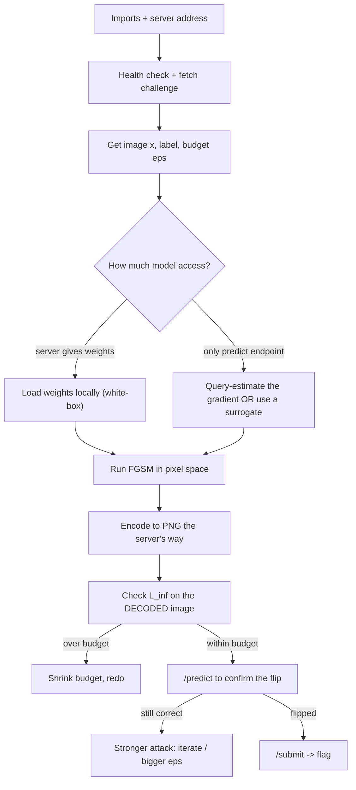

# FGSM API Challenge - Exam Cheatsheet

_HTB Academy · AI Evasion · for "submit an adversarial image to a server" challenges_

> **How to use this sheet**
> 
> - This is for the challenge style where a **server** gives you an image and you must **submit** a changed one that the server misclassifies, staying inside a budget.
> - Run the cells **top to bottom in one Jupyter notebook**. Later cells use names earlier cells made.
> - **🔵 INPUT NEEDED** = replace every `<<LIKE_THIS>>` first.
> - **⚪ no input needed - just run** = run it as it is.
> - **Pixel space** = normal brightness, 0 (black) to 1 (white). These challenges almost always work in pixel space, not model space.

## What this challenge type is

A server holds a secret model. It hands you **one image it classifies correctly** and a **budget** (the most any single pixel may change). Your job: add a tiny, carefully chosen change so the server predicts a **different class**, while the biggest pixel change stays **at or under the budget**. Get both right and the server returns the flag.

The whole game is: get a copy of the model (or an estimate of its gradient), run FGSM, encode the result exactly the way the server decodes it, check the budget on the **decoded** image, then submit.

## The flow



---

## Part A - Talk to the server

## Step 1 - Imports and the server address

🔵 INPUT NEEDED

**What & why:** loads the tools and sets the instance address. Start the instance on the HTB page first.

```python
import os, io, base64 # files, byte buffers, text<->bytes encoding
import numpy as np # number arrays
import requests # sends HTTP requests to the server
import torch # PyTorch: tensors + gradients
import torch.nn as nn # neural-network building blocks
from PIL import Image # reads and writes PNG images

# Full address of your running instance, with http:// and the port, no trailing slash
BASE_URL = "<<http://INSTANCE_IP:PORT>>"

device = torch.device("cpu") # challenge models are small; CPU is simplest
```

**fill in:** `<<http://INSTANCE_IP:PORT>>` = the address the platform shows after you start the instance, e.g. `http://94.237.1.2:41234`.

## Step 2 - Health check

⚪ no input needed - just run

**What & why:** confirms the server is up and shows its settings.

```python
print(requests.get(f"{BASE_URL}/health", timeout=10).json())
```

**Expected:** something like `{'status': 'ok', 'epsilon': 0.25, ...}`. If this errors, the address is wrong or the instance isn't ready yet.

## Step 3 - Image <-> text helpers

⚪ no input needed - just run

**What & why:** the server sends and receives images as **base64 PNG text**. These three helpers convert in both directions and measure the biggest pixel change. **Keep these exact** - the encode/decode must match the server, or your budget check will lie to you.

```python
def x01_from_b64_png(b64: str) -> np.ndarray:
    """base64 PNG text -> (H, W) array in [0,1]."""
    raw = base64.b64decode(b64) # text -> raw bytes
    img = Image.open(io.BytesIO(raw)).convert("L") # bytes -> greyscale image
    x = np.asarray(img, dtype=np.float32) / 255.0 # 0..255 -> 0..1
    return np.clip(x, 0.0, 1.0)

def b64_png_from_x01(x2d: np.ndarray) -> str:
    """(H, W) array in [0,1] -> base64 PNG text."""
    x255 = np.clip((x2d * 255.0).round(), 0, 255).astype(np.uint8) # 0..1 -> whole 0..255
    img = Image.fromarray(x255, mode="L") # array -> greyscale image
    buf = io.BytesIO()
    img.save(buf, format="PNG") # image -> PNG bytes in memory
    return base64.b64encode(buf.getvalue()).decode("ascii") # bytes -> text

def linf(a: np.ndarray, b: np.ndarray) -> float:
    """Biggest absolute difference between two arrays (the L_inf distance)."""
    return float(np.max(np.abs(a - b)))
```

**Remember:** PNG stores pixels as **whole numbers 0 to 255**. Your changed image gets **rounded** when saved, and rounding can push the biggest change slightly **over** the budget. This is the number-one reason a submit fails. We handle it in Step 8.

## Step 4 - Fetch the challenge

⚪ no input needed - just run

**What & why:** gets the baseline image, its true label, and the budget.

```python
ch = requests.get(f"{BASE_URL}/challenge", timeout=10).json()
x = x01_from_b64_png(ch["image_b64"]) # baseline image, (H, W), 0..1
lab = int(ch["label"]) # the true class
eps = float(ch["epsilon"]) # the budget (max change per pixel, in 0..1 space)
print("label:", lab, "| budget:", eps, "| image shape:", x.shape)
```

**fill in:** nothing, but **read the field names in the task**. Some challenges call them `image_b64`/`label`/`epsilon`; others differ. Match your code to what `GET /challenge` actually returns.

---

## Part B - Get model access

The attack needs a **gradient** - which way to nudge each pixel. How you get it depends on what the server exposes. Three cases, most to least access:

## Step 5 - CASE 1: the server gives you the weights (white-box)

🔵 INPUT NEEDED

**What & why:** the easiest case. The task gives you the model's **architecture** and a `/weights` download. You rebuild the model locally and compute the gradient directly. **The architecture must match the task's exactly**, or the weights won't load.

```python
# Paste the EXACT architecture from the task. This is only an example shape.
class SimpleClassifier(nn.Module):
    def __init__(self):
        super().__init__()
        self.conv1 = nn.Conv2d(1, 32, 3, 1)
        self.conv2 = nn.Conv2d(32, 64, 3, 1)
        self.dropout1 = nn.Dropout(0.25)
        self.dropout2 = nn.Dropout(0.5)
        self.fc1 = nn.Linear(9216, 128)
        self.fc2 = nn.Linear(128, 10)

    def forward(self, x01):
        # WATCH THIS LINE: if the model normalizes INSIDE, you feed it plain 0..1 images.
        x = (x01 - <<MEAN>>) / <<STD>> # some models have this; some don't
        x = torch.relu(self.conv1(x))
        x = torch.relu(self.conv2(x))
        x = torch.max_pool2d(x, 2)
        x = self.dropout1(x)
        x = torch.flatten(x, 1)
        x = torch.relu(self.fc1(x))
        x = self.dropout2(x)
        x = self.fc2(x)
        return torch.log_softmax(x, dim=1)

# Download and load the weights
wt = requests.get(f"{BASE_URL}/weights", timeout=10).content
open("weights.pth", "wb").write(wt)

model = SimpleClassifier().to(device)
model.load_state_dict(torch.load("weights.pth", map_location=device))
model.eval() # REQUIRED: turns dropout OFF. Without it, outputs are random.
```

**fill in:**

- The whole class body - copy it from the task, don't guess.
- `<<MEAN>>`, `<<STD>>` - only if the task's `forward` normalizes inside (e.g. `0.1307`, `0.3081` for MNIST). **If it doesn't, delete that line.**

**The one thing to check:** does `forward` normalize inside itself?

- **If yes** → you hand the model **plain 0..1** images, and you clip the attack to **0.0 and 1.0** (Step 7).
- **If no** → you must normalize the image yourself before the model, and clip in model space. Most submit-style challenges normalize inside, so plain 0..1 is the common case.

## Step 6 - CASE 1 check: local copy matches the server

⚪ no input needed - just run

**What & why:** proves your local model is the same one the server uses. If these disagree, nothing below will work.

```python
x_t = torch.from_numpy(x[None, None, ...]).float().to(device) # (H,W) -> (1,1,H,W)
local_pred = int(model(x_t).argmax(dim=1).item())

server = requests.post(f"{BASE_URL}/predict",
                       json={"image_b64": b64_png_from_x01(x)}, timeout=10).json()
print("local:", local_pred, "| server:", server["pred"], "| true label:", lab)
```

**Expected:** all three match. If local and server disagree, your architecture or the normalize line is wrong.

## Step 7 - The FGSM step (pixel space)

🔵 INPUT NEEDED

**What & why:** the attack itself, written for plain 0..1 images. New image = old image + budget × direction of the gradient. **`.sign()` keeps only the direction** (+ or −), never the size. We clip to **0.0 and 1.0** because that's the valid range for a plain image.

```python
def fgsm_pixel(model, x_t, label, epsilon):
    x_adv = x_t.clone().detach().requires_grad_(True) # copy + track slopes for the pixels
    loss = torch.nn.functional.cross_entropy(model(x_adv),
                                             torch.tensor([label], device=device))
    model.zero_grad(set_to_none=True) # clear leftover slopes
    loss.backward() # fill x_adv.grad with one slope per pixel
    step = epsilon * x_adv.grad.sign() # budget * direction only
    x_out = x_adv + step # UNTARGETED: plus. Targeted: use minus.
    x_out = torch.clamp(x_out, 0.0, 1.0) # keep inside a valid 0..1 image
    return x_out.detach()
```

**fill in:** nothing to type, but decide untargeted vs targeted. For "just be wrong", keep the `+` and pass the **true** label. For "make it say class T", use `-` and pass **T** as the label.

## Step 8 - Run it, with the rounding-safe budget

⚪ no input needed - just run

**What & why:** PNG rounds to whole 1/255 steps. Rounding the budget **down** to a whole step first means the saved image can never drift above the server's limit. This single line fixes most failed submits.

```python
eps_safe = np.floor(eps * 255) / 255 # round the budget DOWN to a whole 1/255 step
print("budget given:", eps, "| budget used:", eps_safe)

x_adv_t = fgsm_pixel(model, x_t, lab, eps_safe) # the attack
x_adv_np = x_adv_t.squeeze().cpu().numpy() # (1,1,H,W) -> (H,W) array

with torch.no_grad():
    print("model now says:", model(x_adv_t).argmax(dim=1).item(), "| true label:", lab)
```

**Expected:** "model now says" differs from the true label. If it still matches, the budget is too small for one step - go to Step 11.

---

## Part C - Encode, verify, submit

## Step 9 - Encode and re-check the budget on the DECODED image

⚪ no input needed - just run

**What & why:** the server checks the budget on the image **after decoding your PNG**, so you must check the same thing. Measure `linf` on the **decoded** image, not the raw tensor.

```python
adv_b64 = b64_png_from_x01(x_adv_np) # array -> PNG text (this rounds)
x_back = x01_from_b64_png(adv_b64) # decode it back, exactly as the server will
print("L_inf after encoding:", linf(x_back, x), "| allowed:", eps)
```

**Expected:** the left number is **at or below** the right one. If it's over (even by a hair), lower `eps_safe` by one step (`eps_safe -= 1/255`) and redo Step 8.

## Step 10 - Confirm with /predict, then /submit

⚪ no input needed - just run

**What & why:** `/predict` tells you the server's verdict **without** spending your submit. Only submit once predict shows a flipped class **and** Step 9 is within budget.

```python
pred = requests.post(f"{BASE_URL}/predict",
                     json={"image_b64": adv_b64}, timeout=10).json()
print("predict says:", pred) # 'pred' should differ from the true label

if pred["pred"] != lab:
    r = requests.post(f"{BASE_URL}/submit",
                      json={"image_b64": adv_b64}, timeout=10)
    print(r.status_code, r.json() if r.ok else r.text)
else:
    print("Not flipped yet - use Step 11 to make the attack stronger.")
```

**Reading the errors:** a `400` with `L_inf too large` means Step 9 was over budget (lower `eps_safe`). A `400` with `Not misclassified` means the attack was too weak (Step 11).

---

## Part D - When one step isn't enough

## Step 11 - Iterate (I-FGSM) for a stronger attack at the same budget

⚪ no input needed - just run

**What & why:** if a single FGSM step doesn't flip it, take **many small steps**, re-reading the gradient each time, and after every step **project back** so no pixel ever drifts more than the budget from the original. Same budget, much stronger.

```python
def ifgsm_pixel(model, x_t, label, epsilon, num_iter=20):
    alpha = epsilon / num_iter # small step size; alpha * num_iter = epsilon
    x_adv = x_t.clone().detach()
    for _ in range(num_iter):
        x_adv = x_adv.detach().requires_grad_(True)
        loss = torch.nn.functional.cross_entropy(model(x_adv),
                                                 torch.tensor([label], device=device))
        model.zero_grad(set_to_none=True)
        loss.backward()
        x_adv = x_adv + alpha * x_adv.grad.sign() # one small step (minus for targeted)
        # project: never more than epsilon from the ORIGINAL, then keep a valid 0..1 image
        x_adv = x_t + torch.clamp(x_adv - x_t, -epsilon, epsilon)
        x_adv = torch.clamp(x_adv, 0.0, 1.0).detach()
    return x_adv

x_adv_t = ifgsm_pixel(model, x_t, lab, eps_safe, num_iter=20)
x_adv_np = x_adv_t.squeeze().cpu().numpy()
with torch.no_grad():
    print("model now says:", model(x_adv_t).argmax(dim=1).item(), "| true label:", lab)
```

**Then go back to Step 9** (encode, check budget, predict, submit) with this stronger `x_adv_np`.

**If it still won't flip:** the budget may genuinely be tight. Try more iterations (`num_iter=40`), or a random start (add a tiny random nudge inside the budget before the loop). If the challenge allows it, a bigger `eps` would help - but here `eps` is fixed by the server, so iterate.

## Step 12 - CASE 2 and CASE 3: no weights given

⚪ no input needed - read, use only if there's no `/weights`

**What & why:** some challenges only give you `/predict`. You can't read the gradient directly, so you estimate it or borrow it.

**CASE 2 - Surrogate + transferability (try this first, cheap):** Train or load **your own** model on the same kind of data (e.g. a normal MNIST classifier), run FGSM/I-FGSM against **it**, and submit the result. Adversarial images often fool other models too - that's **transferability**. Costs almost no server queries. Build your own model with the standard training cheatsheet, then feed its `x_adv` into Steps 9-10.

**CASE 3 - Query-estimated gradient (last resort, many queries):** Nudge each pixel a tiny bit, ask `/predict` how the confidence changed, and use the change as an estimate of that pixel's slope. This is slow (two queries per pixel for a full estimate) and may hit rate limits, so prefer a surrogate. The idea, not a drop-in:

```python
# Rough sketch - estimate slope for a few high-impact pixels, not all of them.
# For pixel p: confidence(x with p nudged up) - confidence(x with p nudged down) ~ slope at p.
# Move the most sensitive pixels in the helpful direction, stay within the budget, submit.
```

Use CASE 3 only when there's no architecture and a surrogate won't transfer.

---

## Part E - See it (optional)

## Step 13 - Quick 3-panel view

⚪ no input needed - just run

**What & why:** eyeballs the original, the adversarial, and the change, so you can confirm the picture still looks like the original class to a human.

```python
import matplotlib.pyplot as plt
change = (x_back - x) * 10 + 0.5 # amplify the change x10, centre on grey
fig, ax = plt.subplots(1, 3, figsize=(10, 4))
ax[0].imshow(x, cmap="gray", vmin=0, vmax=1); ax[0].set_title(f"original (true {lab})")
ax[1].imshow(x_back, cmap="gray", vmin=0, vmax=1); ax[1].set_title(f"adversarial ({pred['pred']})")
ax[2].imshow(np.clip(change, 0, 1), cmap="gray"); ax[2].set_title("change x10")
for a in ax: a.axis("off")
plt.show()
```

**Reading it:** the change panel should be faint speckle, and the adversarial should still look like the original digit to you. If the adversarial looks wrecked, your clip range or budget is wrong.

---

## If you remember nothing else

## The attack in 4 lines

1. **Fetch** the image `x`, true label `lab`, and budget `eps` from the server. Everything is in plain **0 to 1** pixel space.
2. **Get the gradient.** White-box: rebuild the model from the task, load `/weights`, call `model.eval()`. No weights: attack your own surrogate model and rely on transfer.
3. **FGSM:** `x_adv = clamp(x + eps * grad.sign(), 0, 1)`. If one step doesn't flip it, **iterate** with small steps and project back inside `eps` each time.
4. **Encode to PNG, then check the budget on the DECODED image** (PNG rounds to 1/255, which can push you over). `/predict` to confirm the flip, then `/submit` for the flag.

## The core from memory

```python
# white-box, pixel space
model.eval()
x_t = torch.from_numpy(x[None, None, ...]).float()
x_t.requires_grad_(True)
loss = F.cross_entropy(model(x_t), torch.tensor([lab]))
loss.backward()
eps_safe = np.floor(eps * 255) / 255 # rounding-safe budget
x_adv = torch.clamp(x_t + eps_safe * x_t.grad.sign(), 0, 1) # FGSM, untargeted
adv_b64 = b64_png_from_x01(x_adv.squeeze().detach().numpy())
assert linf(x01_from_b64_png(adv_b64), x) <= eps # check on the DECODED image
# requests.post(.../predict) to confirm, then .../submit for the flag
```

## Must-know facts

- **These challenges work in plain 0 to 1 pixel space.** The budget `eps` is the **max change to any single pixel** (an L∞ bound). Clip the attack to **0.0 and 1.0**, not to model space.
- **Always call `model.eval()` after loading weights.** It turns dropout off. Skip it and the model's answers are random, so your gradient is garbage.
- **The budget is checked on the DECODED PNG, not your tensor.** PNG rounds to whole 1/255 steps, which can nudge your biggest change over the limit. Round the budget **down** to a 1/255 step first (`np.floor(eps*255)/255`), and re-measure `linf` after a full encode→decode.
- **`/predict` is free intel; `/submit` is the real thing.** Confirm the flip with predict before you submit. Read the 400 messages: `L_inf too large` = over budget (lower eps), `Not misclassified` = too weak (iterate).
- **Does the model normalize inside its own `forward`?** If yes (the usual case), feed it plain 0..1 and clip to 0..1. If no, normalize the image yourself first and clip in model space. Getting this wrong makes local and server predictions disagree in Step 6.
- **Three access levels:** white-box (weights given → read the gradient directly), **surrogate/transfer** (only predict → attack your own model, submit that - cheap, try first), **query-estimated gradient** (nudge pixels and watch confidence - slow, last resort). This mirrors first-order theory: these attacks need gradients, so without them you estimate or borrow.
- **FGSM vs I-FGSM:** one big step vs many small steps re-reading the gradient and projecting back inside `eps` each time. Same budget, I-FGSM is far stronger - use it the moment one step won't flip.
- **Untargeted vs targeted:** untargeted = `+ eps*sign`, pass the **true** label, goal "be wrong". Targeted = `- eps*sign`, pass the **target** label, goal "say class T". Targeted is harder and may need iteration.
- **Framework tie-in:** this is **OWASP ML01:2023 Input Manipulation** - an inference-time attack needing only query access. White-box reads the gradient; black-box transfers from a surrogate.