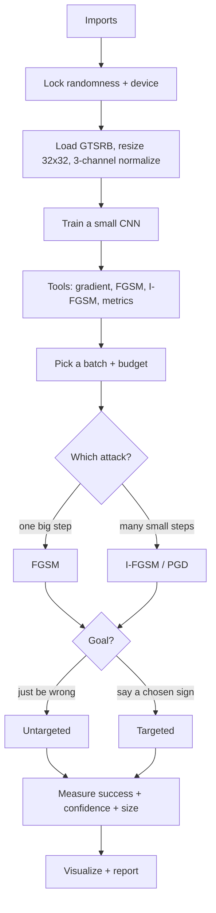

# FGSM & I-FGSM - Exam Cheatsheet (GTSRB traffic signs)

*HTB Academy · AI Evasion - First-Order Attacks · same attack as the MNIST sheet, on a real-world colour dataset*

> **Why this version exists:** the exam may hand you a real dataset, not MNIST. GTSRB is the classic safety example used in adversarial-ML research (showing a lab model can misread a sign). This sheet trains **your own** classifier on a **public** dataset in a notebook and attacks **that**, purely to learn the method for the exam. It is not for use against any real deployed system.
>
> **How to use this sheet**
> - Run the cells **top to bottom in one Jupyter notebook**. Later cells use names earlier cells created.
> - **🔵 INPUT NEEDED** = replace every `<<LIKE_THIS>>` first. A leftover `<<...>>` makes the cell fail on purpose so you can't forget one.
> - **⚪ no input needed - just run** = run as-is.
> - **Model space** = the shifted/rescaled pixels the model sees (normalized). **Pixel space** = normal brightness 0-1. Every budget must say which one.

## What changes from the MNIST sheet (read this first)

| Thing | MNIST sheet | This sheet (GTSRB) |
|---|---|---|
| Images | greyscale, 1 channel, 28×28 | **colour, 3 channels (RGB)**, resized to 32×32 |
| Classes | 10 digits | **43 traffic-sign types** |
| Normalization numbers | one mean, one spread | **three means + three spreads** (one per colour) |
| Library | HTB's `htb_ai_library` | **plain torchvision** (no HTB library) |
| Model | HTB's `SimpleCNN` | **a small CNN we define ourselves** |
| Everything else | - | **the attack code is almost identical** |

**The attack itself does not change. Only the data loading, the normalization (now 3 numbers), and the clip range change.** If you understand the MNIST sheet, you understand this one.

## The flow



---

## Part A - Setup

## Step 1 - Imports

⚪ no input needed - just run

**What & why:** loads PyTorch, torchvision (which has GTSRB built in), plotting and number tools. No HTB library this time.

```python
import os
import random
from typing import Dict, Optional, Tuple
import numpy as np
import torch
from torch import nn, Tensor
import torch.nn.functional as F
from torch.utils.data import DataLoader
from torchvision import datasets, transforms # datasets.GTSRB lives here
import matplotlib.pyplot as plt
```

**Expected:** no output. If `torchvision` is missing: `pip install torchvision`.

## Step 2 - Lock randomness + pick the device

⚪ no input needed - just run

**What & why:** fixed seeds so results repeat. Device = GPU if present, else CPU. Model and data must share one device.

```python
SEED = 1337
random.seed(SEED)
np.random.seed(SEED)
torch.manual_seed(SEED) # one seed covers Python, numpy, torch
device = torch.device("cuda" if torch.cuda.is_available() else "cpu")
print(device)
```

**Expected:** `cpu` or `cuda`.

## Step 3 - Normalization numbers (3 per colour)

⚪ no input needed - just run

**What & why:** colour images have three channels (Red, Green, Blue), so there are **three** averages and **three** spreads. These are standard GTSRB values. The black/white clip range is now a small tensor, not two plain numbers, because each colour clips separately.

```python
# Per-channel average brightness and spread (Red, Green, Blue), standard for GTSRB
GTSRB_MEAN = [0.3403, 0.3121, 0.3214]
GTSRB_STD = [0.2724, 0.2608, 0.2669]

# Build model-space "black" and "white" for each colour: (0 - mean)/std and (1 - mean)/std
mean_t = torch.tensor(GTSRB_MEAN).view(1, 3, 1, 1).to(device) # shape fits any batch of RGB images
std_t = torch.tensor(GTSRB_STD).view(1, 3, 1, 1).to(device)
CLIP_MIN = ((0.0 - mean_t) / std_t) # model-space black, per colour
CLIP_MAX = ((1.0 - mean_t) / std_t) # model-space white, per colour

def eps_pixel_to_norm(eps_pixel):
    # One pixel budget -> model space. Colours have different spreads, so this is APPROXIMATE
    # (uses the average spread). Fine for picking a budget; the clip below stays exact per colour.
    avg_std = sum(GTSRB_STD) / 3
    return eps_pixel / avg_std

def eps_norm_to_pixel(eps_norm):
    avg_std = sum(GTSRB_STD) / 3
    return eps_norm * avg_std

print("clip min per colour:", CLIP_MIN.flatten().tolist())
print("clip max per colour:", CLIP_MAX.flatten().tolist())
print("8/255 in model space ~", round(eps_pixel_to_norm(8/255), 4))
```

**Expected:** three "min" numbers around −1.2 to −1.3, three "max" around 2.4 to 2.5, and `8/255 in model space ~ 0.1196`.

**Key difference from MNIST:** **the clip is now a per-colour tensor (`CLIP_MIN`/`CLIP_MAX`), and `torch.clamp` with tensor bounds clips each colour to its own black/white.**

## Step 4 - Load GTSRB

⚪ no input needed - just run

**What & why:** downloads the traffic-sign photos, resizes every one to 32×32, turns it into numbers, and applies the 3-channel normalization. Two loaders: one to train, one to test.

```python
# Resize to a fixed 32x32, convert to tensor (0-1), then normalize per colour
train_tf = transforms.Compose([
    transforms.Resize((32, 32)),
    transforms.ToTensor(), # 0-255 -> 0-1, shape (3, 32, 32)
    transforms.Normalize(GTSRB_MEAN, GTSRB_STD), # -> model space
])
test_tf = train_tf # same transform for testing

# split="train" / "test" download the official GTSRB splits into ./data
train_set = datasets.GTSRB(root="./data", split="train", download=True, transform=train_tf)
test_set = datasets.GTSRB(root="./data", split="test", download=True, transform=test_tf)

g = torch.Generator().manual_seed(SEED) # fixed shuffling
train_loader = DataLoader(train_set, batch_size=128, shuffle=True, num_workers=0, generator=g)
test_loader = DataLoader(test_set, batch_size=128, shuffle=False, num_workers=0) # test NOT shuffled
print("train images:", len(train_set), "| test images:", len(test_set))
```

**Expected:** about `train images: 26640 | test images: 12630`. First run downloads ~300 MB.

**If it breaks:** an SSL/download error in a locked-down lab means no internet. Then the model and data are usually provided as files; use the "load a provided model" idea in the MNIST sheet's extras and point `root` at the given folder.

## Step 5 - Define and train a small CNN

⚪ no input needed - just run

**What & why:** a compact colour classifier: three pattern-detecting blocks that shrink the image, then two decision layers ending in **43 scores** (one per sign). Trains a few passes, then reports clean accuracy. Keep the whole class and the training loop as single blocks.

```python
class TrafficCNN(nn.Module):
    """Small CNN for 32x32 RGB traffic signs, 43 classes."""
    def __init__(self, num_classes: int = 43):
        super().__init__()
        self.features = nn.Sequential(
            nn.Conv2d(3, 32, 3, padding=1), nn.ReLU(), nn.MaxPool2d(2), # 32x32 -> 16x16
            nn.Conv2d(32, 64, 3, padding=1), nn.ReLU(), nn.MaxPool2d(2), # 16x16 -> 8x8
            nn.Conv2d(64, 128, 3, padding=1), nn.ReLU(), nn.MaxPool2d(2), # 8x8 -> 4x4
        )
        self.classifier = nn.Sequential(
            nn.Flatten(), # 128 x 4 x 4 -> one long line (2048)
            nn.Linear(128 * 4 * 4, 256), nn.ReLU(),
            nn.Linear(256, num_classes), # -> 43 scores
        )

    def forward(self, x):
        return self.classifier(self.features(x))


def train_model(model, loader, device, epochs=5, lr=1e-3):
    """Standard training loop: nudge the weights to be less wrong."""
    model.train() # training mode
    opt = torch.optim.Adam(model.parameters(), lr=lr)
    for ep in range(epochs):
        total, correct, run_loss = 0, 0, 0.0
        for xb, yb in loader:
            xb, yb = xb.to(device), yb.to(device)
            opt.zero_grad(set_to_none=True) # clear old weight slopes
            logits = model(xb)
            loss = F.cross_entropy(logits, yb)
            loss.backward() # slopes for the WEIGHTS
            opt.step() # take one training step
            run_loss += loss.item() * yb.size(0)
            correct += (logits.argmax(1) == yb).sum().item()
            total += yb.size(0)
        print(f"epoch {ep+1}/{epochs} loss {run_loss/total:.3f} train acc {correct/total:.2%}")
    return model


def evaluate_accuracy(model, loader, device):
    """Fraction correct on a dataset (no attack)."""
    model.eval()
    correct, total = 0, 0
    with torch.no_grad():
        for xb, yb in loader:
            xb, yb = xb.to(device), yb.to(device)
            correct += (model(xb).argmax(1) == yb).sum().item()
            total += yb.size(0)
    return correct / total


model = TrafficCNN(num_classes=43).to(device)
model = train_model(model, train_loader, device, epochs=5)
baseline_acc = evaluate_accuracy(model, test_loader, device)
print(f"Baseline test accuracy: {baseline_acc:.2%}")
model.eval() # REQUIRED before attacking
```

**Expected:** training lines climbing to about 97-99% train accuracy, then `Baseline test accuracy:` around 0.93-0.97. A few minutes on CPU, seconds on GPU.

**Options (training length):**
- **If** CPU and you just need it working → `epochs=3`.
- **If** you want a stronger victim → `epochs=10`.
- **If** you were given a trained model file → skip training and load it (see note in Step 5 of the MNIST sheet's extras).

---

## Part B - Tools (define once, reuse)

> **These four functions are the same as the MNIST sheet, with two edits: the clip uses the per-colour `CLIP_MIN`/`CLIP_MAX` tensors, and there's no model.eval() guard inside (run `model.eval()` yourself).**

## Step 6 - Helper: the input gradient

⚪ no input needed - just run

**What & why:** asks "which way should each pixel move to make the model more wrong?" and returns one slope per pixel (per colour). Weights never change.

```python
def _input_gradient(model: nn.Module, x: Tensor, y: Tensor) -> Tensor:
    """Gradient of loss with respect to the input image."""
    x_req = x.clone().detach().requires_grad_(True) # copy + track slopes for the pixels
    logits = model(x_req)
    loss = F.cross_entropy(logits, y) # how wrong on labels y
    model.zero_grad(set_to_none=True)
    loss.backward() # fill in one slope per pixel
    return x_req.grad.detach()
```

## Step 7 - FGSM attack (model space, per-colour clip)

⚪ no input needed - just run

**What & why:** one big step. Keep each slope's **direction**, move every pixel by the budget, clip each colour to its own valid range.

```python
def fgsm_attack(model: nn.Module,
                images: Tensor,
                labels: Tensor,
                epsilon: float,
                targeted: bool = False) -> Tensor:
    # labels: TRUE labels for untargeted, TARGET labels for targeted
    if epsilon < 0:
        raise ValueError("epsilon must be non-negative")
    grad = _input_gradient(model, images, labels) # one slope per pixel
    step_dir = -1.0 if targeted else 1.0 # untargeted push away / targeted pull toward target
    x_adv = images + step_dir * epsilon * grad.sign() # move every pixel by exactly epsilon
    x_adv = torch.clamp(x_adv, CLIP_MIN, CLIP_MAX) # per-colour black/white clip (tensors from Step 3)
    return x_adv.detach()
```

**Key difference from MNIST:** `torch.clamp(x_adv, CLIP_MIN, CLIP_MAX)` with **tensor** bounds clips each colour to its own limits. On MNIST these were two plain numbers.

## Step 8 - I-FGSM attack (many small steps)

⚪ no input needed - just run

**What & why:** repeats small steps, re-reading the slopes each time, and after every step pulls each pixel back to within the budget of the **original** image (projection) and into the valid range. Same budget, stronger. With a random start, this is PGD.

```python
def iterative_fgsm(model: nn.Module,
                   images: Tensor,
                   labels: Tensor,
                   epsilon: float,
                   num_iter: int,
                   alpha: Optional[float] = None,
                   targeted: bool = False,
                   random_start: bool = False) -> Tensor:
    """Iterative FGSM (BIM) with projection. Returns model-space adversarials."""
    if alpha is None:
        alpha = epsilon / max(num_iter, 1) # default step = budget split across steps
    if random_start:
        torch.manual_seed(SEED) # note: same noise each call
        delta = torch.empty_like(images).uniform_(-epsilon, epsilon)
        x_adv = torch.clamp(images + delta, CLIP_MIN, CLIP_MAX)
    else:
        x_adv = images.clone()

    for _ in range(num_iter):
        x_adv = x_adv.detach().requires_grad_(True) # fresh slopes at the CURRENT image
        loss = F.cross_entropy(model(x_adv), labels)
        model.zero_grad(set_to_none=True)
        loss.backward()
        step_dir = -1.0 if targeted else 1.0
        x_adv = x_adv + step_dir * alpha * x_adv.grad.sign() # one small step
        # Projection: cap drift from the ORIGINAL image at epsilon, then keep each colour valid
        x_adv = torch.clamp(images + (x_adv - images).clamp(-epsilon, epsilon), CLIP_MIN, CLIP_MAX)

    return x_adv.detach()
```

## Step 9 - Measuring function

⚪ no input needed - just run

**What & why:** accuracy before/after, success among the originally-correct only, confidence in the **true** sign, and change size (overall per image + biggest single pixel change, which proves the budget).

```python
def evaluate_attack(model: nn.Module,
                    clean_images: Tensor,
                    adversarial_images: Tensor,
                    true_labels: Tensor) -> Dict[str, float]:
    """Accuracy, success rate, confidence shift, perturbation size (both sets in model space)."""
    model.eval()
    with torch.no_grad():
        clean_probs = F.softmax(model(clean_images), dim=1)
        adv_probs = F.softmax(model(adversarial_images), dim=1)
        clean_pred = clean_probs.argmax(dim=1)
        adv_pred = adv_probs.argmax(dim=1)

        clean_correct = (clean_pred == true_labels)
        adv_correct = (adv_pred == true_labels)
        flipped = (~adv_correct) & clean_correct # was right, now wrong

        conf_clean = clean_probs.gather(1, true_labels.view(-1, 1)).squeeze(1) # prob of TRUE sign
        conf_adv = adv_probs.gather(1, true_labels.view(-1, 1)).squeeze(1)

        l2 = (adversarial_images - clean_images).view(clean_images.size(0), -1).norm(p=2, dim=1)
        linf = (adversarial_images - clean_images).abs().amax()

        return {
            "clean_accuracy": clean_correct.float().mean().item(),
            "adversarial_accuracy": adv_correct.float().mean().item(),
            "attack_success_rate": (flipped.float().sum()
                                    / clean_correct.float().sum().clamp_min(1.0)).item(),
            "avg_clean_confidence": conf_clean.mean().item(),
            "avg_adv_confidence": conf_adv.mean().item(),
            "avg_confidence_drop": (conf_clean - conf_adv).mean().item(),
            "avg_l2_perturbation": l2.mean().item(),
            "max_linf_perturbation": linf.item(),
        }
```

---

## Part C - Run the attack

## Step 10 - Pick a batch + settings

🔵 INPUT NEEDED

**What & why:** takes the first test batch, sets the budget and step count, records which signs the model gets right before attacking. Only those count.

```python
images, labels = next(iter(test_loader)) # first 128 test signs
images, labels = images.to(device), labels.to(device)
model.eval()

epsilon = <<EPSILON>> # budget in MODEL SPACE (try 0.1; research often uses 8/255 ~ 0.12)
num_iter = <<NUM_ITER>> # I-FGSM steps (try 10)

with torch.no_grad():
    clean_pred = model(images).argmax(dim=1)
originally_correct = (clean_pred == labels)
print("clean correct:", originally_correct.sum().item(), "of", len(labels))
```

**fill in:**
- `<<EPSILON>>` = model-space budget, e.g. `0.1`. For the research-standard pixel budget write `eps_pixel_to_norm(8/255)` (about 0.12).
- `<<NUM_ITER>>` = steps, e.g. `10`.

**Options (budget size):**
- **If** you want an invisible change → small, e.g. `eps_pixel_to_norm(8/255)`.
- **If** you want a high flip rate and don't mind visible speckle → larger, e.g. `0.2` or `0.3`.
- **If** the task gives a "/255" or pixel number → convert with `eps_pixel_to_norm`.

**Expected:** `clean correct: 120 of 128` (roughly 118-126, since GTSRB is harder than MNIST).

## Step 11 - Run untargeted FGSM and I-FGSM

⚪ no input needed - just run

**What & why:** "be wrong, any wrong sign." Both attacks, same batch and budget.

```python
model.eval()
x_adv = fgsm_attack(model, images, labels, epsilon) # one big step
x_adv_ifgsm = iterative_fgsm(model, images, labels, epsilon=epsilon,
                             num_iter=num_iter, random_start=True) # many small steps

with torch.no_grad():
    adv_pred = model(x_adv).argmax(dim=1)
    adv_pred_ifgsm = model(x_adv_ifgsm).argmax(dim=1)

n_ok = originally_correct.float().sum().clamp_min(1.0)
flipped = (adv_pred != labels) & originally_correct
flipped_ifgsm = (adv_pred_ifgsm != labels) & originally_correct
print(f"FGSM success: {(flipped.float().sum()/n_ok).item():.2%}")
print(f"I-FGSM success: {(flipped_ifgsm.float().sum()/n_ok).item():.2%}")
```

**Expected:** I-FGSM clearly higher than FGSM (often near 100% at a moderate budget). Exact numbers depend on your model.

## Step 12 - Measure both

⚪ no input needed - just run

```python
mf = evaluate_attack(model, images, x_adv, labels)
mi = evaluate_attack(model, images, x_adv_ifgsm, labels)
for k in mf:
    print(f"{k:24s} FGSM {mf[k]:.4f} | I-FGSM {mi[k]:.4f}")
```

**How to read it:** same meanings as the MNIST sheet. The two to watch: `attack_success_rate` (I-FGSM higher) and `max_linf_perturbation` (**must equal or be under your budget**).

## Step 13 - Targeted attack ("make it read as THIS sign")

🔵 INPUT NEEDED

**What & why:** force a chosen sign class. Two changes only: pass the **target** class as the label, and `targeted=True`. Finds a correctly classified source sign, then tries budgets smallest-first and stops at the first that works.

```python
SOURCE_CLASS = <<SOURCE_CLASS>> # starting sign id, 0-42 (e.g. 14 is "Stop" in standard GTSRB ids)
TARGET_CLASS = <<TARGET_CLASS>> # sign id you want it to read as (e.g. 1 is "Speed limit 30")
eps_candidates = <<EPS_LIST>> # model-space budgets, smallest first, e.g. [0.1, 0.2, 0.3]
USE_IFGSM = <<USE_IFGSM>> # True = I-FGSM (stronger), False = FGSM (one step)

model.eval()
# 1) Find a correctly classified SOURCE_CLASS image
candidate, candidate_label = None, None
for xb, yb in test_loader:
    xb, yb = xb.to(device), yb.to(device)
    match = (yb == SOURCE_CLASS).nonzero(as_tuple=True)[0]
    if len(match) == 0:
        continue
    with torch.no_grad():
        preds = model(xb[match]).argmax(dim=1)
        ok = (preds == SOURCE_CLASS)
        if ok.any():
            idx = match[ok.nonzero(as_tuple=True)[0][0].item()].item()
            candidate, candidate_label = xb[idx], yb[idx]
            break
if candidate is None:
    raise RuntimeError("No correctly classified source sign found")

# 2) Try budgets until the target is reached
target_label = torch.tensor([TARGET_CLASS], device=device) # TARGET goes in the labels slot
success_eps, x_adv_targeted = None, None
for e in eps_candidates:
    if USE_IFGSM:
        x_t = iterative_fgsm(model, candidate.unsqueeze(0), target_label,
                             epsilon=e, num_iter=num_iter, targeted=True, random_start=True)
    else:
        x_t = fgsm_attack(model, candidate.unsqueeze(0), target_label, epsilon=e, targeted=True)
    with torch.no_grad():
        probs = F.softmax(model(x_t), dim=1)[0]
    pred = probs.argmax().item()
    print(f"epsilon={e:.2f} -> predicted {pred} (p={probs[pred].item():.2%})")
    if pred == TARGET_CLASS:
        success_eps, x_adv_targeted = e, x_t
        break
if success_eps is None:
    print("Target never reached: try bigger budgets, more steps, or USE_IFGSM = True")
```

**fill in:**
- `<<SOURCE_CLASS>>` = starting sign id (0-42).
- `<<TARGET_CLASS>>` = target sign id (0-42), different from the source.
- `<<EPS_LIST>>` = model-space budgets smallest first, e.g. `[0.1, 0.2, 0.3]`. Finer: `[round(x,2) for x in np.arange(0.05, 0.41, 0.03)]`.
- `<<USE_IFGSM>>` = `True` or `False`.

**Note on sign ids:** GTSRB label numbers (0-42) map to specific signs; the exact mapping depends on the dataset version. Confirm which id is which by looking at examples (`datasets.GTSRB` returns `(image, label)` pairs) rather than assuming. 14 = Stop and 1 = Speed-limit-30 in the common mapping, but verify.

**Three outcomes:** **hit** (reads as target) · **miss** (wrong, but not the target) · **failure** (still correct).

---

## Part D - Visualize

## Step 14 - One image, before/after/change/probabilities

🔵 INPUT NEEDED

**What & why:** shows a colour sign, its attacked version, the change (amplified), and the top class probabilities. Colour images need an undo-normalize and a channel reorder before display.

```python
def denormalize(x):
    """Model space -> normal 0-1 colour pixels (undo the per-channel normalize)."""
    return torch.clamp(x * std_t + mean_t, 0.0, 1.0)

def show_attack(model, image, label, make_adv, title, targeted=False, target_class=None):
    """image: ONE model-space RGB image (3,H,W). make_adv: the attack function."""
    model.eval()
    img = image.to(device).unsqueeze(0) # make a batch of 1
    with torch.no_grad():
        clean_probs = F.softmax(model(img), dim=1)[0]
    clean_pred = int(clean_probs.argmax().item())

    adv = make_adv(model, img, torch.tensor([int(label)], device=device)) # run the attack (needs gradients)
    with torch.no_grad():
        adv_probs = F.softmax(model(adv), dim=1)[0]
    adv_pred = int(adv_probs.argmax().item())

    # To display: undo normalize, move to CPU, reorder (3,H,W) -> (H,W,3)
    img_vis = denormalize(img)[0].detach().cpu().permute(1, 2, 0).numpy()
    adv_vis = denormalize(adv)[0].detach().cpu().permute(1, 2, 0).numpy()
    diff = np.clip((adv_vis - img_vis) * 10 + 0.5, 0, 1) # amplify change x10, mid-grey = no change

    fig, ax = plt.subplots(1, 4, figsize=(18, 5))
    ax[0].imshow(img_vis); ax[0].set_title(f"Original: {clean_pred} ({clean_probs[clean_pred]:.0%})")
    colour = "red" if adv_pred != int(label) else "green"
    t = f"Adversarial: {adv_pred} ({adv_probs[adv_pred]:.0%})"
    if targeted and target_class is not None:
        t += f" | target={target_class}"
    ax[1].imshow(adv_vis); ax[1].set_title(t, color=colour)
    ax[2].imshow(diff); ax[2].set_title("Change (x10)")
    top = torch.topk(adv_probs, 5)
    ax[3].bar([str(i) for i in top.indices.tolist()], top.values.tolist())
    ax[3].set_title("Top-5 after attack"); ax[3].set_ylim(0, 1)
    for a in ax[:3]:
        a.set_xticks([]); a.set_yticks([])
    fig.suptitle(title, fontsize=16)
    plt.tight_layout(); plt.show()

# Show an untargeted attack on one image
i = <<IMAGE_INDEX>> # 0-127
show_attack(model, images[i].cpu(), labels[i].item(),
            lambda m, xb, yb: fgsm_attack(m, xb, yb, epsilon),
            title="FGSM Untargeted")
show_attack(model, images[i].cpu(), labels[i].item(),
            lambda m, xb, yb: iterative_fgsm(m, xb, yb, epsilon, num_iter, random_start=True),
            title="I-FGSM Untargeted")
```

**fill in:** `<<IMAGE_INDEX>>` = a number 0-127, e.g. `0`. To pick one FGSM actually flipped: `flipped.nonzero().flatten()[0].item()`.

**How to read it:** red adversarial title = fooled. With 43 classes the top-5 bar chart is more useful than MNIST's 10-bar one. The change panel: mid-grey = untouched, lighter/darker = brightened/darkened per colour.

## Step 15 - Show the targeted result

⚪ no input needed - just run (uses Step 13)

```python
if success_eps is None:
    print("Nothing to show: target never reached")
else:
    mk = (lambda m, xb, yb: iterative_fgsm(m, xb, yb, success_eps, num_iter, targeted=True,
                                           random_start=True)) if USE_IFGSM \
         else (lambda m, xb, yb: fgsm_attack(m, xb, yb, success_eps, targeted=True))
    # the attack must use the TARGET label, so feed target_label through make_adv:
    show_attack(model, candidate.cpu(), candidate_label.item(),
                lambda m, xb, yb: mk(m, xb, target_label),
                title="Targeted", targeted=True, target_class=TARGET_CLASS)
```

---

## Part E - Check and report

## Step 16 - Prove the budget + state the improvement

⚪ no input needed - just run

```python
for name, xa in [("FGSM", x_adv), ("I-FGSM", x_adv_ifgsm)]:
    biggest = (xa - images).abs().max().item() # largest single-pixel change; must be <= epsilon
    print(f"{name:7s} max change {biggest:.4f} model space ~ {eps_norm_to_pixel(biggest):.4f} pixel "
          f"~ {round(eps_norm_to_pixel(biggest)*255)}/255")

f = mf["attack_success_rate"]; g = mi["attack_success_rate"]
print(f"FGSM {f:.1%} -> I-FGSM {g:.1%}: +{(g-f)*100:.1f} points, {(g-f)/max(f,1e-9):.1%} relative")
```

**Write it up as:** "An L∞-bounded [FGSM / I-FGSM] evasion attack on a 43-class GTSRB sign classifier, budget [X model space, ~Y/255 pixel], flipped [Z]% of correctly classified test images, reducing average true-class confidence from [A] to [B] (OWASP ML01:2023 Input Manipulation). Demonstrated on a model trained in a controlled environment."

---

## If you remember nothing else

## The attack in 4 lines

1. Model in **evaluation mode**, weights frozen. Turn on **gradient tracking for the image**.
2. Measure how wrong the model is on the **true** class, get **one slope per pixel**.
3. Move **every pixel a small fixed amount** in its slope's direction (direction only). **Targeted:** use the **target** class as the label and move the **opposite** way.
4. **Clip** each pixel to at most the budget from the **original** image and into the valid range (per colour for RGB). **FGSM** = once at full budget. **I-FGSM** = many small steps, re-reading slopes.

## The core from memory

```python
model.eval()
alpha = epsilon / num_iter # num_iter=1, alpha=epsilon gives plain FGSM
x_adv = images.clone()
for _ in range(num_iter):
    x_adv = x_adv.detach().requires_grad_(True) # track slopes for the pixels
    loss = F.cross_entropy(model(x_adv), labels) # targeted: labels = target classes
    loss.backward()
    x_adv = x_adv + alpha * x_adv.grad.sign() # targeted: MINUS instead of plus
    x_adv = torch.clamp(images + (x_adv - images).clamp(-epsilon, epsilon), CLIP_MIN, CLIP_MAX)
```

## What's different on a real dataset (vs MNIST)

- ==Colour = 3 channels, so 3 means + 3 spreads, and the clip is a per-colour tensor.== Display needs undo-normalize **and** a channel reorder to (H, W, 3).
- **More classes (43), so softmax/argmax run over 43 scores**, and a top-5 bar chart reads better than showing all of them.
- **You train your own model with a normal PyTorch loop** (no HTB library): define the CNN, Adam optimizer, cross-entropy, `loss.backward()`, `opt.step()`.
- **The attack code is unchanged in spirit** - only the clip bounds and the normalization numbers differ.

## Must-know facts (same as the MNIST sheet)

- **First-order attacks use only the slopes (gradient)**, so they need **white-box** access. Black-box: estimate slopes by querying with tiny nudges, or attack a look-alike **surrogate** and rely on **transferability**.
- **Training changes weights to be less wrong; the attack freezes weights and changes pixels to be more wrong.**
- **FGSM** (Goodfellow 2014): one step, every pixel moves the full budget, direction only. Fast baseline, can overshoot.
- ==I-FGSM = BIM== (Kurakin 2016): small steps, fresh slopes, projection from the **original** image. **PGD** (Madry 2017) = I-FGSM + random start (± restarts).
- **Why tiny changes work:** networks act nearly linear near an image, and thousands of tiny aligned nudges add up. Accurate, confident models can be **easier** to fool.
- **Targeted:** only two changes (target label + reversed step). Harder; needs a bigger budget or more steps. Outcomes: hit / miss / failure.
- **Norms (rulers):** **L0** count of changed pixels · **L1** total change · **L2** overall size (smooth haze; DeepFool minimises) · **L∞** biggest single pixel change (the FGSM/I-FGSM budget).
- **Normalization:** convert a budget with the spread only. On colour, each channel has its own spread; the per-colour clip keeps every colour valid. **Clip in the same space the image is in.**
- **Code rules:** `model.eval()` **yes**, `torch.no_grad()` **no** during an attack. Model and data on the same device. Targeted → labels you pass are the **targets**.
- **Metrics:** success = flips among the **originally correct** only. Confidence = probability of the **true** class. Max L∞ must be ≤ the budget.
- **Frameworks:** OWASP ML Top 10 → **ML01:2023 Input Manipulation Attack** (inference-time, query access only, unlike training-time poisoning). Google **SAIF** → defense in depth: adversarial training (development), robustness evaluation (before deployment), input filtering (operation), red-team measurement.
- **Reporting:** state **norm + budget + space**, the success rate, the confidence drop, and improvements as both points and relative %. Note the model was trained and attacked in a controlled setting.
