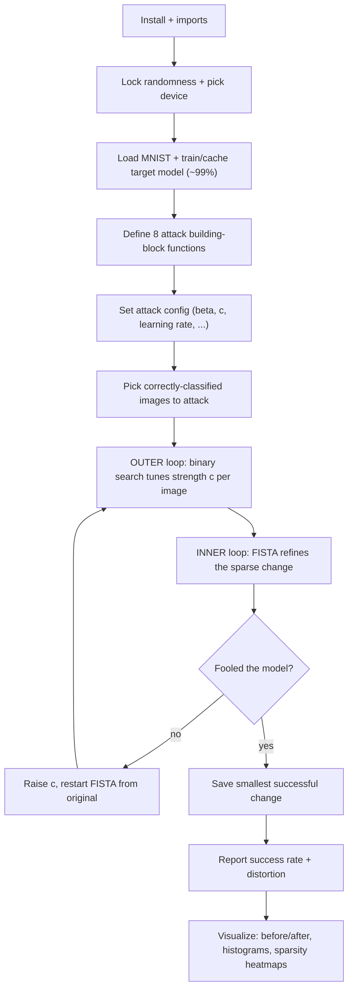

# ElasticNet (EAD) - Exam Cheatsheet

_HTB Academy · AI Evasion - Sparsity Attacks · the ElasticNet half (Sections 2-12)_

> **How to use this sheet**
> 
> - Run the cells **top to bottom in one Jupyter notebook**. Later cells reuse names earlier cells made.
> - **🔵 INPUT NEEDED** = fill every `<<LIKE_THIS>>` before running.
> - **⚪ no input needed - just run** = run it as it is.
> - This sheet has **no math**. Where the real attack uses a formula, you get one plain-English line instead.
> - Images stay in **pixel space**: plain brightness, **0 (black) to 1 (white)**. The model handles any normalizing inside itself.

## What this module does

ElasticNet (**EAD**) is the "change few pixels, but you may change them a lot" attack. Where FGSM spreads a tiny change over every pixel and DeepFool finds the smallest overall change, EAD tries to **leave most pixels untouched** and concentrate the change on a handful that matter. It does this with an optimizer called **FISTA** that nudges the image toward misclassification while a special "shrink" step keeps zeroing out the pixels that barely help. A **binary search** automatically dials the attack strength per image, so each digit gets just enough push to flip.



---

## Part A - Setup

## Step 1 - Install the HTB library

⚪ no input needed - just run

Installs HTB's helper library (the MNIST loader, the target model, the trainer, the plot theme). Same library as the FGSM and DeepFool modules.

```python
# "!" runs a terminal command from inside a notebook cell.
# --upgrade replaces an older copy if one is already there.
!pip install --upgrade git+https://github.com/PandaSt0rm/htb-ai-library
```

> **If it breaks:** no internet in the lab usually means it's already installed - skip to Step 2. If Step 2 then says `No module named 'htb_ai_library'`, you really do need this.

## Step 2 - Imports

⚪ no input needed - just run

Loads everything the sheet uses: PyTorch, plotting, and the HTB helpers.

```python
import torch
import torch.nn as nn
import torch.nn.functional as F
from torch.utils.data import DataLoader
from torchvision import datasets, transforms
import numpy as np
import matplotlib.pyplot as plt
import matplotlib.patches as patches
from pathlib import Path
import warnings
warnings.filterwarnings('ignore') # silence harmless library chatter

# HTB helpers: reproducibility, model save/load, and the plot colours
from htb_ai_library.utils import (
    set_reproducibility, save_model, load_model,
    HTB_GREEN, NODE_BLACK, HACKER_GREY, WHITE,
    AZURE, NUGGET_YELLOW, MALWARE_RED, VIVID_PURPLE, AQUAMARINE,
)
from htb_ai_library.data import get_mnist_loaders
from htb_ai_library.models import MNISTClassifierWithDropout
from htb_ai_library.training import train_model, evaluate_accuracy
from htb_ai_library.visualization import use_htb_style

use_htb_style() # apply the HTB dark theme to all plots
```

**Expected:** no output. An error here means Step 1 didn't finish.

## Step 3 - Lock randomness and pick the device

⚪ no input needed - just run

Fixes the random seed so runs match, and uses the GPU if there is one (EAD is heavy - a GPU helps a lot).

```python
set_reproducibility(1337) # same "random" numbers every run
device = torch.device("cuda" if torch.cuda.is_available() else "cpu")
print(f"Using device: {device}")
```

**Expected:** `Using device: cuda` or `cpu`. Either works; CPU is just slower.

## Step 4 - Load MNIST and build (or load) the target model

⚪ no input needed - just run

Trains `MNISTClassifierWithDropout` to about 99% the first time, then caches it to disk so later runs load instantly.

```python
train_loader, test_loader = get_mnist_loaders(batch_size=128) # ready-made MNIST data
output_dir = Path("output"); output_dir.mkdir(exist_ok=True) # folder for the cached model
model_path = output_dir / "mnist_target.pth"

model = MNISTClassifierWithDropout(num_classes=10).to(device) # build the empty model

if model_path.exists():
    print("Loading cached model...")
    model = load_model(model, model_path, device) # reuse saved weights
else:
    print("Training from scratch (a few minutes)...")
    model = train_model(model, train_loader, test_loader, epochs=5, device=device)
    save_model(model, model_path) # cache for next time

accuracy = evaluate_accuracy(model, test_loader, device)
model.eval() # dropout OFF - REQUIRED before attacking
print(f"Test accuracy: {accuracy:.2f}% | training mode? {model.training}")
```

**Expected:** `Test accuracy: 98.89%` (roughly), and `training mode? False`.

> **If this errors:** a loading/"weights only" error usually means a PyTorch version mismatch - delete `output/mnist_target.pth` and let it retrain.

> **Why `model.eval()` matters:** dropout randomly switches neurons off during training. Left on, the model gives a different answer each time and the attack reads useless gradients. `eval()` turns it off so the attack is stable. **Never attack a model in training mode.**

---

## Part B - The attack building blocks (define once, then reuse)

These are eight small functions. Copy each cell once; they don't produce output, they just teach the notebook the attack. Keep each one whole.

## Step 5 - Measure the change (three rulers)

⚪ no input needed - just run

Measures how big a change is, three ways, one number per image: total change (L1), energy (squared L2), and the blend EAD cares about (elastic).

```python
def compute_distances(adv_images, original_images, beta):
    """
    How big is the change? Returns three per-image numbers:
      l1_dist = total absolute change across all pixels
      l2_dist = squared L2 (sum of squared changes) -- NOTE: no square root
      elastic_dist = l2_dist + beta * l1_dist (the blend the attack minimizes)
    """
    l1_dist = torch.sum(torch.abs(adv_images - original_images), dim=(1, 2, 3))
    l2_dist = torch.sum((adv_images - original_images) ** 2, dim=(1, 2, 3))
    elastic_dist = l2_dist + beta * l1_dist
    return l1_dist, l2_dist, elastic_dist
```

**Plain-English:** `dim=(1, 2, 3)` means "add up over the whole image but keep each image separate," so 20 images give 20 numbers. **In this module, "L2" always means the squared version (no square root).**

## Step 6 - The "fool the model" score

⚪ no input needed - just run

Scores how badly the attack still needs to push. It drops to **zero** the moment the model is fooled, so the optimizer then stops pushing and just shrinks the change.

```python
def compute_adversarial_loss(logits, labels_onehot, confidence, targeted=False):
    """
    Margin score (Carlini & Wagner style). Zero once the attack has won.
      logits = raw model scores, one row per image
      labels_onehot = 1 at the class of interest, 0 elsewhere (see note below)
      confidence = how decisively it must be fooled (0 = barely counts)
      targeted = True to force a chosen class, False to just be wrong
    """
    real = torch.sum(labels_onehot * logits, dim=1) # score of the marked class
    other = torch.max((1 - labels_onehot) * logits - labels_onehot * 10000, dim=1)[0] # best other class
    if targeted:
        # want the TARGET (marked) class to beat everyone else
        loss = torch.clamp(other - real + confidence, min=0)
    else:
        # want the TRUE (marked) class to be overtaken
        loss = torch.clamp(real - other + confidence, min=0)
    return loss
```

**Plain-English:** `labels_onehot` marks a different class depending on the mode - the **true** class when untargeted, the **target** class when targeted. The `-10000` trick just makes sure the marked class can never be picked as its own competitor.

## Step 7 - The total "smooth" loss

⚪ no input needed - just run

Combines the fool-score with the energy ruler into the one number FISTA follows. The sparsity (L1) part is handled separately by the shrink step, not here.

```python
def compute_total_loss(adv_images, original_images, labels_onehot, const,
                       model, beta, confidence, targeted=False):
    """
    The smooth objective FISTA differentiates: c * fool_score + squared_L2.
    (L1 sparsity is NOT here -- the shrink step in Step 9 handles it.)
    Returns: (total_loss, fool_score, (l1, l2, elastic))
    """
    logits = model(adv_images) # forward pass (the slow bit)
    adversarial_loss = compute_adversarial_loss(logits, labels_onehot, confidence, targeted)
    l1_dist, l2_dist, elastic_dist = compute_distances(adv_images, original_images, beta)
    total_loss = const * adversarial_loss + l2_dist # c balances fooling vs size
    return total_loss, adversarial_loss, (l1_dist, l2_dist, elastic_dist)
```

**Plain-English:** `const` (called **c**) is a per-image dial. Bigger c = push harder to fool (bigger change); smaller c = stay small (might fail). Step 12's binary search sets it automatically.

## Step 8 - The look-ahead accelerator

⚪ no input needed - just run

Gives the optimizer a growing "momentum" so it speeds up once it finds a productive direction. Early steps are cautious; later steps accelerate.

```python
def compute_fista_momentum(iteration):
    """How much look-ahead momentum at this iteration. Grows from 0.25 toward (but never past) 1."""
    return iteration / (iteration + 3.0)
```

**Plain-English:** iteration 1 gives 0.25 (careful), iteration 10 gives ~0.77, iteration 100 gives ~0.97 (confident). The `+3` keeps it below 1 so momentum never runs away.

## Step 9 - The shrink step (this is what creates sparsity)

⚪ no input needed - just run

The heart of EAD. After each nudge, it **sets every tiny change to exactly zero** and shrinks the rest. That's what leaves most pixels untouched.

```python
def apply_shrinkage_thresholding(y, original_images, threshold, clip_min=0.0, clip_max=1.0):
    """
    Keep big changes (shrunk a little), kill small ones (set to exactly 0).
      y = the candidate image after a gradient nudge
      threshold = how aggressive the zeroing is (bigger = sparser)
    A change at or below the threshold becomes exactly zero. Clips to a valid 0..1 image.
    """
    diff = y - original_images # the change so far
    shrink_positive = torch.clamp(y - threshold, min=clip_min, max=clip_max)
    shrink_negative = torch.clamp(y + threshold, min=clip_min, max=clip_max)
    cond_positive = (diff > threshold).float() # big positive change -> shrink down
    cond_zero = (torch.abs(diff) <= threshold).float() # small change -> ZERO it
    cond_negative = (diff < -threshold).float() # big negative change -> shrink up
    result = (cond_positive * shrink_positive
              + cond_zero * original_images
              + cond_negative * shrink_negative)
    return result
```

**Plain-English:** a change exactly equal to the threshold counts as "small" and gets zeroed. The zeroed pixels become **true zeros**, not tiny leftovers, which is what makes the attack genuinely sparse.

## Step 10 - One FISTA step

⚪ no input needed - just run

One full optimization step: look ahead, nudge toward fooling, shrink for sparsity, then set up the next look-ahead point.

```python
def fista_step(adv_images, y_momentum, original_images, labels_onehot, const, model,
               beta, learning_rate, confidence, iteration,
               targeted=False, clip_min=0.0, clip_max=1.0):
    """
    One optimization step. Returns the new image, the new look-ahead point,
    the loss number, and the distances.
    """
    y_momentum = y_momentum.detach().requires_grad_(True) # fresh gradient tracking this step only
    total_loss, adversarial_loss, distances = compute_total_loss(
        y_momentum, original_images, labels_onehot, const, model, beta, confidence, targeted
    )
    total_loss_summed = total_loss.sum() # sum so each image updates its own pixels
    total_loss_summed.backward() # fill in the per-pixel gradients
    grad = y_momentum.grad

    y_new = y_momentum - learning_rate * grad # nudge toward lower loss
    adv_new = apply_shrinkage_thresholding( # shrink for sparsity
        y_new, original_images, learning_rate * beta, clip_min, clip_max
    )
    momentum_coef = compute_fista_momentum(iteration) # how much to look ahead
    y_new_momentum = adv_new + momentum_coef * (adv_new - adv_images) # next look-ahead point
    return adv_new, y_new_momentum, total_loss_summed.item(), distances
```

**Plain-English:** the gradient is measured at the **look-ahead point** (`y_momentum`), not the current image - that's the trick that makes FISTA fast. The shrink threshold is `learning_rate * beta`.

## Step 11 - Did it work?

⚪ no input needed - just run

A plain yes/no per image: is the model fooled now?

```python
def check_attack_success(adv_images, labels, model, targeted=False):
    """
    True where the attack succeeded.
      untargeted: success = prediction DIFFERS from the true label
      targeted: success = prediction EQUALS the target label
    """
    with torch.no_grad(): # just checking, no optimizing
        predictions = model(adv_images).argmax(dim=1)
        if targeted:
            return predictions.eq(labels) # matches the target
        else:
            return predictions.ne(labels) # differs from the truth
```

**Plain-English:** `labels` is the **true** labels when untargeted, the **target** labels when targeted (same rule as Step 6).

## Step 12 - Tune the strength (binary search)

⚪ no input needed - just run

Finds the smallest strength c that still fools each image. Success → try weaker; failure → push stronger.

```python
def update_binary_search_bounds(lower_bound, upper_bound, const, success_mask):
    """
    Adjust c per image after a round:
      success -> lower the ceiling, try a smaller c (half-way between bounds)
      failure -> raise the floor; if we have never succeeded yet, multiply c by 10
    """
    for i in range(len(success_mask)):
        if success_mask[i]:
            upper_bound[i] = min(upper_bound[i], const[i]) # c worked -> maybe too big
            if upper_bound[i] < 1e10:
                const[i] = (lower_bound[i] + upper_bound[i]) / 2
        else:
            lower_bound[i] = max(lower_bound[i], const[i]) # c too small
            if upper_bound[i] < 1e10:
                const[i] = (lower_bound[i] + upper_bound[i]) / 2
            else:
                const[i] *= 10 # no success yet -> jump up a scale
    return lower_bound, upper_bound, const
```

**Plain-English:** before the first success there's no ceiling, so c jumps ×10 (0.001 → 0.01 → 0.1 → ...) to find the right scale fast. After a success it halves the gap each round to home in.

---

## Part C - Run the attack

## Step 13 - Attack settings

🔵 INPUT NEEDED

The dials. The defaults match the course and work well on MNIST.

```python
config = {
    "beta": <<BETA>>, # sparsity knob: higher = fewer pixels changed
    "confidence": <<CONFIDENCE>>, # how decisively to fool (0 = minimal)
    "learning_rate": <<LR>>, # FISTA step size
    "max_iterations": <<MAX_ITERS>>, # FISTA steps per binary-search round
    "binary_search_steps": <<BSS>>, # how many c values to try
    "initial_const": <<INIT_C>>, # starting strength
    "clip_min": 0.0, "clip_max": 1.0, # valid pixel range
}
TARGETED = <<TARGETED>> # False = just be wrong, True = force a class
for k, v in config.items(): print(f" {k}: {v}")
```

**fill in:**

- `<<BETA>>` - sparsity. **If** you want a balanced attack → `0.01` (**pick this**, the course default). **If** you want very few changed pixels → `0.05` - `0.1`. **If** you want it to behave like a dense L2 attack → `0.001`.
- `<<CONFIDENCE>>` - **If** you just need it to flip → `0` (**pick this**). **If** the flip must survive rounding/preprocessing → `5` - `20` (bigger change).
- `<<LR>>` - `0.01` (**pick this**). **If** it oscillates/diverges → lower to `0.005`. Don't go above `0.05`.
- `<<MAX_ITERS>>` - `1000` (**pick this**). Lower (`200`) only for a quick test.
- `<<BSS>>` - **If** you want speed (practice) → `5` (**pick this**). **If** you want the smallest possible change (report) → `9`.
- `<<INIT_C>>` - `0.001` (**pick this**). It auto-grows if too small.
- `<<TARGETED>>` - **If** the task says "make it misclassify / any wrong class" → `False` (**pick this**). **If** the task names a class to reach → `True` (and set the targets in Step 14).

## Step 14 - Pick images to attack

🔵 INPUT NEEDED

Grabs images the model **already gets right** (attacking wrong ones proves nothing), and builds the one-hot labels the loss needs.

```python
model.eval()
num_samples = <<NUM_SAMPLES>>

for data, targets in test_loader:
    data, targets = data.to(device), targets.to(device)
    correct_mask = model(data).argmax(dim=1).eq(targets) # keep only correctly classified
    attack_data = data[correct_mask][:num_samples]
    attack_targets = targets[correct_mask][:num_samples]
    if len(attack_data) >= num_samples:
        break
print(f"Selected {len(attack_data)} images")

batch_size = len(attack_data)
original_images = attack_data.clone()

# For TARGETED attacks, choose the class to force here; for untargeted, this stays the true label.
attack_labels = attack_targets # <<-- for targeted, replace with your targets
labels_onehot = torch.zeros(batch_size, 10).to(device)
labels_onehot.scatter_(1, attack_labels.unsqueeze(1), 1) # 1 at the marked class, 0 elsewhere
```

**fill in:**

- `<<NUM_SAMPLES>>` - `20` for a quick run, `100`+ for trustworthy averages.
- **If `TARGETED = True`:** replace `attack_labels = attack_targets` with your chosen target classes, e.g. `attack_labels = (attack_targets + 1) % 10` (one example: aim each image at the next digit). The one-hot is then built from the targets automatically.

## Step 15 - Run the two loops

⚪ no input needed - just run (uses Step 13-14 values)

Outer loop tries different strengths; inner loop runs FISTA; the smallest successful change per image is saved. This is the slow part (minutes on GPU).

```python
# Binary-search bounds + best-result trackers
lower_bound = torch.zeros(batch_size).to(device)
upper_bound = torch.ones(batch_size).to(device) * 1e10
const = torch.ones(batch_size).to(device) * config["initial_const"]
best_adv = original_images.clone()
best_l2 = torch.ones(batch_size).to(device) * 1e10

for binary_step in range(config["binary_search_steps"]):
    adv_images = original_images.clone().detach() # RESTART from the clean image each round
    y_momentum = adv_images.clone()

    for iteration in range(config["max_iterations"]): # FISTA refinement
        adv_images, y_momentum, loss, distances = fista_step(
            adv_images, y_momentum, original_images, labels_onehot, const, model,
            config["beta"], config["learning_rate"], config["confidence"], iteration,
            targeted=TARGETED, clip_min=config["clip_min"], clip_max=config["clip_max"],
        )

    success_mask = check_attack_success(adv_images, attack_labels, model, targeted=TARGETED)
    l1_dist, l2_dist, elastic_dist = compute_distances(adv_images, original_images, config["beta"])

    for i in range(batch_size): # keep only successes that are smaller than before
        if success_mask[i] and l2_dist[i] < best_l2[i]:
            best_adv[i] = adv_images[i]
            best_l2[i] = l2_dist[i]

    lower_bound, upper_bound, const = update_binary_search_bounds(
        lower_bound, upper_bound, const, success_mask
    )
    print(f"Binary step {binary_step+1}/{config['binary_search_steps']}: "
          f"{success_mask.sum().item()}/{batch_size} fooled")
```

**Expected:** the "fooled" count climbs across rounds. It's normal for early rounds to fool few and later rounds to fool most, because c starts tiny and grows.

## Step 16 - Final scores

⚪ no input needed - just run

Re-checks the saved best images and prints the success rate and the four distortion rulers.

```python
with torch.no_grad():
    adv_predictions = model(best_adv).argmax(dim=1)
    final_success = (adv_predictions.eq(attack_labels) if TARGETED
                     else adv_predictions.ne(attack_labels))
    success_rate = final_success.float().mean().item() * 100
    l1_dist, l2_dist, elastic_dist = compute_distances(best_adv, original_images, config["beta"])
    linf_dist = torch.max(torch.abs(best_adv - original_images).view(batch_size, -1), dim=1)[0]

print("=" * 55)
print(f"Success Rate: {success_rate:.2f}% ({final_success.sum()}/{batch_size})")
print(f"Avg L1 (total change): {l1_dist.mean().item():.4f}")
print(f"Avg squared L2 (energy): {l2_dist.mean().item():.4f}")
print(f"Avg L-inf (worst pixel): {linf_dist.mean().item():.4f}")
print(f"Avg elastic (the blend): {elastic_dist.mean().item():.4f}")
print("=" * 55)
```

**Expected (course run, 20 images, beta 0.01):** ~100% success, avg L1 ≈ 20, squared L2 ≈ 4, L∞ ≈ 0.45, elastic ≈ 4.4. (Elastic ≈ squared L2 + beta × L1.)

---

## Part D - See it

## Step 17 - Before / change / after

⚪ no input needed - just run

Shows the originals, the change (brightened 10× so you can see it), and the fooled images with their new labels.

```python
fig, axes = plt.subplots(3, 10, figsize=(20, 6))
for i in range(min(10, batch_size)):
    axes[0, i].imshow(original_images[i].detach().cpu().squeeze(), cmap="gray", vmin=0, vmax=1)
    axes[0, i].set_title(f"True: {attack_targets[i].item()}", fontsize=10); axes[0, i].axis("off")

    pert = (best_adv[i] - original_images[i]).detach().cpu().squeeze() * 10 # amplify 10x
    axes[1, i].imshow(pert, cmap="seismic", vmin=-1, vmax=1) # red=up, blue=down, white=none
    axes[1, i].set_title("Change x10", fontsize=10); axes[1, i].axis("off")

    axes[2, i].imshow(best_adv[i].detach().cpu().squeeze(), cmap="gray", vmin=0, vmax=1)
    axes[2, i].set_title(f"Pred: {adv_predictions[i].item()}", fontsize=10, color=MALWARE_RED); axes[2, i].axis("off")

for y, label in [(0.80, "Original"), (0.50, "Change\n(10x)"), (0.20, "Adversarial")]:
    fig.text(0.02, y, label, rotation=90, fontsize=13, weight="bold", ha="center", va="center")
plt.tight_layout(rect=[0.03, 0, 1, 1]); plt.show()
```

**Reading it:** in the change row, ==white = untouched==, red = brightened, blue = darkened. The change hugs the strokes/edges; the fooled digits still look like the originals to you.

## Step 18 - Distortion histograms

⚪ no input needed - just run

Shows the spread of each ruler across your images, not just the average.

```python
fig, axes = plt.subplots(2, 2, figsize=(14, 10))
metrics = [("L1 (total change)", l1_dist, AZURE),
           ("Squared L2 (energy)", l2_dist, VIVID_PURPLE),
           ("L-inf (worst pixel)", linf_dist, NUGGET_YELLOW),
           ("Elastic (the blend)", elastic_dist, AQUAMARINE)]
for ax, (name, t, colour) in zip(axes.flatten(), metrics):
    v = t.detach().cpu().numpy()
    ax.hist(v, bins=15, color=colour, alpha=0.7, edgecolor=NODE_BLACK)
    ax.axvline(v.mean(), color=MALWARE_RED, linestyle="--", linewidth=2, label=f"Mean: {v.mean():.2f}")
    ax.set_title(name); ax.set_xlabel("distance"); ax.set_ylabel("count"); ax.legend(frameon=False)
plt.tight_layout(); plt.show()
```

**Reading it:** expect a cluster at low values with a **long tail to the right** - a few hard images need much bigger changes. The red line is the mean.

## Step 19 - Where the change lands (sparsity heatmaps)

⚪ no input needed - just run

Heatmaps of where each image changed, plus a bar per image of how many pixels stayed untouched.

```python
fig = plt.figure(figsize=(16, 8))
gs = fig.add_gridspec(3, 5, height_ratios=[1, 1, 0.6], hspace=0.3, wspace=0.3)
for i in range(min(10, batch_size)):
    ax = fig.add_subplot(gs[i // 5, i % 5])
    pert = (best_adv[i] - original_images[i]).detach().cpu().squeeze()
    ax.imshow(torch.abs(pert), cmap="hot", vmin=0, vmax=pert.abs().max()) # black=none -> white=max
    ax.set_title(f"Example {i+1}", fontsize=10); ax.axis("off")

nonzero = (torch.abs(best_adv - original_images) > 1e-6).float().sum(dim=(1, 2, 3))
sparsity = (1 - nonzero / 784) * 100 # % of pixels left unchanged
sparsity = sparsity.detach().cpu().numpy()

ax_stats = fig.add_subplot(gs[2, :])
ax_stats.bar(range(len(sparsity)), sparsity, color=AQUAMARINE, alpha=0.7, edgecolor=NODE_BLACK)
ax_stats.axhline(sparsity.mean(), color=MALWARE_RED, linestyle="--", linewidth=2,
                 label=f"Mean: {sparsity.mean():.1f}%")
ax_stats.set_title("Sparsity per image (% pixels unchanged)"); ax_stats.set_ylim([0, 100])
ax_stats.set_xlabel("image"); ax_stats.set_ylabel("sparsity %"); ax_stats.legend(frameon=False)
plt.tight_layout(); plt.show()
```

**Reading it:** the bright heatmap spots sit on the digit's strokes/edges (where the model is most sensitive), not the background. The bars show sparsity varies a lot image to image (roughly 30-75%, around half on average).

---

## If you remember nothing else

## The attack in 4 lines

1. **Goal:** change as **few pixels as possible** (leave most untouched), even if the changed ones move a lot. That's the opposite of FGSM (tiny change to every pixel).
2. **Loop inside a loop:** an **inner FISTA** optimizer nudges the image toward misclassification and, after every nudge, a **shrink step zeros out the pixels that barely help** (that's what makes it sparse). An **outer binary search** dials the strength c so each image gets just enough push to flip.
3. **Always restart FISTA from the clean image** each binary round, and **save the smallest successful change** per image.
4. **Attack only images the model already gets right**, keep `model.eval()` on, and work in plain 0-1 pixels.

## The core from memory

```python
# setup: get_mnist_loaders -> MNISTClassifierWithDropout -> train 5 epochs -> model.eval()
# define 8 functions: distances, fool-score, total-loss, momentum, SHRINK, fista_step, success, binary-search-update
for binary_step in range(STEPS): # outer: tune strength c
    adv = original.clone().detach(); y = adv.clone()
    for it in range(ITERS): # inner: FISTA
        adv, y, loss, dists = fista_step(adv, y, original, labels_onehot, const, model, beta, lr, conf, it)
    success = check_attack_success(adv, labels, model)
    # save adv where success AND smaller than best so far
    lower, upper, const = update_binary_search_bounds(lower, upper, const, success)
# the SHRINK step (the sparsity engine): zero changes <= threshold, shrink the rest; threshold = lr * beta
```

## Must-know facts

- **EAD changes FEW pixels (sparsity), measured by how many pixels differ (the "L0" idea)**, unlike FGSM (limits the biggest single-pixel change) and DeepFool (minimizes overall change). Sparse changes can slip past defenders that only watch the overall noise level.
- **Sparsity comes from the shrink step, which sets any change at or below a threshold to _exactly_ zero**, not near-zero. Plain optimization alone can't do this - that's why EAD needs FISTA, not ordinary gradient descent.
- ==`beta` is the sparsity dial: higher = fewer changed pixels==; 0.01 is a balanced default, 0.05-0.1 is very sparse, 0.001 behaves like a dense attack.
- **`c` (strength) is set automatically per image by binary search**: it grows ×10 until the first success, then halves the gap to find the smallest change that still fools - unlike FGSM's one fixed setting for every image.
- **The fool-score drops to zero the moment the model is fooled**, so the optimizer then automatically switches from "fool it" to "shrink the change" with no extra code.
- **Always `model.eval()` and attack only already-correct images**; keep everything in plain 0-1 pixels and clip after each step so the result stays a valid image.
- **EAD is slow** - hundreds of FISTA steps inside several binary-search rounds (thousands of passes per image), so use a GPU and fewer binary steps (5) for practice, more (9) for the smallest change.
- **Method point:** ==to flip untargeted → targeted, just set `TARGETED = True` and feed the target classes as the labels==; the same functions handle both - targeted just needs the target to _win_, not merely for the true class to lose, and usually needs a bigger change.