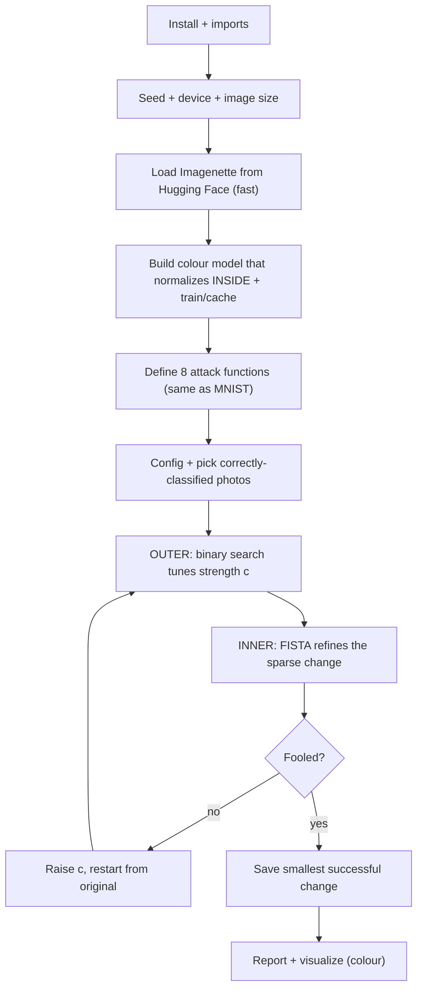

# ElasticNet (EAD) on Imagenette - Exam Cheatsheet

_Real-world colour-photo version · AI Evasion - Sparsity Attacks · for applying EAD beyond MNIST_

> **How to use this sheet**
> 
> - Run the cells **top to bottom in one Jupyter notebook**. Later cells reuse names earlier cells made.
> - **🔵 INPUT NEEDED** = fill every `<<LIKE_THIS>>` before running.
> - **⚪ no input needed - just run** = run it as it is.
> - This sheet has **no math**. Where the real attack uses a formula, you get one plain-English line instead.
> - **Everything is in plain 0..1 colour pixels.** The model does its own normalizing _inside_, so the attack never has to.
> - **Imagenette** = 10 real ImageNet photo classes (fish, dog, cassette player, chainsaw, church, horn, garbage truck, gas pump, golf ball, parachute). This is the self-contained version - **no HTB library needed**.

## What this does

Same attack as the MNIST ElasticNet sheet, pointed at **real colour photos** instead of digits. EAD still tries to **change as few pixels as possible** while fooling the model, using the FISTA optimizer plus a shrink step that keeps zeroing out the pixels that barely help, with a binary search tuning the strength per image. The only real differences from MNIST are the **setup** (load colour photos, use a bigger colour model that normalizes inside) and the **pictures** (colour, so no grayscale). **The 8 attack functions are byte-for-byte identical to the MNIST sheet** - they don't care about image size or colour.



---

## Part A - Setup

## Step 1 - Install

⚪ no input needed - just run

Installs PyTorch (if missing) and Hugging Face `datasets` (the fast way to get Imagenette).

```python
!pip install torch torchvision datasets -q
```

> **If it breaks:** in a lab these are usually already installed - skip to Step 2. Only `datasets` is likely new (you installed it for the CIFAR fix).

## Step 2 - Imports and colours

⚪ no input needed - just run

Loads everything. Since there's no HTB library here, the plot colours are plain hex codes.

```python
import os
import numpy as np
import torch
import torch.nn as nn
import torch.nn.functional as F
from torch.utils.data import Dataset, DataLoader
from torchvision import transforms
import matplotlib.pyplot as plt
import warnings
warnings.filterwarnings('ignore')

# Plot colours (stand-ins for the HTB palette)
HTB_GREEN="#9FEF00"; NODE_BLACK="#141D2B"; HACKER_GREY="#A4B1CD"; WHITE="#FFFFFF"
AZURE="#2EE7FF"; NUGGET_YELLOW="#FFAF00"; MALWARE_RED="#FF3E3E"; VIVID_PURPLE="#9F00FF"; AQUAMARINE="#2EFFCA"

os.environ["HF_HUB_DISABLE_SYMLINKS_WARNING"] = "1" # silence a harmless Windows warning
```

**Expected:** no output.

## Step 3 - Seed, device, image size

🔵 INPUT NEEDED

Fixes randomness, picks the GPU, and sets how big the photos are. ==Bigger = sharper but much slower to attack== (EAD is heavy).

```python
SEED = 1337
torch.manual_seed(SEED); np.random.seed(SEED)
device = torch.device("cuda" if torch.cuda.is_available() else "cpu")

IMG_SIZE = <<IMG_SIZE>> # pixels per side (square)
print("Using device:", device, "| image size:", IMG_SIZE)
```

**fill in:** `<<IMG_SIZE>>`

- **If** you're on CPU or want it to finish fast → `64` (**pick this** for practice).
- **If** you have a GPU and want sharper photos → `128`.
- Don't go above `160` - the attack gets very slow and memory-hungry.

## Step 4 - Load Imagenette from Hugging Face

⚪ no input needed - just run

Downloads the photos from Hugging Face (fast CDN), resizes them, and wraps them so they behave like a normal PyTorch dataset in plain 0..1 pixels.

```python
import tarfile, urllib.request
from pathlib import Path
from torchvision.datasets import ImageFolder

class_names = ["tench","English springer","cassette player","chain saw","church",
               "French horn","garbage truck","gas pump","golf ball","parachute"]

root = Path("imagenette_data"); root.mkdir(exist_ok=True)
tgz = root / "imagenette2-160.tgz"
if not (root / "imagenette2-160").exists():
    if not tgz.exists():
        print("downloading ~95 MB ...")
        urllib.request.urlretrieve("https://s3.amazonaws.com/fast-ai-imageclas/imagenette2-160.tgz", str(tgz) + ".part")
        os.replace(str(tgz) + ".part", tgz)
    print("extracting ...")
    with tarfile.open(tgz) as t:
        try: t.extractall(root, filter="data")
        except TypeError: t.extractall(root)

train_tf = transforms.Compose([transforms.Resize((IMG_SIZE, IMG_SIZE)),
                               transforms.RandomHorizontalFlip(), transforms.ToTensor()])
test_tf = transforms.Compose([transforms.Resize((IMG_SIZE, IMG_SIZE)), transforms.ToTensor()])

train_set = ImageFolder(root / "imagenette2-160" / "train", transform=train_tf)
test_set = ImageFolder(root / "imagenette2-160" / "val", transform=test_tf)

g = torch.Generator().manual_seed(SEED)
train_loader = DataLoader(train_set, batch_size=64, shuffle=True, num_workers=0, generator=g)
test_loader = DataLoader(test_set, batch_size=64, shuffle=False, num_workers=0)
print(len(train_set), "train |", len(test_set), "test | one image:", test_set[0][0].shape)
```

**Expected:** the 10 class names, then something like `9469 train | 3925 test | one image: torch.Size([3, 64, 64])`.

> **If it hangs or the field names differ:** keep `num_workers=0` on Windows. If `row["image"]` errors, print `hf["train"].features` and use whatever the image column is actually called.

## Step 5 - The colour model (normalizes inside)

🔵 INPUT NEEDED

Builds the target model. **Normalizing happens _inside_ the model**, so you feed it plain 0..1 photos and attack in plain 0..1 - exactly like a real deployed classifier that receives image files. Two options:

```python
# Shared "normalize inside" wrapper: takes 0..1 photos, normalizes with ImageNet stats, runs the backbone.
class Model(nn.Module):
    def __init__(self, backbone):
        super().__init__()
        self.register_buffer("mean", torch.tensor([0.485, 0.456, 0.406]).view(1, 3, 1, 1))
        self.register_buffer("std", torch.tensor([0.229, 0.224, 0.225]).view(1, 3, 1, 1))
        self.backbone = backbone
    def forward(self, x01):
        return self.backbone((x01 - self.mean) / self.std) # normalize, then classify

USE_PRETRAINED = <<USE_PRETRAINED>> # True or False

if USE_PRETRAINED:
    # OPTION A: fine-tune a pretrained ResNet-18 (high accuracy, fast; downloads ~45 MB weights once)
    from torchvision.models import resnet18, ResNet18_Weights
    backbone = resnet18(weights=ResNet18_Weights.IMAGENET1K_V1)
    backbone.fc = nn.Linear(backbone.fc.in_features, 10) # swap the final layer to 10 classes
else:
    # OPTION B: a small colour CNN from scratch (fully self-contained, lower accuracy)
    def block(i, o):
        return nn.Sequential(
            nn.Conv2d(i, o, 3, padding=1), nn.BatchNorm2d(o), nn.ReLU(),
            nn.Conv2d(o, o, 3, padding=1), nn.BatchNorm2d(o), nn.ReLU(), nn.MaxPool2d(2))
    backbone = nn.Sequential(
        block(3, 32), block(32, 64), block(64, 128),
        nn.AdaptiveAvgPool2d(4), nn.Flatten(),
        nn.Linear(128 * 16, 256), nn.ReLU(), nn.Dropout(0.5), nn.Linear(256, 10))

model = Model(backbone).to(device)
print("model ready | pretrained:", USE_PRETRAINED)
```

**fill in:** `<<USE_PRETRAINED>>`

- **If** you want high accuracy fast and have internet → `True` (**pick this**). A pretrained net already knows these classes, so a few epochs reach ~95%+.
- **If** you need it fully offline / self-contained → `False` (trains slower, lower accuracy, but no downloads).

## Step 6 - Train and cache the model

⚪ no input needed - just run

Trains for a few passes the first time and saves it, so later runs load instantly. Ends in eval mode (dropout/batch-norm fixed), which is **required before attacking**.

```python
os.makedirs("output", exist_ok=True)
model_path = f"output/imagenette_{'resnet' if USE_PRETRAINED else 'cnn'}_{IMG_SIZE}.pth"

def evaluate(m):
    m.eval(); correct = total = 0
    with torch.no_grad():
        for x, y in test_loader:
            x, y = x.to(device), y.to(device)
            correct += (m(x).argmax(1) == y).sum().item(); total += y.numel()
    return 100 * correct / total

EPOCHS = <<EPOCHS>>
if os.path.exists(model_path):
    model.load_state_dict(torch.load(model_path, map_location=device))
    print("Loaded cached model.")
else:
    opt = torch.optim.Adam(model.parameters(), lr=1e-3)
    for ep in range(EPOCHS):
        model.train()
        for x, y in train_loader:
            x, y = x.to(device), y.to(device)
            opt.zero_grad(); F.cross_entropy(model(x), y).backward(); opt.step()
        print(f"epoch {ep+1}/{EPOCHS} | test acc {evaluate(model):.2f}%")
    torch.save(model.state_dict(), model_path) # cache weights only (safe to reload)

model.eval()
print(f"Final test accuracy: {evaluate(model):.2f}% | training mode? {model.training}")
```

**fill in:** `<<EPOCHS>>`

- **If** `USE_PRETRAINED = True` → `3` (**pick this**, it's already most of the way there).
- **If** `USE_PRETRAINED = False` → `15` - `20` (from scratch needs more).

**Expected:** accuracy climbing to ~95%+ (pretrained) or ~70-80% (from scratch), then `training mode? False`.

---

## Part B - The attack building blocks (identical to the MNIST sheet)

These 8 functions are exactly the same as the MNIST ElasticNet sheet - they work on any image, colour or grey, any size. Copy each cell once.

## Step 7 - Measure the change (three rulers)

⚪ no input needed - just run

```python
def compute_distances(adv_images, original_images, beta):
    """Returns per-image: l1 (total change), l2 (squared L2, no square root), elastic (= l2 + beta*l1)."""
    l1_dist = torch.sum(torch.abs(adv_images - original_images), dim=(1, 2, 3))
    l2_dist = torch.sum((adv_images - original_images) ** 2, dim=(1, 2, 3))
    elastic_dist = l2_dist + beta * l1_dist
    return l1_dist, l2_dist, elastic_dist
```

**Plain-English:** `dim=(1,2,3)` sums over colour, height and width but keeps images separate - one number per photo.

## Step 8 - The "fool the model" score

⚪ no input needed - just run

```python
def compute_adversarial_loss(logits, labels_onehot, confidence, targeted=False):
    """Margin score. Zero once the attack has won. labels_onehot marks the true class (untargeted) or target (targeted)."""
    real = torch.sum(labels_onehot * logits, dim=1) # score of the marked class
    other = torch.max((1 - labels_onehot) * logits - labels_onehot * 10000, dim=1)[0] # best other class
    if targeted:
        loss = torch.clamp(other - real + confidence, min=0) # want target to win
    else:
        loss = torch.clamp(real - other + confidence, min=0) # want true class to lose
    return loss
```

## Step 9 - The total "smooth" loss

⚪ no input needed - just run

```python
def compute_total_loss(adv_images, original_images, labels_onehot, const,
                       model, beta, confidence, targeted=False):
    """The smooth objective FISTA follows: c * fool_score + squared_L2 (L1 handled by the shrink step)."""
    logits = model(adv_images)
    adversarial_loss = compute_adversarial_loss(logits, labels_onehot, confidence, targeted)
    l1_dist, l2_dist, elastic_dist = compute_distances(adv_images, original_images, beta)
    total_loss = const * adversarial_loss + l2_dist
    return total_loss, adversarial_loss, (l1_dist, l2_dist, elastic_dist)
```

## Step 10 - The look-ahead accelerator

⚪ no input needed - just run

```python
def compute_fista_momentum(iteration):
    """How much look-ahead momentum at this step. Grows from 0.25 toward (never past) 1."""
    return iteration / (iteration + 3.0)
```

## Step 11 - The shrink step (creates sparsity)

⚪ no input needed - just run

```python
def apply_shrinkage_thresholding(y, original_images, threshold, clip_min=0.0, clip_max=1.0):
    """Keep big changes (shrunk a little), set small ones (<= threshold) to exactly zero. Clips to a valid 0..1 image."""
    diff = y - original_images
    shrink_positive = torch.clamp(y - threshold, min=clip_min, max=clip_max)
    shrink_negative = torch.clamp(y + threshold, min=clip_min, max=clip_max)
    cond_positive = (diff > threshold).float()
    cond_zero = (torch.abs(diff) <= threshold).float()
    cond_negative = (diff < -threshold).float()
    return cond_positive * shrink_positive + cond_zero * original_images + cond_negative * shrink_negative
```

## Step 12 - One FISTA step

⚪ no input needed - just run

```python
def fista_step(adv_images, y_momentum, original_images, labels_onehot, const, model,
               beta, learning_rate, confidence, iteration,
               targeted=False, clip_min=0.0, clip_max=1.0):
    """One optimization step: look ahead, nudge toward fooling, shrink for sparsity, set next look-ahead point."""
    y_momentum = y_momentum.detach().requires_grad_(True)
    total_loss, adversarial_loss, distances = compute_total_loss(
        y_momentum, original_images, labels_onehot, const, model, beta, confidence, targeted)
    total_loss_summed = total_loss.sum()
    total_loss_summed.backward()
    grad = y_momentum.grad
    y_new = y_momentum - learning_rate * grad
    adv_new = apply_shrinkage_thresholding(y_new, original_images, learning_rate * beta, clip_min, clip_max)
    momentum_coef = compute_fista_momentum(iteration)
    y_new_momentum = adv_new + momentum_coef * (adv_new - adv_images)
    return adv_new, y_new_momentum, total_loss_summed.item(), distances
```

## Step 13 - Did it work?

⚪ no input needed - just run

```python
def check_attack_success(adv_images, labels, model, targeted=False):
    """True where fooled. untargeted: prediction differs from true label. targeted: prediction equals target."""
    with torch.no_grad():
        predictions = model(adv_images).argmax(dim=1)
        return predictions.eq(labels) if targeted else predictions.ne(labels)
```

## Step 14 - Tune the strength (binary search)

⚪ no input needed - just run

```python
def update_binary_search_bounds(lower_bound, upper_bound, const, success_mask):
    """success -> lower ceiling, halve toward smaller c. failure -> raise floor; x10 if never succeeded yet."""
    for i in range(len(success_mask)):
        if success_mask[i]:
            upper_bound[i] = min(upper_bound[i], const[i])
            if upper_bound[i] < 1e10:
                const[i] = (lower_bound[i] + upper_bound[i]) / 2
        else:
            lower_bound[i] = max(lower_bound[i], const[i])
            if upper_bound[i] < 1e10:
                const[i] = (lower_bound[i] + upper_bound[i]) / 2
            else:
                const[i] *= 10
    return lower_bound, upper_bound, const
```

---

## Part C - Run the attack

## Step 15 - Attack settings

🔵 INPUT NEEDED

The dials. On big colour photos, start with fewer images and fewer iterations than MNIST - EAD is much slower here.

```python
config = {
    "beta": <<BETA>>, # sparsity knob: higher = fewer pixels changed
    "confidence": <<CONFIDENCE>>, # how decisively to fool (0 = minimal)
    "learning_rate": <<LR>>, # FISTA step size
    "max_iterations": <<MAX_ITERS>>, # FISTA steps per binary-search round
    "binary_search_steps": <<BSS>>, # how many c values to try
    "initial_const": <<INIT_C>>, # starting strength
    "clip_min": 0.0, "clip_max": 1.0,
}
TARGETED = <<TARGETED>> # False = just be wrong, True = force a class
for k, v in config.items(): print(f" {k}: {v}")
```

**fill in:**

- `<<BETA>>` - `0.01` (**pick this**). Higher (`0.05`) = fewer changed pixels; `0.001` = dense.
- `<<CONFIDENCE>>` - `0` (**pick this**). `5` - `20` for a more robust flip (bigger change).
- `<<LR>>` - `0.01` (**pick this**). Lower to `0.005` if the loss oscillates. Colour photos sometimes like `0.02`.
- `<<MAX_ITERS>>` - **If** practising / on CPU → `300`. **If** you want quality on GPU → `1000`.
- `<<BSS>>` - `5` (**pick this**). `9` for the smallest possible change (slower).
- `<<INIT_C>>` - `0.01` (**pick this** for colour; a bit higher than MNIST's 0.001 since real photos need more push). It auto-grows anyway.
- `<<TARGETED>>` - `False` for "just be wrong" (**pick this**); `True` to force a class (set targets in Step 16).

## Step 16 - Pick photos to attack

🔵 INPUT NEEDED

Grabs photos the model **already gets right**, and builds the one-hot labels.

```python
model.eval()
num_samples = <<NUM_SAMPLES>>

attack_data, attack_targets = [], []
for data, targets in test_loader:
    data, targets = data.to(device), targets.to(device)
    correct = model(data).argmax(dim=1).eq(targets) # keep only correctly classified
    for x, y in zip(data[correct], targets[correct]):
        attack_data.append(x); attack_targets.append(y)
    if len(attack_data) >= num_samples:
        break
attack_data = torch.stack(attack_data[:num_samples])
attack_targets = torch.stack(attack_targets[:num_samples])
print(f"Selected {len(attack_data)} photos")

batch_size = len(attack_data)
original_images = attack_data.clone()
num_pixels = original_images[0].numel() # 3 * IMG_SIZE * IMG_SIZE (for sparsity later)

attack_labels = attack_targets # for TARGETED, replace with your target classes
labels_onehot = torch.zeros(batch_size, 10).to(device)
labels_onehot.scatter_(1, attack_labels.unsqueeze(1), 1)
```

**fill in:**

- `<<NUM_SAMPLES>>` - `10` (**pick this** for colour; big photos are slow). `20`+ only on a good GPU.
- **If `TARGETED = True`:** replace `attack_labels = attack_targets` with your targets, e.g. `attack_labels = (attack_targets + 1) % 10`.

## Step 17 - Run the two loops

⚪ no input needed - just run (slow: minutes on GPU, longer on CPU)

```python
lower_bound = torch.zeros(batch_size).to(device)
upper_bound = torch.ones(batch_size).to(device) * 1e10
const = torch.ones(batch_size).to(device) * config["initial_const"]
best_adv = original_images.clone()
best_l2 = torch.ones(batch_size).to(device) * 1e10

for binary_step in range(config["binary_search_steps"]):
    adv_images = original_images.clone().detach() # RESTART from clean photo each round
    y_momentum = adv_images.clone()

    for iteration in range(config["max_iterations"]):
        adv_images, y_momentum, loss, distances = fista_step(
            adv_images, y_momentum, original_images, labels_onehot, const, model,
            config["beta"], config["learning_rate"], config["confidence"], iteration,
            targeted=TARGETED, clip_min=config["clip_min"], clip_max=config["clip_max"])

    success_mask = check_attack_success(adv_images, attack_labels, model, targeted=TARGETED)
    l1_dist, l2_dist, elastic_dist = compute_distances(adv_images, original_images, config["beta"])

    for i in range(batch_size): # keep successes that are smaller than before
        if success_mask[i] and l2_dist[i] < best_l2[i]:
            best_adv[i] = adv_images[i]; best_l2[i] = l2_dist[i]

    lower_bound, upper_bound, const = update_binary_search_bounds(
        lower_bound, upper_bound, const, success_mask)
    print(f"Binary step {binary_step+1}/{config['binary_search_steps']}: "
          f"{success_mask.sum().item()}/{batch_size} fooled")
```

**Expected:** the "fooled" count climbs across rounds (c starts small and grows).

## Step 18 - Final scores

⚪ no input needed - just run

```python
with torch.no_grad():
    adv_predictions = model(best_adv).argmax(dim=1)
    final_success = (adv_predictions.eq(attack_labels) if TARGETED
                     else adv_predictions.ne(attack_labels))
    success_rate = final_success.float().mean().item() * 100
    l1_dist, l2_dist, elastic_dist = compute_distances(best_adv, original_images, config["beta"])
    linf_dist = torch.max(torch.abs(best_adv - original_images).view(batch_size, -1), dim=1)[0]
    nonzero = (torch.abs(best_adv - original_images) > 1e-6).float().sum(dim=(1, 2, 3))
    sparsity = (1 - nonzero / num_pixels) * 100 # % of pixels left unchanged

print("=" * 55)
print(f"Success Rate: {success_rate:.2f}% ({final_success.sum()}/{batch_size})")
print(f"Avg L1 (total change): {l1_dist.mean().item():.2f}")
print(f"Avg squared L2 (energy): {l2_dist.mean().item():.3f}")
print(f"Avg L-inf (worst pixel): {linf_dist.mean().item():.3f}")
print(f"Avg sparsity (unchanged):{sparsity.mean().item():.1f}%")
print("=" * 55)
```

**Expected:** high success, and a sizeable sparsity % (many pixels untouched). L1 is much bigger than MNIST just because a colour photo has far more pixels.

---

## Part D - See it (colour)

## Step 19 - Before / change / after

⚪ no input needed - just run

Originals, the change (brightened so you can see it), and the fooled photos with their new class names.

```python
def show(img): # (3,H,W) 0..1 tensor -> plottable (H,W,3)
    return img.detach().cpu().permute(1, 2, 0).clamp(0, 1).numpy()

n = min(6, batch_size)
fig, axes = plt.subplots(3, n, figsize=(2.6*n, 8), facecolor=NODE_BLACK)
for i in range(n):
    axes[0, i].imshow(show(original_images[i]))
    axes[0, i].set_title(class_names[attack_targets[i].item()], color=HTB_GREEN, fontsize=9)
    diff = (best_adv[i] - original_images[i])
    amp = (diff * 10 + 0.5) # amplify 10x, centre on grey
    axes[1, i].imshow(show(amp)); axes[1, i].set_title("change x10", color=NUGGET_YELLOW, fontsize=9)
    axes[2, i].imshow(show(best_adv[i]))
    axes[2, i].set_title("-> " + class_names[adv_predictions[i].item()], color=MALWARE_RED, fontsize=9)
    for r in range(3): axes[r, i].axis("off")
for y, lab in [(0.79, "Original"), (0.51, "Change x10"), (0.22, "Adversarial")]:
    fig.text(0.04, y, lab, rotation=90, color=WHITE, fontsize=12, weight="bold", ha="center", va="center")
plt.tight_layout(rect=[0.05, 0, 1, 1]); plt.show()
```

**Reading it:** the fooled photos look essentially identical to the originals, but the class name flips. The change row shows where the attack concentrated (grey = untouched).

## Step 20 - Distortion histograms + sparsity

⚪ no input needed - just run

Spread of each ruler, plus how sparse each attack was.

```python
fig, axes = plt.subplots(2, 2, figsize=(14, 9), facecolor=NODE_BLACK)
metrics = [("L1 (total change)", l1_dist, AZURE),
           ("Squared L2 (energy)", l2_dist, VIVID_PURPLE),
           ("L-inf (worst pixel)", linf_dist, NUGGET_YELLOW),
           ("Sparsity % (unchanged)", torch.tensor(sparsity), AQUAMARINE)]
for ax, (name, t, colour) in zip(axes.flatten(), metrics):
    v = t.detach().cpu().numpy() if torch.is_tensor(t) else t
    ax.hist(v, bins=12, color=colour, alpha=0.8, edgecolor=NODE_BLACK)
    ax.axvline(v.mean(), color=MALWARE_RED, linestyle="--", linewidth=2, label=f"Mean: {v.mean():.2f}")
    ax.set_title(name, color=HTB_GREEN); ax.legend(frameon=False); ax.tick_params(colors=WHITE)
    ax.set_facecolor(NODE_BLACK)
plt.tight_layout(); plt.show()
```

**Reading it:** expect clusters with long tails (a few hard photos need much bigger changes). Higher sparsity = fewer pixels touched.

## Step 21 - Where the change lands (heatmaps)

⚪ no input needed - just run

For each photo, how much each pixel changed (colours added together). Bright = big change.

```python
n = min(6, batch_size)
fig, axes = plt.subplots(1, n, figsize=(2.6*n, 3), facecolor=NODE_BLACK)
for i in range(n):
    heat = torch.abs(best_adv[i] - original_images[i]).sum(0) # add up the 3 colour changes
    axes[i].imshow(heat.detach().cpu().numpy(), cmap="hot")
    axes[i].set_title(f"sparsity {sparsity[i]:.0f}%", color=HTB_GREEN, fontsize=9); axes[i].axis("off")
plt.suptitle("Where EAD changed each photo", color=HTB_GREEN); plt.tight_layout(); plt.show()
```

**Reading it:** the bright spots land on the object's edges and texture (where the model is most sensitive), not flat background - the same pattern as MNIST, just on real photos.

---

## If you remember nothing else

## The attack in 4 lines

1. **Same attack as MNIST, on real colour photos.** Goal: change as **few pixels as possible** while flipping the prediction. The 8 attack functions are **unchanged** - they don't care about colour or size.
2. **Only two things differ:** the **setup** (load colour photos from Hugging Face; use a colour model that **normalizes inside itself** so you attack in plain 0..1 pixels) and the **pictures** (colour, so `permute` to show them and no grayscale colormap).
3. **Inner FISTA** nudges + **shrink step zeros the useless pixels** (sparsity); **outer binary search** tunes strength c; **restart from the clean photo each round** and **save the smallest successful change**.
4. **Attack only already-correct photos, keep `model.eval()` on, work in 0..1, and start with few images + fewer iterations** because EAD on big colour photos is slow.

## The core from memory

```python
# setup: load_dataset("frgfm/imagenette","160px") -> resize+ToTensor (0..1) -> Model that normalizes INSIDE -> train -> eval()
# define the SAME 8 functions as MNIST (distances, fool-score, total-loss, momentum, SHRINK, fista_step, success, binary-update)
for binary_step in range(STEPS): # outer: tune strength c
    adv = original.clone().detach(); y = adv.clone()
    for it in range(ITERS): # inner: FISTA
        adv, y, loss, d = fista_step(adv, y, original, labels_onehot, const, model, beta, lr, conf, it, targeted=TARGETED)
    success = check_attack_success(adv, labels, model, targeted=TARGETED)
    # save adv where success AND smaller than best; then update_binary_search_bounds
# sparsity = 1 - (changed pixels / (3*H*W)); shrink threshold = lr * beta
```

## Must-know facts

- **The attack code is dataset-independent**: the same 8 functions attack MNIST digits and Imagenette photos. Only the setup (data + model) and the plots change - this is the key point for the exam.
- **Put normalization INSIDE the model** so you attack in plain 0..1 pixel space; a real deployed classifier takes image files, so pixel-space is the realistic attack surface.
- **EAD still changes few pixels (sparsity)** on real photos - the change concentrates on object edges and texture where the model is sensitive, not the flat background.
- **L1 looks huge on colour photos only because there are far more pixels** (3 × H × W vs MNIST's 784); compare sparsity % instead of raw L1 across datasets.
- ==`beta` = sparsity dial (higher = fewer pixels), `c` = strength set automatically by binary search== (grows ×10 to the right scale, then halves to the smallest change that still fools).
- **Real photos usually need a bigger `initial_const` and more push than MNIST**, so start c around 0.01 and expect larger changes; the fool-score still drops to zero the instant it succeeds, then the optimizer only shrinks.
- **EAD is slow on big images** - use a GPU, a small image size (64), few photos (10), and fewer FISTA iterations (300) for practice; raise them only for a final high-quality run.
- **Method point:** **to move EAD to any new dataset, change only three things** - the data loader, the model (with normalization inside), and the pixel count used for sparsity - and reuse every attack function as-is.