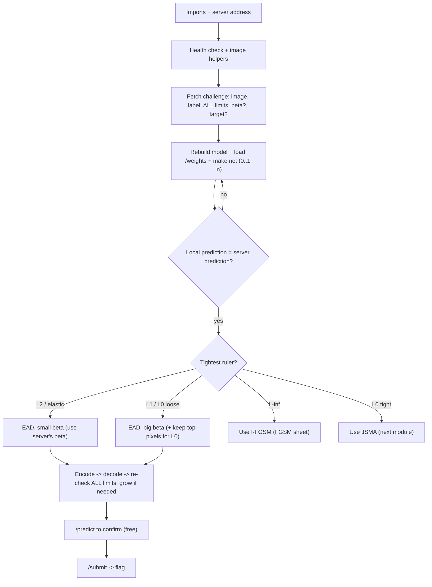

# ElasticNet (EAD) API Challenge - Exam Cheatsheet

_HTB Academy · AI Evasion - Sparsity · for "submit an adversarial image to a server" challenges (untargeted + targeted)_

> **How to use this sheet**
> 
> - This is for the challenge style where a **server** gives you an image and you **submit** a changed one. The server checks that its prediction changed (or became a **target** class) and that your change stays **under its budget**.
> - Run the cells **top to bottom in one Jupyter notebook**. Later cells reuse names earlier cells made.
> - **🔵 INPUT NEEDED** = fill every `<<LIKE_THIS>>` before running.
> - **⚪ no input needed - just run** = run it as it is.
> - This sheet has **no math**. Where the attack uses a formula, you get one plain-English line instead.
> - You always attack in **pixel space**: plain brightness, **0 (black) to 1 (white)**. In Step 5 you make a thing called `net` that takes plain 0..1 - **whether or not the server's model normalizes inside itself**, so the attack never has to care.

## What this challenge type is, and when EAD is the right tool

A server holds a model, hands you **one image** it classifies correctly, and sets a **budget** - the most your change may be. The server may enforce **one** budget or **several at once** (e.g. an elastic cap _and_ an L2 cap _and_ an L1 cap - all must hold). EAD's natural budget is **overall size (L2) or the elastic blend**, and it also does well on **loose L1 / "few pixels" (L0)** budgets because it keeps changes sparse-ish. Pick the attack by the _tightest_ ruler the server enforces:

|Budget the server checks|Best tool|Why|
|---|---|---|
|**L2 / elastic / "total distortion"**|**EAD (this sheet)**|EAD minimizes exactly this - its home turf|
|**L1 / L0 ("change few pixels"), loose**|**EAD + high beta** (+ keep-top-pixels for L0)|EAD makes sparse-ish changes you can trim|
|**L0, tight (e.g. ≤ 20 pixels)**|**JSMA** (next module)|JSMA caps the pixel count exactly; EAD won't fit|
|**L∞ ("max per-pixel change")**|**I-FGSM** (FGSM API sheet)|EAD can move single pixels a lot; it breaks an L∞ cap|

There's also two attack goals: **untargeted** ("make it predict anything wrong") and **targeted** ("make it predict class T"). EAD handles both - targeted just needs a bigger change.

Two things trip people up and this sheet handles both:

1. **The server may send several limit fields and its own `beta`** (like `elastic_max`, `l2_max`, `l1_max`, `beta`). Step 4 reads _whatever_ it sends and builds one `within()` checker that passes only when **all** limits hold.
2. **The model might normalize inside itself, or expect you to normalize first.** Step 5 makes `net` accept plain 0..1 **either way**, so the attack code never changes.

The catch that breaks submits: saving as PNG **rounds every pixel to a whole 1/255 step**, which can undo a change. So you always **encode → decode → re-check** before submitting, and grow the change a little if the flip didn't survive.



---

## Part A - Talk to the server

## Step 1 - Imports and the server address

🔵 INPUT NEEDED

```python
import io, base64
import numpy as np
import requests
import torch
import torch.nn as nn
import torch.nn.functional as F
from PIL import Image
import matplotlib.pyplot as plt

BASE_URL = "<<http://INSTANCE_IP:PORT>>" # full address, with http:// and port, no trailing slash
IMG_MODE = "<<L_or_RGB>>" # "L" = greyscale, "RGB" = colour

device = torch.device("cpu") # challenge models are small; CPU is simplest
```

**fill in:**

- `<<http://INSTANCE_IP:PORT>>` - the address the platform shows, e.g. `http://94.237.1.2:41234`.
- `<<L_or_RGB>>` - `"L"` for black-and-white, `"RGB"` for colour. Not sure? Leave `"L"`, run Step 4, and check the printed shape (a 3-channel model errors in Step 6, telling you to switch).

## Step 2 - Health check

⚪ no input needed - just run

```python
print(requests.get(f"{BASE_URL}/health", timeout=10).json())
```

**Expected:** `{'status': 'ok', ...}`, sometimes including the budget and its type. If it errors, the address is wrong or the instance is still starting.

## Step 3 - Image helpers (PNG text <-> numbers, and the four rulers)

⚪ no input needed - just run

Convert images both ways and make a model-ready tensor. **Keep the encode/decode exactly like this** - your budget check is only honest if you decode the way the server does. (The rulers themselves are built in Step 4, once you know which the server uses.)

```python
def x01_from_b64_png(b64):
    """base64 PNG text -> array (C, H, W) with values 0..1."""
    img = Image.open(io.BytesIO(base64.b64decode(b64))).convert(IMG_MODE)
    x = np.asarray(img, dtype=np.float32) / 255.0
    return x[None] if x.ndim == 2 else x.transpose(2, 0, 1)

def b64_png_from_x01(x):
    """array (C, H, W) 0..1 -> base64 PNG text. This ROUNDS to whole 1/255 steps."""
    x255 = np.clip(np.round(x * 255.0), 0, 255).astype(np.uint8)
    arr = x255[0] if x255.shape[0] == 1 else x255.transpose(1, 2, 0)
    buf = io.BytesIO(); Image.fromarray(arr).save(buf, format="PNG")
    return base64.b64encode(buf.getvalue()).decode("ascii")

def to_tensor(x):
    """array (C, H, W) -> tensor (1, C, H, W) on the device."""
    return torch.from_numpy(x[None]).float().to(device)
```

**Remember:** the server checks the budget on the image **after decoding your PNG**, so you'll always measure on the decoded image, not your raw tensor.

## Step 4 - Fetch the challenge and build the budget checker

🔵 INPUT NEEDED

This reads **whatever** fields the server sent, maps each limit to the ruler it measures, and builds two helpers: `sizes()` (every ruler at once) and `within()` (True only when **all** the server's limits hold).

```python
ch = requests.get(f"{BASE_URL}/challenge", timeout=10).json()
print("fields the server sent:", list(ch.keys())) # READ THIS - keys below must match

# --- the image + the true class (rename the two keys if the print shows different names) ---
x = x01_from_b64_png(ch["image_b64"]) # the image, (C, H, W), 0..1
lab = int(ch["label"]) # the true class

# --- the server's own beta, if it sent one (EAD will reuse it; the elastic ruler needs it) ---
srv_beta = float(ch["beta"]) if "beta" in ch else None

# --- the budget LIMITS: every limit field the server sent, mapped to its ruler ---
# left = the key as the server spells it; right = which ruler it measures.
# Add / rename rows to match the printed keys. Keep only the ones the server actually sends.
LIMIT_RULERS = {
    "budget": "<<l0_l1_l2_or_linf>>", # single-budget servers: say which ruler "budget" is
    "l0_max": "l0",
    "l1_max": "l1",
    "l2_max": "l2", # some servers put SQUARED L2 here - see L2_CAP_IS_SQUARED below
    "linf_max": "linf",
    "elastic_max": "elastic",
}
limits = {LIMIT_RULERS[k]: float(ch[k]) for k in LIMIT_RULERS if k in ch}
assert limits, "No limit field matched - look at the printed keys and edit LIMIT_RULERS."

L2_CAP_IS_SQUARED = False # flip to True only if the server rejects with 'l2 too large'

# --- the goal ---
ATTACK = "<<untargeted_or_targeted>>".lower()
TARGET = <<TARGET>> # class to force (targeted only), else None

def sizes(a, b):
    """Measure the change a-vs-b every way the server might. a, b are (C,H,W) 0..1 arrays."""
    d = (a - b).ravel()
    l1v, l2sq = float(np.abs(d).sum()), float((d * d).sum())
    beta = srv_beta if srv_beta is not None else 0.01
    return {"l0": float((np.abs(d) > 1e-6).sum()), # how many pixels changed
            "l1": l1v, # total absolute change
            "l2": l2sq ** 0.5, # overall size (true L2, with the root)
            "l2sq": l2sq, # squared L2 (what EAD actually minimizes)
            "linf": float(np.abs(d).max()), # biggest single-pixel change
            "elastic": l2sq + beta * l1v} # the elastic blend (squared L2 + beta*L1)

def within(a, b):
    """True only if EVERY limit the server set is satisfied."""
    s = sizes(a, b)
    for ruler, cap in limits.items():
        val = s["l2sq"] if (ruler == "l2" and L2_CAP_IS_SQUARED) else s[ruler]
        if val > cap:
            return False
    return True

print("shape:", x.shape, "| label:", lab, "| beta:", srv_beta,
      "| limits:", limits, "| attack:", ATTACK, "| target:", TARGET)
```

**fill in:**

- The **two key names** (`image_b64`, `label`) - if the printed keys differ (e.g. `"img"`, `"true_label"`), change those two lookups.
- `LIMIT_RULERS` - keep the rows whose keys the server actually printed; delete or rename the rest. If it sent a single `"budget"`, set its ruler to the one the task names (`"l2"`, `"l1"`, etc.).
- `<<l0_l1_l2_or_linf>>` - only used by the `"budget"` row. `"l2"` (total size), `"l1"` (total change), `"l0"` (how many pixels), `"linf"` (max per-pixel).
- `<<untargeted_or_targeted>>` - `"untargeted"` for "be wrong", `"targeted"` for "be class T".
- `<<TARGET>>` - `None` if untargeted; `int(ch["target"])` if the server sends it; or the class number the task names.

> **If `linf` is the only / tightest limit** → stop here and use the FGSM I-FGSM sheet (see Step 13). EAD is the wrong tool for an L∞ cap.

---

## Part B - Get the model

## Step 5 - Rebuild the model, load weights, and make `net` take plain 0..1

🔵 INPUT NEEDED

EAD needs the model's gradients, so rebuild the architecture from the task and load `/weights`. **Paste the class exactly as the task gives it - do NOT edit its `forward`.** Then you make `net`, which is the thing the attack calls. The attack always feeds **plain 0..1 pixels**, so `net` must accept plain 0..1:

- If the task's `forward` **normalizes inside itself** → `net` is just the model.
- If the task's `forward` **expects already-normalized input** → wrap it so the normalize happens first.

```python
# --- 1) Paste the EXACT architecture from the task. Keep its forward() unchanged. ---
class SimpleClassifier(nn.Module): # EXAMPLE ONLY (MNIST-sized, 1 channel)
    def __init__(self, num_classes=10):
        super().__init__()
        self.conv1 = nn.Conv2d(1, 32, 3, 1)
        self.conv2 = nn.Conv2d(32, 64, 3, 1)
        self.dropout1 = nn.Dropout(0.25)
        self.dropout2 = nn.Dropout(0.5)
        self.fc1 = nn.Linear(9216, 128)
        self.fc2 = nn.Linear(128, num_classes)
    def forward(self, x): # this example EXPECTS normalized input
        x = torch.relu(self.conv1(x))
        x = torch.relu(self.conv2(x))
        x = torch.max_pool2d(x, 2)
        x = self.dropout1(x)
        x = torch.flatten(x, 1)
        x = torch.relu(self.fc1(x))
        x = self.dropout2(x)
        return self.fc2(x) # raw scores (EAD works with these)

# --- 2) Load the weights ---
open("weights.pth", "wb").write(requests.get(f"{BASE_URL}/weights", timeout=10).content)
model = SimpleClassifier().to(device)
model.load_state_dict(torch.load("weights.pth", map_location=device))
model.eval() # REQUIRED: dropout OFF, or gradients are random

# --- 3) Make `net`: it MUST take plain 0..1 (the attack always feeds 0..1) ---
MODEL_NORMALIZES_INSIDE = <<True_or_False>> # does the pasted forward() do (x-mean)/std itself?
MEAN, STD = <<MEAN>>, <<STD>> # MNIST 0.1307, 0.3081 (scalars). Ignored if it normalizes inside.

class Norm01(nn.Module):
    """Wrap a model that expects NORMALIZED input so it accepts plain 0..1 pixels."""
    def __init__(self, m, mean, std):
        super().__init__(); self.m, self.mean, self.std = m, mean, std
    def forward(self, x01):
        return self.m((x01 - self.mean) / self.std)

net = model if MODEL_NORMALIZES_INSIDE else Norm01(model, MEAN, STD)
net.eval()
print("training mode?", net.training, "| normalizes inside:", MODEL_NORMALIZES_INSIDE) # training must be False
```

**fill in:**

- The whole class - copy from the task, `forward` untouched.
- `<<True_or_False>>` - `True` if the pasted `forward` already does `(x - mean) / std`; `False` if it assumes the input is already normalized (there's usually a separate `normalize(...)` helper in the task - that's the tell).
- `<<MEAN>>`, `<<STD>>` - only used when `False`. MNIST: `0.1307, 0.3081`. For RGB, use tensors, e.g. `torch.tensor([0.485,0.456,0.406]).view(1,3,1,1), torch.tensor([0.229,0.224,0.225]).view(1,3,1,1)`.

> **If this errors:** `size mismatch` = your class doesn't match the task's. `weights_only` error = the file is a whole model, not just weights; **only load files from the challenge you're solving**. If `local` looks random in Step 6, you almost certainly have `MODEL_NORMALIZES_INSIDE` backwards - flip it.

## Step 6 - Check your copy matches the server

⚪ no input needed - just run

```python
x_t = to_tensor(x)
with torch.no_grad():
    local_pred = net(x_t).argmax(dim=1).item()
server = requests.post(f"{BASE_URL}/predict",
                       json={"image_b64": b64_png_from_x01(x)}, timeout=10).json()
print("local:", local_pred, "| server:", server, "| true label:", lab)
```

**Expected:** local = server = true label. If local differs: wrong architecture, wrong `MEAN`/`STD`, or `MODEL_NORMALIZES_INSIDE` is backwards. If the shape errors, flip `IMG_MODE`.

---

## Part C - The EAD attack (define once)

## Step 7 - The shrink step and the pixel-cap helper

⚪ no input needed - just run

Two small helpers the attack uses: the shrink step (what makes EAD sparse) and a hard pixel-cap (for an L0 budget).

```python
def soft_threshold_img(y, original, threshold, clip_min=0.0, clip_max=1.0):
    """Keep big changes (shrunk a little), set small ones (<= threshold) to exactly zero. This is the sparsity engine."""
    diff = y - original
    shrink_positive = torch.clamp(y - threshold, clip_min, clip_max)
    shrink_negative = torch.clamp(y + threshold, clip_min, clip_max)
    cp = (diff > threshold).float()
    cz = (torch.abs(diff) <= threshold).float()
    cn = (diff < -threshold).float()
    return cp * shrink_positive + cz * original + cn * shrink_negative

def keep_top_pixels(adv, original, n_pixels):
    """Keep only the n_pixels biggest changes, zero the rest. Use this to obey a hard L0 (few-pixels) budget."""
    diff = (adv - original).view(-1).clone()
    if diff.numel() > n_pixels:
        idx = diff.abs().argsort(descending=True)[:int(n_pixels)]
        keep = torch.zeros_like(diff); keep[idx] = 1.0
        diff = diff * keep
    return (original + diff.view_as(adv)).clamp(0.0, 1.0)
```

## Step 8 - The ElasticNet attack (one image)

⚪ no input needed - just run

The whole attack in one function: it runs FISTA (nudge toward fooling + shrink for sparsity) inside a binary search that finds the smallest strength that still works, and returns the best adversarial image. **It calls `net`, so it always works in plain 0..1.** Keep this cell intact.

```python
def elasticnet_attack(image, net, target=None, beta=0.01, confidence=0,
                      learning_rate=0.01, max_iter=1000, binary_steps=9,
                      initial_const=0.01, clip_min=0.0, clip_max=1.0):
    """
    EAD on ONE image, shape (1, C, H, W), pixels 0..1.
      target = class number to force (targeted), or None (untargeted)
      beta = sparsity knob (bigger = fewer pixels changed)
      confidence = how decisively to fool (0 = minimal)
      learning_rate, max_iter, binary_steps, initial_const = optimizer dials
    Returns: (best_adv_image, success_bool, original_label)
    """
    net.eval(); device = next(net.parameters()).device; image = image.to(device)
    targeted = target is not None
    with torch.no_grad():
        out = net(image); n_classes = out.shape[1]; true_label = out.argmax(1).item()
    marked = target if targeted else true_label # true class (untargeted) or target (targeted)
    onehot = torch.zeros(1, n_classes, device=device); onehot[0, marked] = 1.0

    lower, upper, const = 0.0, 1e10, float(initial_const) # binary-search bounds on strength c
    best_adv = image.clone(); best_l2 = float("inf"); best_success = False

    for _ in range(binary_steps): # OUTER: tune strength c
        adv = image.clone().detach(); y = adv.clone()
        for it in range(max_iter): # INNER: FISTA
            y = y.detach().requires_grad_(True)
            logits = net(y)
            real = (onehot * logits).sum(1) # score of the marked class
            other = torch.max((1 - onehot) * logits - onehot * 10000, 1)[0] # best other class
            fool = (torch.clamp(other - real + confidence, min=0) if targeted
                    else torch.clamp(real - other + confidence, min=0)) # zero once fooled
            total = const * fool + ((y - image) ** 2).sum() # fool-score + squared-L2
            total.sum().backward()
            y_new = y - learning_rate * y.grad # gradient nudge
            adv_new = soft_threshold_img(y_new, image, learning_rate * beta, clip_min, clip_max) # shrink
            coef = it / (it + 3.0) # look-ahead momentum
            y = (adv_new + coef * (adv_new - adv)).detach()
            adv = adv_new.detach()

        with torch.no_grad():
            pred = net(adv).argmax(1).item()
        success = (pred == target) if targeted else (pred != true_label)
        l2val = ((adv - image) ** 2).sum().item()
        if success and l2val < best_l2: # keep smallest successful change
            best_adv = adv.clone(); best_l2 = l2val; best_success = True
        if success: # binary-search update
            upper = min(upper, const)
            if upper < 1e10: const = (lower + upper) / 2
        else:
            lower = max(lower, const)
            const = (lower + upper) / 2 if upper < 1e10 else const * 10
    return best_adv.detach(), best_success, true_label
```

**How to call it:** `elasticnet_attack(x_t, net, target=TARGET if ATTACK=="targeted" else None, beta=..., ...)`.

---

## Part D - Run, make it survive PNG, submit

## Step 9 - Pick settings for the budget, then run

🔵 INPUT NEEDED

If the server sent its own `beta`, EAD reuses it so it minimizes **exactly** what the server measures. Only push sparsity harder when the _only_ limits are L1/L0. Sparsity is driven by the shrink threshold (= learning_rate × beta).

```python
target = TARGET if ATTACK == "targeted" else None

# Home turf (L2 / elastic present): use the server's own beta if it gave one.
BETA = srv_beta if srv_beta is not None else 0.01
LR = 0.02

# Only L1/L0 limits (no L2/elastic cap)? Push sparsity harder.
if ("l1" in limits or "l0" in limits) and "l2" not in limits and "elastic" not in limits:
    BETA, LR = <<SPARSE_BETA>>, 0.05

r_adv, ok, orig = elasticnet_attack(
    x_t, net, target=target, beta=BETA, confidence=0,
    learning_rate=LR, max_iter=<<MAX_ITERS>>, binary_steps=9,
    initial_const=(0.05 if target is not None else 0.01))

adv_np = r_adv.squeeze(0).cpu().numpy()

if "l0" in limits: # hard pixel cap: keep only the allowed number of pixels
    adv_np = keep_top_pixels(r_adv, x_t, int(limits["l0"])).squeeze(0).cpu().numpy()

success = (lambda p: p == TARGET) if target is not None else (lambda p: p != lab)
with torch.no_grad():
    now = net(to_tensor(adv_np)).argmax(1).item()
print(f"{orig} -> {now} | success locally: {ok} | within all limits: {within(adv_np, x)}")
print("sizes:", {k: round(v, 4) for k, v in sizes(adv_np, x).items()}, "| limits:", limits)
```

**fill in:**

- `<<SPARSE_BETA>>` - only reached for an L1/L0-only budget. Start at `1.0`. **If** still over → `2.0`. **If** the flip fails → `0.5`.
- `<<MAX_ITERS>>` - `1000` for quality; `300` for a quick try (or on CPU).

**Expected:** `success locally: True`, `within all limits: True`, and every `sizes` value under its matching limit. If a limit is way over, see Step 13.

## Step 10 - Encode, decode, re-check, grow until it survives

⚪ no input needed - just run

Saves as PNG, decodes it like the server, and re-checks the **decoded** image against **all** limits. If rounding undid the flip, it grows the change a little and retries, stopping at the first version that fools **and** fits every limit.

```python
adv_b64 = None
for stretch in [1.0, 1.02, 1.05, 1.1, 1.2, 1.5]: # 1.0 = as-is, then a bit bigger
    cand = np.clip(x + stretch * (adv_np - x), 0.0, 1.0) # grow the change along the same direction
    b64 = b64_png_from_x01(cand)
    x_back = x01_from_b64_png(b64) # decode, as the server will
    with torch.no_grad():
        pred = net(to_tensor(x_back)).argmax(dim=1).item()
    print(f"stretch {stretch:<4}: pred {pred} | success {success(pred)} | within {within(x_back, x)} | "
          f"{ {k: round(sizes(x_back, x)[k], 3) for k in limits} }")
    if success(pred) and within(x_back, x):
        adv_b64 = b64
        break

print("READY to submit" if adv_b64 else "Nothing passed -> see Step 13")
```

**Expected:** a line with `success True` and `within True`, then `READY to submit`. (Stretching keeps the same changed pixels, so an L0 cap still holds.)

## Step 11 - Measure the final image

⚪ no input needed - just run

```python
assert adv_b64, "Step 10 found nothing -> Step 13"
x_final = x01_from_b64_png(adv_b64)
with torch.no_grad():
    probs = F.softmax(net(to_tensor(x_final)), dim=1)[0]
s = sizes(x_final, x)
print(f"final prediction: {probs.argmax().item()} (true {lab}, target {TARGET})")
print(f"L0 {s['l0']:.0f} px | L1 {s['l1']:.2f} | L2 {s['l2']:.3f} (sq {s['l2sq']:.3f}) | "
      f"Linf {s['linf']:.3f} | elastic {s['elastic']:.3f}")
print("vs limits:", limits, "| all within:", within(x_final, x))
print(f"confidence in new class: {probs.max():.3f}")
```

> **The one ambiguity to know:** an `l2_max` field can mean plain L2 **or** squared L2. This sheet assumes **plain L2** (`L2_CAP_IS_SQUARED=False`). Compare the printed `L2` and `sq` values above against the server's `l2_max`: if the server later says "l2 too large" even though plain L2 looks fine, set `L2_CAP_IS_SQUARED=True` in Step 4 and re-run from Step 9.

## Step 12 - Confirm with /predict, then /submit

⚪ no input needed - just run

`/predict` is free; `/submit` counts. Only submit once predict shows success.

```python
pred = requests.post(f"{BASE_URL}/predict", json={"image_b64": adv_b64}, timeout=10).json()
print("server predicts:", pred)

# Some servers track which sample you were given - echo it back if they sent one.
submit_payload = {"image_b64": adv_b64}
if "sample_index" in ch:
    submit_payload["sample_index"] = ch["sample_index"]

if success(int(pred["pred"])):
    r = requests.post(f"{BASE_URL}/submit", json=submit_payload, timeout=10)
    print(r.status_code, r.json() if r.ok else r.text)
else:
    print("Server disagrees -> recheck Step 6, then Step 13.")
```

**Reading the errors:**

|Server says|Means|Do this|
|---|---|---|
|`l2 too large` (but your plain L2 looked fine)|the cap is **squared** L2|set `L2_CAP_IS_SQUARED=True` (Step 4), re-run from Step 9|
|`l1 / l0 / elastic too large`|over that limit after decoding|raise `BETA` (or `SPARSE_BETA`) and re-run Step 9|
|`not misclassified`|flip didn't hold|add bigger values to the stretch list (`2.0`, `3.0`) and redo Step 10|
|`not target`|targeted, wrong class landed|confirm `ATTACK="targeted"` and `TARGET` is right|
|`bad shape` / `missing field`|wrong size/colour, or payload key wrong|match `IMG_MODE`; check the `/submit` key name the task wants|

---

## Part E - When it doesn't work

## Step 13 - Match the tool to the tightest limit

⚪ no input needed - read, then act

EAD is an **L2 / elastic** attack. Look at which limit in `limits` is the binding one (the one `sizes` is closest to or over):

- **L2 / elastic, over by a little:** EAD is already near-minimal. Try `max_iter=2000`, `binary_steps=12`, and the smallest stretch that survives Step 10.
- **L1 limit:** raise `BETA`/`SPARSE_BETA` (1.0 → 2.0) and re-run Step 9. **EAD can only get so sparse**; if even a big beta is over, the budget may expect JSMA.
- **L0 limit (few pixels):** `keep_top_pixels` (Step 9) enforces it, but **for a _tight_ L0 budget (say ≤ 20-50 pixels) EAD usually fails to hold the flip**. That's JSMA's job - next module, caps the pixel count exactly. Use EAD here only when the L0 limit is generous.
- **L∞ limit:** EAD can move single pixels a lot, which breaks an L∞ cap. Use **I-FGSM** from your `FGSM_Challenge_API_Cheatsheet.md` instead (its targeted version for a targeted task).
- **Several limits at once:** the tightest one wins. If the tight one is L∞ or tight-L0, switch tools (above) even though EAD could satisfy the others.

## Step 14 - No weights given: surrogate

🔵 INPUT NEEDED

If there's only `/predict` (no `/weights`), attack **your own** model trained on similar data and submit that, checking each attempt against the free `/predict`.

```python
surrogate_backbone = <<YOUR_TRAINED_MODEL>> # a model YOU trained on similar data
surrogate_backbone.eval()
# make it take plain 0..1 too (wrap if it expects normalized input):
surrogate = surrogate_backbone if MODEL_NORMALIZES_INSIDE else Norm01(surrogate_backbone, MEAN, STD)
surrogate.eval()

r_s, _, _ = elasticnet_attack(x_t, surrogate, target=target, beta=BETA, learning_rate=LR,
                              max_iter=500, binary_steps=9)
s_np = r_s.squeeze(0).cpu().numpy()

adv_b64 = None
for stretch in [1.0, 1.3, 1.6, 2.0, 2.5]: # transfer needs a bigger change
    cand = np.clip(x + stretch * (s_np - x), 0, 1)
    b64 = b64_png_from_x01(cand); x_back = x01_from_b64_png(b64)
    srv = requests.post(f"{BASE_URL}/predict", json={"image_b64": b64}, timeout=10).json()
    print(f"stretch {stretch}: server {srv} | within {within(x_back, x)}")
    if success(int(srv["pred"])) and within(x_back, x):
        adv_b64 = b64; break
print("READY -> Step 12" if adv_b64 else "Didn't transfer -> try I-FGSM on the surrogate")
```

**fill in:** `<<YOUR_TRAINED_MODEL>>` - a model you trained yourself (e.g. the one from your MNIST or Imagenette EAD sheet), same image size/channels.

---

## Part F - See it (optional)

## Step 15 - Four-panel view

⚪ no input needed - just run

```python
x_show = x_final
diff = x_show - x
as_pic = lambda a: a[0] if a.shape[0] == 1 else a.transpose(1, 2, 0)
cmap = "gray" if x.shape[0] == 1 else None
amp = np.clip(as_pic(diff) * 10 + 0.5, 0, 1)
heat = np.abs(diff).sum(axis=0)

fig, ax = plt.subplots(1, 4, figsize=(15, 4))
ax[0].imshow(as_pic(x), cmap=cmap, vmin=0, vmax=1); ax[0].set_title(f"original ({lab})")
ax[1].imshow(amp, cmap=cmap, vmin=0, vmax=1); ax[1].set_title("change x10 (grey=none)")
im = ax[2].imshow(heat, cmap="hot"); ax[2].set_title(f"where it changed\nL0 {sizes(x_show,x)['l0']:.0f}px")
plt.colorbar(im, ax=ax[2], fraction=0.046)
ax[3].imshow(as_pic(x_show), cmap=cmap, vmin=0, vmax=1); ax[3].set_title(f"submitted ({probs.argmax().item()})")
for a in ax: a.axis("off")
plt.suptitle(f"ElasticNet ({ATTACK})"); plt.tight_layout(); plt.show()
```

**Reading it:** grey = untouched in the change panel; bright spots in the heatmap = the pixels EAD changed (should sit on the object, not the background).

---

## If you remember nothing else

## The attack in 4 lines

1. **Read ALL the limits, not one.** The server may send several caps (`elastic_max`, `l2_max`, `l1_max`) plus its own `beta`. Build `within()` so it passes only when **every** limit holds; pick your tool by the **tightest** ruler (EAD for L2/elastic and loose L1/L0; JSMA for tight L0; I-FGSM for L∞).
2. **Make `net` take plain 0..1.** If the model normalizes inside, `net = model`; if it expects normalized input, `net = Norm01(model, MEAN, STD)`. Confirm local prediction = server prediction before attacking.
3. **EAD** runs FISTA (nudge + shrink that zeros useless pixels) inside a **binary search** for the smallest strength that still fools. Reuse the server's `beta` so you minimize exactly what it measures; bigger `beta` = sparser.
4. **PNG rounding can undo the flip**, so encode → decode → re-check all limits, and grow the change (stretch) until the decoded image still fools **and** fits. Then `/predict` (free) to confirm, `/submit` for the flag.

## The core from memory

```python
net = model if MODEL_NORMALIZES_INSIDE else Norm01(model, MEAN, STD) # attack always feeds 0..1
net.eval(); x_t = to_tensor(x)
BETA = srv_beta if srv_beta is not None else 0.01 # reuse the server's beta
adv, ok, orig = elasticnet_attack(x_t, net, target=T_or_None, beta=BETA, learning_rate=0.02)
adv_np = adv.squeeze(0).numpy()
# for an L0 limit: adv_np = keep_top_pixels(adv, x_t, int(limits["l0"])).squeeze(0).numpy()
for s in [1.0, 1.05, 1.2, 1.5]: # beat PNG rounding
    b64 = b64_png_from_x01(np.clip(x + s*(adv_np-x), 0, 1))
    xb = x01_from_b64_png(b64)
    if success(net(to_tensor(xb)).argmax().item()) and within(xb, x): break
# POST /predict {"image_b64": b64} -> then POST /submit (echo sample_index if the server sent one)
```

## Must-know facts

- **Read every limit field and pass them all**: a server can enforce an elastic cap _and_ an L2 cap _and_ an L1 cap together - `within()` must be True for all of them, and your tool is chosen by the **tightest** one.
- **`net` must take plain 0..1 pixels**: if the task's `forward` normalizes inside use the model as-is, otherwise wrap it with `Norm01`; a backwards `MODEL_NORMALIZES_INSIDE` flag makes the local prediction look random in Step 6.
- **Reuse the server's `beta`** when it sends one, so EAD minimizes the exact elastic score the server checks; sparsity is driven by the shrink threshold = learning_rate × beta.
- **An `l2_max` field can mean plain L2 or squared L2**: assume plain, and if the server rejects with "l2 too large" while your plain L2 looks fine, flip `L2_CAP_IS_SQUARED` and re-run.
- **For a _tight_ L0 budget, EAD usually can't hold the flip - use JSMA (next module)**; `keep_top_pixels` only works when the L0 limit is generous. For an L∞ limit, use I-FGSM, not EAD.
- **PNG rounds every pixel to a whole 1/255 step, so encode → decode → re-check and grow the change** until the decoded image still works; measure on the **decoded** image, and stretching keeps the same changed pixels so an L0 cap survives.
- **Untargeted just needs any wrong class; targeted needs the prediction to _equal_ the target** and usually a bigger change - set `target=` and a slightly higher `initial_const`.
- **Method point:** **`/predict` is free, `/submit` counts** - re-check locally on the decoded PNG against all limits, confirm with `/predict`, then submit once; this is OWASP ML01:2023 Input Manipulation (an inference-time evasion attack).