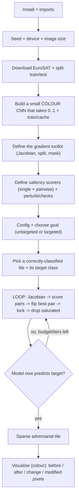

# JSMA on EuroSAT - Exam Cheatsheet

_Real-world colour version · AI Evasion - Sparsity Attacks · applying JSMA beyond MNIST_

> **How to use this sheet**
> 
> - Run the cells **top to bottom in one Jupyter notebook**. Later cells reuse names earlier cells made.
> - **🔵 INPUT NEEDED** = fill every `<<LIKE_THIS>>` before running.
> - **⚪ no input needed - just run** = run it as it is.
> - This sheet has **no math**. Where the attack uses a formula, you get one plain-English line instead.
> - You attack in **plain 0..1 colour pixels**. The model takes 0..1 directly (it normalises inside itself), so the attack never has to.
> - **EuroSAT** = 10 real satellite land-use classes (crops, forest, highway, industrial, river, sea...). This is the **self-contained** version - no HTB library needed.

## What this does

Exactly the same JSMA as the MNIST sheet, pointed at **real colour satellite tiles** instead of digits. It still **changes as few pixels as possible** (minimise the L0 count) by using the model's gradients to score pixels - or **pairs** of pixels - for helping the target class while hurting the rest, then flipping the best ones until the model is fooled. **The attack code is byte-for-byte identical to MNIST** - it doesn't care about colour or image size. **Only three things change to move JSMA to any new dataset:** the data loader, the model, and the pixel count used for sparsity.



---

## Part A - Setup

## Step 1 - Install

⚪ no input needed - just run

Installs PyTorch + torchvision. Nothing else - EuroSAT comes straight from torchvision.

```python
!pip install torch torchvision -q
```

> **If it breaks:** in a lab these are usually already installed - skip to Step 2.

## Step 2 - Imports, seed, device, image size

🔵 INPUT NEEDED

Loads everything, fixes randomness, picks the GPU, and sets how big the tiles are. ==Smaller = faster JSMA AND higher success== (fewer pixels, each one more influential).

```python
import os
import numpy as np
import torch
import torch.nn as nn
import torch.nn.functional as F
from torch.utils.data import DataLoader, random_split
from torchvision import transforms
from torchvision.datasets import EuroSAT
import matplotlib.pyplot as plt
import warnings
warnings.filterwarnings('ignore')

# Plot colours (plain hex, stand-ins for the HTB palette)
HTB_GREEN="#9FEF00"; MALWARE_RED="#FF3E3E"; NUGGET_YELLOW="#FFAF00"; AZURE="#2EE7FF"

SEED = <<SEED>>
torch.manual_seed(SEED); np.random.seed(SEED)
device = torch.device('cuda' if torch.cuda.is_available() else 'cpu')

IMG_SIZE = <<IMG_SIZE>> # pixels per side (square)
print("device:", device, "| image size:", IMG_SIZE)
```

**fill in:**

- `<<SEED>>` - any fixed number, e.g. `1337`. Keep it the same all session.
- `<<IMG_SIZE>>` - **use `32`** (**pick this**): JSMA is both faster and more successful at 32. Only go to `64` (EuroSAT's native size) if you specifically want sharper tiles and accept slower, weaker attacks.

## Step 3 - Download EuroSAT and split train/test

⚪ no input needed - just run

Downloads the satellite tiles once (~90 MB, then reused), resizes them, and makes a train/test split. EuroSAT has no built-in split, so we cut 80/20 ourselves.

```python
tf = transforms.Compose([
    transforms.Resize((IMG_SIZE, IMG_SIZE)),
    transforms.ToTensor(), # tile -> 0..1 tensor, shape (3, H, W)
])

full = EuroSAT(root="eurosat_data", download=True, transform=tf) # first run downloads ~90MB
class_names = full.classes # the 10 land-use names, in label order
print("classes:", class_names)

n = len(full); n_test = int(0.2 * n); n_train = n - n_test
g = torch.Generator().manual_seed(SEED)
train_set, test_set = random_split(full, [n_train, n_test], generator=g)

train_loader = DataLoader(train_set, batch_size=128, shuffle=True, num_workers=0, generator=g)
test_loader = DataLoader(test_set, batch_size=128, shuffle=False, num_workers=0)
print(len(train_set), "train |", len(test_set), "test | one tile:", test_set[0][0].shape)
```

**Expected:** the 10 class names, then something like `21600 train | 5400 test | one tile: torch.Size([3, 32, 32])`.

> **If it hangs:** keep `num_workers=0` on Windows. If the download stalls, delete the `eurosat_data` folder and re-run, or download the EuroSAT RGB zip in a browser and point `root=` at the extracted folder.

## Step 4 - The colour model (takes 0..1, 10 classes)

🔵 INPUT NEEDED

Builds the target model. **Use a SMALL, shallow CNN - not a deep ResNet.** JSMA relies on individual pixels having real influence; deep nets spread the decision across many layers and JSMA's success drops sharply. This CNN also **normalises inside itself** (first layer), so you feed and attack plain 0..1 tiles. **Train it properly** - a weak model has noisy gradients and JSMA flounders.

```python
class ColorCNN(nn.Module): # small + shallow on purpose (good for JSMA)
    def __init__(self, num_classes=10):
        super().__init__()
        self.net = nn.Sequential(
            nn.BatchNorm2d(3), # normalises the 0..1 input INSIDE the model
            nn.Conv2d(3, 32, 3, padding=1), nn.ReLU(), nn.MaxPool2d(2),
            nn.Conv2d(32, 64, 3, padding=1), nn.ReLU(), nn.MaxPool2d(2),
            nn.Conv2d(64, 64, 3, padding=1), nn.ReLU(), nn.AdaptiveAvgPool2d(4), # works for size 32 or 64
            nn.Flatten(),
            nn.Linear(64 * 4 * 4, 128), nn.ReLU(), nn.Dropout(0.3),
            nn.Linear(128, num_classes), # raw scores (logits)
        )
    def forward(self, x01): # x01 = plain 0..1 colour tile
        return self.net(x01)

def train_model(model, train_loader, test_loader, epochs, lr, device):
    """Quick trainer: Adam + cross-entropy, prints test accuracy each epoch."""
    opt = torch.optim.Adam(model.parameters(), lr=lr)
    lossf = nn.CrossEntropyLoss()
    for ep in range(epochs):
        model.train()
        for xb, yb in train_loader:
            xb, yb = xb.to(device), yb.to(device)
            opt.zero_grad(); lossf(model(xb), yb).backward(); opt.step()
        model.eval(); correct = total = 0
        with torch.no_grad():
            for xb, yb in test_loader:
                xb, yb = xb.to(device), yb.to(device)
                correct += (model(xb).argmax(1) == yb).sum().item(); total += yb.size(0)
        print(f"epoch {ep+1}/{epochs} test acc {100*correct/total:.1f}%")
    return model

model_path = f"eurosat_cnn_{IMG_SIZE}.pth"
model = ColorCNN(num_classes=10).to(device)
if os.path.exists(model_path): # already trained? reuse it
    model.load_state_dict(torch.load(model_path, map_location=device)); print("loaded cached model")
else:
    model = train_model(model, train_loader, test_loader, epochs=<<EPOCHS>>, lr=0.001, device=device)
    torch.save(model.state_dict(), model_path)
model.eval() # REQUIRED: dropout/BN in eval so gradients are stable
print("model ready")
```

**fill in:**

- `<<EPOCHS>>` - use `10-12` for a solid model (aim for **~90%+ test accuracy** in the printout). A weak, undertrained model is the #1 cause of JSMA failing, so don't skimp here. If you retrain, **delete the cached `.pth` first** or it just reloads the weak one.

> **Option - pretrained ResNet instead?** You _can_ fine-tune a `torchvision.models.resnet18`, but then (a) it expects ImageNet-normalised input, so wrap it so it takes 0..1, and (b) **expect JSMA to succeed far less often** because a deep net dilutes per-pixel influence. For this attack, the small CNN is the better target.

---

## Part B - The gradient toolkit (identical to MNIST - colour-agnostic)

## Step 5 - The Jacobian (per-class gradients)

⚪ no input needed - just run

One row per class showing how every pixel pushes that class. For colour the row is longer (3 × H × W instead of 784), but the code is unchanged - it flattens whatever shape it gets. Keep each function in its own block.

```python
def compute_class_gradient(x, model, class_idx, wrt='logits'):
    """How does every pixel affect ONE class's score? Returns a flat vector (length = 3*H*W)."""
    x_grad = x.detach().requires_grad_(True)
    logits = model(x_grad)
    if wrt == 'logits':
        scalar = logits[0, class_idx] # raw score, never softmax (see note)
    else:
        scalar = F.softmax(logits, dim=1)[0, class_idx]
    scalar.backward()
    return x_grad.grad.detach().cpu().numpy().flatten().copy() # channel-height-width order, copied

def compute_jacobian_matrix(x, model, num_classes=10, wrt='logits'):
    """Stack one gradient row per class -> (classes x pixels), e.g. (10, 3072) for 3x32x32."""
    if x.shape[0] != 1:
        raise ValueError("needs ONE image at a time (batch size 1)")
    rows = [compute_class_gradient(x, model, c, wrt) for c in range(num_classes)]
    return np.asarray(rows)
```

> **Why logits, never softmax:** softmax makes the "help target" and "hurt others" signals cancel, which breaks JSMA's pixel selection. Always use the raw scores.

## Step 6 - Split into "target" vs "the rest", and mask

⚪ no input needed - just run

Per pixel: how much it helps the target (alpha), and how much it moves all other classes combined (beta = add every row, subtract the target row).

```python
def extract_target_gradient(jacobian, target_class):
    """alpha = the target class's own row (copied so masking can't corrupt the table)."""
    return jacobian[target_class].copy()

def extract_other_gradients(jacobian, target_class):
    """beta = effect on all OTHER classes combined = (sum of every row) - (target row)."""
    return jacobian.sum(axis=0) - jacobian[target_class]

def apply_search_mask(gradient, search_space):
    """Zero out pixels we can't touch; keeps every pixel at its own index."""
    return gradient * search_space
```

---

## Part C - Picking the pixel(s)

## Step 7 - The search space

⚪ no input needed - just run

An on/off list over every channel-pixel. Pixels drop out at pure 0.0 or 1.0 (can't move further).

```python
def initialize_search_space(shape):
    """A True/False list, one per pixel, all True to start. 3x32x32 -> 3072 Trues."""
    num_features = int(np.prod(shape[1:])) # ignores the batch dim -> counts 3*H*W
    return np.ones(num_features, dtype=bool)

def remove_saturated_pixels(search_space, x, clip_min=0.0, clip_max=1.0, epsilon=1e-6):
    """Turn OFF any channel-pixel already at the 0.0 or 1.0 boundary."""
    x_flat = x.detach().cpu().numpy().flatten()
    saturated = (x_flat <= clip_min + epsilon) | (x_flat >= clip_max - epsilon)
    return search_space & ~saturated
```

## Step 8 - Single-pixel saliency (the baseline scorer)

⚪ no input needed - just run

Score each pixel changed **alone**: worth zero unless it both helps the target and hurts the others; otherwise score = (help) × (hurt). Checked both up and down. (Kept because the saliency _picture_ uses it and the exam may ask about single-pixel; the strong attack is the pairwise one in Step 9.)

```python
def score_increase_saliency(target_grad, other_grad):
    """Good to push UP: helps target (alpha>0) AND hurts others (beta<0)."""
    mask = (target_grad > 0) & (other_grad < 0)
    return target_grad * np.abs(other_grad) * mask

def score_decrease_saliency(target_grad, other_grad):
    """Good to push DOWN: helps target (alpha<0) AND hurts others (beta>0)."""
    mask = (target_grad < 0) & (other_grad > 0)
    return np.abs(target_grad) * other_grad * mask

def select_best_direction(inc_scores, dec_scores):
    """Pick the single best pixel across both directions -> (pixel, score, is_increase)."""
    i, d = int(np.argmax(inc_scores)), int(np.argmax(dec_scores))
    si, sd = float(inc_scores[i]), float(dec_scores[d])
    return (i, si, True) if si > sd else (d, sd, False)
```

## Step 9 - Pairwise saliency (the REAL attack's brain)

⚪ no input needed - just run

Score **pairs** moved together: add the two pixels' help-target and hurt-others numbers, then apply the same rule. Finds pixels useless alone but strong together. `top_k` keeps only the most promising pixels so we don't test every pair. Keep each function in one block.

```python
def prune_candidates(alpha, beta, search_space, top_k):
    """Keep only the top_k individually-strongest available pixels before forming pairs."""
    valid = np.where(search_space)[0]
    if valid.size < 2 or top_k is None or valid.size <= top_k:
        return valid
    prelim = np.abs((alpha * search_space)[valid]) * np.abs((beta * search_space)[valid])
    return valid[np.argsort(-prelim)[:top_k]]

def evaluate_pairs(alpha, beta, valid, direction):
    """Try every pair of the kept pixels; return the best-scoring pair for this direction."""
    best_p, best_q, best_score = -1, -1, 0.0
    for i in range(valid.size):
        p = valid[i]
        for j in range(i + 1, valid.size): # each pair once, no self-pairs
            q = valid[j]
            a_pq = alpha[p] + alpha[q] # pair's combined "help target"
            b_pq = beta[p] + beta[q] # pair's combined "hurt others"
            if direction == 'increase':
                if a_pq <= 0 or b_pq >= 0:
                    continue
                score = a_pq * abs(b_pq)
            else:
                if a_pq >= 0 or b_pq <= 0:
                    continue
                score = abs(a_pq) * b_pq
            if score > best_score:
                best_score, best_p, best_q = float(score), int(p), int(q)
    return best_p, best_q, best_score

def compute_pairwise_saliency(alpha, beta, search_space, direction='increase', top_k=None):
    """Prune, then find the best pair. Returns (-1,-1,0.0) when no valid pair exists."""
    valid = prune_candidates(alpha, beta, search_space, top_k)
    if valid.size < 2:
        return -1, -1, 0.0
    best_p, best_q, best_score = evaluate_pairs(alpha, beta, valid, direction)
    return (-1, -1, 0.0) if best_p == -1 else (best_p, best_q, best_score)
```

## Step 10 - Apply a change, and the success/confidence checks

⚪ no input needed - just run

Modify pixels, and read out success + target confidence. **Both pixels of a pair move the same way.**

```python
def apply_single_pixel_perturbation(x, pixel_idx, theta, increase, clip_min=0.0, clip_max=1.0):
    """Move ONE channel-pixel by +/-theta, kept inside [0,1]."""
    shape = x.shape
    xf = x.view(-1).clone() # flatten + CLONE so the original isn't corrupted
    xf[pixel_idx] = torch.clamp(xf[pixel_idx] + (theta if increase else -theta), clip_min, clip_max)
    return xf.view(shape)

def apply_pair_perturbation(x, p, q, theta, increase, clip_min=0.0, clip_max=1.0):
    """Move BOTH channel-pixels of a pair by the same signed step."""
    shape = x.shape
    xf = x.view(-1).clone()
    step = theta if increase else -theta
    xf[p] = torch.clamp(xf[p] + step, clip_min, clip_max)
    xf[q] = torch.clamp(xf[q] + step, clip_min, clip_max)
    return xf.view(shape)

def check_target_reached(x, target_class, model):
    """True once the model's top prediction equals the target class."""
    with torch.no_grad():
        return int(model(x).argmax(dim=1).item()) == target_class

def compute_confidence(x, target_class, model):
    """The model's probability for the target class (0..1)."""
    with torch.no_grad():
        return float(F.softmax(model(x), dim=1)[0, target_class].item())
```

---

## Part D - Run the attack

## Step 11 - Attack configuration

🔵 INPUT NEEDED

The knobs. Defaults filled in; notes say when to change them.

```python
config = {
    'theta': 1.0, # step per pixel. 1.0 = flip fully in one hit (recommended, leave it)
    'gamma': 0.15, # pixel budget as a FRACTION of ALL channel-pixels (0.15 of 3072 ~= 460)
    'max_iter': 500, # how many pairs it may try. THIS is usually the real limiter, not gamma
    'top_k': 128, # how many pixels to consider for pairing (speed vs quality)
    'wrt': 'logits', # ALWAYS 'logits'
    'clip_min': 0.0,
    'clip_max': 1.0,
}
```

**fill in / tune (in order of impact if it's failing):**

- `max_iter` - **the usual bottleneck**. Each pass changes 2 pixels, so `max_iter=500` allows up to ~1000 pixel changes. If attacks fail at a flat pixel count (e.g. always "300 pixels"), you're hitting this - **raise it** (500 → 800).
- `theta` - leave at `1.0` (max punch per pixel). Only lower for subtler changes at the cost of success.
- `gamma` - the hard pixel cap (`gamma × 3 × H × W`). It's rarely the limiter; **raising it usually does nothing** unless the attack is actually reaching the budget. Leave `0.15` for honest sparsity.
- `top_k` - `128` default; `256` considers more pairs (slightly better, slower); `64` faster.

## Step 12 - Choose the goal (untargeted vs targeted)

🔵 INPUT NEEDED

Decides which class JSMA aims at per image. **Untargeted is MUCH easier and far higher success** - it aims at the model's **runner-up** (2nd-best) class, the nearest flip. Targeted forces one specific class you name (harder, needs more pixels/iterations).

```python
def pick_target(x_img, model, mode="untargeted", fixed=None):
    """Which class JSMA aims at for ONE image.
       untargeted -> the model's runner-up (2nd-best) class = the easiest flip.
       targeted -> the exact class number you pass in `fixed`."""
    if mode == "targeted":
        return int(fixed)
    with torch.no_grad():
        logits = model(x_img)[0] # the model's scores for this image
    return int(torch.argsort(logits, descending=True)[1]) # 2nd-highest score = runner-up

ATTACK = "<<untargeted_or_targeted>>" # "untargeted" or "targeted"
FIXED_TARGET = <<TARGET_CLASS_OR_None>> # a class number for targeted; None for untargeted
```

**fill in:**

- `<<untargeted_or_targeted>>` - **If** you just need the model to be wrong → `"untargeted"` (**pick this** - far higher success). **If** the task names a class to force → `"targeted"`.
- `<<TARGET_CLASS_OR_None>>` - **If** targeted → a class number `0-9` different from the tile's true class (print `class_names` to see them). **If** untargeted → `None` (it's ignored).

> **Note:** for untargeted, "success" means reaching that runner-up class - which _is_ a wrong class, exactly what you want. Targeted success means reaching your one specific class.

## Step 13 - The pairwise JSMA attack (one function - identical to MNIST)

⚪ no input needed - just run

The whole attack: Jacobian → score pairs both ways → flip the best pair → lock them → drop saturated → stop on success or budget. Nothing here is colour-specific. Keep it intact.

```python
def jsma_pairwise(x, target_class, model, config, num_classes=10):
    """Run pairwise JSMA on ONE image. Returns (adv_image, success, pixels_used, confidence_curve)."""
    x_adv = x.clone().detach()
    search_space = initialize_search_space(x.shape)
    max_pixels = int(config['gamma'] * int(np.prod(x.shape[1:]))) # budget over ALL channel-pixels
    pixels_modified, conf_curve = 0, []

    for iteration in range(config['max_iter']):
        if check_target_reached(x_adv, target_class, model): # already won? stop
            break
        if pixels_modified >= max_pixels: # out of budget? stop
            break

        jacobian = compute_jacobian_matrix(x_adv, model, num_classes, config['wrt'])
        alpha = extract_target_gradient(jacobian, target_class)
        beta = extract_other_gradients(jacobian, target_class)

        p_inc, q_inc, s_inc = compute_pairwise_saliency(alpha, beta, search_space, 'increase', config['top_k'])
        p_dec, q_dec, s_dec = compute_pairwise_saliency(alpha, beta, search_space, 'decrease', config['top_k'])
        if max(s_inc, s_dec) <= 0.0: # no valid pair left? stop
            break
        if s_inc >= s_dec:
            p, q, increase = p_inc, q_inc, True
        else:
            p, q, increase = p_dec, q_dec, False
        if p < 0 or q < 0:
            break

        x_adv = apply_pair_perturbation(x_adv, p, q, config['theta'], increase,
                                        config['clip_min'], config['clip_max'])
        search_space[p] = False
        search_space[q] = False
        search_space = remove_saturated_pixels(search_space, x_adv, config['clip_min'], config['clip_max'])

        pixels_modified += 2
        conf_curve.append(compute_confidence(x_adv, target_class, model))

    success = check_target_reached(x_adv, target_class, model)
    return x_adv, success, pixels_modified, conf_curve
```

## Step 14 - Attack one tile

🔵 INPUT NEEDED (your goal is set in Step 12)

Grab a tile the model gets right, pick its target via `pick_target`, and run.

```python
# find the first correctly-classified test tile
x, original_class = None, None
for xb, yb in test_loader:
    xb, yb = xb.to(device), yb.to(device)
    with torch.no_grad():
        preds = model(xb).argmax(dim=1)
    for i in range(xb.size(0)):
        if preds[i].item() == yb[i].item():
            x = xb[i:i+1] # keep the batch dim -> (1,3,H,W)
            original_class = int(yb[i].item())
            break
    if x is not None:
        break

target_class = pick_target(x, model, ATTACK, FIXED_TARGET) # runner-up (untargeted) or your class (targeted)

x_adv, success, pixels_used, conf_curve = jsma_pairwise(x, target_class, model, config)
print(f"{class_names[original_class]} -> target {class_names[target_class]} | success: {success} | pixels used: {pixels_used}")
print("true L0 (channel-pixels changed):", int(np.count_nonzero((x_adv - x).detach().cpu().numpy())))
```

> **Note:** `pixels_used` counts _modifications_; the honest sparsity is the **true L0** line (count of channel-pixels that actually changed), which can be a bit lower.

## Step 15 - Attack several tiles (batch + success rate)

🔵 INPUT NEEDED

Run on a handful to get a success rate. Colour JSMA is slower than MNIST, so start small.

```python
images, origs, targets = [], [], []
for xb, yb in test_loader:
    xb, yb = xb.to(device), yb.to(device)
    with torch.no_grad():
        preds = model(xb).argmax(dim=1)
    for i in range(xb.size(0)):
        if len(images) >= <<NUM_SAMPLES>>:
            break
        if preds[i].item() == yb[i].item(): # only attack correctly-classified tiles
            x_i = xb[i:i+1]
            images.append(x_i); origs.append(int(yb[i].item()))
            targets.append(pick_target(x_i, model, ATTACK, FIXED_TARGET)) # per-tile goal
    if len(images) >= <<NUM_SAMPLES>>:
        break

adv_list, successes, l0s = [], 0, []
for x_i, t_i in zip(images, targets):
    x_adv_i, ok_i, _, _ = jsma_pairwise(x_i, t_i, model, config)
    adv_list.append(x_adv_i)
    successes += int(ok_i)
    if ok_i:
        l0s.append(int(np.count_nonzero((x_adv_i - x_i).detach().cpu().numpy())))

print(f"Success: {successes}/{len(images)} ({100*successes/len(images):.0f}%)")
if l0s:
    print(f"True L0 of successes: mean {np.mean(l0s):.1f}, range [{min(l0s)}, {max(l0s)}]")
```

**fill in:** `<<NUM_SAMPLES>>` - `5` to `10` for a demo (colour tiles are slow; each is a few seconds).

> **If your success rate is low, fix these in order:**
> 
> 1. ==Set `ATTACK="untargeted"`== (Step 12) - by far the biggest lever; targeted flips to one specific class are much harder.
> 2. **Raise `max_iter`** (Step 11) - failures stuck at a flat pixel count (e.g. always 300 = 150×2) are hitting the iteration cap, not the budget. Try `500` → `800`.
> 3. ==Use `IMG_SIZE = 32`== and **train the model to ~90%+** (Steps 2 and 4) - small, accurate, shallow models are what JSMA needs.
> 4. `gamma` is almost never the problem - raising it does nothing unless the attack is actually reaching the budget, so don't chase it.
> 
> **Honest expectation:** JSMA is genuinely weaker on real colour data than on MNIST (the course says so too - colour tiles lean on more pixels). Even fully tuned, expect roughly **70-85%** on EuroSAT, not MNIST's 90%+. That's a property of the attack, not a bug - and a good point for the written exam.

---

## Part E - See the results (colour)

## Step 16 - The 4-panel picture

⚪ no input needed - just run

Original tile, adversarial tile, where the change landed (summed over the 3 colour channels), and the modified-pixel mask.

```python
def show_attack_4panel(x_orig, x_adv, true_cls, target_cls, model, class_names, save=None):
    """Original | Adversarial (green=success) | change heatmap | modified-pixel mask. Colour-aware."""
    o = x_orig.detach().cpu().numpy()[0] # (3, H, W)
    a = x_adv.detach().cpu().numpy()[0]
    as_pic = lambda c: np.transpose(c, (1, 2, 0)) # (3,H,W) -> (H,W,3) for colour imshow
    diff = a - o
    heat = np.abs(diff).sum(axis=0) # sum change over the 3 channels -> (H, W)
    mod = (np.abs(diff).sum(axis=0) > 0) # any channel changed at this position
    l0_feat = int(np.count_nonzero(diff)) # changed channel-pixels (the attack's unit)
    total_feat = o.size
    with torch.no_grad():
        pred = int(model(x_adv).argmax(dim=1).item())
    ok = (pred == target_cls)

    fig, ax = plt.subplots(1, 4, figsize=(14, 3.8))
    ax[0].imshow(np.clip(as_pic(o), 0, 1)); ax[0].set_title(f"Original\n{class_names[true_cls]}", color=HTB_GREEN)
    ax[1].imshow(np.clip(as_pic(a), 0, 1))
    ax[1].set_title(f"Adversarial\n{class_names[pred]} " + ("Success" if ok else "Fail"),
                    color=(HTB_GREEN if ok else MALWARE_RED))
    ax[2].imshow(heat / (heat.max() + 1e-8), cmap='hot'); ax[2].set_title(f"Change (summed)\nL0={l0_feat}")
    ax[3].imshow(mod, cmap='hot'); ax[3].set_title(f"Modified pixels\n{l0_feat}/{total_feat} ({100*l0_feat/total_feat:.1f}%)")
    for a_ in ax: a_.axis('off')
    plt.tight_layout()
    if save: plt.savefig(save, dpi=150, bbox_inches='tight')
    plt.show()

show_attack_4panel(x, x_adv, original_class, target_class, model, class_names, save="jsma_eurosat_4panel.png")
```

**Reading it:** the change sits as a few scattered hot spots (the L0 look). `L0` counts changed **channel-pixels** (red/green/blue counted separately), so the percentage is over `3 × H × W`, not the number of pixel _positions_.

## Step 17 - The saliency map

⚪ no input needed - just run

Importance heatmap on the clean tile (summed over colour channels): bright = JSMA would grab it first.

```python
def show_saliency_map(x_img, target_class, model, save=None):
    """Importance heatmap (single-pixel scores), summed over the 3 channels, on the image grid."""
    J = compute_jacobian_matrix(x_img, model, 10, 'logits')
    alpha = extract_target_gradient(J, target_class)
    beta = extract_other_gradients(J, target_class)
    ss = initialize_search_space(x_img.shape)
    scores = np.maximum(score_increase_saliency(alpha, beta),
                        score_decrease_saliency(alpha, beta)) * ss
    c, h, w = x_img.shape[-3:]
    heat = scores.reshape(c, h, w).sum(axis=0) # sum importance over the 3 channels -> (H, W)
    plt.figure(figsize=(6, 6))
    plt.imshow(heat, cmap='hot'); plt.title('Saliency Map (brighter = more important)'); plt.axis('off')
    plt.colorbar(fraction=0.046, pad=0.04)
    if save: plt.savefig(save, dpi=150, bbox_inches='tight')
    plt.show()

show_saliency_map(x, target_class, model, save="jsma_eurosat_saliency.png")
```

## Step 18 - L0 histogram

⚪ no input needed - just run

Spread of pixel counts across your batch, with mean and median lines.

```python
l0_all = [int(np.count_nonzero((a - xi).detach().cpu().numpy())) for a, xi in zip(adv_list, images)]
plt.figure(figsize=(8, 4.5))
plt.hist(l0_all, bins=20, color=HTB_GREEN, alpha=0.7)
plt.axvline(np.mean(l0_all), color=NUGGET_YELLOW, ls='--', lw=2, label=f"Mean: {np.mean(l0_all):.1f}")
plt.axvline(np.median(l0_all), color=AZURE, ls='--', lw=2, label=f"Median: {np.median(l0_all):.1f}")
plt.xlabel('L0 (channel-pixels changed)'); plt.ylabel('Count'); plt.title('L0 Distribution')
plt.legend(); plt.grid(alpha=0.3); plt.tight_layout()
plt.savefig("jsma_eurosat_l0_hist.png", dpi=150, bbox_inches='tight'); plt.show()
```

---

## If you remember nothing else

## The attack in 4 lines

1. **Same JSMA as MNIST, on real colour satellite tiles.** Goal: flip the prediction by changing as **few pixels as possible** (minimise L0). The gradient/saliency/attack code is **unchanged** from MNIST.
2. **Score pixels (or pairs) by the model's gradients:** worth zero unless it helps the target class AND hurts all the others; else score = (help) × (hurt). Use **logits**, never softmax.
3. **Each step: Jacobian → pick the best pair → flip both pixels fully → lock them → drop saturated pixels.** Repeat until the model predicts the target or you run out of iterations/budget.
4. **Only three things changed to move JSMA here:** the **data loader** (EuroSAT), the **model** (small colour CNN that takes 0..1), and the **pixel count** for sparsity (`3 × H × W`, not 784).

## The core from memory

```python
# setup: EuroSAT 0..1 colour tiles -> small shallow CNN (NOT a deep ResNet) -> model.eval()
target = runner_up_class if untargeted else my_chosen_class # untargeted = 2nd-best guess = easy flip
for _ in range(max_iter): # max_iter is usually the real limiter
    if check_target_reached(x_adv, target, model): break # won?
    if pixels_used >= gamma * num_features: break # budget? (num_features = 3*H*W)
    J = compute_jacobian_matrix(x_adv, model, 10, 'logits') # 1 backward pass per class
    alpha = extract_target_gradient(J, target) # helps target
    beta = extract_other_gradients(J, target) # sum(all rows) - target row = hurts others
    p,q,si = compute_pairwise_saliency(alpha, beta, search, 'increase', top_k)
    _,_,sd = compute_pairwise_saliency(alpha, beta, search, 'decrease', top_k)
    x_adv = apply_pair_perturbation(x_adv, p, q, 1.0, increase) # flip BOTH pixels same way
    search[p] = search[q] = False # lock used pixels
    search = remove_saturated_pixels(search, x_adv) # drop 0.0 / 1.0 pixels
    pixels_used += 2
```

## Must-know facts

- **JSMA minimises L0 (the COUNT of changed pixels), not their size** - a handful of saturated pixels, not FGSM's faint all-over noise. Norm owners: FGSM = L∞, DeepFool = L2, ElasticNet = L1+L2, **JSMA = L0**.
- **The attack code is dataset-independent**: the exact same functions attack MNIST digits and EuroSAT tiles. Only the data loader, the model, and the sparsity pixel-count change - this is the key point for the exam.
- **Untargeted (aim at the runner-up class) is far easier than targeted**, so if you just need a wrong answer, use untargeted for a big jump in success.
- **`max_iter` is usually the real limiter, not `gamma`**: a failure stuck at a flat pixel count (e.g. always 300) is hitting the iteration cap - raise `max_iter`, not the budget.
- **Use a SMALL, shallow, well-trained model for JSMA**: deep nets (ResNet) or weak/undertrained models give noisy gradients and JSMA's success collapses.
- **Attack in plain 0..1 pixels and let the model normalise inside itself** (here a BatchNorm first layer), so you never un-normalise during the attack.
- **A pixel's saliency is zero unless it helps the target AND hurts every other class** combined; when it does, score = (help) × (hurt), checked both up and down. Always **logits**.
- **Pairwise beats single-pixel** (two gradients added before scoring, so complementary pixels team up) - more success, fewer pixels.
- **For colour, sparsity is counted in channel-pixels (3 × H × W)**: red, green, and blue at one position are three separate features, so L0 and the budget are over that larger total.
- **Report true sparsity with `count_nonzero(adv − orig)`**, not the step counter, which can over-report.
- **Method point:** **this is OWASP ML01 Input Manipulation - a white-box, iterative, saliency-guided L0 attack**; attack only correctly-classified tiles, keep `model.eval()` on, and work in 0..1 colour pixels. JSMA is weaker on real colour than on MNIST - expect ~70-85%.