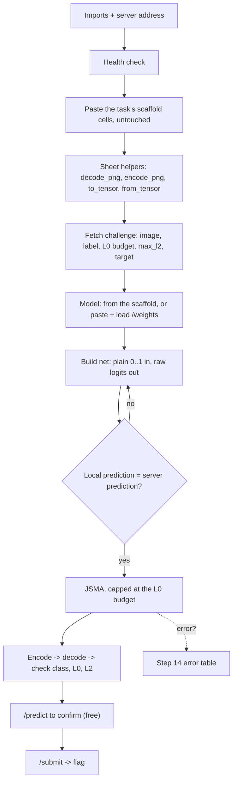

y
# JSMA (Saliency Map) API Challenge - Exam Cheatsheet

_HTB Academy · AI Evasion - Sparsity · for "submit an adversarial image to a server" challenges (untargeted + targeted)_

> **How to use this sheet**
> 
> - This is for the challenge style where a **server** gives you an image and you **submit** a changed one. The server checks that the prediction changed (or became a **target** class) and that your change stays **under its limits**.
> - Run the cells **top to bottom in one Jupyter notebook**. Later cells reuse names earlier cells made.
> - **🔵 INPUT NEEDED** = fill every `<<LIKE_THIS>>` before running.
> - **⚪ no input needed - just run** = run it as it is.
> - This sheet has **no math**. Where the attack uses a formula, you get one plain-English line instead.
> - **Every code block below is ONE Jupyter cell.** Never split a block (or a loop) across cells.

## The 5 golden rules when the task gives you its own code

HTB challenge pages usually include "scaffold" cells (helpers + model + a verify line). These rules stop the two codes from fighting:

1. **Paste the task's scaffold cells first, exactly as given, and never edit them.** They are your proof that the model loads and matches the server.
2. **This sheet's helpers have their own names** (`decode_png`, `encode_png`, `to_tensor`, `from_tensor`), so the task's code can't overwrite them. The task's `x01_from_b64_png` / `b64_png_from_x01` stay the task's; this sheet never calls them.
3. **Keep `x` in the task's shape**: greyscale stays `(28, 28)`. Shapes are only changed at the border: `to_tensor(x)` going into the model, `from_tensor(t, like=x)` coming out.
4. **`net` is the only thing the attack talks to**: it takes plain 0..1 pixels and returns raw logits, whatever the task's model does inside.
5. **Changed a cell above? Kernel → Restart & Run All.** Old versions of functions stay in memory until you restart.

## What this challenge type is, and when JSMA is the right tool

A server holds a model, hands you **one image** it classifies correctly, and sets a **budget** - the most your change may be. JSMA's natural budget is **L0: "change at most N pixels"**. It changes pixels one pair at a time and stops exactly at the budget. Pick the attack by the budget the server enforces:

|Budget the server checks|Best tool|Why|
|---|---|---|
|**L0 ("change few pixels" / "at most N pixels")**|**JSMA (this sheet)**|JSMA minimises the pixel COUNT and caps it exactly|
|**L2 / "total distortion"**|**DeepFool**|smallest overall size|
|**L1 / elastic / sparse-ish**|**ElasticNet (EAD)**|few pixels but gentle changes|
|**L∞ ("max per-pixel change")**|**I-FGSM** (FGSM sheet)|JSMA flips pixels fully (0↔1), which blows an L∞ cap|

Two goals: **untargeted** ("be wrong") and **targeted** ("be class T"). JSMA always attacks toward a class; for untargeted this sheet aims at the model's **runner-up** class (the easiest flip).

**JSMA's quiet superpower:** with `theta=1.0` every changed pixel lands on exactly 0.0 or 1.0, which are exactly 0 and 255 in a PNG, so **saving as PNG changes nothing**. Bonus: if the server also has an **L2 cap** (`max_l2`), each flipped pixel adds at most 1 to the squared size, so 50 pixels can never exceed L2 ≈ 7.07. You still check it.



---

## Part A - Talk to the server

## Step 1 - Imports and the server address

🔵 INPUT NEEDED

```python
import io, base64
import numpy as np
import requests
import torch
import torch.nn as nn
import torch.nn.functional as F
from PIL import Image
import matplotlib.pyplot as plt

BASE_URL = "<<http://INSTANCE_IP:PORT>>" # full address, with http:// and port, no trailing slash
IMG_MODE = "<<L_or_RGB>>" # "L" = greyscale, "RGB" = colour

device = torch.device("cpu") # challenge models are small; CPU is simplest
```

**fill in:**

- `<<http://INSTANCE_IP:PORT>>` - the address the platform shows, e.g. `http://154.57.164.79:42234`.
- `<<L_or_RGB>>` - `"L"` for black-and-white (MNIST), `"RGB"` for colour.

## Step 2 - Health check

⚪ no input needed - just run

```python
print(requests.get(f"{BASE_URL}/health", timeout=10).json())
```

**Expected:** something like `{'status': 'healthy'}`. If it errors, the address is wrong or the instance is still starting.

## Step 3 - Paste the task's scaffold (if the page gives one)

🔵 INPUT NEEDED - copy, don't edit

Look at the task page for its Python blocks. Copy them into **their own cells, in the same order, unchanged**:

|Task block (typical name)|Copy it?|Why|
|---|---|---|
|"API Helpers and Challenge Fetching"|**Yes, as one cell**|gives you `ch`, `x`, the task's helpers, a clean `/predict` check|
|"Model Architecture and Loading"|**Yes, as one cell**|builds the model class, downloads `/weights`, loads them, prints "Local prediction"|
|"Testing Server Validation" (submits the clean image)|Optional|it should fail with a 400; skip it if you don't want to spend a `/submit`|
|No scaffold at all?| - |skip this step; Step 6 Option B builds the model for you|

**Expected:** the model block prints `Local prediction: N, should match server: N` with the same number twice. If the task's own code errors here, see Step 14.

> **Before moving on, read the task's verify line** (usually the last lines of the model block). If it looks like `model(some_normalize(x_tensor))`, the model wants **normalized** input → Step 7 flag `False`. If it's just `model(x_tensor)`, the model takes **plain 0..1** → `True`. **Trust the verify line over the docstring**: the HTB MNIST docstring says "[0,1] range" but its verify line normalizes.

## Step 4 - This sheet's helpers (shape-proof, unique names)

⚪ no input needed - just run

Convert images both ways, move between arrays and tensors without shape errors, and measure a change. These work with `(H, W)`, `(1, H, W)` or `(3, H, W)`, so it doesn't matter what shape the task's code left `x` in.

```python
def decode_png(b64):
    """base64 PNG text -> 0..1 array. Greyscale -> (H, W) like the HTB scaffolds; colour -> (3, H, W)."""
    img = Image.open(io.BytesIO(base64.b64decode(b64))).convert(IMG_MODE)
    a = np.asarray(img, dtype=np.float32) / 255.0
    return a if a.ndim == 2 else a.transpose(2, 0, 1)

def encode_png(x):
    """0..1 array (H, W), (1, H, W) or (3, H, W) -> base64 PNG text. Rounds to 1/255 steps (harmless for 0/1 pixels)."""
    a = np.asarray(x, dtype=np.float32)
    if a.ndim == 3 and a.shape[0] == 1:
        a = a[0] # (1, H, W) -> (H, W)
    elif a.ndim == 3:
        a = a.transpose(1, 2, 0) # (3, H, W) -> (H, W, 3)
    a255 = np.clip(np.round(a * 255.0), 0, 255).astype(np.uint8)
    buf = io.BytesIO(); Image.fromarray(a255).save(buf, format="PNG")
    return base64.b64encode(buf.getvalue()).decode("ascii")

def to_tensor(x):
    """Any image array -> a COPIED tensor (1, C, H, W). Copy = the attack can never overwrite your x."""
    a = np.array(x, dtype=np.float32) # np.array makes a copy
    if a.ndim == 2:
        a = a[None] # (H, W) -> (1, H, W): add the channel
    return torch.from_numpy(a[None]).to(device) # (C, H, W) -> (1, C, H, W): add the batch

def from_tensor(t, like):
    """Tensor (1, C, H, W) -> numpy array in the SAME shape as `like` (your x)."""
    return t.detach().cpu().numpy().reshape(np.shape(like)).copy()

def l0(a, b): return int(np.sum(np.abs(a - b) > 1e-6)) # how many CHANNEL-pixels changed
def l0_positions(a, b): # pixel POSITIONS changed (any channel)
    d = np.abs(np.asarray(a) - np.asarray(b))
    return int(((d.sum(axis=0) if d.ndim == 3 else d) > 1e-6).sum())
def l1(a, b): return float(np.sum(np.abs(a - b))) # total absolute change
def l2(a, b): return float(np.sqrt(np.sum((a - b) ** 2))) # overall size
def linf(a, b): return float(np.max(np.abs(a - b))) # biggest single-pixel change
```

> **L0 counts what?** For greyscale a pixel has one channel, so `l0` = `l0_positions`. For colour, `l0` counts red/green/blue separately, `l0_positions` counts a spot once. Match whichever the server rejects on.

## Step 5 - Fetch the challenge and read every limit

🔵 INPUT NEEDED

Prints every field the server sent **with its value**, then sets the image, label, limits and goal. Safe to run even if the scaffold already fetched: the server returns the same challenge.

```python
ch = requests.get(f"{BASE_URL}/challenge", timeout=10).json()
print({k: (v if k != "<<IMAGE_KEY>>" else f"<{len(v)} chars of PNG>") for k, v in ch.items()}) # READ THIS

x = decode_png(ch["<<IMAGE_KEY>>"]) # the image, 0..1, same shape as the task's x
lab = int(ch["<<LABEL_KEY>>"]) # the true class

L0_BUDGET = int(<<L0_BUDGET>>) # the most CHANGED PIXELS allowed
MAX_L2 = <<MAX_L2_or_None>> # second limit if the server sends one, else None
NUM_CLASSES = <<NUM_CLASSES>> # how many classes the model has

ATTACK = "<<untargeted_or_targeted>>".lower()
TARGET = <<TARGET>> # class to force (targeted), else None

print("shape:", x.shape, "| label:", lab, "| L0 budget:", L0_BUDGET, "| max L2:", MAX_L2,
      "| classes:", NUM_CLASSES, "| attack:", ATTACK, "| target:", TARGET)
```

**fill in** (copy the key names from the printed line, letter for letter):

- `<<IMAGE_KEY>>` - the field holding the picture, e.g. `image_b64` (both places).
- `<<LABEL_KEY>>` - the true class, e.g. `original_label` or `label`.
- `<<L0_BUDGET>>` - e.g. `ch["l0_budget"]`, or the number the task names.
- `<<MAX_L2_or_None>>` - e.g. `float(ch["max_l2"])`; `None` if there's no L2 field.
- `<<NUM_CLASSES>>` - e.g. `10`.
- `<<untargeted_or_targeted>>` - `"targeted"` if the server sends a target class, else `"untargeted"`.
- `<<TARGET>>` - **the server's target field, e.g. `int(ch["target_class"])`**, never the original label. `None` if untargeted.

> **If the budget is L∞, L2-only, or L1/elastic - stop here** and use the matching sheet. JSMA is for L0.

---

## Part B - Get the model and make `net`

## Step 6 - The model

🔵 INPUT NEEDED - pick ONE option

**Option A - the task's scaffold already built and loaded the model (Step 3).** Run nothing here. Just note the variable name it used (HTB uses `model`) for Step 7.

**Option B - no scaffold.** Paste the architecture exactly as the task gives it, then load the weights.

```python
# --- 1) Paste the EXACT architecture from the task (example below = HTB's MNIST LeNet-5). ---
class MNISTClassifier(nn.Module):
    def __init__(self):
        super().__init__()
        self.conv1 = nn.Conv2d(1, 6, kernel_size=5)
        self.conv2 = nn.Conv2d(6, 16, kernel_size=5)
        self.pool = nn.AvgPool2d(2, 2)
        self.fc1 = nn.Linear(16 * 4 * 4, 120)
        self.fc2 = nn.Linear(120, 84)
        self.fc3 = nn.Linear(84, 10)
        self.act = nn.Tanh()
    def forward(self, x):
        x = self.pool(self.act(self.conv1(x)))
        x = self.pool(self.act(self.conv2(x)))
        x = torch.flatten(x, 1)
        x = self.act(self.fc1(x)); x = self.act(self.fc2(x))
        return F.log_softmax(self.fc3(x), dim=1) # leave as the task wrote it; Step 7 handles it

# --- 2) Load the weights ---
open("weights.pth", "wb").write(requests.get(f"{BASE_URL}/weights", timeout=10).content)
model = MNISTClassifier().to(device)
model.load_state_dict(torch.load("weights.pth", map_location=device))
model.eval() # REQUIRED: dropout/BN off
```

**fill in:** the whole class - copied from the task, `forward` untouched. Change `MNISTClassifier()` to the task's class name.

## Step 7 - Build `net`: plain 0..1 in, raw logits out

🔵 INPUT NEEDED

Two wrappers, so you **never edit the task's model**:

- `RawLogits` reads the **last Linear layer's output** (the raw scores). This matters because JSMA needs logits; if the task's `forward` ends in `log_softmax` or `softmax`, the "help the target" and "hurt the others" signals get mixed. It's harmless if the model already returns logits.
- `Norm01` adds the normalisation, if the model expects normalized input, so the attack can feed plain 0..1.

```python
base_model = <<MODEL_VAR>> # the loaded model's variable name
base_model.eval()

USE_RAW_LOGITS = True # keep True; set False only if the output-shape check below fails
MODEL_NORMALIZES_INSIDE = <<True_or_False>> # True = model takes plain 0..1; False = task normalizes before calling it
MEAN, STD = <<MEAN>>, <<STD>> # used only when False

class RawLogits(nn.Module):
    """Return the LAST nn.Linear layer's output (raw logits), even if forward() ends in log_softmax/softmax."""
    def __init__(self, m):
        super().__init__()
        self.m, self.box = m, {}
        last_linear = [mod for mod in m.modules() if isinstance(mod, nn.Linear)][-1]
        last_linear.register_forward_hook(lambda mod, inp, out: self.box.__setitem__("z", out))
    def forward(self, x):
        self.m(x) # run the whole model; the hook catches the logits
        return self.box["z"]

class Norm01(nn.Module):
    """Wrap a model that expects NORMALIZED input so it accepts plain 0..1 pixels."""
    def __init__(self, m, mean, std):
        super().__init__(); self.m, self.mean, self.std = m, mean, std
    def forward(self, x01):
        return self.m((x01 - self.mean) / self.std)

net = RawLogits(base_model) if USE_RAW_LOGITS else base_model
if not MODEL_NORMALIZES_INSIDE:
    net = Norm01(net, MEAN, STD)
net.eval()
print("training mode?", net.training, "| raw logits:", USE_RAW_LOGITS, "| normalizes inside:", MODEL_NORMALIZES_INSIDE)
```

**fill in:**

- `<<MODEL_VAR>>` - `model` for HTB scaffolds and Option B.
- `<<True_or_False>>` - read the task's verify line (Step 3 box): `model(normalize(...))` → `False`; `model(x_tensor)` → `True`.
- `<<MEAN>>`, `<<STD>>` - only when `False`. Use the task's own numbers (MNIST: `0.1307, 0.3081`). For colour, tensors shaped `(1,3,1,1)`.

## Step 8 - Check `net` matches the server

⚪ no input needed - just run

```python
with torch.no_grad():
    out = net(to_tensor(x))
local_pred = int(out.argmax(1))
server = requests.post(f"{BASE_URL}/predict", json={"image_b64": encode_png(x)}, timeout=10).json()
print("output shape:", tuple(out.shape), "-> should be (1,", NUM_CLASSES, ")")
print("local:", local_pred, "| server:", server, "| true label:", lab)
```

**Expected:** shape `(1, 10)`, and local = server prediction = true label. If not, go to Step 14.

---

## Part C - The JSMA attack (define once)

## Step 9 - The gradient + pair-scoring toolkit

⚪ no input needed - just run

One gradient row per class (the Jacobian). Split it into "helps the target" (alpha) and "helps the rest" (beta). Score **pairs** of pixels, keeping only the `top_k` most promising so it's fast. Plus the helpers that flip pixels and track which ones are still usable.

```python
def compute_class_gradient(x, net, class_idx):
    """How every pixel affects ONE class's raw score -> flat vector."""
    xg = x.detach().clone().requires_grad_(True)
    net(xg)[0, class_idx].backward()
    return xg.grad.detach().cpu().numpy().flatten().copy()

def compute_jacobian_matrix(x, net, num_classes):
    """Stack one gradient row per class -> (classes x pixels). One backward pass per class."""
    if x.shape[0] != 1:
        raise ValueError("one image at a time (batch size 1)")
    return np.asarray([compute_class_gradient(x, net, c) for c in range(num_classes)])

def extract_target_gradient(J, t): return J[t].copy() # alpha: effect on the target
def extract_other_gradients(J, t): return J.sum(axis=0) - J[t] # beta: effect on all other classes

def initialize_search_space(shape):
    return np.ones(int(np.prod(shape[1:])), dtype=bool) # all pixels usable to start

def remove_saturated_pixels(search, x, clip_min=0.0, clip_max=1.0, eps=1e-6):
    xf = x.detach().cpu().numpy().flatten()
    return search & ~((xf <= clip_min + eps) | (xf >= clip_max - eps)) # drop pixels stuck at 0 or 1

def prune_candidates(alpha, beta, search, direction, top_k):
    """Keep the top_k pixels that most help the target and hurt the rest, in this direction."""
    valid = np.where(search)[0]
    if valid.size < 2 or top_k is None or valid.size <= top_k:
        return valid
    sign = 1.0 if direction == 'increase' else -1.0
    prelim = sign * (alpha[valid] - beta[valid])
    return valid[np.argsort(-prelim)[:top_k]]

def evaluate_pairs(alpha, beta, valid, direction):
    """Score every pair at once; a pair counts only if it helps the target AND hurts the rest."""
    a, b = alpha[valid], beta[valid]
    A = a[:, None] + a[None, :] # pair's effect on target
    B = b[:, None] + b[None, :] # pair's effect on the rest
    upper = np.triu(np.ones(A.shape, dtype=bool), 1) # each pair once, no pixel with itself
    good = (A > 0) & (B < 0) if direction == 'increase' else (A < 0) & (B > 0)
    S = np.where(upper & good, np.abs(A) * np.abs(B), 0.0)
    if S.max() <= 0:
        return -1, -1, 0.0
    i, j = np.unravel_index(np.argmax(S), S.shape)
    return int(valid[i]), int(valid[j]), float(S[i, j])

def compute_pairwise_saliency(alpha, beta, search, direction='increase', top_k=None):
    valid = prune_candidates(alpha, beta, search, direction, top_k)
    if valid.size < 2:
        return -1, -1, 0.0
    return evaluate_pairs(alpha, beta, valid, direction)

def apply_pair_perturbation(x, p, q, theta, increase, clip_min=0.0, clip_max=1.0):
    shape = x.shape; xf = x.reshape(-1).clone()
    step = theta if increase else -theta
    xf[p] = torch.clamp(xf[p] + step, clip_min, clip_max)
    xf[q] = torch.clamp(xf[q] + step, clip_min, clip_max)
    return xf.view(shape)
```

## Step 10 - The JSMA attack (one image, budget-aware)

⚪ no input needed - just run

The whole attack in one function. It aims at the target (or the runner-up if untargeted), flips the best pair each step, and **stops the instant one more pair would go over the L0 budget**. Keep it in one cell.

```python
def jsma_attack(image, net, target=None, l0_budget=None, theta=1.0, top_k=128,
                max_iter=400, num_classes=10, clip_min=0.0, clip_max=1.0):
    """JSMA on ONE image tensor (1,C,H,W) in 0..1. Returns (adv tensor, success, orig_label).
       target = class to force; None = untargeted (aims at the runner-up class).
       l0_budget = max changed pixels allowed (the server's L0 cap)."""
    net.eval(); device = next(net.parameters()).device; image = image.to(device)
    with torch.no_grad():
        logits0 = net(image)[0]
        orig_label = int(logits0.argmax())
    targeted = target is not None
    aim = target if targeted else int(torch.argsort(logits0, descending=True)[1]) # runner-up

    num_features = int(np.prod(image.shape[1:]))
    budget = num_features if l0_budget is None else int(l0_budget)
    x_adv = image.clone().detach()
    search = initialize_search_space(image.shape)
    changed = 0

    for _ in range(max_iter):
        with torch.no_grad():
            pred = int(net(x_adv).argmax(1))
        if (pred == aim) if targeted else (pred != orig_label): # done?
            break
        if changed + 2 > budget: # one more pair would bust the budget
            break
        J = compute_jacobian_matrix(x_adv, net, num_classes)
        a = extract_target_gradient(J, aim)
        b = extract_other_gradients(J, aim)
        pi, qi, si = compute_pairwise_saliency(a, b, search, 'increase', top_k)
        pd, qd, sd = compute_pairwise_saliency(a, b, search, 'decrease', top_k)
        if max(si, sd) <= 0.0: # no useful pair left
            break
        if si >= sd: p, q, inc = pi, qi, True
        else: p, q, inc = pd, qd, False
        x_adv = apply_pair_perturbation(x_adv, p, q, theta, inc, clip_min, clip_max)
        search[p] = False; search[q] = False # never touch these again
        search = remove_saturated_pixels(search, x_adv, clip_min, clip_max)
        changed += 2

    with torch.no_grad():
        pred = int(net(x_adv).argmax(1))
    success = (pred == target) if targeted else (pred != orig_label)
    return x_adv.detach(), success, orig_label
```

> **Tight or odd L0 budget?** Pairwise moves 2 pixels at a time, so with an odd cap it stops 1 short. That's usually fine. For a very tight cap (≤ 10), use the single-pixel version from the JSMA module sheet.

---

## Part D - Run, check, submit

## Step 11 - Run the attack

🔵 INPUT NEEDED

```python
target = TARGET if ATTACK == "targeted" else None

adv_t, success, orig = jsma_attack(
    to_tensor(x), net, target=target, l0_budget=L0_BUDGET, theta=1.0,
    top_k=<<TOP_K>>, max_iter=<<MAX_ITER>>, num_classes=NUM_CLASSES)

adv_np = from_tensor(adv_t, like=x) # back to x's own shape
with torch.no_grad():
    now = int(net(to_tensor(adv_np)).argmax(1))
print(f"{orig} -> {now} | success locally: {success} | L0 {l0(adv_np, x)} / {L0_BUDGET} | L2 {l2(adv_np, x):.3f}")
```

**fill in:**

- `<<TOP_K>>` - `128` (default). `64` is faster, `None` checks every pair (slow).
- `<<MAX_ITER>>` - `400`. The budget usually stops it long before that.

**Expected:** `success locally: True`, L0 at or under the budget, e.g. `1 -> 7 | ... | L0 32 / 50`. If L0 is `0` but it says success, the original was already the target; recheck `TARGET`.

## Step 12 - Encode, decode, check EVERY limit

⚪ no input needed - just run

Save as PNG, decode it exactly as the server will, and check the class, the L0 budget, the L2 cap (if any), and the 0..1 range in one place. **All checks go here, after the decode**, not earlier.

```python
adv_b64 = encode_png(adv_np)
x_back = decode_png(adv_b64) # what the server will see
with torch.no_grad():
    probs = F.softmax(net(to_tensor(x_back)), dim=1)[0]
pred_back = int(probs.argmax())

checks = {
    "class": (pred_back == TARGET) if ATTACK == "targeted" else (pred_back != lab),
    "L0": l0(x_back, x) <= L0_BUDGET,
    "L2": True if MAX_L2 is None else l2(x_back, x) < MAX_L2,
    "range": bool(x_back.min() >= 0.0 and x_back.max() <= 1.0),
}
print(f"after PNG: pred {pred_back} (true {lab}, target {TARGET}) | confidence {float(probs.max()):.3f}")
print(f"L0 {l0(x_back, x)} / {L0_BUDGET} | positions {l0_positions(x_back, x)} | "
      f"L1 {l1(x_back, x):.2f} | L2 {l2(x_back, x):.3f} / {MAX_L2} | Linf {linf(x_back, x):.3f}")
print(checks)
print("READY to submit" if all(checks.values()) else "Not ready -> Step 14")
```

**Expected:** every check `True`, `READY to submit`. `Linf ≈ 1.0` is normal for JSMA.

## Step 13 - Confirm with /predict, then /submit

🔵 INPUT NEEDED

`/predict` is free; `/submit` counts. It only submits if the server agrees.

```python
SUBMIT_EXTRA = <<SUBMIT_EXTRA>> # extra fields the task's /submit example shows, else {}

pred = requests.post(f"{BASE_URL}/predict", json={"image_b64": adv_b64}, timeout=10).json()
srv_class = int(pred.get("predicted_class", pred.get("pred", pred.get("prediction", -1))))
print("server predicts:", srv_class, "| full reply:", pred)

ok = (srv_class == TARGET) if ATTACK == "targeted" else (srv_class != lab)
if ok:
    r = requests.post(f"{BASE_URL}/submit", json={"image_b64": adv_b64, **SUBMIT_EXTRA}, timeout=10)
    print(r.status_code, r.text)
else:
    print("Server disagrees -> Step 14.")
```

**fill in:** `<<SUBMIT_EXTRA>>` - copy the task's `/submit` example. If it only sends `image_b64` (HTB JSMA does), use `{}`. If it also sends e.g. `sample_index`, use `{"sample_index": ch["sample_index"]}`.

---

## Part E - When it breaks

## Step 14 - Error → cause → exact fix

⚪ no input needed - find your error, do the fix

|You see|What it means|Do this|
|---|---|---|
|`Expected 3D (unbatched) or 4D (batched) input to conv2d, but got input of size: [1, 1, 1, 28, 28]`|Dimensions were added twice: `x` already had a channel, and code like `x[None, None, ...]` added two more|Don't edit that line. Leave `x` in the task's shape (`decode_png` keeps greyscale `(28, 28)`) and always use `to_tensor(x)`|
|`mat1 and mat2 shapes cannot be multiplied` (traceback ends in `fc1` / `Linear`)|The tensor is missing its channel: `(1, 28, 28)` instead of `(1, 1, 28, 28)`|Build tensors with `to_tensor(x)`, never `torch.from_numpy(x[None])`|
|`ValueError: Too many dimensions: 3 > 2` (from `Image.fromarray`)|A 2-D-only encoder (the task's `b64_png_from_x01`) got a `(1, 28, 28)` array|Encode with `encode_png(...)`, which accepts any shape|
|`Expected (N,1,28,28), got torch.Size([1, 1, 1, 28, 28])`|Same double-dimension problem, in the task's own helper|Same fix: `to_tensor(x)`|
|Functions act differently than this sheet says, after pasting task code|**Name collision**: the task's cell defined a function with the same name, and whichever cell ran last wins|Use this sheet's unique names (`decode_png`, `encode_png`, `to_tensor`, `from_tensor`), then **Kernel → Restart & Run All**|
|Local prediction ≠ server prediction|`net` sees the image differently from the server|Flip `MODEL_NORMALIZES_INSIDE` (read the task's verify line), check `MEAN`/`STD`, check `model.eval()`, check the class is pasted exactly|
|Output shape isn't `(1, NUM_CLASSES)`|The model's last `nn.Linear` isn't the class layer|Set `USE_RAW_LOGITS = False` in Step 7|
|`NameError: name 'x_back' is not defined` (or `adv_np`, `net`...)|You ran a check before the cell that creates that name|Put checks only in Step 12; run the cells in order|
|`KeyError: 'label'` (or `'budget'`, `'target'`)|The server named the field differently|Copy the key names from Step 5's printed line, letter for letter|
|L0 prints `0`, or your original `x` changed too|The attack wrote into `x`'s memory (`torch.from_numpy` shares it with the array)|Use `to_tensor(x)`, which copies; re-fetch `x` (Step 5)|
|Attack "succeeds" with 0 pixels, or flips to the wrong class|`TARGET` is wrong (often set to the original label)|`TARGET = int(ch["target_class"])` (the server's target field)|
|`success locally: False`, L0 stopped at the budget|Ran out of pixels|`top_k=None` (best pair, slower); make sure `USE_RAW_LOGITS = True`; try the single-pixel version|
|`success locally: False`, L0 far under budget|Hit `max_iter` or no useful pair left|Raise `MAX_ITER`; set `top_k=None`|
|400 `L0 constraint violated: 55 pixels modified (max: 50)`|Over the pixel cap, or the server counts differently|Check `l0` vs `l0_positions`; lower the `l0_budget` you pass by 2|
|400 `Target misclassification failed: predicted 3, expected 7`|The flip didn't hold on the server|Run Step 8 again (local must = server); check Step 12 used the decoded image|
|400 `Submission rejected: please derive the adversarial example from the provided baseline image`|You attacked a different image|Attack the `x` from `/challenge`, not a dataset image|
|400 L2 too large|Over `max_l2`|Rare with JSMA; lower `l0_budget` a little (fewer flipped pixels = smaller L2)|
|`ConnectionError` / timeout|Instance stopped or address changed|Restart the instance, update `BASE_URL`, Restart & Run All|

## Step 15 - Match the tool to the budget

⚪ no input needed - read, then act

- **L0 only:** this sheet.
- **L0 + L2 cap:** this sheet. JSMA's L2 stays small (each flipped pixel adds at most 1 to the squared size), and Step 12 checks it.
- **L∞:** wrong tool. Use **I-FGSM** (FGSM sheet).
- **L2 only:** use **DeepFool**. **L1 / elastic:** use **ElasticNet**.

## Step 16 - No weights given: surrogate

🔵 INPUT NEEDED

If there's only `/predict` (no `/weights`), attack **your own** model and test each try against the free `/predict`.

```python
surrogate = RawLogits(<<YOUR_TRAINED_MODEL>>) # a model YOU trained on similar data
if not MODEL_NORMALIZES_INSIDE:
    surrogate = Norm01(surrogate, MEAN, STD)
surrogate.eval()

adv_s, _, _ = jsma_attack(to_tensor(x), surrogate, target=target, l0_budget=L0_BUDGET,
                          theta=1.0, top_k=128, max_iter=400, num_classes=NUM_CLASSES)
s_b64 = encode_png(from_tensor(adv_s, like=x))
srv = requests.post(f"{BASE_URL}/predict", json={"image_b64": s_b64}, timeout=10).json()
print("server on surrogate attack:", srv)
# if it transferred and is under budget -> set adv_b64 = s_b64 and run Step 13
```

**fill in:** `<<YOUR_TRAINED_MODEL>>` - a model you trained yourself (same image size and channels).

> **Transfer is harder for L0 attacks**, because the exact pixels that matter differ between models.

---

## Part F - See it (optional)

## Step 17 - Four-panel view

⚪ no input needed - just run

```python
as_pic = lambda a: a if a.ndim == 2 else (a[0] if a.shape[0] == 1 else a.transpose(1, 2, 0))
cmap = "gray" if (x.ndim == 2 or x.shape[0] == 1) else None
d = np.abs(x_back - x)
heat = d.sum(axis=0) if d.ndim == 3 else d

fig, ax = plt.subplots(1, 4, figsize=(15, 4))
ax[0].imshow(as_pic(x), cmap=cmap, vmin=0, vmax=1); ax[0].set_title(f"original ({lab})")
ax[1].imshow(as_pic(x_back), cmap=cmap, vmin=0, vmax=1); ax[1].set_title(f"submitted ({pred_back})")
im = ax[2].imshow(heat, cmap="hot"); ax[2].set_title(f"where it changed\nL0 {l0(x_back, x)}")
plt.colorbar(im, ax=ax[2], fraction=0.046)
ax[3].imshow(heat > 0, cmap="hot"); ax[3].set_title(f"modified pixels\n{l0_positions(x_back, x)} positions")
for a in ax: a.axis("off")
plt.suptitle(f"JSMA ({ATTACK})"); plt.tight_layout(); plt.show()
```

**Reading it:** a few bright scattered dots on or near the strokes are the L0 signature. A faint haze over the whole image would be FGSM.

---

## Filled-in example: HTB JSMA Challenge (Sparsity module, Section 27)

What this challenge sent: `sample_index`, `target_class` (7), `l0_budget` (50), `original_label` (1), `max_l2` (8.0), `image_b64`. MNIST, greyscale, 28×28, LeNet-5 that ends in `log_softmax`, with a separate `mnist_normalize`.

|Placeholder|What to put|
|---|---|
|`<<http://INSTANCE_IP:PORT>>`|the instance address, e.g. `http://154.57.164.79:42234`|
|`<<L_or_RGB>>`|`"L"`|
|Step 3|paste "API Helpers and Challenge Fetching" and "Model Architecture and Loading" as two cells, unchanged|
|`<<IMAGE_KEY>>`|`image_b64`|
|`<<LABEL_KEY>>`|`original_label`|
|`<<L0_BUDGET>>`|`ch["l0_budget"]`|
|`<<MAX_L2_or_None>>`|`float(ch["max_l2"])`|
|`<<NUM_CLASSES>>`|`10`|
|`<<untargeted_or_targeted>>`|`targeted`|
|`<<TARGET>>`|`int(ch["target_class"])`|
|Step 6|Option A (the scaffold loaded `model`)|
|`<<MODEL_VAR>>`|`model`|
|`<<True_or_False>>`|`False` (the verify line is `model(mnist_normalize(x_tensor))`)|
|`<<MEAN>>`, `<<STD>>`|`MNIST_MEAN, MNIST_STD` (the scaffold defines them: 0.1307, 0.3081)|
|`<<TOP_K>>`, `<<MAX_ITER>>`|`128`, `400`|
|`<<SUBMIT_EXTRA>>`|`{}` (the task's `/submit` example sends only `image_b64`)|

**Expected run:** Step 8 shows local 1 = server 1; Step 11 shows `1 -> 7` with roughly 20-45 pixels; Step 12 prints `READY to submit`; Step 13 returns `200` with `"success": true` and the flag.

---

## If you remember nothing else

## The attack in 4 lines

1. **JSMA owns the L0 budget** ("change at most N pixels"). Rebuild the model, load `/weights`, `model.eval()`, confirm local = server. For L∞ use I-FGSM, L2 DeepFool, L1/elastic ElasticNet.
2. **It flips a few pixels, chosen by gradients:** each step it picks the pair that most helps the target class and hurts the rest, and pushes both fully to 0 or 1. Untargeted = aim at the runner-up class.
3. **Stop at the budget:** never let one more pair exceed the pixel cap; `theta=1.0` means each pixel saturates in one hit.
4. **PNG is a non-issue** (0.0/1.0 are exact as 0/255), so re-check the decoded image against every limit, confirm with `/predict` (free), then `/submit`.

## The core from memory

```python
net = RawLogits(model) # raw logits, even if forward ends in log_softmax
if not MODEL_NORMALIZES_INSIDE: net = Norm01(net, MEAN, STD) # attack feeds plain 0..1
net.eval()
adv_t, ok, orig = jsma_attack(to_tensor(x), net, target=TARGET, l0_budget=L0_BUDGET,
                              theta=1.0, top_k=128, num_classes=10)
adv_b64 = encode_png(from_tensor(adv_t, like=x)) # PNG-exact with theta=1.0
x_back = decode_png(adv_b64) # check class, L0, L2 on THIS
# POST /predict {"image_b64": adv_b64} -> then POST /submit
```

## Must-know facts

- **JSMA is the L0 tool**: it minimises and caps the _number_ of changed pixels, so it's the right attack when the server limits how many pixels you may touch.
- **Never edit the task's scaffold; convert at the border instead**. Keep `x` in the task's shape, use `to_tensor(x)` into the model and `from_tensor(t, like=x)` out, and almost every shape error disappears.
- **Unique helper names prevent silent overwrites**: if the task and your sheet both define `x01_from_b64_png`, whichever cell ran last wins, and the "wrong" version breaks shapes three cells later.
- **`net` must take plain 0..1 and return raw logits**: `Norm01` adds normalisation if the task normalises outside the model, and `RawLogits` skips a final `log_softmax`/`softmax` so "help target" and "hurt others" stay separate.
- **The verify line tells you about normalisation, not the docstring**: `model(normalize(x))` means `MODEL_NORMALIZES_INSIDE = False`.
- **`TARGET` comes from the server's target field**, never the original label, and every limit the server sends (L0 and L2) gets checked on the decoded PNG.
- ==theta=1.0 makes JSMA PNG-exact and keeps L2 small==: changed pixels land on 0/255, and 50 flipped pixels can never exceed L2 ≈ 7.07.
- **Method point:** **`/predict` is free, `/submit` counts**. Attack to the budget, re-check the decoded PNG, confirm with `/predict`, then submit once. This is OWASP ML01 Input Manipulation (an inference-time evasion attack).