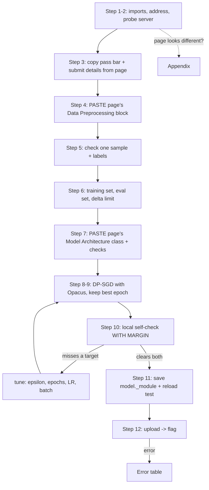

# DP-SGD - Defensive Challenge Cheatsheet (submit a PRIVATE model)

_HTB Academy · AI Privacy · for "train a model with DP-SGD that passes an accuracy + privacy check, then upload it" challenges_

> **How to use this sheet**
> 
> - This challenge is **defensive**. You don't attack anything. You **train a model with DP-SGD** (Opacus) and **upload the saved file**. The server checks two things: is it **accurate enough**, and does it **leak little enough** to a membership-inference attack.
> - Run the cells **top to bottom in one Jupyter notebook**. Later cells use names earlier cells made.
> - **📋 COPY FROM THE HTB PAGE** = take that block from the challenge page and paste it where the cell says. **Don't retype it, don't edit it.**
> - **🔵 INPUT NEEDED** = replace every `<<LIKE_THIS>>` first (a leftover one fails with `SyntaxError` on purpose). **⚪ no input needed - just run** = run it as it is.
> - The main path below matches how the real challenge (Section 12, SVHN) is set up. **If your challenge looks different, the Appendix at the end covers the variants.**

## 📋 What to copy from the HTB page (do this first)

The server itself gives you almost nothing; it only has `/`, `/health` and `/validate`. **Everything you need is on the challenge page.** Keep the page open next to the notebook and copy these four things:

|On the HTB challenge page|What you copy|Where it goes|
|---|---|---|
|**API Endpoints** (`export BASE_URL=...`) + your instance address|the instance IP and port|**Step 1** → `BASE_URL`|
|**Requirements** table|the two numbers (e.g. accuracy ≥ 55%, mia_advantage ≤ 5%)|**Step 3** → `TARGET_ACC`, `TARGET_ADV`|
|**Submit** code block|the endpoint (`/validate`), the field name (`"model"`), the file name (`"dp_model.safetensors"`)|**Step 3** → `SUBMIT_PATH`, `FILE_FIELD`, `FILE_NAME`|
|**Data Preprocessing** code block|the **whole block**, exactly as given|**Step 4** paste zone|
|**Model Architecture** code block|the **whole class**, exactly as given|**Step 7** paste zone|

## What this challenge is

The page gives you a dataset, the validator's **preprocessing code**, a **fixed model class**, and a **pass bar**. You train that **exact** class with **DP-SGD**: Opacus clips each training image's gradient and adds noise to every update, so the model can't memorise individual images. Then you save its weights **without Opacus's wrapper** (`model._module.state_dict()`) and upload the file. If accuracy and leak are both inside the bar → flag.

## The flow



---

## Golden rules

1. **Paste the page's code exactly as given and never edit it** (the preprocessing block and the model class). The validator uses exactly that code, so yours must match it.
2. **Never define or import a second class with the task's class name** (e.g. another `SVHNCNN` or `MLP`). The last definition wins, and rebuilding the model then crashes. This sheet's own helpers all start with `dp_` or are named `make_model` / `save_dp_model`, so they can't clash.
3. **Don't change the data or the model.** No flattening, no transposing, no extra normalising, no `ModuleValidator.fix` on the task class. Opacus trains the class **as given**.
4. **Save `model._module.state_dict()`, not `model.state_dict()`.** Opacus wraps the model and adds `_module.` to every weight name, and the validator can't load that.
5. **`/validate` returns the flag directly, so every upload is a real attempt.** Prove it locally first (Step 10). Changed a cell above? **Kernel → Restart & Run All.**

---

## Part A - Talk to the server

## Step 1 - Imports + address

🔵 INPUT NEEDED · 📋 COPY FROM THE HTB PAGE: your instance's IP and port

**What & why:** loads the tools (Opacus is the DP engine) and sets the server address. Start the instance on the HTB page first.

```python
import os, io, json, copy, base64, requests
import numpy as np, torch
import torch.nn as nn, torch.nn.functional as F, torch.optim as optim
from torch.utils.data import DataLoader, TensorDataset, Subset, Dataset
from torchvision import datasets, transforms
from safetensors.torch import save_file, load_file
from opacus import PrivacyEngine
from opacus.validators import ModuleValidator

BASE_URL = "<<http://INSTANCE_IP:PORT>>" # with http:// and the port, NO trailing slash
device = torch.device("cuda" if torch.cuda.is_available() else "cpu")
torch.manual_seed(1337); np.random.seed(1337)
print("device:", device)
```

**fill in:** `<<http://INSTANCE_IP:PORT>>` = the address the platform shows after you start the instance, e.g. `http://154.57.164.83:40429`.

**Expected:** `device: cuda` or `device: cpu`. DP training on CPU is slow; Step 6 shows how to do a quick first run.

**If it breaks:** `No module named 'opacus'` → run `!pip install opacus` in a cell, then re-run this one.

## Step 2 - Check the server is up (and see what it offers)

⚪ no input needed - just run

**What & why:** asks the server for its pages and prints every field, **including error replies** (they list the endpoints that really exist). This confirms the instance is up and that `/validate` exists.

```python
def dp_get(path):
    """GET an endpoint. Returns its JSON. On an error status it still returns the body (it often lists the real endpoints)."""
    try:
        r = requests.get(f"{BASE_URL}{path}", timeout=15)
        try:
            body = r.json()
        except Exception:
            body = r.text[:300]
        return body if r.ok else {"HTTP_STATUS": r.status_code, "body": body}
    except Exception as e:
        return f"ERROR {type(e).__name__}: {e}"

def dp_show(obj, name):
    """Print every field and a shortened value, so you can copy key names letter for letter."""
    print(f"--- {name} ---")
    if isinstance(obj, dict):
        for k, v in obj.items():
            s = str(v)
            print(f"{k:>22} : {s[:90]}{' ...(' + str(len(s)) + ' chars)' if len(s) > 90 else ''}")
    else:
        print(obj)

for path in ["/", "/health", "/challenge"]:
    dp_show(dp_get(path), path)
```

**Expected (Section 12):**

```
--- / --- service : DP-SGD Privacy Challenge (SVHN) version : 1.0
--- /health --- status : ok data_loaded : True
--- /challenge --- HTTP_STATUS : 404 body : {'available_endpoints': ['/', '/health', '/validate'], 'error': 'Endpoint not found'}
```

**Read it:** the 404 on `/challenge` is **normal**. It tells you the server has no settings or data to give you, and that the real endpoints are `/`, `/health` and `/validate`. Everything else comes from the HTB page (Steps 3, 4, 7).

**If it breaks:** every line says `ERROR ... ConnectionError` → wrong address, or the instance isn't up yet. If an endpoint like `/challenge` returns **real fields** (data, targets), see **Appendix A2**.

## Step 3 - Copy the pass bar + submit details from the page

🔵 INPUT NEEDED · 📋 COPY FROM THE HTB PAGE: the **Requirements** table and the **Submit** code block

**What & why:** one place for the challenge's rules. Later cells read these names.

```python
# From the REQUIREMENTS table (write percentages as fractions):
TARGET_ACC = <<TARGET_ACC>> # "accuracy ≥ 55%" -> 0.55
TARGET_ADV = <<TARGET_ADV>> # "mia_advantage ≤ 5%" -> 0.05
EPSILON_CAP = <<EPSILON_CAP>> # only if the table has an epsilon row (e.g. "epsilon ≤ 10" -> 10.0), else None

# From the SUBMIT code block: requests.post(f"{BASE_URL}/validate", files={"model": ("dp_model.safetensors", f, ...)})
SUBMIT_PATH = "<<SUBMIT_PATH>>" # the part after BASE_URL -> "/validate"
FILE_FIELD = "<<FILE_FIELD>>" # the key inside files={...} -> "model"
FILE_NAME = "<<FILE_NAME>>" # the file name inside the brackets -> "dp_model.safetensors"

print(f"bar: accuracy >= {TARGET_ACC}, advantage <= {TARGET_ADV}, epsilon cap {EPSILON_CAP} | upload to {SUBMIT_PATH} as '{FILE_FIELD}'")
```

**fill in:** copy each value from where its comment points. Section 12: `0.55`, `0.05`, `None`, `"/validate"`, `"model"`, `"dp_model.safetensors"`.

**Expected:** `bar: accuracy >= 0.55, advantage <= 0.05, epsilon cap None | upload to /validate as 'model'`.

**Remember:** the server replies in fractions (`"accuracy": 0.5612`), which is why you write `0.55` and not `55`.

---

## Part B - The data, exactly the validator's way

## Step 4 - Paste the page's Data Preprocessing block

🔵 INPUT NEEDED · 📋 COPY FROM THE HTB PAGE: the **whole Data Preprocessing** code block

**What & why:** the validator scores your model on data prepared by **this exact code**. Pasting it means your training data goes through the same steps (same dataset split, same normalisation, same label numbering). Then one **bridge line** hands the result to the rest of the sheet under the names it uses.

```python
# ===== 📋 PASTE THE PAGE'S "DATA PREPROCESSING" BLOCK HERE, EXACTLY AS GIVEN (example below = Section 12's) =====
from torchvision import datasets, transforms

SVHN_MEAN = (0.4377, 0.4438, 0.4728)
SVHN_STD = (0.1980, 0.2010, 0.1970)

transform = transforms.Compose([
    transforms.ToTensor(),
    transforms.Normalize(SVHN_MEAN, SVHN_STD)
])

train_dataset = datasets.SVHN("data", split='train', download=True, transform=transform)
test_dataset = datasets.SVHN("data", split='test', download=True, transform=transform)
# ===== end of page code =====

# BRIDGE: give the page's datasets the names this sheet uses.
train_ds, test_ds = train_dataset, test_dataset # <- only change these if the page used different names
print(f"train {len(train_ds)} | test {len(test_ds)}")
```

**fill in:** replace everything between the two `**=**` lines with the page's block (for Section 12 it's already the example). Only touch the **bridge** line if the page calls its datasets something other than `train_dataset` / `test_dataset`.

**Expected (Section 12):** `train 73257 | test 26032` (the first run downloads SVHN, about 180 MB).

**If it breaks:**

- **Download timeout (`URLError ... WinError 10060`)** → SVHN comes from Stanford's server, which is often slow or down. See **Appendix A3** (browser download, or a Hugging Face copy).
- **The page's block uses numpy** (`.data`, `/ 255`, `StandardScaler`) instead of `transform=` → see **Appendix A1** for the bridge to use instead.

## Step 5 - Check one sample and the labels

⚪ no input needed - just run

**What & why:** before any slow training, prove that a sample has the shape the model expects and that labels run 0 to (number of classes − 1).

```python
x0, y0 = train_ds[0]
check_idx = np.random.default_rng(0).choice(len(train_ds), min(2000, len(train_ds)), replace=False)
ys = np.array([int(train_ds[i][1]) for i in check_idx])
NUM_CLASSES = int(ys.max()) + 1
print("one sample:", tuple(x0.shape), x0.dtype, "| values", round(float(x0.min()), 2), "to", round(float(x0.max()), 2))
print(f"labels seen {ys.min()}-{ys.max()} | classes: {NUM_CLASSES} | distinct seen: {len(np.unique(ys))}")
assert ys.min() == 0, "labels don't start at 0: the page's code must shift them (check you pasted the whole block)"
```

**Expected (Section 12):** `one sample: (3, 32, 32) torch.float32 | values -2.2 to 2.8` (roughly; normalised pixels go below 0 and above 1), and `labels seen 0-9 | classes: 10 | distinct seen: 10`.

**Read it:**

- `(3, 32, 32)` = one colour image, which is what a CNN expects.
- Values only between 0 and 1 when the page normalises → the transform didn't get applied (check the paste).
- The number of classes should match the page (SVHN: digits 0-9 = 10).

## Step 6 - Training set, evaluation set, batch size + delta limit

🔵 INPUT NEEDED

**What & why:** DP-SGD trains **one** model directly on the training images; the noise is what protects them. A smaller evaluation set is scored after each epoch so training can keep the best epoch. DP training is 2-5× slower than normal, so a subset lets you do a quick first run.

```python
TRAIN_SUBSET = <<TRAIN_SUBSET>> # None = all training images (the real run); e.g. 20000 for a quick first test
EVAL_SUBSET = <<EVAL_SUBSET>> # test images scored after each epoch, e.g. 5000 (None = all; slower)
BATCH_SIZE = <<BATCH_SIZE>> # e.g. 256 (bigger batches dilute the DP noise)

rng = np.random.default_rng(1337)
train_dp_ds = train_ds if TRAIN_SUBSET is None else Subset(
    train_ds, rng.choice(len(train_ds), min(TRAIN_SUBSET, len(train_ds)), replace=False)) # never more than exists
eval_ds = test_ds if EVAL_SUBSET is None else Subset(
    test_ds, rng.choice(len(test_ds), min(EVAL_SUBSET, len(test_ds)), replace=False))
N_TRAIN = len(train_dp_ds)
print(f"DP training images {N_TRAIN} | per-epoch eval {len(eval_ds)} | full test {len(test_ds)} | "
      f"keep delta < {1 / N_TRAIN:.1e}")
```

**fill in:** `<<TRAIN_SUBSET>>` = `None` for the real run (`20000` to test the pipeline quickly), `<<EVAL_SUBSET>>` = e.g. `5000`, `<<BATCH_SIZE>>` = e.g. `256`.

**Expected (Section 12, full):** `DP training images 73257 | per-epoch eval 5000 | full test 26032 | keep delta < 1.4e-05`.

**Remember:** **delta** (DP's "tiny chance the guarantee fails") must stay **well below 1 ÷ number of training images**. The last number printed is that limit. For SVHN's 73,257 images, `1e-5` is fine. For ~125k images, use `1e-6`.

---

## Part C - The model, exactly the validator's class

## Step 7 - Paste the page's Model Architecture, then check it

🔵 INPUT NEEDED · 📋 COPY FROM THE HTB PAGE: the **whole Model Architecture** code block

**What & why:** the validator does `TheirClass().load_state_dict(your_file)`. **Your saved weight names and shapes must match their class exactly**, so you train **their** class, pasted unchanged. This cell also checks the output size, shows the weight names, and confirms Opacus can train the class as it is.

```python
# ===== 📋 PASTE THE PAGE'S "MODEL ARCHITECTURE" CLASS HERE, EXACTLY AS GIVEN (example below = Section 12's) =====
import torch.nn as nn
import torch.nn.functional as F

class SVHNCNN(nn.Module):
    """CNN for SVHN classification (Opacus compatible)."""

    def __init__(self):
        super(SVHNCNN, self).__init__()
        self.conv1 = nn.Conv2d(3, 32, kernel_size=3, padding=1)
        self.conv2 = nn.Conv2d(32, 64, kernel_size=3, padding=1)
        self.conv3 = nn.Conv2d(64, 64, kernel_size=3, padding=1)
        self.pool = nn.MaxPool2d(2, 2)
        self.fc1 = nn.Linear(64 * 4 * 4, 64)
        self.fc2 = nn.Linear(64, 10)

    def forward(self, x):
        x = self.pool(F.relu(self.conv1(x)))
        x = self.pool(F.relu(self.conv2(x)))
        x = self.pool(F.relu(self.conv3(x)))
        x = x.view(-1, 64 * 4 * 4)
        x = F.relu(self.fc1(x))
        x = self.fc2(x)
        return x
# ===== end of page code =====

TASK_CLASS = <<TASK_CLASS>> # the class name you just pasted, NO quotes, e.g. SVHNCNN

def make_model():
    """A fresh copy of the validator's exact model (the page's class, built with its defaults)."""
    return TASK_CLASS()

probe = make_model().to(device).eval()
with torch.no_grad():
    out = probe(train_ds[0][0].unsqueeze(0).to(device)) # one real sample, as a batch of 1
dp_problems = ModuleValidator.validate(make_model(), strict=False)
print("output shape:", tuple(out.shape), f"(want (1, {NUM_CLASSES}))")
print("weight names:", list(probe.state_dict().keys()))
print("Opacus problems with this class (want []):", [str(e)[:80] for e in dp_problems])
assert out.shape == (1, NUM_CLASSES), "output size != number of classes: wrong class pasted, or wrong data"
```

**fill in:**

- Replace everything between the two `**=**` lines with the page's class (for Section 12 it's already the example).
- `<<TASK_CLASS>>` = the class name **without quotes**, e.g. `SVHNCNN`. It's the word after `class` in what you pasted. **Not** a file name, **not** in quotes.

**Expected (Section 12):** `output shape: (1, 10)`, `weight names: ['conv1.weight', 'conv1.bias', ..., 'fc2.weight', 'fc2.bias']`, `Opacus problems with this class (want []): []`.

**If Opacus problems is NOT `[]`:** see **Appendix A6**. Never "fix" the class; the validator would no longer be able to load your file.

---

## Part D - Train with DP-SGD

## Step 8 - OPTIONAL: how much noise does each budget cost? (seconds, no training)

🔵 INPUT NEEDED

**What & why:** asks Opacus how much noise each **epsilon** (privacy budget; smaller = more private) needs for your data size, batch size and epochs. More noise means lower accuracy. Use it to pick `TARGET_EPSILON` before the slow training.

```python
from opacus.accountants.utils import get_noise_multiplier

for eps_try in <<EPS_LIST>>:
    nm = get_noise_multiplier(target_epsilon=eps_try, target_delta=<<DELTA>>,
                              sample_rate=BATCH_SIZE / N_TRAIN, epochs=<<EPOCHS>>, accountant="rdp")
    print(f"epsilon {eps_try:>5}: noise multiplier {nm:.3f} (bigger = noisier updates = lower accuracy)")
```

**fill in:** `<<EPS_LIST>>` e.g. `[1, 3, 5, 8]`, and the same `<<DELTA>>` / `<<EPOCHS>>` you'll use in Step 9 (e.g. `1e-5`, `10`).

**Expected:** a smaller epsilon gives a bigger noise multiplier. Roughly, multipliers around 0.5-1.0 still train well.

## Step 9 - DP-SGD training (keeps its best epoch)

🔵 INPUT NEEDED

**What & why:** wraps the **unchanged** task model, an optimizer and a data loader with Opacus, giving it a target epsilon. Opacus picks the noise, clips each image's gradient, adds noise to every update and counts the budget spent. After each epoch the model is scored on the evaluation set, and the best epoch's **clean** weights (`._module`) are kept.

```python
TARGET_EPSILON = <<TARGET_EPSILON>> # privacy budget to aim for, e.g. 8.0 (at/below EPSILON_CAP if there is one)
DELTA = <<DELTA>> # well below 1 / number of training images (Step 6 printed the limit), e.g. 1e-5
EPOCHS = <<EPOCHS>> # e.g. 10
LR = <<LR>> # e.g. 0.1 (DP training usually wants a higher learning rate than normal)
MAX_GRAD_NORM = <<MAX_GRAD_NORM>> # the per-image clip, e.g. 1.0

def dp_predict(model, ds, bs=512):
    """Softmax probabilities + true labels for a whole dataset (eval mode, no gradients)."""
    model.eval(); P, Y = [], []
    with torch.no_grad():
        for xb, yb in DataLoader(ds, batch_size=bs, shuffle=False):
            P.append(F.softmax(model(xb.to(device)), 1).cpu().numpy()); Y.append(np.asarray(yb))
    return np.concatenate(P), np.concatenate(Y)

dp_model = make_model().to(device) # the page's class, UNCHANGED
dp_opt = optim.SGD(dp_model.parameters(), lr=LR, momentum=0.9)
dp_loader = DataLoader(train_dp_ds, batch_size=BATCH_SIZE, shuffle=True)
privacy_engine = PrivacyEngine(accountant="rdp")
dp_model, dp_opt, dp_loader = privacy_engine.make_private_with_epsilon(
    module=dp_model, optimizer=dp_opt, data_loader=dp_loader,
    target_epsilon=TARGET_EPSILON, target_delta=DELTA, epochs=EPOCHS, max_grad_norm=MAX_GRAD_NORM)
print(f"noise multiplier {dp_opt.noise_multiplier:.3f} | sampling rate {BATCH_SIZE / N_TRAIN:.5f}")

crit = nn.CrossEntropyLoss()
best_acc, best_state, best_eps = -1.0, None, None
for ep in range(EPOCHS):
    dp_model.train()
    for xb, yb in dp_loader:
        dp_opt.zero_grad(); crit(dp_model(xb.to(device)), yb.to(device)).backward(); dp_opt.step()
    P, Y = dp_predict(dp_model, eval_ds)
    acc = float((P.argmax(1) == Y).mean())
    eps_now = privacy_engine.get_epsilon(DELTA)
    if acc > best_acc:
        best_acc, best_eps = acc, eps_now
        best_state = copy.deepcopy(dp_model._module.state_dict()) # ._module = clean names; deepcopy = a real snapshot
    print(f" epoch {ep + 1}/{EPOCHS} eval accuracy {acc:.4f} spent epsilon {eps_now:.2f}")
dp_model._module.load_state_dict(best_state)
spent_eps = privacy_engine.get_epsilon(DELTA)
print(f"kept best epoch: eval accuracy {best_acc:.4f} (epsilon by then {best_eps:.2f}) | total spent {spent_eps:.2f} (delta {DELTA})")
```

**fill in (Section 12 starting values):** `<<TARGET_EPSILON>>` `8.0`, `<<DELTA>>` `1e-5`, `<<EPOCHS>>` `10`, `<<LR>>` `0.1`, `<<MAX_GRAD_NORM>>` `1.0`.

**Expected:** a noise multiplier, then accuracy rising each epoch while spent epsilon climbs to the target. The last line shows the kept accuracy and the total budget spent.

**Tuning (if/then):**

- **If** accuracy is too low → **raise** `TARGET_EPSILON` (less noise; stay under any cap), more `EPOCHS`, a higher `LR`, or a bigger `BATCH_SIZE`.
- **If** the leak check fails (Step 10) → **lower** `TARGET_EPSILON` (more noise), or fewer epochs.
- **If** accuracy jumps around or collapses → `LR` is too high for this much noise; lower it, or raise `MAX_GRAD_NORM` slightly (1.0 → 1.5).
- **If** each epoch is far too slow (CPU) → use a GPU, or `TRAIN_SUBSET` in Step 6.

> **Honest notes:** (1) **Report the TOTAL spent epsilon** (the last number), not the target. (2) Each re-run while tuning is a separate model; report the one you submit. (3) Choosing the best epoch on test images makes your local accuracy slightly optimistic, so keep a margin. (4) Opacus may print warnings (secure random numbers, hooks). Those are harmless; only errors matter.

---

## Part E - Prove it, save it, upload it

## Step 10 - Local self-check, with margin

⚪ no input needed - just run

**What & why:** measures accuracy on the **full** test set, and your own membership advantage the course way (balanced pool, best of many confidence thresholds: training images = "members", test images = "non-members"). That's the same comparison the validator makes. Only upload when both clear the bar with room.

```python
def dp_mia_advantage(model, member_ds, nonmember_ds, k=10000):
    """Balanced best-threshold confidence attack (course style) on k members vs k non-members. Returns accuracy - 0.5."""
    rng = np.random.default_rng(0)
    k = min(k, len(member_ds), len(nonmember_ds))
    mem = Subset(member_ds, rng.choice(len(member_ds), k, replace=False))
    non = Subset(nonmember_ds, rng.choice(len(nonmember_ds), k, replace=False))
    mc, nc = dp_predict(model, mem)[0].max(1), dp_predict(model, non)[0].max(1)
    allc = np.concatenate([mc, nc]); lab = np.concatenate([np.ones(k), np.zeros(k)])
    return max(np.mean((allc >= t) == lab) for t in np.percentile(allc, np.linspace(0, 100, 1000))) - 0.5

P, Y = dp_predict(dp_model, test_ds)
final_acc = float((P.argmax(1) == Y).mean())
adv = dp_mia_advantage(dp_model, train_dp_ds, test_ds)
print(f"accuracy (full test) {final_acc:.4f} (need >= {TARGET_ACC}) | membership advantage {adv:.4f} (need <= {TARGET_ADV})")
print(f"spent epsilon {spent_eps:.2f} (cap: {EPSILON_CAP}) | delta {DELTA} (limit < {1 / N_TRAIN:.1e})")
ok_eps = EPSILON_CAP is None or spent_eps <= EPSILON_CAP
ok = final_acc >= TARGET_ACC + 0.01 and adv <= TARGET_ADV - 0.005 and ok_eps and DELTA < 1 / N_TRAIN
print("LIKELY PASS - upload" if ok else "TOO CLOSE OR FAILING - tune Step 9 first")
```

**Expected:** `LIKELY PASS - upload`, with accuracy at least 1 point above the target and advantage at least half a point below the cap.

**Read it:** with DP-SGD the advantage is usually small; a few thousandths is normal even for a model that leaks nothing. On Section 12 (55% / 5%) a sensible first run usually clears both. **If it says LIKELY PASS, upload - don't over-tune.**

## Step 11 - Save the clean weights + prove they load like the validator loads them

⚪ no input needed - just run

**What & why:** **saves `model._module.state_dict()`** (no `_module.` prefix), on the CPU and stored contiguously so safetensors won't complain. Then it builds a **fresh** page-class model, loads the file and checks the predictions are identical. That's exactly what the validator does.

```python
def save_dp_model(model, path):
    """Strip Opacus's wrapper -> CPU, contiguous -> safetensors."""
    sd = model._module.state_dict() if hasattr(model, "_module") else model.state_dict()
    sd = {k: v.detach().cpu().contiguous() for k, v in sd.items()}
    save_file(sd, path)

save_dp_model(dp_model, FILE_NAME)
reloaded = make_model().to(device)
reloaded.load_state_dict(load_file(FILE_NAME))
few = Subset(test_ds, range(min(500, len(test_ds))))
same = np.allclose(dp_predict(reloaded, few)[0], dp_predict(dp_model, few)[0], atol=1e-5)
print(f"saved {FILE_NAME} ({os.path.getsize(FILE_NAME) // 1024} KB) | reloads into the page's class | same predictions: {same}")
```

**Expected:** `... reloads into the page's class | same predictions: True`. **If the load line errors here, the validator will reject the file too.**

## Step 12 - Upload and read the whole reply

⚪ no input needed - just run (for Section 12)

**What & why:** uploads the file exactly like the page's **Submit** example and prints every field of the reply.

```python
SUBMIT_MODE = "multipart" # "multipart" = files={...} upload like the page's example. Appendix A4 covers other formats.
EXTRA_FIELDS = {} # extra form fields, only if the page's submit example sends more than the file (Appendix A4)

def dp_submit(path):
    """Upload the model the way the page shows, print the whole reply, return it."""
    if SUBMIT_MODE == "multipart":
        with open(path, "rb") as f:
            r = requests.post(f"{BASE_URL}{SUBMIT_PATH}",
                              files={FILE_FIELD: (os.path.basename(path), f, "application/octet-stream")},
                              data=EXTRA_FIELDS, timeout=180)
    else:
        b64 = base64.b64encode(open(path, "rb").read()).decode()
        r = requests.post(f"{BASE_URL}{SUBMIT_PATH}", json={FILE_FIELD: b64, **EXTRA_FIELDS}, timeout=180)
    try:
        reply = r.json()
    except Exception:
        reply = r.text[:500]
    print("HTTP", r.status_code)
    dp_show(reply, "reply")
    return reply

reply = dp_submit(FILE_NAME)
```

**Expected (pass):** `HTTP 200`, then `passed : True`, `accuracy : 0.5...` or higher, `mia_advantage : 0.0...`, `flag : HTB{...}`.

**If `passed` is False:** the reply's `accuracy` and `mia_advantage` show which side failed. Use the tuning box in Step 9, then repeat Steps 9-12.

---

## Error → what it means → exact fix

|Error / symptom|What it means|Fix|
|---|---|---|
|`Unexpected key(s) in state_dict: "_module.conv1.weight"...`|you saved the **Opacus-wrapped** model|save `model._module.state_dict()` (Step 11 does). Take the best-epoch snapshot from `dp_model._module` too|
|`Missing / Unexpected key(s)` with different layer names|your model isn't the page's class|paste the page's class **unchanged** (Step 7)|
|`size mismatch for fc1.weight: ...`|right names, wrong sizes: the class was changed or built with other arguments|paste it unchanged; `make_model()` builds it with its defaults|
|`Missing key(s) in state_dict: "bn.running_mean", "bn.running_var"`|the class was run through `ModuleValidator.fix` (BatchNorm swapped out)|never "fix" the page's class (Appendix A6)|
|`TypeError: super(type, obj): obj (instance of SVHNCNN) is not an instance or subtype of type (SVHNCNN)`|**name collision**: a second class with the page's name was defined/imported after your paste|remove the other one; re-run Step 7, or Restart & Run All|
|`TypeError: 'str' object is not callable` in `make_model`|class name written in quotes|`TASK_CLASS = SVHNCNN` (**no quotes**)|
|`TypeError: ... unexpected keyword argument 'train'`|you changed the page's SVHN line; SVHN uses `split='train'` / `split='test'`|paste the page's block unchanged|
|`RuntimeError: Expected 3D (unbatched) or 4D (batched) input to conv2d, but got input of size: [1, 3072]`|images got flattened|keep images as `(3, 32, 32)`: use the page's transform as is (Step 4)|
|`AssertionError: labels don't start at 0`|labels weren't shifted the way the page does|paste the **whole** preprocessing block (Step 4)|
|`NameError: name 'train_dataset' is not defined`|the page names its datasets differently|fix the **bridge** line in Step 4 to the page's names|
|`URLError ... WinError 10060` while loading data|the dataset server didn't respond|Appendix A3|
|accuracy ≈ 1 ÷ number of classes (≈10% for SVHN)|the model didn't learn|Step 9 tuning: raise epsilon / LR / epochs|
|server accuracy clearly lower than your local one|your data differs from the validator's|Step 4 must be the page's block, unchanged|
|`passed: False` with `mia_advantage` above the cap|not private enough|lower `TARGET_EPSILON`, fewer epochs|
|Step 10 flags delta|`DELTA` ≥ 1 ÷ number of training images|smaller delta (e.g. `1e-6`)|
|`CUDA out of memory` / RAM errors|batches too big|lower `BATCH_SIZE`; lower `bs=` in `dp_predict`|
|very slow epochs on CPU|per-image gradients are expensive|GPU, or `TRAIN_SUBSET` / `EVAL_SUBSET` (Step 6)|
|`HTTP 400` and the reply says no file / bad field|upload format or field name differs from the page|`FILE_FIELD` exactly as in the page's `files={...}`; see Appendix A4|
|`ConnectionError` / timeout on upload|instance down, wrong address, slow upload|check `BASE_URL` (no trailing slash), restart the instance|

---

## Filled-in example: Section 12 (DP-SGD Challenge, SVHN)

|Step|What you put in|Where it came from on the page|
|---|---|---|
|1|`BASE_URL = "http://<your instance IP>:<port>"`|your started instance|
|3|`TARGET_ACC = 0.55`, `TARGET_ADV = 0.05`, `EPSILON_CAP = None`|**Requirements**: accuracy ≥ 55%, mia_advantage ≤ 5% (no epsilon row)|
|3|`SUBMIT_PATH = "/validate"`, `FILE_FIELD = "model"`, `FILE_NAME = "dp_model.safetensors"`|**Submit**: `requests.post(f"{BASE_URL}/validate", files={"model": ("dp_model.safetensors", f, ...)})`|
|4|the whole block (`SVHN_MEAN`, `SVHN_STD`, `transform`, `train_dataset`, `test_dataset`); bridge unchanged|**Data Preprocessing**|
|6|`TRAIN_SUBSET = None`, `EVAL_SUBSET = 5000`, `BATCH_SIZE = 256`|your choice|
|7|the whole `class SVHNCNN` block; `TASK_CLASS = SVHNCNN`|**Model Architecture**|
|9|`TARGET_EPSILON = 8.0`, `DELTA = 1e-5`, `EPOCHS = 10`, `LR = 0.1`, `MAX_GRAD_NORM = 1.0`|your choice (delta < 1/73,257)|

**What a successful run prints (shape of it; your numbers will differ):**

```
--- /challenge --- HTTP_STATUS : 404 body : {'available_endpoints': ['/', '/health', '/validate'], ...}
bar: accuracy >= 0.55, advantage <= 0.05, epsilon cap None | upload to /validate as 'model'
train 73257 | test 26032
one sample: (3, 32, 32) torch.float32 | values -2.2 to 2.8
labels seen 0-9 | classes: 10 | distinct seen: 10
output shape: (1, 10) ... Opacus problems with this class (want []): []
noise multiplier 0.6.. | sampling rate 0.00349
  epoch 10/10 eval accuracy 0.8... spent epsilon 8.00
LIKELY PASS - upload
saved dp_model.safetensors ... | reloads into the page's class | same predictions: True
HTTP 200
--- reply --- passed : True accuracy : 0.8... mia_advantage : 0.0... flag : HTB{...}
```

---

## Appendix - if your challenge is set up differently

Use only the part that matches your case. Each one says which main step it **replaces** or **changes**.

## A1 - The page prepares data with numpy (`.data`, `/ 255`, `StandardScaler`) instead of `transform=`

**Replaces Step 4.** **How to tell:** the page's preprocessing makes arrays (`X_train = train_dataset.data.numpy()...`, `scaler.fit_transform(...)`) rather than passing `transform=` to the dataset. That's the Section 20 (EMNIST) style.

🔵 INPUT NEEDED · 📋 COPY FROM THE HTB PAGE: the whole Data Preprocessing block

```python
# ===== 📋 PASTE THE PAGE'S "DATA PREPROCESSING" BLOCK HERE, EXACTLY AS GIVEN (example = Section 20's) =====
import numpy as np
from sklearn.preprocessing import StandardScaler
from torchvision import datasets

train_dataset = datasets.EMNIST("data", split='letters', train=True, download=True)
test_dataset = datasets.EMNIST("data", split='letters', train=False, download=True)

X_train = train_dataset.data.numpy().reshape(-1, 784).astype(np.float32) / 255.0
X_test = test_dataset.data.numpy().reshape(-1, 784).astype(np.float32) / 255.0

# Labels are 1-26 for A-Z, convert to 0-25
y_train = train_dataset.targets.numpy() - 1
y_test = test_dataset.targets.numpy() - 1

scaler = StandardScaler()
X_train_norm = scaler.fit_transform(X_train)
X_test_norm = scaler.transform(X_test)
# ===== end of page code =====

# BRIDGE: turn the page's final arrays into datasets. Change the four names only if the page used different ones.
INPUT_SHAPE = <<INPUT_SHAPE>> # one sample's shape for the model: (784,) for an MLP, (1, 28, 28) for a greyscale CNN
train_ds = TensorDataset(torch.tensor(np.asarray(X_train_norm, dtype=np.float32).reshape(-1, *INPUT_SHAPE)),
                         torch.tensor(np.asarray(y_train, dtype=np.int64)))
test_ds = TensorDataset(torch.tensor(np.asarray(X_test_norm, dtype=np.float32).reshape(-1, *INPUT_SHAPE)),
                         torch.tensor(np.asarray(y_test, dtype=np.int64)))
print(f"train {len(train_ds)} | test {len(test_ds)}")
```

**fill in:** paste the page's block; `<<INPUT_SHAPE>>` = `(784,)` if the page's model starts with `nn.Linear(784, ...)`, or `(1, 28, 28)` if it starts with `nn.Conv2d(1, ...)`. In the bridge, use the names of the page's **last** arrays (the scaled ones if it scales).

**Expected:** e.g. `train 124800 | test 20800` for EMNIST letters. Then continue at Step 5. **Never transpose EMNIST images**; the validator doesn't.

## A2 - The server serves the data (an endpoint returns real fields)

**Replaces Step 4.** **How to tell:** in Step 2, an endpoint like `/challenge` or `/data` returned real data fields instead of a 404.

🔵 INPUT NEEDED

```python
DATA_ENDPOINT = "<<DATA_ENDPOINT>>" # the endpoint that returned data in Step 2, e.g. "/challenge"
INPUT_SHAPE = <<INPUT_SHAPE>> # one sample's shape, e.g. (784,) or (3, 32, 32)

from sklearn.model_selection import train_test_split
ch_data = dp_get(DATA_ENDPOINT)
X_all = np.array(ch_data["<<X_FIELD>>"], dtype=np.float32).reshape(-1, *INPUT_SHAPE)
y_all = np.array(ch_data["<<Y_FIELD>>"], dtype=np.int64)
X_tr, X_te, y_tr, y_te = train_test_split(X_all, y_all, test_size=0.15, random_state=1337, stratify=y_all) # local test
train_ds = TensorDataset(torch.tensor(X_tr), torch.tensor(y_tr))
test_ds = TensorDataset(torch.tensor(X_te), torch.tensor(y_te))
print(f"train {len(train_ds)} | local test {len(test_ds)}")
```

**fill in:** the endpoint, plus the exact key names `<<X_FIELD>>` / `<<Y_FIELD>>` as Step 2 printed them (letter for letter). If the server also gives a test set, build `test_ds` from it instead of splitting. If labels don't start at 0, subtract the offset from `y_all`.

## A3 - The dataset download fails

**Changes Step 4.** **How to tell:** `URLError ... WinError 10060` or a long hang while the page's dataset line runs.

- **SVHN (Stanford server):** download `http://ufldl.stanford.edu/housenumbers/train_32x32.mat` and `test_32x32.mat` in a browser, put both in the `data` folder, and re-run Step 4. torchvision finds them and skips the download.
- **EMNIST (NIST server):** download `https://biometrics.nist.gov/cs_links/EMNIST/gzip.zip` in a browser, put it at `data/EMNIST/raw/gzip.zip`, and re-run.
- **SVHN via a Hugging Face copy:** run this **after** the transform lines of Step 4 ran, and **instead of** the two `datasets.SVHN(...)` lines plus the bridge. Step 5 then checks the sizes and labels.

```python
!pip install datasets
from datasets import load_dataset
hf = load_dataset("ufldl-stanford/svhn", "cropped_digits") # same SVHN digits, different host

class DPHFImages(Dataset):
    """Wraps a Hugging Face image split so it returns (transformed image, label 0-9) like torchvision."""
    def __init__(self, hf_split, tf):
        self.ds, self.tf = hf_split, tf
    def __len__(self):
        return len(self.ds)
    def __getitem__(self, i):
        row = self.ds[i]
        y = int(row["label"])
        y = 0 if y == 10 else y # safety: some copies label the digit 0 as 10
        return self.tf(row["image"].convert("RGB")), y

train_ds = DPHFImages(hf["train"], transform) # 'transform' = the page's transform from Step 4
test_ds = DPHFImages(hf["test"], transform)
print(f"train {len(train_ds)} | test {len(test_ds)}")
```

**Expected:** `train 73257 | test 26032`, then Step 5 shows labels 0-9.

## A4 - The upload is different (base64 JSON, extra fields, a dry-run endpoint)

**Changes Steps 3 and 12.** **How to tell:** look at the page's Submit example.

- **If** it sends `json={"model_b64": ...}` (base64 text) instead of `files={...}` → in Step 12 set `SUBMIT_MODE = "base64"`, and in Step 3 set `FILE_FIELD` to that JSON key (e.g. `"model_b64"`).
- **If** it sends more than the file (e.g. `data={"epsilon": ...}` or a JSON `"epsilon"` key) → in Step 12 set `EXTRA_FIELDS` with the **exact** names, e.g. `EXTRA_FIELDS = {"epsilon": round(spent_eps, 2)}`. Missing one gives `HTTP 400 ... missing field`.
- **If** there's a separate free test endpoint (e.g. `/evaluate`) → set `SUBMIT_PATH` to it first, check the reply, then switch to the real one.

## A5 - The Requirements table has an epsilon limit

**Changes Steps 3, 9 and 10.** Put the limit in `EPSILON_CAP` (Step 3), set `TARGET_EPSILON` at or below it (Step 9), and Step 10 then checks that the spent epsilon stays under it. If accuracy is then too low, use more epochs, a higher LR or a bigger batch instead of raising epsilon.

## A6 - Step 7 says the class has a problem for Opacus (usually BatchNorm)

**Changes Step 7.** Don't run `ModuleValidator.fix` on the page's class. It replaces BatchNorm with GroupNorm, which removes `running_mean` / `running_var`, so the validator's load fails with `Missing key(s) in state_dict: "bn.running_mean", "bn.running_var"`. A DP challenge normally gives a DP-safe class (Section 12 says "BatchNorm excluded for Opacus compatibility"). If yours really includes BatchNorm, re-read the page for whether a different architecture is allowed.

---

## If you remember nothing else

## The challenge in 4 lines

1. **Everything comes from the challenge page**: the pass bar and upload details (Step 3), the **Data Preprocessing** block (paste it whole, Step 4), the **Model Architecture** class (paste it whole, Step 7). The server only confirms it's up and takes the upload.
2. **Train the page's class, unchanged, with Opacus**: `make_private_with_epsilon(..., target_epsilon, target_delta, epochs, max_grad_norm)`, keep the best epoch, and read the **total spent** epsilon (delta below 1 ÷ training images).
3. **Prove it locally with margin** (accuracy on the full test set, membership advantage on train vs test).
4. **Save `model._module.state_dict()` as safetensors, reload it into a fresh page-class model, then upload** like the page's Submit example and read the whole reply.

## The core from memory

```python
# Step 4: the page's preprocessing, pasted as is (Section 12)
transform = transforms.Compose([transforms.ToTensor(), transforms.Normalize(SVHN_MEAN, SVHN_STD)])
train_dataset = datasets.SVHN("data", split='train', download=True, transform=transform)
# Step 7: the page's class, pasted as is -> SVHNCNN
model = SVHNCNN().to(device)
opt = optim.SGD(model.parameters(), lr=0.1, momentum=0.9)
loader = DataLoader(train_dataset, batch_size=256, shuffle=True)
pe = PrivacyEngine(accountant="rdp")
model, opt, loader = pe.make_private_with_epsilon(module=model, optimizer=opt, data_loader=loader,
        target_epsilon=8.0, target_delta=1e-5, epochs=10, max_grad_norm=1.0)
for ep in range(10):
    model.train()
    for xb, yb in loader:
        opt.zero_grad(); F.cross_entropy(model(xb.to(device)), yb.to(device)).backward(); opt.step()
spent = pe.get_epsilon(1e-5)
save_file({k: v.cpu().contiguous() for k, v in model._module.state_dict().items()}, "dp_model.safetensors") # ._module!
with open("dp_model.safetensors", "rb") as f:
    print(requests.post(f"{BASE_URL}/validate", files={"model": ("dp_model.safetensors", f, "application/octet-stream")}).json())
```

## Must-know facts

- **This is a defensive challenge: you upload a model trained with DP-SGD (its safetensors weights), and it must pass BOTH an accuracy floor and a membership-advantage cap.** The server usually serves no settings or data; the challenge page has everything.
- **Paste the page's Data Preprocessing block and Model Architecture class exactly as given.** Your training data and weights must match what the validator builds and loads, letter for letter.
- **Opacus may train the page's class but must not change it.** Check that `ModuleValidator.validate` returns `[]`; running `ModuleValidator.fix` would swap BatchNorm for GroupNorm, and the validator's load would fail on `running_mean` / `running_var`.
- **Save `model._module.state_dict()`, never the wrapped model's state_dict**, because Opacus adds a `_module.` prefix to every name. Snapshot the best epoch from `model._module` too, and reload the file into a fresh page-class model before uploading.
- ==SVHN loads with `split='train'` / `split='test'` (not `train=True`), its labels are already 0-9, and its images must stay `(3, 32, 32)`==: flattening breaks the CNN's `conv2d` and `view` calls.
- **Report the TOTAL spent epsilon with delta, and keep delta well below 1 ÷ number of training images** (SVHN's 73,257 → under 1.4e-5, so 1e-5 is fine). Epsilon depends on noise, batch/data ratio, epochs and delta, not on the clip.
- **Tune in the right direction**. Accuracy too low: higher epsilon (under any cap), more epochs, higher LR, bigger batch. Leak too high: lower epsilon, fewer epochs. Step 8 shows the noise cost of each epsilon before you train.
- **Method point:** **copy from the page, don't translate it; train the unchanged class with Opacus; prove it locally with margin; reload the saved file into a fresh page-class model; then upload once** (`/validate` returns the flag directly, so there's no free dry-run). In the report, give epsilon with delta, the clip, the noise multiplier, the epochs, the accuracy and the measured leak.