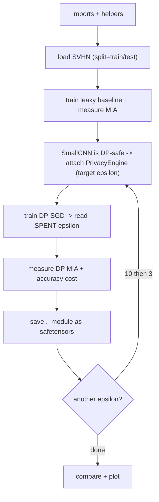

# DP-SGD - New-Dataset Cheatsheet (SVHN)

*HTB Academy · AI Privacy · the DP-SGD DEFENSE on a fresh colour dataset · **self-contained** (plain PyTorch + torchvision + Opacus, no HTB library)*

> **How to use this sheet**
> - Same defense as the course module sheet, but **nothing depends on `htb_ai_library`** - the model, the loaders, the training and the membership test are all defined here.
> - Dataset: **SVHN** (32×32 **colour** street-view house-number digits, 10 classes) - the CIFAR-like "train one noisy model" task.
> - Run top to bottom in one notebook. **🔵 INPUT NEEDED** = fill every `<<LIKE_THIS>>`. **⚪** = just run.
> - ==Privacy budget (epsilon): smaller = more private, always with delta.== Not the FGSM epsilon. **No math here.**

## What changes vs the course (CIFAR-10) sheet

| Thing | Course sheet | This sheet |
|---|---|---|
| Data | CIFAR-10 (HTB loader) | **SVHN** via `torchvision.datasets.SVHN` - note `split="train"/"test"` (not `train=True/False`) |
| Model | HTB `CIFAR10CNN` | `SmallCNN` defined here (already BatchNorm-free = DP-safe) |
| Training / MIA | HTB helpers | defined here (plain PyTorch) |
| Everything about DP-SGD | - | **identical** |

## The flow



---

## Part A - Setup

## Step 1 - Install + imports + colours

⚪ no input needed - just run

```python
!pip install torch torchvision opacus safetensors # skip if already installed

import os, numpy as np, torch
import torch.nn as nn, torch.nn.functional as F, torch.optim as optim
from torch.utils.data import DataLoader, TensorDataset
import torchvision
from torchvision import transforms
from opacus import PrivacyEngine
from opacus.validators import ModuleValidator
from safetensors.torch import save_file, load_file
import matplotlib.pyplot as plt

# HTB plot colours as fallback hex (no library needed)
HTB_GREEN, AZURE, MALWARE_RED, NODE_BLACK = "#9FEF00", "#2EB8FF", "#FF3E3E", "#141D2B"

torch.manual_seed(1337); np.random.seed(1337)
device = torch.device("cuda" if torch.cuda.is_available() else "cpu")
for d in ("figs","output","models"): os.makedirs(d, exist_ok=True)
print("device:", device)
```

**Expected:** `device: cuda` (or `cpu`).

## Step 2 - Config

⚪ no input needed - just run

```python
BATCH_SIZE = 256
EPOCHS = <<EPOCHS>> # 20 course-style; 10 on a slow CPU. Baseline + DP use the SAME number.
LR = 0.1
MAX_GRAD_NORM = 1.0 # clip: how much any one image may influence an update
DELTA = 1e-5 # keep well below 1 / number-of-training-images
NUM_CLASSES = 10
print("config set")
```

**fill in:** `<<EPOCHS>>` = `20` (or `10` on a slow CPU). DP-SGD is 2-5× slower than normal training.

## Step 3 - The DP-safe model + plain helpers

⚪ no input needed - just run

**What & why:** **`SmallCNN` uses only Conv / ReLU / MaxPool / Linear - no BatchNorm - so it's already DP-safe.** The helpers replace the HTB library.

```python
class SmallCNN(nn.Module):
    """Colour-image classifier for 3x32x32 inputs. No BatchNorm -> works with DP-SGD."""
    def __init__(self, num_classes=10):
        super().__init__()
        self.conv1 = nn.Conv2d(3, 32, 3, padding=1); self.conv2 = nn.Conv2d(32, 64, 3, padding=1)
        self.conv3 = nn.Conv2d(64, 64, 3, padding=1); self.pool = nn.MaxPool2d(2, 2); self.relu = nn.ReLU()
        self.fc1 = nn.Linear(64 * 4 * 4, 128) # 32 -> 16 -> 8 -> 4 after three pools
        self.fc2 = nn.Linear(128, num_classes)
    def forward(self, x):
        x = self.pool(self.relu(self.conv1(x)))
        x = self.pool(self.relu(self.conv2(x)))
        x = self.pool(self.relu(self.conv3(x)))
        x = x.view(x.size(0), -1)
        return self.fc2(self.relu(self.fc1(x)))

def evaluate_accuracy(model, loader):
    model.eval(); correct = total = 0
    with torch.no_grad():
        for xb, yb in loader:
            pred = model(xb.to(device)).argmax(1).cpu(); correct += (pred == yb).sum().item(); total += len(yb)
    return 100.0 * correct / total

def compute_mia_advantage(model, member_loader, nonmember_loader):
    """Balanced confidence-threshold membership test. Returns (best accuracy, advantage = acc - 0.5)."""
    def confidences(loader):
        model.eval(); out = []
        with torch.no_grad():
            for xb, _ in loader:
                out.extend(F.softmax(model(xb.to(device)), 1).max(1).values.cpu().numpy())
        return np.array(out)
    m, n = confidences(member_loader), confidences(nonmember_loader)
    k = min(len(m), len(n)) # balance -> 0.5 is "no leak"
    allc = np.concatenate([m[:k], n[:k]]); lab = np.concatenate([np.ones(k), np.zeros(k)])
    best = max(np.mean((allc >= th) == lab) for th in np.percentile(allc, np.linspace(0, 100, 1000)))
    return best, best - 0.5
```

**Expected:** no output.

## Step 4 - Load SVHN

🔵 INPUT NEEDED

**What & why:** ==SVHN uses `split="train"/"test"` (not `train=True/False`), is colour (3 channels), and torchvision already maps the digit "0" to label 0.==

```python
!pip install datasets

from datasets import load_dataset
from torch.utils.data import Dataset

hf = load_dataset("ufldl-stanford/svhn", "cropped_digits") # same 32x32 SVHN digits; fast, no Stanford server

class HFSVHN(Dataset):
    """Wraps a Hugging Face split so it behaves like torchvision's SVHN: returns (image tensor, label 0-9)."""
    def __init__(self, hf_split, transform):
        self.ds, self.tf = hf_split, transform
    def __len__(self):
        return len(self.ds)
    def __getitem__(self, i):
        row = self.ds[i]
        y = int(row["label"])
        y = 0 if y == 10 else y # safety: some copies label the digit 0 as 10
        return self.tf(row["image"].convert("RGB")), y # same transform as Step 4

train_ds = HFSVHN(hf["train"], tf)
test_ds = HFSVHN(hf["test"], tf)
train_loader = DataLoader(train_ds, batch_size=BATCH_SIZE, shuffle=True)
test_loader = DataLoader(test_ds, batch_size=BATCH_SIZE, shuffle=False)

labels_seen = [test_ds[i][1] for i in range(200)]
print(f"train {len(train_ds)} | test {len(test_ds)} | labels {min(labels_seen)}-{max(labels_seen)} | image {tuple(test_ds[0][0].shape)}")
```

**fill in:** `<<DATA_ROOT>>` = e.g. `"./data"`. Downloads ~180 MB the first time, then caches.

**Expected:** `train 73257 | test 26032`.

---

## Part B - Baseline + DP-SGD

## Step 5 - Train the leaky baseline + measure its leak

⚪ no input needed - just run

```python
def train_plain(model, loader, epochs, lr):
    model.to(device).train(); opt = optim.SGD(model.parameters(), lr=lr, momentum=0.9); crit = nn.CrossEntropyLoss()
    for e in range(epochs):
        correct = total = 0
        for xb, yb in loader:
            xb, yb = xb.to(device), yb.to(device)
            opt.zero_grad(); out = model(xb); loss = crit(out, yb); loss.backward(); opt.step()
            correct += (out.argmax(1) == yb).sum().item(); total += len(yb)
        print(f" epoch {e+1}/{epochs} train acc {100*correct/total:.2f}%")
    return model

baseline_model = train_plain(SmallCNN(NUM_CLASSES).to(device), train_loader, EPOCHS, LR)
train_acc_baseline = evaluate_accuracy(baseline_model, train_loader)
test_acc_baseline = evaluate_accuracy(baseline_model, test_loader)
print(f"baseline train {train_acc_baseline:.2f}% test {test_acc_baseline:.2f}% gap {train_acc_baseline-test_acc_baseline:.2f}")
mia_acc_b, mia_adv_b = compute_mia_advantage(baseline_model, train_loader, test_loader)
print(f"baseline MIA advantage {mia_adv_b:.4f} (0 = no leak; ~0.004 is the luck floor)")
torch.save(baseline_model.state_dict(), "output/svhn_baseline.pth")
```

**Expected:** SVHN is easier than CIFAR, so test accuracy is high (often ~88-90%); the train-test gap and a small positive MIA advantage are the leak you'll shrink.

## Step 6 - DP-safe model + attach the engine

🔵 INPUT NEEDED

```python
TARGET_EPSILON = <<TARGET_EPSILON>> # 10.0 first, then rerun fresh with 3.0

train_loader_dp = DataLoader(train_ds, batch_size=BATCH_SIZE, shuffle=True) # fresh loader for Opacus
dp_model = ModuleValidator.fix(SmallCNN(NUM_CLASSES).to(device)) # make DP-safe (no-op here; keep it)
print("DP problems (want []):", ModuleValidator.validate(dp_model, strict=False))
optimizer_dp = optim.SGD(dp_model.parameters(), lr=LR, momentum=0.9)
privacy_engine = PrivacyEngine(accountant="rdp")
dp_model, optimizer_dp, train_loader_dp = privacy_engine.make_private_with_epsilon(
    module=dp_model, optimizer=optimizer_dp, data_loader=train_loader_dp,
    target_epsilon=TARGET_EPSILON, target_delta=DELTA, epochs=EPOCHS, max_grad_norm=MAX_GRAD_NORM)
print("noise multiplier Opacus chose:", round(optimizer_dp.noise_multiplier, 3))
```

**fill in:** `<<TARGET_EPSILON>>` = `10.0`, then `3.0`. Smaller = more private = more noise = lower accuracy.

**Expected:** `DP problems (want []): []`, then a noise multiplier (read whatever prints).

## Step 7 - Train privately + read the SPENT budget

⚪ no input needed - just run

```python
dp_model.train(); crit = nn.CrossEntropyLoss()
for e in range(EPOCHS):
    correct = total = 0
    for xb, yb in train_loader_dp:
        xb, yb = xb.to(device), yb.to(device)
        optimizer_dp.zero_grad(); out = dp_model(xb); loss = crit(out, yb); loss.backward(); optimizer_dp.step()
        correct += (out.argmax(1) == yb).sum().item(); total += len(yb)
    print(f" epoch {e+1}/{EPOCHS} train acc {100*correct/total:.2f}% spent epsilon {privacy_engine.get_epsilon(DELTA):.2f}")

final_epsilon = privacy_engine.get_epsilon(DELTA)
train_acc_dp = evaluate_accuracy(dp_model, train_loader_dp)
test_acc_dp = evaluate_accuracy(dp_model, test_loader)
print(f"DP spent epsilon {final_epsilon:.2f} (delta {DELTA}) | train {train_acc_dp:.2f}% test {test_acc_dp:.2f}% gap {train_acc_dp-test_acc_dp:.2f}")
```

**Expected:** the spent epsilon lands near your target; the gap shrinks vs baseline and test accuracy drops a few points. **The gap shrinking is the clearest proof it worked.**

## Step 8 - Measure the DP leak + save

🔵 INPUT NEEDED

```python
mia_acc_dp, mia_adv_dp = compute_mia_advantage(dp_model, train_loader_dp, test_loader)
print(f"DP MIA advantage {mia_adv_dp:.4f} (baseline {mia_adv_b:.4f}) | accuracy cost {test_acc_baseline-test_acc_dp:.2f} points")

save_file(dp_model._module.state_dict(), "models/svhn_dp_model.safetensors") # ._module strips Opacus's wrapper
print("saved models/svhn_dp_model.safetensors")
SmallCNN(NUM_CLASSES).load_state_dict(load_file("models/svhn_dp_model.safetensors")); print("reload OK")
```

**fill in:** nothing, but save whichever epsilon model you'll submit (epsilon 10 usually keeps the best accuracy under a low-leak target).

**Expected:** DP advantage at/near the ~0.004 noise floor; `reload OK`.

## Step 9 - Compare + plot

⚪ no input needed - just run (after both epsilon runs)

```python
rows = [("baseline", test_acc_baseline, mia_adv_b, "inf"),
        ("DP eps=10", <<TEST10>>, <<ADV10>>, <<EPS10>>),
        ("DP eps=3", <<TEST3>>, <<ADV3>>, <<EPS3>>)]
print(f"{'model':<11}{'test%':>8}{'MIA adv':>10}{'epsilon':>10}")
for n, t, a, e in rows: print(f"{n:<11}{t:>8.2f}{a:>10.4f}{str(e):>10}")

fig, ax = plt.subplots(figsize=(7,4), facecolor=NODE_BLACK)
ax.bar([r[0] for r in rows], [r[1] for r in rows], color=[MALWARE_RED, AZURE, HTB_GREEN])
ax.set_ylabel("test accuracy %"); ax.set_title("SVHN: privacy vs accuracy", color=HTB_GREEN)
ax.set_facecolor(NODE_BLACK); plt.savefig("figs/svhn_tradeoff.png", facecolor=NODE_BLACK, bbox_inches="tight"); plt.show()
```

**fill in:** `<<TEST10>>` ... = the numbers you printed for each run.

---

## If you remember nothing else

## DP-SGD in 4 lines

1. Keep the normal model but make it **DP-safe** (no BatchNorm; `ModuleValidator.fix`).
2. Attach an Opacus **`PrivacyEngine`** with a **target epsilon**; it clips each example's gradient and adds noise.
3. Train through the wrapped optimizer, then read the **spent** epsilon.
4. Measure the membership leak before/after on a balanced pool; report epsilon-with-delta and the accuracy cost.

## The core from memory

```python
dp_model = ModuleValidator.fix(SmallCNN().to(device)) # no BatchNorm -> DP-safe
opt = optim.SGD(dp_model.parameters(), lr=0.1, momentum=0.9); pe = PrivacyEngine(accountant="rdp")
dp_model, opt, loader = pe.make_private_with_epsilon(
    module=dp_model, optimizer=opt, data_loader=loader,
    target_epsilon=10.0, target_delta=1e-5, epochs=EPOCHS, max_grad_norm=1.0)
# ...train normally through opt... then: spent = pe.get_epsilon(1e-5)
save_file(dp_model._module.state_dict(), "models/dp.safetensors") # ._module strips the wrapper
```

## Must-know facts

- **DP-SGD clips each example's gradient to a cap and adds Gaussian noise to every update**, so the finished model barely depends on any one person. Opacus does the clipping, noising and accounting.
- ==SVHN uses `split="train"/"test"`, not `train=True/False`==, and is colour (3 channels) - the only real code difference from the CIFAR course setup; everything about DP-SGD is identical.
- **Use a BatchNorm-free model** (BatchNorm mixes examples and can't be clipped per-example); `SmallCNN` here avoids it, but always still call `ModuleValidator.fix`.
- **Read the SPENT epsilon (`privacy_engine.get_epsilon(delta)`), not the target**, and keep the DP epochs equal to the epochs Opacus calibrated for, or the real epsilon overshoots.
- **Epsilon is reported with delta (delta well below 1 / number-of-training-images) and depends on the noise/sampling/steps, not on the clip value.** The clip only trades accuracy.
- **Save `model._module.state_dict()`** or the weight names keep Opacus's `_module.` prefix and won't load into a plain `SmallCNN` or a validator.
- **On a balanced membership test, an advantage near ~0.004 is the luck floor (no measurable leak)** - quote AUC or balanced accuracy, never raw accuracy on an imbalanced pool; the shrinking train-test gap is the sturdiest evidence.
- **Method point:** **pick the largest epsilon (least noise) whose measured leak is already at the noise floor and that still meets the accuracy target**; report epsilon-with-delta, the accuracy cost in points, the before/after leak, and note DP doesn't cover aggregate patterns, model theft or evasion.
