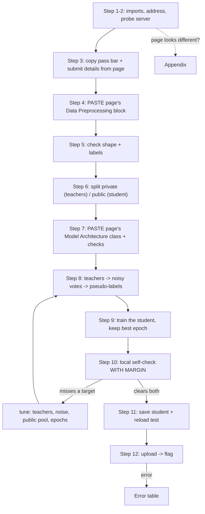

# PATE - Defensive Challenge Cheatsheet (submit a PRIVATE student model)

_HTB Academy · AI Privacy · for "train a PATE student that passes an accuracy + privacy check, then upload it" challenges_

> **How to use this sheet**
> 
> - This challenge is **defensive**. You don't attack anything. You build a **PATE student model** and **upload the saved file**. The server checks two things: is it **accurate enough**, and does it **leak little enough** to a membership-inference attack.
> - Run the cells **top to bottom in one Jupyter notebook**. Later cells use names earlier cells made.
> - **📋 COPY FROM THE HTB PAGE** = take that block from the challenge page and paste it where the cell says. **Don't retype it, don't edit it.**
> - **🔵 INPUT NEEDED** = replace every `<<LIKE_THIS>>` first (a leftover one fails with `SyntaxError` on purpose). **⚪ no input needed - just run** = run it as it is.
> - The main path below matches how the real challenge (Section 20, EMNIST Letters) is set up. **If your challenge looks different, the Appendix at the end covers the variants.**

## 📋 What to copy from the HTB page (do this first)

The server itself gives you almost nothing; it only has `/`, `/health` and `/validate`. **Everything you need is on the challenge page.** Keep the page open next to the notebook and copy these five things:

|On the HTB challenge page|What you copy|Where it goes|
|---|---|---|
|**API Endpoints** (`export BASE_URL=...`) + your instance address|the instance IP and port|**Step 1** → `BASE_URL`|
|**Requirements** table|the two numbers (e.g. accuracy ≥ 80%, mia_advantage ≤ 3%)|**Step 3** → `TARGET_ACC`, `TARGET_ADV`|
|**Submit** code block|the endpoint (`/validate`), the field name (`"model"`), the file name (`"pate_student.safetensors"`)|**Step 3** → `SUBMIT_PATH`, `FILE_FIELD`, `FILE_NAME`|
|**Data Preprocessing** code block|the **whole block**, exactly as given|**Step 4** paste zone|
|**Model Architecture** code block|the **whole class**, exactly as given|**Step 7** paste zone|

## What this challenge is

The page gives you a dataset, the validator's **preprocessing code**, a **fixed model class** for the student, and a **pass bar**. PATE works like this:

1. Split the private training data into many **disjoint** pieces and train one **teacher** per piece.
2. The teachers **vote** on the labels of a separate **public** pool, with **random noise added to the vote counts**.
3. A **student**, built from the page's class, learns **only** from that public pool and its noisy labels.

You upload the student. It never saw the private data, so its leak about that data stays low. If accuracy and leak are both inside the bar → flag.

## The flow



---

## Golden rules

1. **Paste the page's code exactly as given and never edit it** (the preprocessing block and the model class). The validator uses exactly that code, so yours must match it.
2. **Never define or import a second class with the page's class name** (e.g. `from htb_ai_library import MLP` after pasting the page's `MLP`). The last definition wins, and rebuilding the model then crashes. This sheet's own helpers all start with `pate_` or are named `make_student`, so they can't clash.
3. **Don't change the data or the student's class.** No transposing, no extra scaling, no different layer sizes. Teachers can be anything (the server never sees them); **only the student must be the page's class**.
4. **Save the student's `state_dict()` as safetensors and reload it into a fresh page-class model before uploading.** The student is a plain model, so there's no `._module` here (that's only for Opacus/DP-SGD).
5. **`/validate` returns the flag directly, so every upload is a real attempt.** Prove it locally first (Step 10). Changed a cell above? **Kernel → Restart & Run All.**

---

## Part A - Talk to the server

## Step 1 - Imports + address

🔵 INPUT NEEDED · 📋 COPY FROM THE HTB PAGE: your instance's IP and port

**What & why:** loads the tools and sets the server address. Start the instance on the HTB page first.

```python
import os, io, json, copy, base64, requests
import numpy as np, torch
import torch.nn as nn, torch.nn.functional as F, torch.optim as optim
from torch.utils.data import DataLoader, TensorDataset
from sklearn.model_selection import train_test_split
from safetensors.torch import save_file, load_file

BASE_URL = "<<http://INSTANCE_IP:PORT>>" # with http:// and the port, NO trailing slash
device = torch.device("cuda" if torch.cuda.is_available() else "cpu")
torch.manual_seed(1337); np.random.seed(1337)
print("device:", device)
```

**fill in:** `<<http://INSTANCE_IP:PORT>>` = the address the platform shows after you start the instance, e.g. `http://154.57.164.83:40429`.

**Expected:** `device: cuda` or `device: cpu`. Both are fine; the models are small MLPs.

## Step 2 - Check the server is up (and see what it offers)

⚪ no input needed - just run

**What & why:** asks the server for its pages and prints every field, **including error replies** (they list the endpoints that really exist). This confirms the instance is up and that `/validate` exists.

```python
def pate_get(path):
    """GET an endpoint. Returns its JSON. On an error status it still returns the body (it often lists the real endpoints)."""
    try:
        r = requests.get(f"{BASE_URL}{path}", timeout=15)
        try:
            body = r.json()
        except Exception:
            body = r.text[:300]
        return body if r.ok else {"HTTP_STATUS": r.status_code, "body": body}
    except Exception as e:
        return f"ERROR {type(e).__name__}: {e}"

def pate_show(obj, name):
    """Print every field and a shortened value, so you can copy key names letter for letter."""
    print(f"--- {name} ---")
    if isinstance(obj, dict):
        for k, v in obj.items():
            s = str(v)
            print(f"{k:>22} : {s[:90]}{' ...(' + str(len(s)) + ' chars)' if len(s) > 90 else ''}")
    else:
        print(obj)

for path in ["/", "/health", "/challenge"]:
    pate_show(pate_get(path), path)
```

**Expected (Section 20):**

```
--- / --- service : PATE Privacy Challenge (EMNIST Letters) version : 1.0
--- /health --- status : ok data_loaded : True
--- /challenge --- HTTP_STATUS : 404 body : {'available_endpoints': ['/', '/health', '/validate'], 'error': 'Endpoint not found'}
```

**Read it:** the 404 on `/challenge` is **normal**. It tells you the server has no settings or data to give you, and that the real endpoints are `/`, `/health` and `/validate`. Everything else comes from the HTB page (Steps 3, 4, 7).

**If it breaks:** every line says `ERROR ... ConnectionError` → wrong address, or the instance isn't up yet. If an endpoint like `/challenge` returns **real fields** (data, targets), see **Appendix A2**.

## Step 3 - Copy the pass bar + submit details from the page

🔵 INPUT NEEDED · 📋 COPY FROM THE HTB PAGE: the **Requirements** table and the **Submit** code block

**What & why:** one place for the challenge's rules. Later cells read these names.

```python
# From the REQUIREMENTS table (write percentages as fractions):
TARGET_ACC = <<TARGET_ACC>> # "accuracy ≥ 80%" -> 0.80
TARGET_ADV = <<TARGET_ADV>> # "mia_advantage ≤ 3%" -> 0.03

# From the SUBMIT code block: requests.post(f"{BASE_URL}/validate", files={"model": ("pate_student.safetensors", f, ...)})
SUBMIT_PATH = "<<SUBMIT_PATH>>" # the part after BASE_URL -> "/validate"
FILE_FIELD = "<<FILE_FIELD>>" # the key inside files={...} -> "model"
FILE_NAME = "<<FILE_NAME>>" # the file name inside the brackets -> "pate_student.safetensors"

print(f"bar: accuracy >= {TARGET_ACC}, advantage <= {TARGET_ADV} | upload to {SUBMIT_PATH} as '{FILE_FIELD}'")
```

**fill in:** copy each value from where its comment points. Section 20: `0.80`, `0.03`, `"/validate"`, `"model"`, `"pate_student.safetensors"`.

**Expected:** `bar: accuracy >= 0.8, advantage <= 0.03 | upload to /validate as 'model'`.

**Remember:** the server replies in fractions (`"accuracy": 0.8612`), which is why you write `0.80` and not `80`. If the table also has an **epsilon** row, see **Appendix A5**.

---

## Part B - The data, exactly the validator's way

## Step 4 - Paste the page's Data Preprocessing block

🔵 INPUT NEEDED · 📋 COPY FROM THE HTB PAGE: the **whole Data Preprocessing** code block

**What & why:** the validator scores your student on data prepared by **this exact code**. Pasting it means your data gets the same steps (same dataset, same `/255`, same label shift, same scaler fitted on the same rows). Then one **bridge line** hands the final arrays to the rest of the sheet, and one line shapes them for the model.

```python
# ===== 📋 PASTE THE PAGE'S "DATA PREPROCESSING" BLOCK HERE, EXACTLY AS GIVEN (example below = Section 20's) =====
import numpy as np
from sklearn.preprocessing import StandardScaler
from torchvision import datasets

train_dataset = datasets.EMNIST("data", split='letters', train=True, download=True)
test_dataset = datasets.EMNIST("data", split='letters', train=False, download=True)

X_train = train_dataset.data.numpy().reshape(-1, 784).astype(np.float32) / 255.0
X_test = test_dataset.data.numpy().reshape(-1, 784).astype(np.float32) / 255.0

# Labels are 1-26 for A-Z, convert to 0-25
y_train = train_dataset.targets.numpy() - 1
y_test = test_dataset.targets.numpy() - 1

scaler = StandardScaler()
X_train_norm = scaler.fit_transform(X_train)
X_test_norm = scaler.transform(X_test)
# ===== end of page code =====

# BRIDGE: the page's FINAL arrays -> the names this sheet uses (change the right-hand names only if the page used different ones)
X_train_all, y_train_all, X_test_all, y_test_all = X_train_norm, y_train, X_test_norm, y_test

INPUT_SHAPE = <<INPUT_SHAPE>> # one sample's shape for the student: (784,) for an MLP, (1, 28, 28) for a greyscale CNN
X_train_all = np.asarray(X_train_all, dtype=np.float32).reshape(-1, *INPUT_SHAPE)
X_test_all = np.asarray(X_test_all, dtype=np.float32).reshape(-1, *INPUT_SHAPE)
y_train_all = np.asarray(y_train_all, dtype=np.int64); y_test_all = np.asarray(y_test_all, dtype=np.int64)
print(f"train {X_train_all.shape} | test {X_test_all.shape}")
```

**fill in:**

- Replace everything between the two `**=**` lines with the page's block (for Section 20 it's already the example).
- **Bridge:** the right-hand names must be the page's **last** arrays: the **scaled** ones if it scales (`X_train_norm`, `X_test_norm`) and the **shifted** labels (`y_train`, `y_test`).
- `<<INPUT_SHAPE>>` = `(784,)` if the page's model starts with `nn.Linear(784, ...)` (Section 20), or `(1, 28, 28)` if it starts with `nn.Conv2d(1, ...)`.

**Expected (Section 20):** `train (124800, 784) | test (20800, 784)`. The first run downloads EMNIST, a ~560 MB zip, so it takes a while.

**If it breaks:**

- **Download timeout (`URLError ... WinError 10060`)** → EMNIST comes from NIST's server, which can be slow or down. See **Appendix A3**.
- **The page's block uses `transform=`** (torchvision transforms) instead of numpy → see **Appendix A1** for the bridge to use instead.
- **Never transpose EMNIST images.** Many tutorials do; the validator doesn't.

## Step 5 - Check the shape and the labels

⚪ no input needed - just run

**What & why:** proves the data looks like what the student expects, and that labels run from 0 to (number of classes − 1) before anything slow runs.

```python
NUM_CLASSES = int(y_train_all.max()) + 1
print("one sample:", X_train_all[0].shape, "| overall mean", round(float(X_train_all.mean()), 3),
      "| spread", round(float(X_train_all.std()), 3))
print(f"labels {y_train_all.min()}-{y_train_all.max()} | classes: {NUM_CLASSES} | distinct: {len(np.unique(y_train_all))}")
assert y_train_all.min() == 0, "labels don't start at 0: paste the WHOLE preprocessing block (it does the shift)"
```

**Expected (Section 20):** `one sample: (784,) | overall mean 0.0 | spread ~0.9`, then `labels 0-25 | classes: 26 | distinct: 26`.

**Read it:** a mean around 0 means the scaler ran. `classes: 26` must match the page ("26 classes, A-Z").

## Step 6 - Split: private (teachers) and public (student)

🔵 INPUT NEEDED

**What & why:** PATE needs two separate pools from the training data. The **private** pool is cut into disjoint pieces, one per teacher. The **public** pool is what the teachers label (with noise) and what the student learns from. The page's test set stays your local test set, because it's what the validator scores on.

```python
PUBLIC_FRACTION = <<PUBLIC_FRACTION>> # share of training rows used as the public pool, e.g. 0.2

X_private, X_public, y_private, y_public = train_test_split(
    X_train_all, y_train_all, test_size=PUBLIC_FRACTION, random_state=1337, stratify=y_train_all)
X_local_test, y_local_test = X_test_all, y_test_all
print(f"private {len(X_private)} | public {len(X_public)} | local test {len(X_local_test)}")
```

**fill in:** `<<PUBLIC_FRACTION>>` = e.g. `0.2`. A bigger public pool gives the student more to learn from (helps accuracy) but leaves less data for each teacher.

**Expected (Section 20, 0.2):** `private 99840 | public 24960 | local test 20800`.

---

## Part C - The student, exactly the validator's class

## Step 7 - Paste the page's Model Architecture, then check it

🔵 INPUT NEEDED · 📋 COPY FROM THE HTB PAGE: the **whole Model Architecture** code block

**What & why:** the validator does `TheirClass().load_state_dict(your_file)`. **Your student's weight names and shapes must match their class exactly**, so the student **is** their class, pasted unchanged and built with its defaults. This cell checks the output size and shows the weight names.

```python
# ===== 📋 PASTE THE PAGE'S "MODEL ARCHITECTURE" CLASS HERE, EXACTLY AS GIVEN (example below = Section 20's) =====
import torch.nn as nn
import torch.nn.functional as F

class MLP(nn.Module):
    """Multi-Layer Perceptron for EMNIST Letters classification."""

    def __init__(self, input_size=784, hidden_layers=None, num_classes=26, dropout=0.2):
        super(MLP, self).__init__()
        if hidden_layers is None:
            hidden_layers = [256, 128]

        self.layers = nn.ModuleList()
        self.dropouts = nn.ModuleList()

        prev_size = input_size
        for hidden_size in hidden_layers:
            self.layers.append(nn.Linear(prev_size, hidden_size))
            self.dropouts.append(nn.Dropout(dropout))
            prev_size = hidden_size

        self.output = nn.Linear(prev_size, num_classes)

    def forward(self, x):
        for layer, dropout in zip(self.layers, self.dropouts):
            x = F.relu(layer(x))
            x = dropout(x)
        return self.output(x)
# ===== end of page code =====

TASK_CLASS = <<TASK_CLASS>> # the class name you just pasted, NO quotes, e.g. MLP

def make_student():
    """A fresh copy of the validator's exact model (the page's class, built with its defaults)."""
    return TASK_CLASS()

probe = make_student().to(device).eval()
with torch.no_grad():
    out = probe(torch.tensor(X_private[:1]).to(device))
print("output shape:", tuple(out.shape), f"(want (1, {NUM_CLASSES}))")
print("weight names:", list(probe.state_dict().keys()))
assert out.shape == (1, NUM_CLASSES), "output size != number of classes: wrong class pasted, or wrong data"
```

**fill in:**

- Replace everything between the two `**=**` lines with the page's class (for Section 20 it's already the example).
- `<<TASK_CLASS>>` = the class name **without quotes**, e.g. `MLP`. It's the word after `class` in what you pasted. **Not** a file name, **not** in quotes.

**Expected (Section 20):** `output shape: (1, 26)` and `weight names: ['layers.0.weight', 'layers.0.bias', 'layers.1.weight', 'layers.1.bias', 'output.weight', 'output.bias']`.

---

## Part D - Teachers vote, student learns

## Step 8 - Train the teachers, take a noisy vote, check label quality

🔵 INPUT NEEDED

**What & why:** each teacher trains on its own **disjoint** slice of the private pool (one person → one teacher). The teachers then vote on every public row. **Laplace noise added to the vote counts is what makes it private.** The noisy winner becomes that row's **pseudo-label**. Teachers are never uploaded, so this uses the page's class for them too, just for simplicity.

```python
NUM_TEACHERS = <<NUM_TEACHERS>> # e.g. 50-100 for 26 classes on ~100k rows (fewer = each teacher stronger)
T_EPOCHS = <<T_EPOCHS>> # teacher training passes, e.g. 20
NOISE_SCALE = <<NOISE_SCALE>> # Laplace noise on the votes: bigger = more private, noisier labels (e.g. 5-20)

def pate_train(model, X, y, epochs, lr=1e-3, bs=64):
    """Plain supervised training (Adam). Used for the teachers."""
    model.to(device).train()
    opt = optim.Adam(model.parameters(), lr=lr); crit = nn.CrossEntropyLoss()
    dl = DataLoader(TensorDataset(torch.tensor(X), torch.tensor(y)), batch_size=bs, shuffle=True)
    for _ in range(epochs):
        for xb, yb in dl:
            opt.zero_grad(); crit(model(xb.to(device)), yb.to(device)).backward(); opt.step()
    return model

def pate_probs(model, X, bs=2048):
    """Softmax probabilities in eval mode (dropout off), in chunks so large arrays fit in memory."""
    model.eval(); out = []
    with torch.no_grad():
        for i in range(0, len(X), bs):
            out.append(F.softmax(model(torch.tensor(X[i:i + bs]).to(device)), 1).cpu().numpy())
    return np.concatenate(out)

# 1) disjoint teachers
np.random.seed(1337)
teacher_parts = np.array_split(np.random.permutation(len(X_private)), NUM_TEACHERS)
teachers = []
for i, part in enumerate(teacher_parts):
    teachers.append(pate_train(make_student(), X_private[part], y_private[part], T_EPOCHS))
    if (i + 1) % 10 == 0:
        print(f" trained {i + 1}/{NUM_TEACHERS} teachers")

# 2) every teacher votes on every public row; add Laplace noise; the noisy winner is the pseudo-label
X_query, y_query_true = X_public, y_public # true labels are for SCORING only; the student never sees them
votes = np.zeros((len(X_query), NUM_CLASSES), dtype=np.int32)
for t in teachers:
    p = pate_probs(t, X_query).argmax(1)
    votes[np.arange(len(p)), p] += 1
student_labels = np.argmax(votes + np.random.laplace(0.0, NOISE_SCALE, votes.shape), axis=1)

# 3) how good the labels are, and what the privacy cost is
per_q = 2.0 / NOISE_SCALE
total_eps = np.sqrt(2 * len(X_query) * per_q ** 2 * np.log(1 / 1e-5)) + len(X_query) * per_q * (np.exp(per_q) - 1)
print(f"{NUM_TEACHERS} teachers x ~{len(teacher_parts[0])} rows | median top-vote share {np.median(votes.max(1)) / NUM_TEACHERS:.2f}")
if y_query_true is not None: # (a server-supplied public pool may have no true labels -> skip this line)
    print(f"clean vote accuracy {np.mean(votes.argmax(1) == y_query_true):.3f} | noisy label accuracy {np.mean(student_labels == y_query_true):.3f}")
print(f"per-query epsilon {per_q:.3f} | total epsilon {total_eps:.1f} (delta 1e-5, standard accountant)")
```

**fill in (Section 20 starting values):** `<<NUM_TEACHERS>>` `75`, `<<T_EPOCHS>>` `20`, `<<NOISE_SCALE>>` `10.0`.

**Expected:** a teacher count every 10, then the label quality and privacy lines. **Noisy label accuracy is roughly the ceiling for the student's accuracy**, so if it's under the target, tune before training the student:

**Tuning (if/then):**

- **If** clean vote accuracy is low → teachers are too weak: **fewer** teachers (more rows each) or more `T_EPOCHS`.
- **If** clean is fine but noisy is much lower → too much noise: **lower** `NOISE_SCALE` (privacy gets weaker; note the new epsilon).
- **If** both are fine but the student falls short (Step 9) → a bigger public pool (`PUBLIC_FRACTION`, Step 6) or more student epochs.
- **If** the leak check fails instead (Step 10) → the opposite: more noise, a smaller public pool, fewer student epochs.
- **If** the student is a **CNN** (an image page, Appendix A1) → CNN teachers need more data and more epochs than an MLP: use **fewer** teachers (e.g. 10-25) and `T_EPOCHS` of 10+. In testing, a CNN was still at 14% accuracy after 1 epoch and only reached 87% after 4.

> **Honest notes:** (1) The printed epsilon uses the standard, data-independent accountant; a single-digit epsilon only comes from a tighter data-dependent method, so don't quote one you didn't compute. (2) Every re-run of the vote is a new noisy release. In a report, give the settings of the run you actually uploaded. (3) Section 20's page checks only accuracy and advantage, not epsilon, so the noise scale is purely your accuracy-vs-leak knob there.

## Step 8b - OPTIONAL: quick noise sweep (labels only, seconds)

🔵 INPUT NEEDED

**What & why:** re-scores the votes you already have at several noise levels, without retraining anything. It shows where label accuracy starts to fall, so you can pick `NOISE_SCALE` before the slow student training.

```python
if y_query_true is None:
    print("public pool has no true labels -> this sweep can't score; judge by the student's accuracy in Steps 9-10")
else:
    for ns in <<NOISE_LIST>>:
        lab = np.argmax(votes + np.random.laplace(0.0, ns, votes.shape), axis=1)
        pq = 2.0 / ns
        eps = np.sqrt(2 * len(votes) * pq ** 2 * np.log(1e5)) + len(votes) * pq * (np.exp(pq) - 1)
        print(f"noise {ns:>5}: noisy label accuracy {np.mean(lab == y_query_true):.3f} | total epsilon {eps:.1f}")
```

**fill in:** `<<NOISE_LIST>>` = e.g. `[2, 5, 10, 15, 20, 30]`. Pick the **largest** noise whose label accuracy is still comfortably above `TARGET_ACC`, set `NOISE_SCALE` to it, and re-run Step 8.

## Step 9 - Train the student (keeps its best epoch)

🔵 INPUT NEEDED

**What & why:** the student is a fresh page-class model, trained **only** on the public rows and their noisy labels. After each epoch it's scored on the local test set, and the best epoch is kept. `copy.deepcopy` takes a real snapshot; without it the "best" copy would keep changing with the live model.

```python
S_EPOCHS = <<S_EPOCHS>> # student training passes, e.g. 30

student = make_student().to(device)
opt = optim.Adam(student.parameters(), lr=1e-3); crit = nn.CrossEntropyLoss()
dl = DataLoader(TensorDataset(torch.tensor(X_query), torch.tensor(student_labels)), batch_size=64, shuffle=True)
best_acc, best_state = -1.0, None
for ep in range(S_EPOCHS):
    student.train()
    for xb, yb in dl:
        opt.zero_grad(); crit(student(xb.to(device)), yb.to(device)).backward(); opt.step()
    acc = float((pate_probs(student, X_local_test).argmax(1) == y_local_test).mean())
    if acc > best_acc:
        best_acc, best_state = acc, copy.deepcopy(student.state_dict())
    print(f" epoch {ep + 1}/{S_EPOCHS} local test accuracy {acc:.4f}")
student.load_state_dict(best_state)
print(f"kept the best epoch: local test accuracy {best_acc:.4f}")
```

**fill in:** `<<S_EPOCHS>>` = e.g. `30`.

**Expected:** accuracy rising, then flattening; the last line shows the kept accuracy.

> **Honest note:** picking the best epoch on the same test set the validator uses makes your local number slightly optimistic. Treat anything within ~1 point of the target as "not safe yet."

---

## Part E - Prove it, save it, upload it

## Step 10 - Local self-check, with margin

⚪ no input needed - just run

**What & why:** measures accuracy and your own membership advantage the course way (balanced pool, best of many confidence thresholds). You can't see which rows the validator calls "members", so this checks three cases:

- the **whole training set** (most likely, since the page's preprocessing treats all of `X_train` as training data; this one drives the verdict),
- only the public rows the student **trained on** (the worst case),
- only the **private** rows (which it never saw).

```python
def pate_mia_advantage(model, X_members, X_nonmembers):
    """Balanced best-threshold confidence attack (course style). Returns accuracy - 0.5."""
    rng = np.random.default_rng(0)
    mc, nc = pate_probs(model, X_members).max(1), pate_probs(model, X_nonmembers).max(1)
    k = min(len(mc), len(nc), 10000)
    mc, nc = rng.choice(mc, k, replace=False), rng.choice(nc, k, replace=False) # balance -> 0.5 = no leak
    allc = np.concatenate([mc, nc]); lab = np.concatenate([np.ones(k), np.zeros(k)])
    return max(np.mean((allc >= t) == lab) for t in np.percentile(allc, np.linspace(0, 100, 1000))) - 0.5

final_acc = float((pate_probs(student, X_local_test).argmax(1) == y_local_test).mean())
adv_full = pate_mia_advantage(student, X_train_all, X_local_test) # members = any training row (likely validator setup)
adv_query = pate_mia_advantage(student, X_query, X_local_test) # members = only rows the student TRAINED on
adv_private = pate_mia_advantage(student, X_private, X_local_test) # members = only rows it never saw
print(f"accuracy {final_acc:.4f} (need >= {TARGET_ACC})")
print(f"advantage (need <= {TARGET_ADV}): whole training set {adv_full:.4f} | its own training rows {adv_query:.4f} | private rows {adv_private:.4f}")
if final_acc >= TARGET_ACC + 0.01 and adv_full <= TARGET_ADV - 0.005:
    print("LIKELY PASS - upload" + ("" if adv_query <= TARGET_ADV else
          " (note: would FAIL if the validator used only the student's own training rows)"))
else:
    print("TOO CLOSE OR FAILING - tune Step 8/9 first")
```

**Expected:** accuracy at least 1 point above the target, the whole-training-set advantage at least half a point below the cap, then `LIKELY PASS - upload`.

**Read it:** `private rows` near 0 is normal. `its own training rows` is the worst case; if the note appears and you want to be safe either way, add noise or train the student for fewer epochs. **On Section 20 the accuracy target is the hard side**, because 26 letters are harder for teachers to agree on than 10 digits.

## Step 11 - Save the student + prove it loads like the validator loads it

⚪ no input needed - just run

**What & why:** saves the student's weights exactly like the page's Submit example (`save_file(student_model.state_dict(), ...)`), on the CPU and stored contiguously so safetensors won't complain. Then it builds a **fresh** page-class model, loads the file and checks the predictions are identical. That's exactly what the validator does.

```python
def save_pate_student(model, path):
    """Plain state_dict -> CPU, contiguous -> safetensors."""
    sd = model._module.state_dict() if hasattr(model, "_module") else model.state_dict()
    sd = {k: v.detach().cpu().contiguous() for k, v in sd.items()}
    save_file(sd, path)

save_pate_student(student, FILE_NAME)
reloaded = make_student().to(device)
reloaded.load_state_dict(load_file(FILE_NAME))
same = np.allclose(pate_probs(reloaded, X_local_test[:500]), pate_probs(student, X_local_test[:500]), atol=1e-5)
print(f"saved {FILE_NAME} ({os.path.getsize(FILE_NAME) // 1024} KB) | reloads into the page's class | same predictions: {same}")
```

**Expected:** `... reloads into the page's class | same predictions: True`. **If the load line errors here, the validator will reject the file too.**

## Step 12 - Upload and read the whole reply

⚪ no input needed - just run (for Section 20)

**What & why:** uploads the file exactly like the page's **Submit** example and prints every field of the reply.

```python
SUBMIT_MODE = "multipart" # "multipart" = files={...} upload like the page's example. Appendix A4 covers other formats.
EXTRA_FIELDS = {} # extra form fields, only if the page's submit example sends more than the file (Appendix A4)

def pate_submit(path):
    """Upload the model the way the page shows, print the whole reply, return it."""
    if SUBMIT_MODE == "multipart":
        with open(path, "rb") as f:
            r = requests.post(f"{BASE_URL}{SUBMIT_PATH}",
                              files={FILE_FIELD: (os.path.basename(path), f, "application/octet-stream")},
                              data=EXTRA_FIELDS, timeout=180)
    else:
        b64 = base64.b64encode(open(path, "rb").read()).decode()
        r = requests.post(f"{BASE_URL}{SUBMIT_PATH}", json={FILE_FIELD: b64, **EXTRA_FIELDS}, timeout=180)
    try:
        reply = r.json()
    except Exception:
        reply = r.text[:500]
    print("HTTP", r.status_code)
    pate_show(reply, "reply")
    return reply

reply = pate_submit(FILE_NAME)
```

**Expected (pass):** `HTTP 200`, then `passed : True`, `accuracy : 0.8...`, `mia_advantage : 0.0...`, `flag : HTB{...}`.

**If `passed` is False:** the reply's `accuracy` and `mia_advantage` show which side failed. Use the tuning box in Step 8, then repeat Steps 8-12.

---

## Error → what it means → exact fix

|Error / symptom|What it means|Fix|
|---|---|---|
|`Missing key(s) in state_dict: "layers.0.weight"...` + `Unexpected key(s): "net.0.weight"...`|your student isn't the page's class (different layer names)|paste the page's class **unchanged** (Step 7)|
|`size mismatch for layers.0.weight: [128, 784] vs [256, 784]`|right names, wrong sizes: the class was changed or built with other arguments|paste it unchanged; `make_student()` builds it with its defaults|
|`TypeError: super(type, obj): obj (instance of MLP) is not an instance or subtype of type (MLP)`|**name collision**: a second `MLP` was defined/imported after your paste (e.g. `from htb_ai_library import MLP`)|remove the other one; re-run Step 7, or Restart & Run All|
|`TypeError: 'str' object is not callable` in `make_student`|class name written in quotes|`TASK_CLASS = MLP` (**no quotes**)|
|`AssertionError: labels don't start at 0`|the label shift (`- 1` for EMNIST letters) didn't run|paste the **whole** preprocessing block (Step 4)|
|`NameError: name 'X_train_norm' is not defined`|the page names its final arrays differently|fix the **bridge** line in Step 4 to the page's names|
|`mat1 and mat2 shapes cannot be multiplied`|data shape doesn't fit the student|`INPUT_SHAPE` (Step 4): `(784,)` for an MLP, `(1, 28, 28)` for a CNN|
|`URLError ... WinError 10060` while loading data|the dataset server didn't respond|Appendix A3|
|accuracy near 1 ÷ number of classes (≈4% for 26)|labels not shifted, or the student learned nothing|check Step 5; then Step 8 label quality|
|server accuracy clearly lower than your local one|your data differs from the validator's (transposed, rescaled, different scaler rows)|Step 4 must be the page's block, unchanged|
|`passed: False`, accuracy below the target|labels too noisy or teachers too weak|Step 8 tuning: fewer teachers, less noise, bigger public pool, more epochs|
|`passed: False`, `mia_advantage` above the cap|student too confident on its training rows|more noise, smaller public pool, fewer student epochs|
|`HTTP 400` and the reply says no file / bad field|upload format or field name differs from the page|`FILE_FIELD` exactly as in the page's `files={...}`; see Appendix A4|
|`safetensors` error about shared or non-contiguous tensors|tensors saved straight from the model|use `save_pate_student` (CPU + contiguous copies)|
|`ConnectionError` / timeout on upload|instance down, wrong address, slow upload|check `BASE_URL` (no trailing slash), restart the instance|

---

## Filled-in example: Section 20 (PATE Challenge, EMNIST Letters)

|Step|What you put in|Where it came from on the page|
|---|---|---|
|1|`BASE_URL = "http://<your instance IP>:<port>"`|your started instance|
|3|`TARGET_ACC = 0.80`, `TARGET_ADV = 0.03`|**Requirements**: accuracy ≥ 80%, mia_advantage ≤ 3%|
|3|`SUBMIT_PATH = "/validate"`, `FILE_FIELD = "model"`, `FILE_NAME = "pate_student.safetensors"`|**Submit**: `requests.post(f"{BASE_URL}/validate", files={"model": ("pate_student.safetensors", f, ...)})`|
|4|the whole block (EMNIST letters, `/255`, `- 1`, `StandardScaler`); bridge unchanged; `INPUT_SHAPE = (784,)`|**Data Preprocessing**; the model starts with `nn.Linear(784, ...)`|
|6|`PUBLIC_FRACTION = 0.2`|your choice|
|7|the whole `class MLP` block; `TASK_CLASS = MLP`|**Model Architecture**|
|8|`NUM_TEACHERS = 75`, `T_EPOCHS = 20`, `NOISE_SCALE = 10.0`|your choice; tune with Step 8b|
|9|`S_EPOCHS = 30`|your choice|

**What a successful run prints (shape of it; your numbers will differ):**

```
--- /challenge --- HTTP_STATUS : 404 body : {'available_endpoints': ['/', '/health', '/validate'], ...}
bar: accuracy >= 0.8, advantage <= 0.03 | upload to /validate as 'model'
train (124800, 784) | test (20800, 784)
labels 0-25 | classes: 26 | distinct: 26
private 99840 | public 24960 | local test 20800
output shape: (1, 26) (want (1, 26))
clean vote accuracy 0.8.. | noisy label accuracy 0.8..
LIKELY PASS - upload
saved pate_student.safetensors ... | reloads into the page's class | same predictions: True
HTTP 200
--- reply --- passed : True accuracy : 0.8... mia_advantage : 0.0... flag : HTB{...}
```

---

## Appendix - if your challenge is set up differently

Use only the part that matches your case. Each one says which main step it **replaces** or **changes**.

## A1 - The page prepares data with a torchvision `transform` instead of numpy

**Replaces Step 4.** **How to tell:** the page's preprocessing builds `transforms.Compose([...])` and passes `transform=` to the dataset (the Section 12 / SVHN style), instead of making numpy arrays.

🔵 INPUT NEEDED · 📋 COPY FROM THE HTB PAGE: the whole Data Preprocessing block

```python
# ===== 📋 PASTE THE PAGE'S "DATA PREPROCESSING" BLOCK HERE, EXACTLY AS GIVEN (example = a transform-style page) =====
from torchvision import datasets, transforms

SVHN_MEAN = (0.4377, 0.4438, 0.4728)
SVHN_STD = (0.1980, 0.2010, 0.1970)

transform = transforms.Compose([
    transforms.ToTensor(),
    transforms.Normalize(SVHN_MEAN, SVHN_STD)
])

train_dataset = datasets.SVHN("data", split='train', download=True, transform=transform)
test_dataset = datasets.SVHN("data", split='test', download=True, transform=transform)
# ===== end of page code =====

def pate_stack(ds):
    """Run every image through the page's transform once and stack the results into numpy arrays."""
    X = np.stack([np.asarray(ds[i][0], dtype=np.float32) for i in range(len(ds))])
    y = np.array([int(ds[i][1]) for i in range(len(ds))], dtype=np.int64)
    return X, y

# BRIDGE: change the two dataset names only if the page used different ones
X_train_all, y_train_all = pate_stack(train_dataset)
X_test_all, y_test_all = pate_stack(test_dataset)
print(f"train {X_train_all.shape} | test {X_test_all.shape}")
```

**fill in:** paste the page's block. Keep the bridge names matching the page's datasets.

**Expected:** e.g. `train (73257, 3, 32, 32) | test (26032, 3, 32, 32)` for SVHN. That's ~1.2 GB in memory, so it takes a minute. Images keep their real shape, so a CNN student works. Continue at Step 5.

## A2 - The server serves the data (an endpoint returns real fields)

**Replaces Step 4 (and possibly Step 6).** **How to tell:** in Step 2, an endpoint like `/challenge` or `/data` returned real data fields instead of a 404.

🔵 INPUT NEEDED

```python
DATA_ENDPOINT = "<<DATA_ENDPOINT>>" # the endpoint that returned data in Step 2, e.g. "/challenge"
INPUT_SHAPE = <<INPUT_SHAPE>> # one sample's shape, e.g. (784,)

ch_data = pate_get(DATA_ENDPOINT)
X_all = np.array(ch_data["<<X_FIELD>>"], dtype=np.float32).reshape(-1, *INPUT_SHAPE)
y_all = np.array(ch_data["<<Y_FIELD>>"], dtype=np.int64)
X_train_all, X_test_all, y_train_all, y_test_all = train_test_split( # hold out a local test set
    X_all, y_all, test_size=0.15, random_state=1337, stratify=y_all)
print(f"train {X_train_all.shape} | local test {X_test_all.shape}")
```

**fill in:** the endpoint and the exact key names `<<X_FIELD>>` / `<<Y_FIELD>>` as Step 2 printed them (letter for letter). If labels don't start at 0, subtract the offset from `y_all`.

**If the server ALSO gives an unlabeled public pool** (e.g. a `public_X` field): after Step 6, replace the public pool with it:

```python
X_public = np.array(ch_data["<<PUBLIC_FIELD>>"], dtype=np.float32).reshape(-1, *INPUT_SHAPE)
y_public = None # no true labels -> Step 8's label-accuracy print and Step 8b can't score; judge by Step 9/10 accuracy
```

With `y_public = None`, Step 8 simply skips its label-accuracy line, and Step 8b says it can't score. Judge by the student's accuracy in Steps 9-10 instead.

## A3 - The dataset download fails

**Changes Step 4.** **How to tell:** `URLError ... WinError 10060`, or a long hang on the page's dataset line.

- **EMNIST (NIST server):** download `https://biometrics.nist.gov/cs_links/EMNIST/gzip.zip` in a browser, put it at `data/EMNIST/raw/gzip.zip`, and re-run Step 4. torchvision checks the file and skips the download.
- **SVHN (Stanford server):** download `http://ufldl.stanford.edu/housenumbers/train_32x32.mat` and `test_32x32.mat` into the `data` folder, then re-run.
- **Other torchvision datasets:** put the files the error mentions into the dataset's `data/<Name>/raw/` folder the same way.

## A4 - The upload is different (base64 JSON, extra fields, a dry-run endpoint)

**Changes Steps 3 and 12.** **How to tell:** look at the page's Submit example.

- **If** it sends `json={"model_b64": ...}` (base64 text) instead of `files={...}` → in Step 12 set `SUBMIT_MODE = "base64"`, and in Step 3 set `FILE_FIELD` to that JSON key.
- **If** it sends more than the file (e.g. an `"epsilon"` field) → in Step 12 set `EXTRA_FIELDS` with the **exact** names, e.g. `EXTRA_FIELDS = {"epsilon": round(total_eps, 2)}`. Missing one gives `HTTP 400 ... missing field`.
- **If** there's a separate free test endpoint (e.g. `/evaluate`) → set `SUBMIT_PATH` to it first, check the reply, then switch.

## A5 - The Requirements table has an epsilon limit

**Changes Steps 8 and 10.** Pick `NOISE_SCALE` (and the public-pool size, since every labelled row costs budget) so the `total epsilon` printed in Step 8 stays at or below the limit. Step 8b shows the epsilon for each noise level. If accuracy then falls short, use stronger teachers (fewer, more epochs) rather than less noise.

---

## If you remember nothing else

## The challenge in 4 lines

1. **Everything comes from the challenge page**: the pass bar and upload details (Step 3), the **Data Preprocessing** block (paste it whole, Step 4, then bridge its final arrays), the **Model Architecture** class (paste it whole, Step 7). The server only confirms it's up and takes the upload.
2. **PATE**: disjoint teachers on the private rows → every teacher votes on the public rows → add Laplace noise to the vote counts → the noisy winners are pseudo-labels → a **page-class student** trains only on those.
3. **Prove it locally with margin**: accuracy on the page's test set, membership advantage on the whole training set (and the worst case).
4. **Save the student's `state_dict()` as safetensors, reload it into a fresh page-class model, then upload** like the page's Submit example and read the whole reply.

## The core from memory

```python
# Step 4: page's preprocessing pasted as is -> X_train_norm, y_train, X_test_norm, y_test (Section 20)
X_priv, X_pub, y_priv, y_pub = train_test_split(X_train_norm, y_train, test_size=0.2, stratify=y_train)
parts = np.array_split(np.random.permutation(len(X_priv)), 75) # disjoint teacher slices
teachers = [pate_train(MLP(), X_priv[p], y_priv[p], 20) for p in parts] # MLP = the page's class
votes = np.zeros((len(X_pub), 26), int)
for t in teachers:
    p = pate_probs(t, X_pub).argmax(1); votes[np.arange(len(p)), p] += 1
labels = np.argmax(votes + np.random.laplace(0, 10.0, votes.shape), axis=1) # noisy vote = pseudo-label
student = pate_train(MLP(), X_pub, labels, 30) # the student = what you upload
save_file({k: v.cpu().contiguous() for k, v in student.state_dict().items()}, "pate_student.safetensors")
with open("pate_student.safetensors", "rb") as f:
    print(requests.post(f"{BASE_URL}/validate", files={"model": ("pate_student.safetensors", f, "application/octet-stream")}).json())
```

## Must-know facts

- **This is a defensive challenge: you upload a PATE student (a plain model's safetensors weights), and it must pass BOTH an accuracy floor and a membership-advantage cap.** The server usually serves no settings or data; the challenge page has everything.
- **Paste the page's Data Preprocessing block and Model Architecture class exactly as given.** Your data and the student's weights must match what the validator builds and loads.
- **Only the student has to be the page's class, built with its defaults**; teachers can be anything because the validator never sees them. Different layer names give `Missing / Unexpected key(s)`; different sizes give `size mismatch`.
- **EMNIST letters are labelled 1-26 (the page subtracts 1), the page's scaler is fitted on the full training set, and EMNIST must never be transposed.** Pasting the whole block handles all three.
- **PATE's privacy comes from disjoint teacher partitions plus Laplace noise on the vote counts**; the student never trains on private rows, so its leak about them is near 0. Its real leak risk is the public rows it trained on.
- **Noisy label accuracy roughly caps the student's accuracy**, so check it in Step 8 (and sweep the noise in 8b) before the slow student training.
- **Tune in the right direction**. Accuracy too low: fewer but stronger teachers, less noise, a bigger public pool, more student epochs. Leak too high: more noise, a smaller public pool, fewer student epochs.
- **Method point:** **copy from the page, don't translate it; prove the student locally with margin; reload the saved file into a fresh page-class model; then upload once** (`/validate` returns the flag directly, so there's no free dry-run). In the report, give the teacher count, noise scale, queries and the epsilon you computed, plus the accuracy and measured leak.