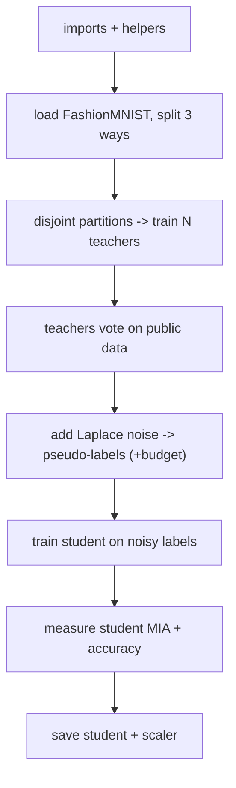

# PATE - New-Dataset Cheatsheet (FashionMNIST)

*HTB Academy · AI Privacy · the PATE DEFENSE on a fresh greyscale dataset · **self-contained** (plain PyTorch + torchvision + scikit-learn, no HTB library)*

> **How to use this sheet**
> - Same defense as the course module sheet, but **nothing depends on `htb_ai_library`** - the model, loaders, training, voting and membership test are all defined here.
> - Dataset: **FashionMNIST** (28×28 **greyscale** clothing, 10 classes) - the MNIST-like "teachers vote, student learns" task.
> - Run top to bottom in one notebook. **🔵 INPUT NEEDED** = fill every `<<LIKE_THIS>>`. **⚪** = just run.
> - ==Privacy budget (epsilon): smaller = more private, always with delta.== Not the FGSM epsilon. **No math here.**

## What changes vs the course (MNIST) sheet

| Thing | Course sheet | This sheet |
|---|---|---|
| Data | MNIST (HTB loader) | **FashionMNIST** via `torchvision.datasets.FashionMNIST` (a drop-in - same shape, harder task) |
| Model | HTB `MLP` | `SimpleMLP` defined here |
| Training / vote / MIA | HTB helpers | defined here (plain PyTorch + numpy) |
| Everything about PATE | - | **identical** |

## The flow



---

## Part A - Setup + data

## Step 1 - Install + imports + config

⚪ no input needed - just run

```python
!pip install torch torchvision scikit-learn safetensors # skip if already installed

import os, numpy as np, torch
import torch.nn as nn, torch.nn.functional as F, torch.optim as optim
from torch.utils.data import DataLoader, TensorDataset
import torchvision
from sklearn.model_selection import train_test_split
from sklearn.preprocessing import StandardScaler
from safetensors.torch import save_file
from safetensors.numpy import save_file as save_numpy
import contextlib, io

torch.manual_seed(1337); np.random.seed(1337)
device = torch.device("cuda" if torch.cuda.is_available() else "cpu")
for d in ("figs","output","models"): os.makedirs(d, exist_ok=True)

NUM_TEACHERS = <<NUM_TEACHERS>> # course-style 250; 50 on a slow CPU
T_EPOCHS = <<T_EPOCHS>> # per teacher; 30 course, 15 demo
S_EPOCHS = <<S_EPOCHS>> # student; 30 course, 15 demo
NOISE_SCALE = <<NOISE_SCALE>> # vote noise; 20.0 course (bigger = more private, worse labels)
NUM_QUERIES = <<NUM_QUERIES>> # public images to label; 5000 course
print("device:", device)
```

**fill in:** `NUM_TEACHERS` (`250`, or `50` on CPU), `T_EPOCHS`/`S_EPOCHS` (`30`, or `15`), `NOISE_SCALE` (`20.0`), `NUM_QUERIES` (`5000`).

## Step 2 - The model + plain helpers

⚪ no input needed - just run

```python
class SimpleMLP(nn.Module):
    """784 -> 128 -> 64 -> 10 fully-connected classifier (for flattened 28x28 images)."""
    def __init__(self, inp=784, hidden=(128, 64), num_classes=10, dropout=0.2):
        super().__init__(); layers, d = [], inp
        for h in hidden:
            layers += [nn.Linear(d, h), nn.ReLU(), nn.Dropout(dropout)]; d = h
        layers += [nn.Linear(d, num_classes)]; self.net = nn.Sequential(*layers)
    def forward(self, x): return self.net(x)

def make_loader(X, y, bs, shuffle=True):
    ds = TensorDataset(torch.as_tensor(X, dtype=torch.float32), torch.as_tensor(y, dtype=torch.long))
    return DataLoader(ds, batch_size=bs, shuffle=shuffle)

def train_mlp(model, loader, epochs, lr=0.001):
    model.to(device).train(); opt = optim.Adam(model.parameters(), lr=lr); crit = nn.CrossEntropyLoss()
    for e in range(epochs):
        for xb, yb in loader:
            opt.zero_grad(); crit(model(xb.to(device)), yb.to(device)).backward(); opt.step()
    return model

def get_probs(model, X):
    """Softmax probabilities for a numpy array of rows. Eval mode (dropout off)."""
    model.eval()
    with torch.no_grad():
        return F.softmax(model(torch.as_tensor(X, dtype=torch.float32).to(device)), 1).cpu().numpy()

def accuracy_np(model, X, y): return float((get_probs(model, X).argmax(1) == y).mean() * 100)
```

**Expected:** no output.

## Step 3 - Load FashionMNIST + split THREE ways

🔵 INPUT NEEDED

**What & why:** 28×28 greyscale clothing, 10 classes. Flatten to 784, scale to 0-1. Three pools: private (teachers), public (student), holdout (final score).

```python
DATA_ROOT = "<<DATA_ROOT>>" # e.g. "./data"
tr = torchvision.datasets.FashionMNIST(DATA_ROOT, train=True, download=True)
te = torchvision.datasets.FashionMNIST(DATA_ROOT, train=False, download=True)

X_train = tr.data.numpy().reshape(-1, 784).astype(np.float32) / 255.0 # raw pixels -> flat, 0..1
y_train = tr.targets.numpy()
X_test = te.data.numpy().reshape(-1, 784).astype(np.float32) / 255.0
y_test = te.targets.numpy()
num_features, num_classes = 784, 10

X_private, X_public, y_private, y_public = train_test_split(
    X_train, y_train, test_size=0.2, random_state=1337, stratify=y_train)
X_holdout, y_holdout = X_test, y_test
print(f"private {len(X_private)} | public {len(X_public)} | holdout {len(X_holdout)}")
```

**fill in:** `<<DATA_ROOT>>` = e.g. `"./data"`.

**Expected:** `private 48000 | public 12000 | holdout 10000`.

## Step 4 - Scale (privacy-clean: fit on PUBLIC)

⚪ no input needed - just run

**What & why:** fit the scaler on **public** data so no un-noised private statistics leak into the student. (The course fits on private; this is cleaner, and you must ship this scaler with the model - Step 9.)

```python
scaler = StandardScaler()
X_public_norm = scaler.fit_transform(X_public).astype(np.float32) # fit on PUBLIC
X_private_norm = scaler.transform(X_private).astype(np.float32)
X_holdout_norm = scaler.transform(X_holdout).astype(np.float32)
print("scaled:", X_private_norm.shape, X_public_norm.shape, X_holdout_norm.shape)
```

**Options:** to match the course exactly, fit on `X_private` instead. Recommended: keep it on `X_public`.

---

## Part B - Teachers, voting, student

## Step 5 - Disjoint partitions + train teachers + vote counter

⚪ no input needed - just run

```python
np.random.seed(1337)
indices = np.random.permutation(len(X_private_norm))
psize = len(X_private_norm) // NUM_TEACHERS
teacher_partitions = [indices[i*psize:] if i == NUM_TEACHERS-1 else indices[i*psize:(i+1)*psize]
                      for i in range(NUM_TEACHERS)]
print(f"{NUM_TEACHERS} disjoint partitions, ~{psize} images each")

teachers = []
for i in range(NUM_TEACHERS):
    t = SimpleMLP(num_features, (128, 64), num_classes, 0.2)
    loader = make_loader(X_private_norm[teacher_partitions[i]], y_private[teacher_partitions[i]], 64)
    with contextlib.redirect_stdout(io.StringIO()): # hush per-epoch prints
        train_mlp(t, loader, T_EPOCHS, 0.001)
    teachers.append(t)
    if (i+1) % 50 == 0: print(f" trained {i+1}/{NUM_TEACHERS} teachers")
print(f"done: {len(teachers)} teachers")

def get_teacher_votes(teachers, X):
    """Vote tally per image. Shape (num_images, num_classes); each row sums to num_teachers."""
    votes = np.zeros((len(X), num_classes), dtype=np.int32)
    for t in teachers:
        preds = get_probs(t, X).argmax(1)
        votes[np.arange(len(preds)), preds] += 1
    return votes
```

**Expected:** `250 disjoint partitions, ~192 each`, then `done: 250 teachers`. ==Disjoint = one person → one teacher → at most one vote changed: the privacy core.==

## Step 6 - Noisy labels + privacy budget

⚪ no input needed - just run

```python
def noisy_argmax(votes, noise_scale):
    noise = np.random.laplace(0.0, noise_scale, size=votes.shape)
    return np.argmax(votes.astype(np.float64) + noise, axis=1)

def compute_privacy_budget(num_queries, noise_scale, delta=1e-5):
    per = 2.0 / noise_scale # 2 = one person can shift 2 vote counts
    total = np.sqrt(2 * num_queries * (per**2) * np.log(1/delta)) + num_queries * per * (np.exp(per) - 1)
    return total, per

nq = min(NUM_QUERIES, len(X_public_norm))
qidx = np.random.choice(len(X_public_norm), nq, replace=False)
X_query, y_query_true = X_public_norm[qidx], y_public[qidx] # true labels for SCORING only

votes = get_teacher_votes(teachers, X_query)
student_labels = noisy_argmax(votes, NOISE_SCALE) # <-- budget spent here (run once!)
clean_preds = votes.argmax(1)
total_eps, per_eps = compute_privacy_budget(nq, NOISE_SCALE)
print(f"clean ensemble {(clean_preds==y_query_true).mean()*100:.2f}% | noisy labels {(student_labels==y_query_true).mean()*100:.2f}%")
print(f"per-query epsilon {per_eps:.4f} | TOTAL epsilon {total_eps:.2f} (delta 1e-5)")
```

**Expected:** clean ensemble a bit above the noisy labels; `per-query epsilon 0.1000`, `TOTAL epsilon ~86.5` at 5000 queries / scale 20. **FashionMNIST is harder than MNIST, so expect a slightly bigger clean-vs-noisy gap.**

> **Honest note:** the course claims the total is ~8.81, but this standard (data-independent) formula gives ~86.5 - the low number only comes from a tighter data-dependent accountant. Compute epsilon from your actual queries; running `noisy_argmax` again spends budget again.

## Step 7 - Train the student

⚪ no input needed - just run

```python
student = SimpleMLP(num_features, (128, 64), num_classes, 0.2)
with contextlib.redirect_stdout(io.StringIO()):
    train_mlp(student, make_loader(X_query, student_labels, 64), S_EPOCHS, 0.001)
student_acc = accuracy_np(student, X_holdout_norm, y_holdout)
print(f"PATE student holdout accuracy: {student_acc:.2f}%")
```

**Expected:** FashionMNIST students usually land around ~82-86% (lower than MNIST's ~88% because clothing is harder).

## Step 8 - Does it leak?

⚪ no input needed - just run

```python
def pate_mia(model, Xm, Xn):
    mc, nc = get_probs(model, Xm).max(1), get_probs(model, Xn).max(1)
    k = min(len(mc), len(nc)); allc = np.concatenate([mc[:k], nc[:k]]); lab = np.concatenate([np.ones(k), np.zeros(k)])
    best = max(np.mean((allc >= t) == lab) for t in np.percentile(allc, np.linspace(0,100,1000)))
    return best, best - 0.5

adv_priv = pate_mia(student, X_private_norm, X_holdout_norm)[1]
adv_query = pate_mia(student, X_query, X_holdout_norm)[1]
print(f"student vs PRIVATE data advantage {adv_priv:.4f} (want ~0 - PATE protected it)")
print(f"student vs QUERY data advantage {adv_query:.4f} (leaks, but query data is public by design)")
```

**Expected:** private advantage near the noise floor (~0.00x); query advantage clearly positive. The private test is a **negative control** (the student trained on neither pool), so ~0 there proves the separation, not the noise strength.

## Step 9 - Save student + scaler

⚪ no input needed - just run

```python
save_file(student.state_dict(), "models/fmnist_student.safetensors") # plain model, no ._module
save_numpy({"mean": scaler.mean_.astype(np.float32), "scale": scaler.scale_.astype(np.float32)},
           "models/fmnist_scaler.safetensors") # load-time: scaled = (raw/255 - mean) / scale
print("saved student + scaler")
```

**Expected:** two files written.

---

## If you remember nothing else

## PATE in 4 lines

1. Cut the private data into **disjoint** partitions, one **teacher** per partition.
2. Teachers **vote** on public unlabeled images; add **Laplace noise** to the vote counts; the noisy winner is each image's pseudo-label.
3. Train a **student** only on those noisy-labeled public images - it never sees private data, so inference is free forever.
4. Measure the student's leak before/after on a balanced pool; report epsilon-with-delta and the accuracy cost.

## The core from memory

```python
votes = get_teacher_votes(teachers, X_query) # (images, classes)
labels = np.argmax(votes + np.random.laplace(0, 20.0, votes.shape), axis=1) # noisy pseudo-labels
train_mlp(student, make_loader(X_query, labels, 64), S_EPOCHS) # student = what you deploy
save_file(student.state_dict(), "models/fmnist_student.safetensors") # plain model, no ._module
```

## Must-know facts

- **PATE's privacy comes from disjoint partitions (one person → one teacher) plus Laplace noise added to the teacher votes.** The deployed student never touches private data, so inference is free.
- **FashionMNIST is a drop-in for MNIST (same 28×28 greyscale, flatten to 784, 10 classes) but harder**, so teacher consensus is weaker and the noise costs a little more label accuracy.
- **Each query is "worth" a sensitivity of 2** (one person can shift two counts); per-query budget is 2 ÷ noise-scale, so scale 20 gives 0.10 per query, and ~86.5 total for 5000 queries by the standard accountant (not 8.81).
- **PATE needs in-distribution PUBLIC unlabeled data; DP-SGD does not** - usually the deciding factor between them. Deduplicate people before partitioning, or one person in several partitions multiplies the budget.
- **Fit any scaler on PUBLIC data and ship it with the student** - the saved weights alone won't deploy, and fitting on private data leaks un-noised statistics outside the accounting.
- **On a balanced membership test, an advantage near ~0.004 is the luck floor (no measurable leak)**; the PATE "private-data" test is a negative control (student saw neither pool), so treat ~0 there as proof of separation, not of the noise.
- **The student reaches roughly ensemble-level accuracy because random label-noise errors mostly cancel during training**; the real exposure is the teachers (each memorizes its slice), which must stay offline.
- **Method point:** **pick the largest noise scale before label accuracy bends, compute epsilon for the exact queries released**; report epsilon-with-delta, the accuracy cost, and that PATE doesn't cover aggregate patterns, model theft or evasion.
