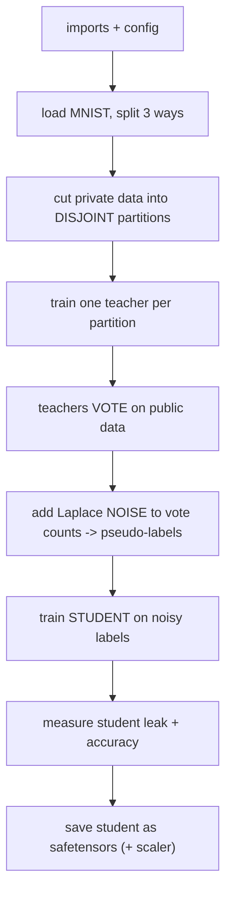

# PATE - Exam Cheatsheet

*HTB Academy · AI Privacy · the PATE privacy DEFENSE (MNIST, course pipeline)*

> **How to use this sheet**
> - PATE is a **defense**, not an attack. It stops the membership-inference attack you learned earlier by making sure the deployed model **never touches the private data at all**.
> - Run the cells **top to bottom in one Jupyter notebook**.
> - **🔵 INPUT NEEDED** = replace every `<<LIKE_THIS>>` first. **⚪** = just run.
> - ==Privacy budget (epsilon): smaller = more private, always reported with delta.== Not the FGSM epsilon.
> - **No math on this sheet** - one plain-English line per idea.

## What PATE does

PATE = **Private Aggregation of Teacher Ensembles**. Split the private data into many **disjoint** pieces, train one **teacher** model per piece, then have all the teachers **vote** on labels for a separate pool of **public, unlabeled** data - with **random noise added to the vote counts**. The noisy winning vote becomes a "pseudo-label". A **student** model is trained only on those noisy-labeled public images. The student never sees private data, so once trained it can be queried forever at no privacy cost.

The exam cares about three things: run the pipeline, read the privacy-vs-accuracy tradeoff, and write it up as a report remediation.

## The flow



---

## Part A - Setup

## Step 1 - Install + imports

⚪ no input needed - just run

**What & why:** PATE uses the HTB helper library's fully-connected `MLP` and the MNIST digits.

```python
!pip install --upgrade git+https://github.com/PandaSt0rm/htb-ai-library
!pip install torchvision tqdm scikit-learn safetensors

import os, json, numpy as np, torch
import matplotlib.pyplot as plt
from sklearn.model_selection import train_test_split
from sklearn.preprocessing import StandardScaler
from safetensors.torch import save_file
from tqdm import tqdm

from htb_ai_library import (
    set_reproducibility, use_htb_style,
    MLP, get_mnist_loaders,
    create_dataloader, train_model, evaluate_accuracy, get_model_predictions,
    HTB_GREEN, NODE_BLACK, HACKER_GREY, WHITE, AZURE, MALWARE_RED, AQUAMARINE, NUGGET_YELLOW,
)
```

**Expected:** no output (an error = a missing install).

## Step 2 - Config

⚪ no input needed - just run

**What & why:** three groups of settings - teachers, the noisy vote, the student.

```python
RANDOM_SEED = 1337
DEVICE = torch.device("cuda" if torch.cuda.is_available() else "cpu")
set_reproducibility(RANDOM_SEED); use_htb_style()
DATASET_CONFIG = {"name": "mnist", "num_classes": 10, "num_features": 784}

TEACHER_CONFIG = {"num_teachers": <<NUM_TEACHERS>>, "hidden_layers": [128, 64],
                  "dropout": 0.2, "epochs": <<T_EPOCHS>>, "batch_size": 64, "learning_rate": 0.001}
AGGREGATION_CONFIG = {"noise_scale": <<NOISE_SCALE>>, "num_student_queries": <<NUM_QUERIES>>}
STUDENT_CONFIG = {"hidden_layers": [128, 64], "dropout": 0.2,
                   "epochs": <<S_EPOCHS>>, "batch_size": 64, "learning_rate": 0.001}
for d in ("figs", "output", "models"): os.makedirs(d, exist_ok=True)
print("device:", DEVICE)
```

**fill in:**
- `<<NUM_TEACHERS>>` = how many teachers. **Course: `250`.** More teachers = stronger, more reliable voting, but each gets less data. On a slow CPU `50` still works.
- `<<T_EPOCHS>>`, `<<S_EPOCHS>>` = training passes for teachers / student. **Course: `30` each** (`15` for a demo).
- `<<NOISE_SCALE>>` = how much noise is added to the votes. **Course: `20.0`.** Bigger = more private, worse labels. Below ~10 privacy is weak; above ~40 labels fall apart.
- `<<NUM_QUERIES>>` = how many public images the teachers label (= student training size = budget spent). **Course: `5000`.**

**Expected:** `device: cuda` (or `cpu`).

## Step 3 - Load MNIST + split THREE ways

⚪ no input needed - just run

**What & why:** **Private** trains the teachers (the sensitive data). **Public** gets labeled by the teachers and trains the student (assumed non-sensitive). **Holdout** is touched by no one, for the final score only.

```python
train_loader, test_loader = get_mnist_loaders() # downloads/caches MNIST

# raw pixels straight from the dataset (skips the loader transform -> we scale by 255 ourselves)
X_train = train_loader.dataset.data.numpy().reshape(-1, 784).astype(np.float32) / 255.0
y_train = train_loader.dataset.targets.numpy()
X_test = test_loader.dataset.data.numpy().reshape(-1, 784).astype(np.float32) / 255.0
y_test = test_loader.dataset.targets.numpy()
num_features, num_classes = 784, 10

X_private, X_public, y_private, y_public = train_test_split(
    X_train, y_train, test_size=0.2, random_state=RANDOM_SEED, stratify=y_train)
X_holdout, y_holdout = X_test, y_test
print(f"private {len(X_private)} | public {len(X_public)} | holdout {len(X_holdout)}")
```

**Expected:** `private 48000 | public 12000 | holdout 10000`.

## Step 4 - Scale the features

⚪ no input needed - just run

```python
scaler = StandardScaler()
X_public_norm = scaler.fit_transform(X_public).astype(np.float32) # fit on PUBLIC (privacy-clean)
X_private_norm = scaler.transform(X_private).astype(np.float32)
X_holdout_norm = scaler.transform(X_holdout).astype(np.float32)
print("scaled:", X_private_norm.shape, X_public_norm.shape, X_holdout_norm.shape)
```

**Options (which data to fit the scaler on):**
- **If** matching the course exactly → fit on `X_private`.
- **If** you want it privacy-clean (**recommended, as written**) → fit on `X_public`. The scaler's numbers are statistics of whatever you fit it on, and private statistics would leak **outside** the privacy accounting. (You must ship this scaler with the model - Step 8.)

---

## Part B - Teachers

## Step 5 - Disjoint partitions

⚪ no input needed - just run

**What & why:** **each teacher must see a different, non-overlapping slice - that's the whole privacy point: one person lands in exactly one teacher, so can change at most one vote.**

```python
num_teachers = TEACHER_CONFIG["num_teachers"]
np.random.seed(RANDOM_SEED)
indices = np.random.permutation(len(X_private_norm)) # shuffle so partitions aren't ordered
partition_size = len(X_private_norm) // num_teachers
teacher_partitions = [indices[i*partition_size:] if i == num_teachers-1
                      else indices[i*partition_size:(i+1)*partition_size] for i in range(num_teachers)]
print(f"{num_teachers} partitions, ~{partition_size} images each")
```

**Expected (course):** `250 partitions, ~192 images each`.

## Step 6 - Train the teachers + define the vote counter

⚪ no input needed - just run

**What & why:** one fresh `MLP` per partition. Each is weak alone, but together they vote well. `get_teacher_votes` tallies, for each image, how many teachers chose each class.

```python
import contextlib, io
holdout_loader = create_dataloader(X_holdout_norm, y_holdout, 128, shuffle=False)
teachers = []
for i in tqdm(range(num_teachers), desc="Training teachers"):
    teacher = MLP(input_size=num_features, hidden_layers=TEACHER_CONFIG["hidden_layers"],
                  num_classes=num_classes, dropout=TEACHER_CONFIG["dropout"])
    teacher_loader = create_dataloader(X_private_norm[teacher_partitions[i]],
                                       y_private[teacher_partitions[i]], TEACHER_CONFIG["batch_size"])
    with contextlib.redirect_stdout(io.StringIO()): # hide the per-epoch prints (else thousands of lines)
        train_model(teacher, teacher_loader, holdout_loader, device=DEVICE,
                    epochs=TEACHER_CONFIG["epochs"], learning_rate=TEACHER_CONFIG["learning_rate"])
    teachers.append(teacher)
print(f"trained {len(teachers)} teachers")

def get_teacher_votes(teachers, X, device):
    """For each image, count how many teachers voted for each class. Shape (num_images, num_classes)."""
    votes = np.zeros((X.shape[0], num_classes), dtype=np.int32)
    for teacher in teachers:
        preds = get_model_predictions(teacher, X, device).argmax(axis=1) # eval-mode softmax -> top class
        votes[np.arange(len(preds)), preds] += 1
    return votes
```

**Expected:** a progress bar, then `trained 250 teachers`. Each vote row will sum to `num_teachers`.

> **Honest note:** the course tallies votes with a slow Python loop and overwrites the name `train_loader` inside the loop; this version uses the fast `votes[np.arange(...), preds] += 1` and a `teacher_loader` name so nothing important gets clobbered.

---

## Part C - Noisy voting + student

## Step 7 - Noisy labels + the privacy budget

⚪ no input needed - just run

**What & why:** collect the votes, **add Laplace noise to the counts**, and take the noisy winner as each image's pseudo-label. The noise is what makes it private. Then compute the total budget spent.

```python
def noisy_argmax(votes, noise_scale):
    """Add random Laplace noise to every vote count, return the noisy winning class per image."""
    noise = np.random.laplace(loc=0.0, scale=noise_scale, size=votes.shape)
    return np.argmax(votes.astype(np.float64) + noise, axis=1)

def compute_privacy_budget(num_queries, noise_scale, delta=1e-5):
    """Total privacy spent over all labeled queries. Returns (total, per-query)."""
    per_query = 2.0 / noise_scale # 2 = one person can shift 2 vote counts
    total = np.sqrt(2 * num_queries * (per_query ** 2) * np.log(1 / delta))
    total += num_queries * per_query * (np.exp(per_query) - 1)
    return total, per_query

num_queries = min(AGGREGATION_CONFIG["num_student_queries"], len(X_public_norm))
query_idx = np.random.choice(len(X_public_norm), num_queries, replace=False)
X_query = X_public_norm[query_idx]
y_query_true = y_public[query_idx] # real labels - for SCORING only, student never sees them

votes = get_teacher_votes(teachers, X_query, DEVICE)
student_labels = noisy_argmax(votes, AGGREGATION_CONFIG["noise_scale"]) # <-- budget spent HERE (run once!)
clean_preds = votes.argmax(axis=1) # no-noise winner, MEASUREMENT only

total_eps, per_eps = compute_privacy_budget(num_queries, AGGREGATION_CONFIG["noise_scale"])
print(f"labeled {num_queries} | clean ensemble {(clean_preds==y_query_true).mean()*100:.2f}% | "
      f"noisy labels {(student_labels==y_query_true).mean()*100:.2f}%")
print(f"per-query epsilon {per_eps:.4f} | TOTAL epsilon {total_eps:.2f} (delta 1e-5)")
```

**Expected (course):** clean ensemble ~88%, noisy labels ~87% (noise costs under 1 point). `per-query epsilon 0.1000`, **TOTAL epsilon ~86.5** for 5000 queries at scale 20.

> **Honest note - the famous "8.81":** the course *says* the total is ~8.81, but its own formula (above) returns ~**86.5** for 5000 queries at scale 20. The low single-digit number only comes from a tighter *data-dependent* accountant that rewards strong agreement. **For a report, compute epsilon from your actual queries and scale; don't copy 8.81.** Also: **running `noisy_argmax` again spends budget AGAIN** - label once.

## Step 8 - Train the student + save it (and the scaler)

⚪ no input needed - just run

**What & why:** an ordinary model trained on (public image, noisy label) pairs. It never sees private data, so training and querying it later cost **no** extra privacy.

```python
student_model = MLP(input_size=num_features, hidden_layers=STUDENT_CONFIG["hidden_layers"],
                    num_classes=num_classes, dropout=STUDENT_CONFIG["dropout"])
student_loader = create_dataloader(X_query, student_labels, STUDENT_CONFIG["batch_size"])
train_model(student_model, student_loader, holdout_loader, device=DEVICE,
            epochs=STUDENT_CONFIG["epochs"], learning_rate=STUDENT_CONFIG["learning_rate"])
student_test_acc = evaluate_accuracy(student_model, holdout_loader, DEVICE)
print(f"PATE student holdout accuracy: {student_test_acc:.2f}%")

save_file(student_model.state_dict(), "models/pate_student.safetensors") # no ._module needed (not wrapped)
from safetensors.numpy import save_file as save_numpy
save_numpy({"mean": scaler.mean_.astype(np.float32), "scale": scaler.scale_.astype(np.float32)},
           "models/pate_scaler.safetensors") # load-time: scaled = (raw/255 - mean) / scale
print("saved student + scaler")
```

**Expected (course):** about **88%** - roughly as good as the clean ensemble, despite ~13% of its training labels being wrong (random label errors mostly cancel out).

---

## Part D - Consensus + privacy eval

## Step 9 - Consensus check + confident aggregation (optional)

⚪ no input needed - just run

**What & why:** labels where teachers strongly agree are the reliable ones. **Confident aggregation** keeps only high-agreement images (marking the rest −1 to drop), giving fewer but cleaner labels.

```python
max_votes = votes.max(axis=1) # winning count per image, out of num_teachers
for cut in (0.6, 0.8):
    n = (max_votes >= cut * num_teachers).sum()
    print(f"share with >= {int(cut*100)}% agreement: {n/len(max_votes):.1%}")

def confident_aggregation(votes, noise_scale, threshold):
    """Noisy-label only images whose top vote count reaches `threshold`; others get -1 (drop before training)."""
    mask = votes.max(axis=1) >= threshold
    labels = np.full(len(votes), -1, dtype=np.int64)
    if mask.sum() > 0:
        v = votes[mask].astype(np.float64)
        labels[mask] = np.argmax(v + np.random.laplace(0, noise_scale, size=v.shape), axis=1)
    return labels, mask

conf_labels, conf_mask = confident_aggregation(votes, AGGREGATION_CONFIG["noise_scale"],
                                               threshold=int(0.8 * num_teachers))
if conf_mask.sum() > 0:
    print(f"confident set: kept {conf_mask.mean():.1%}, label accuracy "
          f"{(conf_labels[conf_mask] == y_query_true[conf_mask]).mean()*100:.1f}%")
```

**Expected (course):** roughly 69% of images reach 80% agreement; the kept labels are more accurate than the full set.

> **Honest note:** the course decides "keep or drop" from the **clean** (un-noised) vote count, which is **not actually private** - a neighbour's data could flip a 200 to a 199 and change the decision with certainty, and the −1 markers leak. The real method (**Confident-GNMax**) noises the threshold check too and charges budget for every query, even rejected ones. Use confident aggregation for label quality, but don't claim the "free rejections" privacy saving in a report.

## Step 10 - Does the student leak?

⚪ no input needed - just run

**What & why:** attack the student. Two tests: against the **private** data (should look random - the student never saw it) and against the **public query** data (will leak - the student did train on it, which is fine because it's public).

```python
def pate_mia_advantage(model, X_members, X_nonmembers, device):
    mc = get_model_predictions(model, X_members, device).max(axis=1)
    nc = get_model_predictions(model, X_nonmembers, device).max(axis=1)
    n = min(len(mc), len(nc)); allc = np.concatenate([mc[:n], nc[:n]]); lab = np.concatenate([np.ones(n), np.zeros(n)])
    best = max(np.mean((allc >= t) == lab) for t in np.percentile(allc, np.linspace(0, 100, 1000)))
    return best, best - 0.5

adv_priv = pate_mia_advantage(student_model, X_private_norm, X_holdout_norm, DEVICE)[1]
adv_query = pate_mia_advantage(student_model, X_query, X_holdout_norm, DEVICE)[1]
print(f"student vs PRIVATE data advantage {adv_priv:.4f} (want ~0 - PATE protected it)")
print(f"student vs QUERY data advantage {adv_query:.4f} (leaks - but query data is public by design)")
```

**Expected (course):** private advantage ~0.002 (random); query advantage ~0.075.

> **Honest note:** the private-data test is a **negative control** - the student trained on neither the private data nor the holdout, so *any* such model scores ~0.5 there, even one trained with no noise. It proves the *separation*, not the noise strength. The data PATE actually exposes is in the **teachers** (each memorizes its tiny slice), so teachers must stay offline and never be queryable.

---

## Part E - Writing it up in the report

**Finding:** Membership inference against [model]. CWE-359 / CWE-200.

**Root cause:** the model overfits, so it's more confident on memorized records.

**Remediation (PATE):** retrain as a PATE student. Give the number of teachers, the noise scale, the number of labeling queries, the **total epsilon + delta** (and whether the epsilon is data-dependent), and the student accuracy vs the baseline. Requires **in-distribution public unlabeled data** - if none exists, use DP-SGD instead.

**Always:** quote epsilon WITH delta, back it with a before/after leak number on a balanced pool, and note PATE protects individual records only (not aggregate patterns, model theft or evasion), and that the **teacher ensemble must stay offline**.

---

## If you remember nothing else

## PATE in 4 lines

1. Cut the private data into **disjoint** partitions, one **teacher** per partition.
2. Teachers **vote** on public unlabeled images; add **Laplace noise** to the vote counts; the noisy winner is each image's pseudo-label.
3. Train a **student** only on those noisy-labeled public images - it never sees private data, so inference is free forever.
4. Measure the student's membership leak before/after on a balanced pool; report epsilon-with-delta and the accuracy cost.

## The core from memory

```python
# teachers vote with noise -> student learns
votes = get_teacher_votes(teachers, X_query, DEVICE) # (images, classes) tally
labels = np.argmax(votes + np.random.laplace(0, 20.0, votes.shape), axis=1) # noisy winner = pseudo-label
train_model(student_model, create_dataloader(X_query, labels, 64), holdout_loader, device=DEVICE, epochs=30)
save_file(student_model.state_dict(), "models/pate_student.safetensors") # plain model, no ._module
```

## Must-know facts

- **PATE's privacy comes from two things: disjoint partitions (one person influences exactly one teacher) and Laplace noise added to the teacher votes.** The deployed student never touches private data.
- **Each query is "worth" a sensitivity of 2** because one person can shift two vote counts; the per-query budget is 2 ÷ noise-scale, so noise scale 20 gives 0.10 per query.
- **Total epsilon for 5000 queries at scale 20 is ~86.5 by the standard (data-independent) accountant, NOT the course's 8.81** - that low number only comes from a tighter data-dependent method. Compute it from your actual queries; running the noisy vote again spends budget again.
- **PATE needs in-distribution PUBLIC unlabeled data; DP-SGD does not** - that requirement is usually the deciding factor between them. Deduplicate people before partitioning, or one person in several partitions multiplies the budget.
- **The student reaches ~88% on MNIST, about as good as the clean teacher vote**, because random noise errors in the labels mostly cancel out during training. Noise costs under 1 point of label accuracy when consensus is strong.
- **Confident aggregation (keep only high-agreement images) improves label quality but the course's version isn't truly private** - it decides from clean vote counts; the real method (Confident-GNMax) noises the threshold and charges every query.
- **The "attack the student with private data" test is a negative control** (student saw neither pool, so ~0.5 for any model); the real exposure is the teachers, which must stay offline. Report the leak as a lower bound alongside epsilon and delta.
- **Method point:** **pick the largest noise scale before label accuracy bends, compute epsilon for the exact queries released, fit any scaler on public data and ship it with the student**; report epsilon-with-delta, the accuracy cost, and that PATE doesn't cover aggregate patterns, model theft or evasion.
