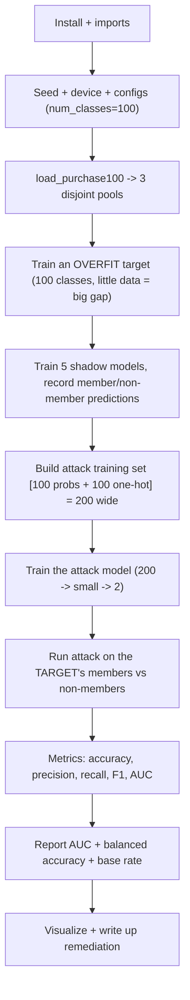

# Shadow Model Membership Inference - Exam Cheatsheet (Purchase-100)

_HTB Academy · AI Privacy · same attack as the Adult-Census sheet, on the classic Purchase-100 benchmark_

> **Why this version exists:** the exam may hand you a dataset that isn't Adult Census. **Purchase-100 is the dataset the shadow-model attack was invented on** (Shokri et al., 2017), so it's the most exam-faithful second example. It also behaves very differently: with **100 classes and little data per class**, the target overfits hugely, so the attack goes from "weak" (Adult, AUC ~0.57) to "strong" (AUC often 0.8+). This sheet trains **your own** models on a **public research dataset** in a notebook to learn the method. It is not for use against any real system.
> 
> **How to use this sheet**
> 
> - Run the cells **top to bottom in one Jupyter notebook**. Later cells use names earlier cells created.
> - **🔵 INPUT NEEDED** = replace every `<<LIKE_THIS>>` first. A leftover `<<...>>` makes the cell fail on purpose.
> - **⚪ no input needed - just run** = run as-is.
> - **Member** = a record that **was** in the target's training set. **Non-member** = one it never trained on.

## What changes from the Adult sheet (read this first)

|Thing|Adult sheet|This sheet (Purchase-100)|
|---|---|---|
|Records|14 mixed features, 2 classes|**600 binary features (bought / didn't), 100 classes**|
|Loader|`load_adult_census` → 7 values|**`load_purchase100` → 8 values** (adds `num_classes`)|
|Attack input width|4 (2 probs + 2 one-hot)|**200 (100 probs + 100 one-hot)**|
|Overfitting|mild (gap ~11 points)|**severe** (few records per class → target memorises)|
|Shadow-test accuracy|~50% (shadows barely leak)|**well above 50%** (shadows overfit too)|
|Attack strength|weak (AUC ~0.57)|**strong (AUC often 0.8+)**|
|`stratify=` on class splits|fine|**drop it** (100 classes + small splits can't stratify)|
|Decision-boundary call|default|**must pass `num_classes=100`**|

**The attack pipeline is identical. What changes: the loader (8 values), the class count (100 everywhere), the attack input width (200), and a couple of small guards. Everything else is the Adult sheet.**

## The flow



---

## Part A - Setup

## Step 1 - Install

⚪ no input needed - just run

**What & why:** PyTorch and friends, plus HTB's library (which includes the Purchase-100 loader).

```python
!pip install torch numpy scikit-learn matplotlib tqdm safetensors
!pip install --upgrade git+https://github.com/PandaSt0rm/htb-ai-library
```

**If it breaks:** usually pre-installed in the lab; skip to Step 2 and come back only if an import fails.

## Step 2 - Imports

⚪ no input needed - just run

**What & why:** same tools as the Adult sheet. The only data import that changes is `load_purchase100` instead of `load_adult_census`.

```python
import os, json
import numpy as np
import torch
import torch.nn.functional as F
from sklearn.model_selection import train_test_split
from sklearn.preprocessing import StandardScaler
from sklearn.metrics import (accuracy_score, precision_score, recall_score, f1_score,
                             classification_report, roc_auc_score, confusion_matrix)

from htb_ai_library import (
    set_reproducibility, use_htb_style,
    MLP, AttackModel,
    load_purchase100, # <-- Purchase-100 loader (returns 8 values, not 7)
    train_fixed_epochs, train_with_early_stopping, evaluate_model,
    get_model_predictions, prepare_attack_data, create_dataloader,
    plot_training_history, plot_overfitting_gap, plot_confidence_distributions,
    plot_shadow_confidence_distributions, plot_attack_roc_curve, plot_precision_recall_curve,
    plot_attack_accuracy_comparison, analyze_attack_decision_boundary, plot_decision_boundary,
)
```

**Expected:** no output.

## Step 3 - Seed, device, folders

⚪ no input needed - just run

```python
RANDOM_SEED = 1337
DEVICE = torch.device("cuda" if torch.cuda.is_available() else "cpu")
set_reproducibility(RANDOM_SEED)
use_htb_style()

FIGS_DIR = "figs"; MODEL_DIR = "output/models"; FIG_PREFIX = "Purchase_"
os.makedirs(MODEL_DIR, exist_ok=True); os.makedirs(FIGS_DIR, exist_ok=True)
print(DEVICE)
```

**Expected:** `cpu` or `cuda`. On CPU this dataset is still quick because the models are MLPs.

---

## Part B - Data

## Step 4 - Load Purchase-100 into three disjoint pools

🔵 INPUT NEEDED (the pool sizes, optional)

**What & why:** downloads Purchase-100 (shoppers described by 600 yes/no purchase features, grouped into 100 shopping profiles) and makes the same three non-overlapping pools as the Adult sheet. **This loader returns EIGHT values** - the extra one is `num_classes` (100). Smaller `target_size` = more overfitting = stronger attack.

```python
X_target, y_target, X_shadow, y_shadow, X_attack_eval, y_attack_eval, num_features, num_classes = load_purchase100(
    target_size=<<TARGET_SIZE>>,
    shadow_pool_size=<<SHADOW_POOL>>,
    eval_pool_size=<<EVAL_SIZE>>,
    random_state=RANDOM_SEED,
)
DATASET_CONFIG = {"num_classes": num_classes} # 100 - used everywhere below
print(f"features {num_features} | classes {num_classes}")
print(f"target (members) {len(X_target)} | shadow pool {len(X_shadow)} | eval (non-members) {len(X_attack_eval)}")
```

**fill in:**

- `<<TARGET_SIZE>>` = members (the target's training set). Use `5000` (strong overfit, classic setup). Smaller = even more overfit.
- `<<SHADOW_POOL>>` = shadow records. Use `10000` (each shadow trains on half, matching the target's size).
- `<<EVAL_SIZE>>` = non-members for testing. Use `5000` - **match `TARGET_SIZE` so the evaluation pool is BALANCED** (then 50% is the real baseline). The default is 10000, which would make it 1:2 non-member-heavy.

**Options:**

- **If** you want the balanced, honest setup → `5000 / 10000 / 5000` (**pick this**).
- **If** you want to reproduce a 2:1-style imbalance to practise the base-rate maths → `5000 / 10000 / 10000`, and lean on Step 19.
- **If** your CPU is slow → `2000 / 4000 / 2000` (smaller, trains faster, still overfits hard).

**Expected:** `features 600 | classes 100`, then your three pool sizes. First run downloads a small archive.

**If it breaks:** a download error in a locked lab means no internet - then the dataset is usually provided as a file; point `data_dir="<path to the given folder>"`.

## Step 5 - Rescale (optional for binary features, kept for consistency)

⚪ no input needed - just run

**What & why:** the 600 features are already 0/1, so rescaling matters less here than it did for Adult's mixed scales - but we keep it so the pipeline is identical and nothing surprises you. **Learn the scaling from the members only, apply it everywhere else.**

```python
scaler = StandardScaler()
X_target_norm = scaler.fit_transform(X_target) # learn from members, apply
X_attack_eval_norm = scaler.transform(X_attack_eval) # apply the SAME scaling (transform, not fit_transform)
print("scaled members:", X_target_norm.shape, "| scaled non-members:", X_attack_eval_norm.shape)
```

**Expected:** `scaled members: (5000, 600) | scaled non-members: (5000, 600)` (or your sizes).

**Option:** for binary features you _can_ skip scaling (set `X_target_norm = X_target` etc.). It changes the exact numbers slightly but not the story. Keeping the scaler is the safe default.

---

## Part C - Train the overfit target

## Step 6 - Configs (note the bigger networks for 600→100)

⚪ no input needed - just run

**What & why:** 600 inputs and 100 outputs need a bit more width than Adult's 14→2. The target still uses **no dropout** and fixed epochs to overfit; shadows are smaller with dropout; the attack model is tiny.

```python
TARGET_MODEL_CONFIG = {"hidden_layers": [512, 256], "dropout": 0.0,
                       "epochs": 50, "batch_size": 64, "learning_rate": 0.001}
SHADOW_MODEL_CONFIG = {"num_shadow_models": 5, "hidden_layers": [256, 128], "dropout": 0.3,
                       "epochs": 50, "batch_size": 64, "learning_rate": 0.001,
                       "early_stopping_patience": 10, "shadow_data_size": 0.5}
ATTACK_MODEL_CONFIG = {"hidden_layers": [128, 64], "dropout": 0.2,
                       "epochs": 50, "batch_size": 128, "learning_rate": 0.001,
                       "early_stopping_patience": 15}
```

**Option:** on a slow CPU, drop every `epochs` to `30`. The target overfits fast here, so even 30 shows a big gap.

## Step 7 - Build and train the target, measure the gap

⚪ no input needed - just run

**What & why:** builds the 600 → 512 → 256 → 100 target and trains it. With only ~50 records per class it **memorises almost perfectly** and generalises poorly, so the overfitting gap is huge - the opposite of Adult's mild gap.

```python
train_loader = create_dataloader(X_target_norm, y_target, TARGET_MODEL_CONFIG['batch_size'])
test_loader = create_dataloader(X_attack_eval_norm, y_attack_eval,
                                 TARGET_MODEL_CONFIG['batch_size'], shuffle=False)

target_model = MLP(input_size=num_features,
                   hidden_layers=TARGET_MODEL_CONFIG['hidden_layers'],
                   num_classes=DATASET_CONFIG['num_classes'], # 100
                   dropout=TARGET_MODEL_CONFIG['dropout'])
print(f"Architecture: {num_features} -> {TARGET_MODEL_CONFIG['hidden_layers']} -> {num_classes}")

history = train_fixed_epochs(target_model, train_loader, test_loader,
                             device=DEVICE, epochs=TARGET_MODEL_CONFIG['epochs'],
                             learning_rate=TARGET_MODEL_CONFIG['learning_rate'])

train_acc, _, _ = evaluate_model(target_model, train_loader, DEVICE)
test_acc, _, _ = evaluate_model(target_model, test_loader, DEVICE)
print(f"\nTarget train {train_acc:.4f} test {test_acc:.4f} gap {train_acc - test_acc:.4f}")

plot_training_history(history, "Target Model Training",
                      save_path=os.path.join(FIGS_DIR, f"{FIG_PREFIX}target_training.png"))
plot_overfitting_gap(train_acc, test_acc,
                     save_path=os.path.join(FIGS_DIR, f"{FIG_PREFIX}overfitting_gap.png"))
```

**Expected:** `Architecture: 600 -> [512, 256] -> 100`, then training near **100% on members** with a **much lower** test accuracy - a **large gap** (far bigger than Adult's 0.11). The exact test number depends on the data, but the gap is the point.

---

## Part D - Shadow models

## Step 8 - Make 5 shadow splits (no class stratify here)

⚪ no input needed - just run

**What & why:** each shadow trains on a different random half of the shadow pool. ==Unlike the Adult sheet, do NOT pass `stratify=y_shadow`== - with 100 classes and a small pool, some class may have too few records to stratify and it errors. A plain random split is fine; the attack doesn't need balanced classes.

```python
shadow_splits = []
for i in range(SHADOW_MODEL_CONFIG['num_shadow_models']):
    X_train_s, X_out_s, y_train_s, y_out_s = train_test_split(
        X_shadow, y_shadow, train_size=SHADOW_MODEL_CONFIG['shadow_data_size'],
        random_state=RANDOM_SEED + i # NOTE: no stratify= on 100-class data
    )
    shadow_splits.append((X_train_s, X_out_s, y_train_s, y_out_s))
print(f"{len(shadow_splits)} shadows | per shadow ~{len(shadow_splits[0][0])} in, ~{len(shadow_splits[0][1])} out")
```

**Expected:** `5 shadows | per shadow ~5000 in, ~5000 out` (half of a 10000 pool).

## Step 9 - Train all 5 shadows and collect predictions (ONE cell)

⚪ no input needed - just run

**What & why:** identical to the Adult sheet's merged loop, but note `num_classes` is now 100. **This is one loop; I keep it as one cell. The validation split inside also drops `stratify`** for the same 100-class reason.

```python
all_attack_X, all_attack_y, all_preds_in, all_preds_out = [], [], [], []

for i, (X_train_s, X_out_s, y_train_s, y_out_s) in enumerate(shadow_splits):
    print(f"\nTraining Shadow Model {i+1}/{SHADOW_MODEL_CONFIG['num_shadow_models']}")
    X_train_s_norm = scaler.transform(X_train_s) # same target scaler
    X_out_s_norm = scaler.transform(X_out_s)

    # Validation slice for early stopping (no stratify on 100 classes)
    X_tr_s, X_val_s, y_tr_s, y_val_s = train_test_split(
        X_train_s_norm, y_train_s, test_size=0.2, random_state=RANDOM_SEED + i)
    train_loader_s = create_dataloader(X_tr_s, y_tr_s, SHADOW_MODEL_CONFIG['batch_size'])
    val_loader_s = create_dataloader(X_val_s, y_val_s, SHADOW_MODEL_CONFIG['batch_size'], shuffle=False)

    shadow_model = MLP(input_size=num_features,
                       hidden_layers=SHADOW_MODEL_CONFIG['hidden_layers'],
                       num_classes=DATASET_CONFIG['num_classes'], # 100
                       dropout=SHADOW_MODEL_CONFIG['dropout'])
    train_with_early_stopping(shadow_model, train_loader_s, val_loader_s, device=DEVICE,
                              epochs=SHADOW_MODEL_CONFIG['epochs'],
                              learning_rate=SHADOW_MODEL_CONFIG['learning_rate'],
                              patience=SHADOW_MODEL_CONFIG['early_stopping_patience'], verbose=False)

    preds_in = get_model_predictions(shadow_model, X_train_s_norm, DEVICE)
    preds_out = get_model_predictions(shadow_model, X_out_s_norm, DEVICE)
    attack_X_s, attack_y_s = prepare_attack_data(preds_in, preds_out, y_train_s, y_out_s)
    all_attack_X.append(attack_X_s); all_attack_y.append(attack_y_s)
    all_preds_in.append(preds_in); all_preds_out.append(preds_out)

    full_in = create_dataloader(X_train_s_norm, y_train_s, SHADOW_MODEL_CONFIG['batch_size'], shuffle=False)
    full_out = create_dataloader(X_out_s_norm, y_out_s, SHADOW_MODEL_CONFIG['batch_size'], shuffle=False)
    tr_s, _, _ = evaluate_model(shadow_model, full_in, DEVICE)
    ou_s, _, _ = evaluate_model(shadow_model, full_out, DEVICE)
    print(f" Shadow {i+1} - Train Acc: {tr_s:.4f}, Out Acc: {ou_s:.4f}")
```

**Expected:** five runs, each ending with a shadow that overfits **a lot** (train near 100%, out far lower). **Unlike Adult, these shadows leak strongly**, because 100 classes + little data overfit even with dropout.

## Step 10 - Combine into the attack training set (now 200 wide)

⚪ no input needed - just run

```python
attack_X = np.concatenate(all_attack_X, axis=0)
attack_y = np.concatenate(all_attack_y, axis=0)
print(f"attack_X {attack_X.shape} (width = 2 x {num_classes} = {2*num_classes})")
print(f"members {np.sum(attack_y==1)} | non-members {np.sum(attack_y==0)}")
```

**Expected:** `attack_X (N, 200)` - each row is **100 probabilities + 100 one-hot** label slots. Members and non-members equal.

---

## Part E - Attack model

## Step 11 - Three-way split

⚪ no input needed - just run

**What & why:** train / validation / test. ==Here `stratify=attack_y` is fine== because that label is just member/non-member (2 values), not the 100 classes.

```python
X_attack_train, X_attack_test, y_attack_train, y_attack_test = train_test_split(
    attack_X, attack_y, test_size=0.2, random_state=RANDOM_SEED, stratify=attack_y)
X_attack_tr, X_attack_val, y_attack_tr, y_attack_val = train_test_split(
    X_attack_train, y_attack_train, test_size=0.2, random_state=RANDOM_SEED, stratify=y_attack_train)

attack_train_loader = create_dataloader(X_attack_tr, y_attack_tr, ATTACK_MODEL_CONFIG['batch_size'])
attack_val_loader = create_dataloader(X_attack_val, y_attack_val, ATTACK_MODEL_CONFIG['batch_size'], shuffle=False)
attack_test_loader = create_dataloader(X_attack_test, y_attack_test, ATTACK_MODEL_CONFIG['batch_size'], shuffle=False)
print(f"train {len(X_attack_tr)} | val {len(X_attack_val)} | test {len(X_attack_test)}")
```

**Expected:** three sizes in an 80/20/of-80 pattern (e.g. with a 20000-row attack set: `12800 | 3200 | 4000`).

## Step 12 - Build and train the attack model (input = 200)

⚪ no input needed - just run

**What & why:** the attack network's input width is `attack_X.shape[1]` = 200, set automatically. **Unlike Adult, expect the shadow-test accuracy to be WELL above 50%**, because the shadows overfit and so carry a real signal.

```python
attack_model = AttackModel(input_size=attack_X.shape[1], # 200
                           hidden_layers=ATTACK_MODEL_CONFIG['hidden_layers'],
                           dropout=ATTACK_MODEL_CONFIG['dropout'])
print(f"Attack model: {attack_X.shape[1]} -> {ATTACK_MODEL_CONFIG['hidden_layers']} -> 2")

history_attack = train_with_early_stopping(attack_model, attack_train_loader, attack_val_loader,
                                           device=DEVICE, epochs=ATTACK_MODEL_CONFIG['epochs'],
                                           learning_rate=ATTACK_MODEL_CONFIG['learning_rate'],
                                           patience=ATTACK_MODEL_CONFIG['early_stopping_patience'])
plot_training_history(history_attack, "Attack Model Training",
                      save_path=os.path.join(FIGS_DIR, f"{FIG_PREFIX}attack_training.png"))
```

**Expected:** `Attack model: 200 -> [128, 64] -> 2`, and (unlike Adult) a training curve where accuracy climbs **clearly above 0.5**.

## Step 13 - Score on shadow data + save

⚪ no input needed - just run

```python
attack_test_acc, attack_test_predictions, _ = evaluate_model(attack_model, attack_test_loader, DEVICE)
print(f"Attack shadow-test accuracy: {attack_test_acc:.4f}")
print(classification_report(y_attack_test, attack_test_predictions,
                            target_names=['Non-Member', 'Member'], digits=4))
torch.save(attack_model.state_dict(), os.path.join(MODEL_DIR, "attack_model_purchase.pt"))
print("saved")
```

**Expected:** accuracy **well above 0.50** (often 0.7-0.9 on this benchmark), unlike Adult's ~0.50. That already tells you the attack will be strong on the target.

## Step 14 - Decision boundary (MUST pass num_classes)

⚪ no input needed - just run

**What & why:** probes the attack across confidence levels. ==You MUST pass `num_classes=num_classes` (100) here==, or the function builds a 4-wide probe that doesn't fit the 200-wide attack model and errors.

```python
boundary_analysis = analyze_attack_decision_boundary(attack_model, DEVICE, num_classes=num_classes)
for cls, data in list(boundary_analysis.items())[:2]:
    mp, conf = data['membership_probs'], data['confidences']
    crosses = np.where(np.diff(np.sign(mp - 0.5)) != 0)[0]
    where = f"crosses 0.5 at confidence ~{conf[crosses[0]]:.3f}" if len(crosses) else "never crosses 0.5"
    print(f" Class {cls}: membership-prob range [{mp.min():.3f}, {mp.max():.3f}] -> {where}")
plot_decision_boundary(boundary_analysis,
                       save_path=os.path.join(FIGS_DIR, f"{FIG_PREFIX}decision_boundary.png"))
```

**Expected:** the membership probability now **rises clearly with confidence** and crosses 0.5 at some point - a real, usable threshold, unlike Adult's flat lines.

**If it breaks:** `RuntimeError: mat1 and mat2 shapes cannot be multiplied` here means you forgot `num_classes=num_classes` (it defaulted to 2).

---

## Part F - Execute on the target

## Step 15 - Collect the target's predictions

⚪ no input needed - just run

```python
preds_members = get_model_predictions(target_model, X_target_norm, DEVICE)
preds_non_members = get_model_predictions(target_model, X_attack_eval_norm, DEVICE)
print(f"members {len(preds_members)} | non-members {len(preds_non_members)}")
```

**Expected:** your member and non-member counts (e.g. `5000 | 5000`).

## Step 16 - Build the eval set and run the attack (ONE cell)

⚪ no input needed - just run

**What & why:** identical to the Adult sheet - members and non-members prepared separately (the function labels by position), with an empty placeholder whose **column count must be `num_classes` (100)**.

```python
attack_X_members, attack_y_members = prepare_attack_data(
    preds_members, np.zeros((0, preds_members.shape[1])), # (0, 100) placeholder
    y_target, np.array([], dtype=np.int64))
attack_X_non_members, attack_y_non_members = prepare_attack_data(
    np.zeros((0, preds_non_members.shape[1])), preds_non_members,
    np.array([], dtype=np.int64), y_attack_eval)

attack_X_eval = np.concatenate([attack_X_members, attack_X_non_members], axis=0)
attack_y_eval = np.concatenate([attack_y_members, attack_y_non_members], axis=0)

attack_eval_loader = create_dataloader(attack_X_eval, attack_y_eval,
                                       ATTACK_MODEL_CONFIG['batch_size'], shuffle=False)
_, attack_predictions, attack_probs = evaluate_model(attack_model, attack_eval_loader, DEVICE)
membership_probs = attack_probs[:, 1]
print(f"eval set {len(attack_X_eval)} | members {np.sum(attack_y_eval==1)} | non-members {np.sum(attack_y_eval==0)}")
```

**Expected:** a balanced eval set if you set `EVAL_SIZE = TARGET_SIZE` (e.g. `10000 | members 5000 | non-members 5000`).

## Step 17 - The four headline metrics

⚪ no input needed - just run

```python
attack_accuracy = accuracy_score(attack_y_eval, attack_predictions)
attack_precision = precision_score(attack_y_eval, attack_predictions)
attack_recall = recall_score(attack_y_eval, attack_predictions)
attack_f1 = f1_score(attack_y_eval, attack_predictions)
print(f" accuracy {attack_accuracy:.4f}")
print(f" precision {attack_precision:.4f}")
print(f" recall {attack_recall:.4f}")
print(f" F1 {attack_f1:.4f}")
```

**Expected:** all clearly above 0.5 - this benchmark is strongly vulnerable (literature attack accuracy is often 0.7-0.9+, versus Adult's base-rate-inflated 0.69).

---

## Part G - Report it honestly

## Step 18 - Honest decomposition

⚪ no input needed - just run

**What & why:** even when the attack is genuinely strong, report it straight: the base rate, non-members actually caught (specificity), balanced accuracy, and AUC.

```python
tn, fp, fn, tp = confusion_matrix(attack_y_eval, attack_predictions).ravel()
specificity = tn / (tn + fp)
always_member = (attack_y_eval == 1).mean()
balanced_acc = (attack_recall + specificity) / 2
auc = roc_auc_score(attack_y_eval, membership_probs)
print(f"accuracy {attack_accuracy:.4f}")
print(f"'always member' baseline {always_member:.4f}")
print(f"honest advantage over base {attack_accuracy - always_member:+.4f}")
print(f"specificity (non caught) {specificity:.3f}")
print(f"balanced accuracy {balanced_acc:.4f}")
print(f"AUC (quote THIS) {auc:.4f}")
```

**Expected:** with a balanced pool, the baseline is `0.5000`, and **the honest advantage is large and positive here** (unlike Adult). AUC is high (often 0.8+). Specificity is also high, because a strong attack catches non-members too (not just over-calling "member").

## Step 19 - Balanced re-score (if your eval pool was imbalanced)

⚪ no input needed - just run

**What & why:** if you chose the imbalanced `EVAL_SIZE = 10000` option, this strips out the base-rate inflation. If you already balanced, it just confirms the same number.

```python
rng = np.random.default_rng(RANDOM_SEED)
idx_m, idx_n = np.where(attack_y_eval == 1)[0], np.where(attack_y_eval == 0)[0]
k = min(len(idx_m), len(idx_n))
keep = np.r_[rng.choice(idx_m, k, replace=False), rng.choice(idx_n, k, replace=False)]
yb, pb = attack_y_eval[keep], membership_probs[keep]
print(f"balanced pool {int((yb==1).sum())}+{int((yb==0).sum())} | acc@0.5 {accuracy_score(yb,(pb>0.5).astype(int)):.4f} | AUC {roc_auc_score(yb,pb):.4f}")
```

**Expected:** accuracy close to the balanced accuracy from Step 18, and AUC essentially unchanged.

## Step 20 - Save results

⚪ no input needed - just run

```python
results = {'attack_accuracy': attack_accuracy, 'attack_precision': attack_precision,
           'attack_recall': attack_recall, 'attack_f1': attack_f1, 'attack_auc': auc,
           'attack_y_true': attack_y_eval, 'attack_y_pred': attack_predictions, 'attack_probs': membership_probs,
           'confidence_members': np.max(preds_members, axis=1),
           'confidence_non_members': np.max(preds_non_members, axis=1)}
output = {'target_model': {'train_accuracy': float(train_acc), 'test_accuracy': float(test_acc),
                           'overfitting_gap': float(train_acc - test_acc)},
          'attack_results': {'accuracy': float(attack_accuracy), 'auc': float(auc),
                             'balanced_accuracy': float(balanced_acc),
                             'advantage_over_base_rate': float(attack_accuracy - always_member)},
          'dataset': {'name': 'Purchase-100', 'num_features': int(num_features), 'num_classes': int(num_classes)}}
json.dump(output, open(os.path.join(FIGS_DIR, f"{FIG_PREFIX}results.json"), 'w'), indent=2)
print("saved results")
```

**Expected:** `saved results`.

---

## Part H - Visualize

## Step 21 - Draw and show the plots

⚪ no input needed - just run

**What & why:** the same figures as the Adult sheet. Remember they save to disk and close, so display them yourself.

```python
plot_attack_roc_curve(results['attack_y_true'], results['attack_probs'],
                      save_path=os.path.join(FIGS_DIR, f"{FIG_PREFIX}attack_roc.png"))
plot_precision_recall_curve(results['attack_y_true'], results['attack_probs'],
                            save_path=os.path.join(FIGS_DIR, f"{FIG_PREFIX}attack_pr.png"))
plot_confidence_distributions(results['confidence_members'], results['confidence_non_members'],
                              save_path=os.path.join(FIGS_DIR, f"{FIG_PREFIX}confidence_distributions.png"))
plot_shadow_confidence_distributions(all_preds_in, all_preds_out,
                                     save_path=os.path.join(FIGS_DIR, f"{FIG_PREFIX}shadow_confidence.png"))
plot_attack_accuracy_comparison(results, save_path=os.path.join(FIGS_DIR, f"{FIG_PREFIX}attack_metrics.png"))
print(f"member conf {np.mean(results['confidence_members']):.4f} | non-member conf {np.mean(results['confidence_non_members']):.4f}")

from IPython.display import Image, display
for name in ["target_training", "overfitting_gap", "shadow_confidence", "attack_training",
             "decision_boundary", "attack_roc", "attack_pr", "confidence_distributions", "attack_metrics"]:
    p = os.path.join(FIGS_DIR, f"{FIG_PREFIX}{name}.png")
    display(Image(filename=p)) if os.path.exists(p) else print("missing", p)
```

**Expected:** a **big** member/non-member confidence gap (members near 1.0, non-members much lower - not the near-overlap you saw with Adult), a ROC curve that bows well above the diagonal, and a confidence-histogram where the two colours separate clearly.

---

## If you remember nothing else

## The attack in 4 lines

1. **Build shadow models you control** on data where you know who was "in" vs "out", and record each one's predictions for members and non-members.
2. **Train a tiny attack model** on those rows (input = the 100 class probabilities + the 100-slot one-hot label = **200 numbers**; output = member or not).
3. **Point it at the target.** Query the target on its members and on known non-members, run the predictions through the attack model.
4. **Report honestly:** AUC and balanced accuracy, with the base rate stated. On Purchase-100 the attack is genuinely strong, unlike Adult.

## The core from memory

```python
# load_purchase100 -> 8 values (adds num_classes = 100)
X_target,y_target,X_shadow,y_shadow,X_attack_eval,y_attack_eval,num_features,num_classes = load_purchase100(
    target_size=5000, shadow_pool_size=10000, eval_pool_size=5000, random_state=1337)
# target MLP: num_features -> [512,256] -> num_classes, dropout 0.0, trained long = big overfit gap
# shadow splits: NO stratify (100 classes); attack input width = 2 * num_classes = 200
# decision boundary MUST get num_classes: analyze_attack_decision_boundary(attack_model, DEVICE, num_classes=100)
auc = roc_auc_score(true_member_labels, membership_probs) # the honest number (often 0.8+ here)
```

## What's different from the Adult sheet

- ==`load_purchase100` returns 8 values (adds `num_classes=100`); plug 100 into every `num_classes=` and the attack input becomes 200 wide== (100 probs + 100 one-hot), set automatically by `attack_X.shape[1]`.
- ==Drop `stratify=` on any split of the 100-class data== (shadow splits and the shadow validation split); keep it only on the binary member/non-member `attack_y` split.
- ==Pass `num_classes=num_classes` to `analyze_attack_decision_boundary`==, or it builds a 4-wide probe and crashes.
- **Because each class has little data, the target (and the shadows) overfit hard**, so the attack is strong: shadow-test accuracy is well above 50% and AUC is often 0.8+, versus Adult's ~0.57.

## Must-know facts (same technique as Adult)

- **Membership inference decides whether one record was in the target's training set**, from predictions alone (black-box). Purchase-100 is the benchmark the shadow-model attack was introduced on.
- **The root cause is overfitting**; more classes with less data per class overfit harder, which is exactly why Purchase-100 leaks far more than Adult. Fixes: dropout, early stopping, more data per class, and differential privacy (DP-SGD / PATE).
- **Shadow models are your own look-alikes with known membership**; you train the attack on their behaviour and transfer it to the target. The attack works because the shadows overfit like the target.
- **The attack input is the probability vector plus the one-hot true label**, so for 100 classes it's 200 numbers; the attack model stays small because the pattern (high/peaked confidence suggests member) is simple.
- **More output classes give a richer membership signal**: a 100-way probability vector is a far more detailed fingerprint than Adult's single free number, which is a big reason the attack is stronger here.
- **Report AUC and balanced accuracy with the base rate stated**, and balance the evaluation pool (match `eval_pool_size` to `target_size`) so 0.5 is the honest baseline. A strong attack also catches non-members (high specificity), not just over-calls "member".
- **All HTB privacy plot functions save a PNG and close it**, so display the saved files yourself; fit the scaler on training members only; always pass `device=DEVICE` by name.
- **Framework tie-in for the report:** membership inference is **OWASP ML04:2023** (and LLM02:2025 for LLM apps); a sensible CWE is **CWE-359** (Exposure of Private Personal Information) or CWE-200. All recommend differential privacy. Note any demo was run on a public dataset in a controlled setting.